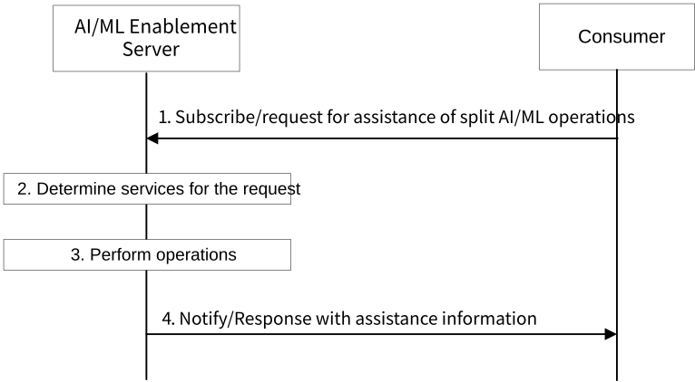
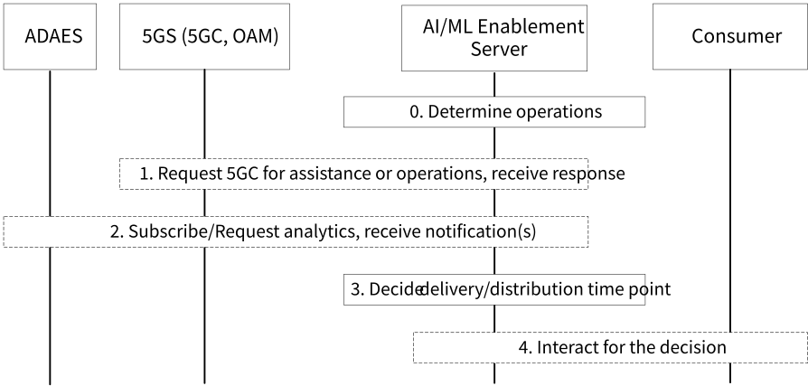

# 8.28 Solution #28: Support AI/ML Splitting Operations in Enablement Layer

## 8.28.1 General

There are many different types of split AI/ML operations, for example discover nodes for split learning or split inference, AI/ML task (e.g. learning or inference) split, AI/ML task delivery, ML model distribution or delivery, AI/ML data distribution or delivery. For example, in split learning, multiple split nodes systematically split the deep neural network (composed of many computational layers) and run a subset of these layers, sharing over the network only the intermediate data, i.e., the activation results of the last layer in split nodes. The ML model distribution is a multicast ML model transfer between nodes and delivery is unicast (point-to-point) delivery.

To support split AI/ML operations in Enablement Layer, differnt assistance for management and configuration are required. This solution proposes mechanisms on supporting the various types of split AI/ML operations in Enablement Layer.

The following clauses specify procedures, information flows and APIs for KI #5 to support various split AI/ML operations in Enablement Layer.

Pre-conditions:

\- Consumer (e.g., VAL Server, VAL client (e.g. via the AIML enablement client)) decides one or more type(s) of split AI/ML operations is needed, based on the request from VAL Client or local configuration. If is requested by VAL Client, the VAL Client and VAL Server may negotiate the type(s) of split AI/ML operations to be executed and the detail requirements.

\- The consumer decides that assistance from AI/ML Enablement Server for management and configuration to support the split AI/ML operations is needed.

## 8.28.2 Procedures for supporting assistance of split AI/ML operations

### 8.28.2.1 Procedure for subscribe/request assistance of split AI/ML operations

Figure 8.28.2.1-1: Procedure for subscribe/request assistance of split AI/ML operations

Figure 8.28.2.1-1 illustrates the procedure for subscribe/request assistance of split AI/ML operations. The corresponding procedure in detail is as follows:

1\. The Consumer (e.g. VAL Server, VAL client (e.g. via the AIML enablement client)) subscribes/request to the AI/ML Enablement Server for assistance of split AI/ML operations. The request includes one or more type(s) of split AI/ML operations to indicate the operations that the assistance information be used for, assistance information needed, and requirements for the type of split AI/ML operations.

1a. For discovery split nodes, the request includes this type of split AI/ML operations (e.g. discover nodes for split learning or split inference), assistance information needed (e.g. a list of split nodes (the split AIML task will be sent to the split nodes), and requirements for the type of split AI/ML operations. The requirements for discovery split nodes may include number of split nodes (the split node can be UE, edge, and/or cloud), requirement on capability of the split nodes, initial list of split nodes (if available).

1b. For AI/ML task split, the request includes this type of split AI/ML operations (e.g. AI/ML task (e.g. learning or inference) split), assistance information needed. The requirements for AI/ML task split may include maximum number of sub tasks, maximum time for complete the whole task.

1c. For AI/ML task delivery, ML model or AI/ML data distribution/delivery, the request includes this type of split AI/ML operations (e.g. AI/ML task delivery, ML model distribution or delivery, AI/ML data distribution or delivery), assistance information needed (e.g. time point(s) or time window(s) for AI/ML task delivery or AI/ML model/data distribution/delivery). The requirements for AI/ML task delivery, ML model or AI/ML data distribution/delivery may include information of the AI/ML task/model/data (e.g. size of the task or ML model, or data volume), information of the receiving nodes, requirement on the delivery/distribution (e.g. time budget, time critical or not, requirement on QoS), maximum time for complete the distribution/delivery, one time or continuous delivery/distribution.

2\. The AI/ML Enablement Server derives information for the request, determines downstream entities and services needed, e.g. discovery nodes from AI/ML registry, subscribe/request analytics from ADAES, request assistance or operations from 5GC NFs (e.g. Member UE selection, recommended time windows for AI/ML operations with QoS, QoS monitoring, network data analytics).

3\. The AI/ML Enablement Server performs operations according to the determination made in step 2.

3a. If the type of split AI/ML operations in the request in step 1 is discovery split nodes, the procedure for FL member discovery can be reused (by replacing FL members with split nodes, replacing FL process with AI/ML split operations). The AI/ML Enablement Server subscribes/requests analytics to ADAES for Edge load analytics and UE-to-UE application performance analytics, and requests assistance information from NEF by using the Nnef_MemberUESelectionAssistance service as defined in 3GPP TS 23.502 \[6\] (the initial list of UEs may be provided by the consumer in step 1 or discovered by the AI/ML Enablement Server from AI/ML registry). After receiving the required analytics and assistance information, the AI/ML Enablement Server decides a list of split nodes (e.g., UE(s), edge server(s), cloud server(s)).

3b. If the type of split AI/ML operations in the request in step 1 is AI/ML task delivery, AI/ML model/data distribution/delivery, use the procedure in clause 8.22.2.2.

NOTE 1: Additional information needed for the AI/ML Enablement Server to generate assistance information will be specified in the normative phase.

4\. The AI/ML Enablement Server notifies/responds to the consumer with the assistance information for the split AI/ML operations. The consumer (e.g. VAL Server, VAL client (e.g. via the AIML enablement client)) may use the assistance information for decision making on the split AI/ML operations or assisting VAL client for AI/ML decision making.

NOTE 2: Additional information needed in the request and response will be specified in the normative phase.

### 8.28.2.2 Procedure for assistance of AI/ML task/model/data delivery/distribution

Figure 8.28.2.2-1: Procedure for assistance of AI/ML task/model/data delivery/distribution

Figure 8.28.2.2-1 illustrates the procedure for assistance of AI/ML task/model/data delivery/distribution. This procedure enhances the architecture and related functions to support management and/or configuration for in-time transfer of AI/ML models. The corresponding procedure in detail is as follows:

0\. AI/ML Enablement Server determines operations for executing based on the information provided in the request in step 1 and the determinations in step 2 of clause 8.28.2.1.

1\. The AI/ML Enablement Server may send requests to 5GC for assistance or operations.

1a. The AI/ML Enablement Server requests to NEF for assistance or operations (e.g. PDTQ on recommended time windows for AI/ML operations with QoS, QoS monitoring). The request may include the information of the AI/ML task/model/data (e.g. size of the task or ML model, or data volume), information of the receiving nodes, requirement on the delivery/distribution (e.g. time budget, time critical or not, QoS), maximum time for complete the distribution/delivery.

NOTE 1: Additional information needed in the request to NEF for the services will be specified in the normative phase and coordination with SA2.

The NEF responds to the AI/ML Enablement Server with the required results (e.g. recommended time windows for AI/ML operations, QoS monitoring results, transmission resource for the AF session established), or indication that the cannot provide the required delivery/distribution condition.

> 1b. The AI/ML Enablement Server may subscribe/request to NWDAF for analytics (e.g. E2E data volume transfer time, DN performance, Network performance, UE mobility). The details parameters in the requests to NWDAF for analytics are given in 3GPP TS 23.288 \[2\].

2\. The AI/ML Enablement Server may subscribe/request to ADAES for analytics (e.g. slice-specific application performance analytics, UE-to-UE application performance analytics). The details parameters in the requests to ADAES for analytics are given in 3GPP TS 23.436 \[4\].

NOTE 2; The AI/ML Enablement Server may need network analytics from NWDAF and/or application layer analytics from ADAE for generating assistance information as introduced in steps 1b and 2.

3\. The AI/ML Enablement Server generates assistance information on assist deciding delivery/distribution time point(s)/window(s), based on the information/analytics received in steps 1 and 2.

4\. The AI/ML Enablement Server may interact with the consumer to provide assistance information.

Step 4 is mandatory if continuous delivery/distribution is required.

The steps 1-4 are repeated until all the AI/ML task/model/data delivery/distribution are completed, if continuous delivery/distribution is required.

NOTE 3: The consumer (e.g. VAL server, VAL client (e.g. via the AIML enablement client)) delivers/distributes the AI/ML task/model/data to the receiving nodes according to the decided time point(s)/time window(s).

## 8.28.3 Architecture Impacts

The application enabler layer architecture impacts are the following:

\- AI/ML Enablement Server is introduced to support assistance of split AI/ML operations.

## 8.28.4 Corresponding APIs

This subclause provides a summary on the corresponding API for solution #28.

\- AIMLE Assistance of Split AI/ML Operations API (request-response or subscribe-notify model; API provider: AIMLE Server; known consumers: VAL Server, VAL client (e.g. via the AIML enablement client)).

## 8.28.5 Solution evaluation

This solution addresses Key Issue #5 and introduces procedures on supporting various split AI/ML operations in Enablement Layer. This solution reuses existing mechanisms of 5GC (e.g., PDTQ on recommended time windows for AI/ML operations with QoS, QoS monitoring, network analytics provided by NWDAF), and ADAE analytics.
