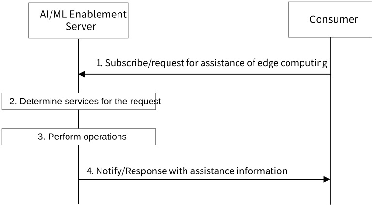

# 8.29 Solution #29: Enhance AIML Services for Assisting Edge Computing

## 8.29.1 General

An AI/ML task can be seen as a specical computing task, and edge comptuting can be used for completing the AI/ML tasks. A CAS, CES, ECS, EES or EAS (which are defined in 3GPP TS 23.558 \[14\]) may have different roles in different types of edge computing, e.g. hiearchitical computing (with one root node (e.g., CAS, EAS), the root has one or more children which also know as sub-root node(s) (e.g., EAS), and multiple leaf nodes (e.g., EES or EAS) which with no children), distributed computing (with one coordination node (e.g., CAS, CES, or ECS) and multiple execution nodes (e.g., EAS)). Here, hierarchical computing represents a computation architecture with multiple computation entities involved and multiple levels of computations for a computation task.

The following clauses specify procedures, information flows and APIs for KI #1 to enhance AIML Services for Supporting Edge Computing.

Pre-conditions:

\- An AI/ML task be treated as a specical computing task, consumer (e.g., CAS, EAS) uses edge comptuting method for completing the AI/ML tasks.

\- The consumer decides its role in the edge computing architecture (e.g., hierarchical computing, distributed computing) for an AI/ML task, and also the type of edge computing operations, based on its local configuration.

\- The consumer decides that assistance from AI/ML Enablement Server for management and configuration to support the edge computing process is needed.

## 8.29.2 Procedures for assisting edge computing

Figure 8.29.2-1: Procedure for assisting an edge computing process

Figure 8.29.2-1 illustrates the procedure for subscribe/request assistance of edge computing. The corresponding procedure in detail is as follows:

1\. The Consumer (e.g. CAS, EAS) subscribes/requests to the AI/ML Enablement Server for assistance of an edge computing process. The request includes role of the consumer in an edge computing architecture (e.g. root node, sub-root node or leaf node of a hierarchical computing process, coordination node or execution node of a distributed computing process), type of edge computing operations (e.g. task distribution, intermediate output delivery, execution node selection) to indicate the operations that the assistance information be used for, assistance information type (e.g. time window(s) for computing task distribution and/or intermediate output delivery, candidate execution node list) to indicate the assistance information needed.

2\. The AI/ML Enablement Server derives information for the request, determines downstream entities and services needed (e.g. time window(s) recommendation for computing task distribution if the consumer is a root node in a hierarchical computing process or a coordination node in a distribution computing process, time window(s) recommendation for intermediate output delivery is the consumer is a leaf node in a hierarchical computing process, candidate execution node list provisioning if the consumer is a coordination node of a distributed computing process).

3\. The AI/ML Enablement Server performs operations according to the determination in step 2 to generate assistance information. For example, the AI/ML Enablement Server may subscribe/request analytics from ADAE Server (e.g. edge load analytics), request assistance information or configurations from 5GC NFs (e.g. Member UE selection).

4\. The AI/ML Enablement Server notifies/responds to the consumer with the assistance information for the edge computing process. The consumer (e.g. CAS, EAS) may use the assistance information for decision making on its edge computing operations.

## 8.29.3 Architecture Impacts

There is no impact on architecture in application enabler layer. Based on the existing architecture, the impacts on functionality are the following:

\- AI/ML Enablement Server is introduced to assist edge computing.

\- AI/ML Enablement Consumer (e.g. CAS, EAS) is introduced to consume the enhanced AI/ML Enablement Server services.

## 8.29.4 Corresponding APIs

This subclause provides a summary on the corresponding API for solution #29.

\- AIMLE Assistance of Edge Computing API (request-response or subscribe-notify model; API provider: AIMLE Server; known consumers: CAS, EAS).

## 8.29.5 Solution evaluation

This solution addresses Key Issue #1 and introduces procedures to assist the opreations of edge compting process for AI/ML task. This solution reuses existing mechanisms of 5GC (e.g. Member UE selection) and ADAE analytics.

NOTE: The possible impact of this solution to other solutions will be discussed and evaluated during the normative phase.
