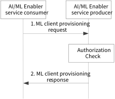

# 8.3 Solution #3: Provision of ML clients to support AI/ML at the application layer

## 8.3.1 General

The following clauses specify procedures, information flows and APIs for Key issue #3, #7 to provision the ML clients for the AIML Enabler services.

Assumptions:

1\. The proposed solution is based on the AIML Enabler service producer/consumer architecture. The service producer can be a standalone new entity like an AIML Enabler server or collocated with SEAL entity like an ADAE server or part of the ADAE server. The AIML Enabler service consumer could be VAL servers, VAL UE, or any other entities that consume the AIML Enabler services.

## 8.3.2 Procedures

Figure 8.3.2-1: ML client config provisioning procedure

1\. The AIML Enabler service consumer (e.g. VAL server or VAL UE) sends a ML client config provisioning request to the AIML Enabler service producer (e.g. ADAE server). The request may contain UE ML client profile e.g., ML capability, UE QoS.

NOTE 1: The UE ML client profile is used in Solution #7 and Solution #8.

2\. Upon receiving the request, the AIML enabler service producer performs an authorization check. If authorization is successful, the AIML enabler service producer registers the client and provides the response to the AIML Enabler service consumer with a registration ID.

NOTE 2: The harmonization of terms like AIML service producer / consumer will be confirmed based on the agreed AIMLAPP architecture in clause 7.

## 8.3.3 Architecture Impacts

The current solution is based on the service producer and consumer model, where the service producer and consumer could be AIML enabler server and client. The architecture based on AIML enabler client / server is described in clause 7. The solution does not introduce any architecture impacts. The AIML enabler service producer is AIML Enablement server and AIML enabler service consumer is VAL server, VAL UE, AIML Member (like AIML Enablement client)

## 8.3.4 Corresponding APIs

This subclause provides a summary on the corresponding API for solution #3.

\- ML client provisioning request API (request/response model; API provider: AIMLE server; known consumer: AIML consumer (like VAL server, VAL UE); corresponding to step 1and step 2 of clause 8.3.2).

## 8.3.5 Solution evaluation

This solution (hereafter referred to as evaluated solution) addresses Key Issue #3(bullet 2 - Identify procedures for supporting FL at the application enablement layer, including FL entity discovery, registration, communication, reporting) and KI #7(bullet 2- How to support the AI/ML member participation configurations) to support FL. This solution is feasible and doesn't introduce any dependency to 3GPP network systems. The solution can be merged with other solution #8, solution #9, and solution #10.Step 1 of Solution # 8 uses AIML client profile and step 1 of the evaluated solution uses the UE ML client profile, both are similar in functionality and either can be enhanced to support the provisioning and registration process. Similarly, solution #8 provides AIML client profile ID as a response in step 3 and the evaluated solution provides registration ID as a response in step 3. Both solutions are similar and steps 1-3 can be merged.

Step 1 of Solution #9 mentions a NOTE to reuse solution #3 for step 1. Moreover, step 2 of the solution #9 provides list of information about the FL member which could be enhanced with UE ML client profile information for the registration process. Step 1 of the evaluated solution can be merged with step 1 and step 2 of Solution #9.

Solution #10 provides the client provisioning based on the list of configurations, where configurations like Mode of member participation, List of compute-utilization based configurations are similar to UE ML client profile - ML capability information and UE compute capability respectively. Therefore step 1 of the evaluated solution can be merged into step 1 of solution # 10.
