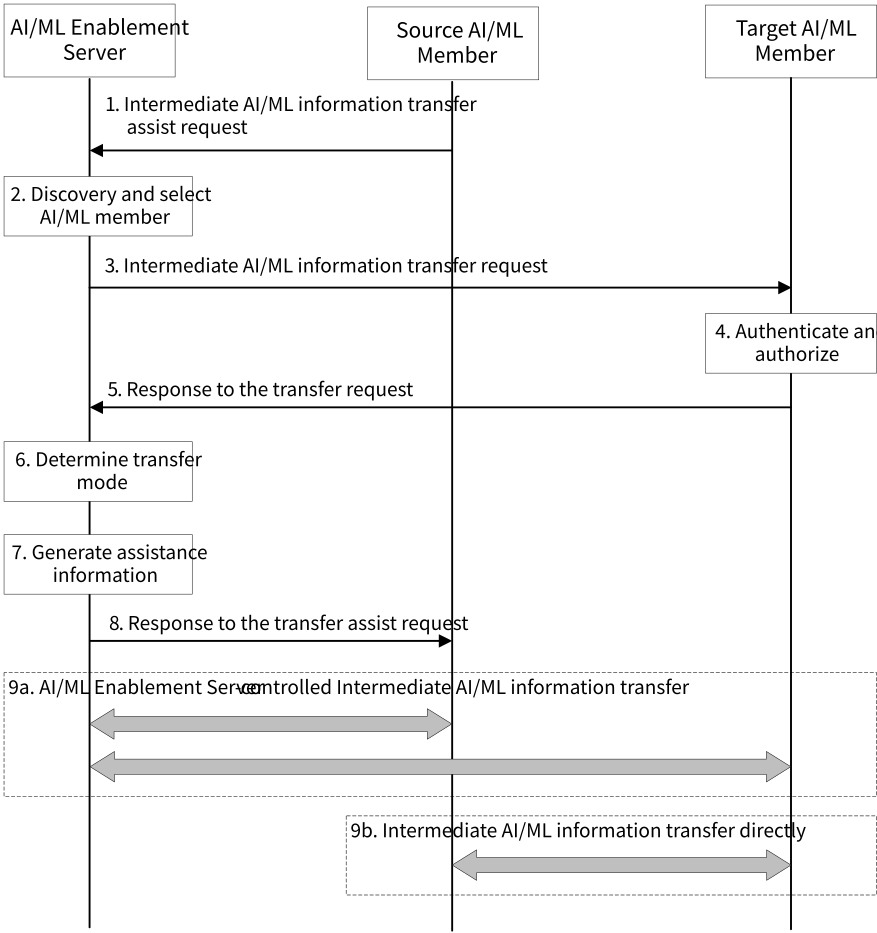
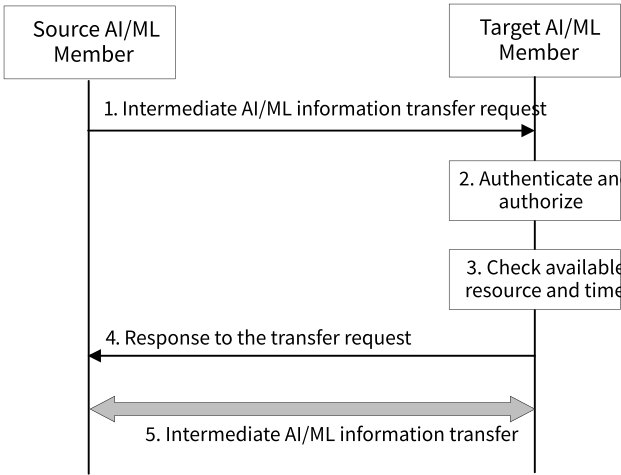

# 8.30 Solution #30: Support Transfer of Intermediate AIML Operation Information

## 8.30.1 General

The following clauses specify procedures, information flows and APIs for KI #6 and #7 to support transfer of intermediate AIML operation information.

Pre-conditions:

\- Due to various reasons (e.g., changes of available resource, changes of available time), an AI/ML member (e.g., AI/ML Enablement Client, VAL Client) finds itself cannot finish the assigned AI/ML task during the performing process.

\- To save resource and time, the AI/ML member (source AI/ML member) decides to transfer the intermediate AI/ML information (e.g., the intermediate AI/ML operation status and results) to another AI/ML member (target AI/ML member) for further operations to complete the AI/ML task.

## 8.30.2 Procedures for intermediate AI/ML information transfer

### 8.30.2.1 AI/ML Enablement Server assist intermediate AI/ML information transfer

Pre-conditions:

\- The information of target AI/ML member (e.g. another AI/ML Enablement Client or VAL Client different from the source AI/ML member) is unknown at the source AI/ML member. The source AI/ML member decides that assist from the AI/ML Enablement Server is needed.

Figure 8.30.2.1-1: Procedure for AI/ML Enablement Server assist intermediate AI/ML information transfer

Figure 8.30.2.1-1 illustrates the procedure for AI/ML Enablement Server assist intermediate AI/ML information transfer. The corresponding procedure in detail is as follows:

1\. The source AI/ML member (e.g. an AI/ML Enablement Client) sends request to AI/ML Enablement Server for assisting intermediate AI/ML information transfer. The request message contains the type of the AI/ML operation (e.g. ML model training), the type of the intermediate AI/ML information (e.g. intermediate AI/ML operation status, intermediate AI/ML operation results), the requirement on the transfer (e.g. data volume, except time for finishing the transfer, requirement on the target AI/ML member on available resource and time). The request message may contain requirement on server-controlled intermediate AI/ML information transfer.

NOTE: The procedure can also be used for transfer AI/ML services (e.g., ML model performance evaluation, ML model update) between AI/ML members. Details will be discussed during the normative phase.

2\. The AI/ML Enablement Server discovers other AI/ML members (e.g., other AI/ML Enablement Clients) directly or via ML repository, and selects one or more target AI/ML member(s) based on the request from the source AI/ML member.

3\. The AI/ML Enablement Server sends request to the selected target AI/ML member(s) for intermediate AI/ML operation information transfer. The request message contains the information in the request message from the source AI/ML member in step 1, may contain the information of the source AI/ML member.

4\. The target AI/ML member(s) authenticates and authorizes the request from the AI/ML Enablement Server. If the request is authorized, the target AI/ML member(s) performs step 5.

5\. The target AI/ML member(s) responses to the AI/ML Enablement Server with information (e.g. available time for continue performing the AI/ML operation).

> If the information of the source AI/ML member is contained in the request message in step 3, the target AI/ML member(s) may determine to interact with the source AI/ML member directly based on its local configuration. The response message may contain an indication on direct transfer.

6\. The AI/ML Enablement Server determines the transfer mode, i.e. transfer with server-controlled or transfer directly from the source AI/ML member to the target AI/ML member, according to the information of the source and the target AI/ML members (e.g. the location of the source and the target AI/ML members, requirement on transfer QoS, the requirement on server-controlled transfer in the request in step 1, the indication on direct transfer in the response in step 5).

7\. If target AI/ML member(s) is discovered based on the steps 2-5, the AI/ML Enablement Server generates assistance information for the transfer of intermediate AI/ML operation information from the source AI/ML member to the target AI/ML member(s) (e.g. time window for the transfer).

8\. The AI/ML Enablement Server responses to the source AI/ML member with the information of the target AI/ML member(s), and assistance information generated in step 6. The response message contains the information of the target AI/ML member, may contain an indication of direct transfer if it is decided in step 6.

9\. The intermediate AI/ML operation information may be transferred directly between the source and target AI/ML members as shown in step 9b, or via the AI/ML Enablement Server (e.g. AI/ML Enablement Server controlled information transfer between two AI/ML members) as shown in step 9a.

If transfer directly, the source AI/ML member performs information transfer to the target AI/ML member(s) based on assistance information received from the AI/ML Enablement Server in step 7. The source AI/ML member may initiate the directly transfer process based on its local configuration. Or the target AI/ML member may initiate the directly transfer process, the source AI/ML member may authorize the direct transfer request from the target AI/ML member if the direct transfer indication is received from step 7.

### 8.30.2.2 Direct intermediate AI/ML information transfer

Pre-conditions:

\- The information of target AI/ML member (e.g., another AI/ML Enablement Client or VAL Client different from the source AI/ML member) is assumed to be known at the source AI/ML member, or the source AI/ML member may get the target AI/ML member information via ML repository. The source AI/ML member decides to transfer the intermediate AI/ML operation information to the target AI/ML member.

Figure 8.30.2.2-1: Procedure for direct intermediate AI/ML information transfer

Figure 8.30.2.2-1 illustrates the procedure for direct intermediate AI/ML information transfer. The corresponding procedure in detail is as follows:

1\. The source AI/ML member (e.g. an AI/ML Enablement Client) sends request to the target AI/ML member(s) for intermediate AI/ML operation information transfer. The request message contains the information of the source AI/ML member, the type of the AI/ML operation (e.g. ML model training), the type of the intermediate AI/ML information (e.g. intermediate AI/ML operation status, intermediate AI/ML operation results), the requirement on the transfer (e.g. data volume, except time for finishing the transfer, requirement on the target AI/ML member on available resource and time).

2\. The target AI/ML member(s) authenticates and authorizes the request from the AI/ML Enablement Server. If the request is authorized, the target AI/ML member(s) performs the next steps.

3\. The target AI/ML member(s) checks its availability for continue the AI/ML operations (e.g. available resource and time).

4\. The target AI/ML member(s) responses to the source AI/ML member with information (e.g. available time for continue performing the AI/ML operation).

The source AI/ML member interacts with the target AI/ML member(s) for transfer parameters (e.g. transfer time window) and performs intermediate AI/ML operation information transfer to the target AI/ML member(s).

## 8.30.3 Architecture Impacts

The application enabler layer architecture impacts are the following:

\- AI/ML Enablement Server is introduced to support discovery of target AI/ML member directly or via ML repository.

\- AI/ML Enablement Server is introduced to support assistance of transfer intermediate AI/ML information from source AI/ML member to target AI/ML member.

## 8.30.4 Corresponding APIs

This subclause provides a summary on the corresponding API for solution #30.- AIMLE Intermediate AI/ML Information Transfer Assist API (request-response; API provider: AIMLE Server; known consumers: AIMLE Client).

\- AIMLE Intermediate AI/ML Information Transfer API (request-response; API provider: AIMLE Client; known consumers: AIMLE Server, AIMLE Client).

## 8.30.5 Solution evaluation

This solution addresses Key Issues #6 and #7 and introduces procedures on supporting the maintenance of an AI/ML process and supporting transfer learning at application enablement layers, assistance the transfer of intermediate AI/ML operaton status and results. This solution is feasible and doesn't introduce any dependency to 3GPP network systems.
