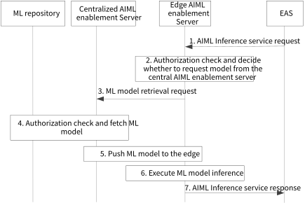

# 8.31 Solution #31: Supporting AIML inference service in edge

## 8.31.1 Solution description

The solution addresses Key Issue #1 to enhance the architecture and related functions to support application layer AI/ML services in edge computing scenarios corresponding to hierarchical AIMLE deployment scenario as in clause 9.4.

At present, the vast majority of model inference services are concentrated in online interactive services with high real-time requirements (e.g., delay requirements of 50-150ms), such as video monitoring, industrial quality inspection. Restricted by the resources and computing capability of edge, pushing the trained model to the edge AIMLE server to perform inference tasks will solve the real-time requirements of VAL app or EAS.

Moreover, the trained model in edge AILME server is deployed on demand. When the model inference service requested by EAS is not available or is not the latest version, the edge AIMLE server needs to request the ML from the central AILME server/ML repository.

AIML enablement servers deployed at the edge may only perform inference services, and the model is also limited.

Pre-conditions:

\- AIML enablement servers are deployed at the edge, receiving trained models from central AIML enablement servers and are responsible for providing inference services for specific models for EAS.

\- EAS has connected to edge AIML enablement server at the EDN.

Figure 8.31.1-1: inference service request procedure in edge

1\. EAS initiates a request to Edge AIML enablement server to use AIML inference service (e.g., Intelligent Q&A service, network analysis service). The request includes EAS identifier, security credentials, service identifier, and may include other related information, e.g., the model vendor that offer the inference, inference delay requirements, performance/accuracy parameter, ML model information etc.

2\. Upon receiving the request, the Edge AIML enablement server validates if the requestor EAS is authorized to use AIML inference service. If the requestor is authorized, and the AIML enabled server already has a model that can meet the requirements of EAS and execute the current inference service, the AIML enablement server then proceed to step 7; otherwise, proceed to step 3.

3\. The Edge AIML enablement server sends a ML retrieval request to the Central AIML enablement server. The request includes security credentials, inference service identifier, and a list of requirements of the ML model, e.g., the ML model vendor, performance/accuracy parameter, ML model information.

4\. The Central AIML enablement server validates the request and verifies the security credentials provided in the request, Then Central AIML enablement server determine the appropriate ML model based on the requirements of the model in the ML retrieval request and then fetches the ML model from the ML repository (as defined in clause 7.2.4.4).

5\. The Central AIML enablement server pushes trained models that can perform the specific inference services to the edge.

6\. Upon obtaining the model, the Edge AIML enablement server executes the inference service.

7\. The Edge AIML enablement server provides the inference service result to EAS.

Editor's Note: The detailed information elements included in the request/response listed in this clause are FFS.

## 8.31.2 Architecture Impacts

The application enabler layer architecture impacts are the following:

\- Edge AIML Enablement server is introduced to provide support the inference for the edge scenario.

\- Central AIML Enablement server has the capability of interacting with Edge AIML enablement server for providing the trained model for the edge scenario.

\- An ML repository needs to be defined for serving as ML model repository for the ML model used for edge scenario.

## 8.31.3 Corresponding APIs

This subclause provides a summary on the corresponding API for solution #31.

\- AIML inference service API (request-response model: API provider: Edge AIMLE Server, known consumer: EAS).

\- ML models retrieval API (request-response model: API provider: Central AIMLE server, known consumer: Edge AIMLE Server).

## 8.31.4 Solution evaluation

This solution addresses Key Issue #1 and in particular the architecture enhancements for edge scenarios (in hierarchical deployments). This solution is feasible and provides value by enabling an edge deployed AIMLE server to fetch a trained model from the central AIMLE / ML repository and support ML model inference locally at the edge platform. This solution doesn’t have any dependencies with other 3GPP WGs.
