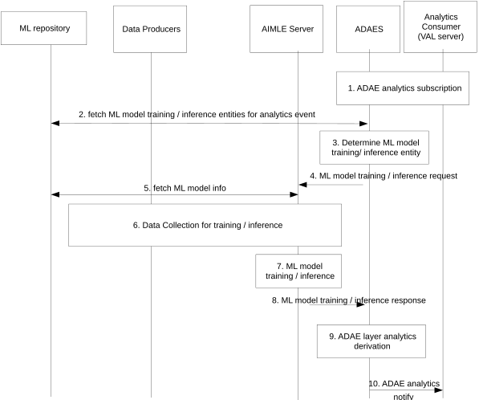

# 8.4 Solution #4: Support for ML-enabled ADAE analytics

## 8.4.1 Solution description

This solution addresses Key Issue #2.

This solution introduces the selection and configuration of the ML model entities to support a certain ADAE layer analytics event. This solution aims the enhancement of analytics services provided by the analytics enablement functionality, and in particular analytics related to VAL server or session performance, as well as analytics related to edge load (as specified in 3GPP TS 23.436 \[4\]).

In this solution, ADAES is using AIMLE capability for ML model training / inference for ADAE layer analytics events.

NOTE: Such training and inference can be performed in multiple entities (distributed AIML Enablement, AIML Enablement client); however it is not explicitly shown in the procedure.

Figure 8.4.1-1 illustrates the procedure where the ML-enabled analytics are provided using ML model training at the enabler layer (by an app layer ML model training service).

Pre-conditions:

1\. ADAEC is connected to ADAES.

Figure 8.4.1-1: Support for ML-enabled ADAE analytics

1\. The VAL server subscribes to ADAES for an analytics service (e.g., for Analytics ID = ‘VAL server \#1 perf analytics’). The subscription is applicable to the ADAE analytics services as described in 3GPP TS 23.436 \[4\]. Such subscription can also indicate the use of AI/ML enabled analytics, and optionally the ML model info.

2\. The ADAES discovers the list of ML training and inference entities and their capabilities. Such discovery can be via sending a request to the ML repository, assuming that such registry has already a mapping of the ML candidate participants which are mapped to the given Analytics Event/ID. This step may also include fetching the ML model information for identifying already trained models for the Analytics Event.

NOTE: This solution assumes that the ML repository can be accessed by ADAES and AIMLE server; however, if this is not possible the interaction of ADAES with ML repository needs to be via AIMLE server.

3\. The ADAES determines the entity (ies) to be considered for ML model training entity for the analytics event ID. The criteria for the determination of the entity(ies) is up to implementation.

4\. The ADAES requests the selected ML training entity (e.g. AIML Enablement server) to provide ML model training for the given analytics event. ADAES may also provide the requirements to be used (if provided in step 1, e.g., type of training, whether it is online or offline training, time to provide trained models.

5a. The AIMLE server sends a request to the ML repository (e.g. A-ADRF) to receive the one or more ML model information for the given Analytics ID and/or the vertical type (e.g. IIOT server \#1).

5b. The AIMLE server receives a response, which includes the ML model information and the mapping to the analytics ID / VAL consumer type, the ML model file address for the initial model, the permissions for updating the ML model (related to who is the consumer), the ML model vendor ID, charging model for using the ML model, etc.

6\. The AIMLE server collects the data to train/infer the model from the data producers (e.g., based on the assumptions for data producers as in procedures in clause 8.2.2 and clause 8.2.3 of 3GPP TS 23.436 \[4\]).

7\. The AIMLE server performs ML model training and/or inference.

8\. The AIMLE server sends an ML model training/inference response to the ADAES, with the trained and/or inferred model outputs.

9\. The ADAES derives analytics based on the trained/inferred data. ADAES may also perform ML model inference in addition (or alternatively) to AIML Enablement server using its own data, based on the deployments.

10\. ADAES sends the analytics outputs as notification to the VAL server.

## 8.4.2 Architecture Impacts

The application enabler layer architecture impacts are the following:

\- AIMLE server is introduced to provide support the training and/or inference for the analytics event.

\- ADAES is enhanced to select and configure the entity (-ies) to serve as ML model training and inference entities and utilizes these services to improve the ADAE layer analytics.

\- An ML repository needs to be defined for serving as ML model info repository as well ML member registry in the architecture.

## 8.4.3 Corresponding APIs / information

This subclause provides a summary on the corresponding API for solution #4.

\- ML model training API (request / response model; API provider: AIMLE Server; known consumer: ADAES; corresponding to step 4 and 8).

\- ML model inference API (request / response model; API provider: AIMLE Server; known consumer: ADAES; corresponding to step 4 and 8).

\- ML model info fetch API (request / response or subscribe notify model; API provider: ML model registry; known consumer: AIMLE server; corresponding to step 5).

## 8.4.4 Solution evaluation

This solution addresses Key Issue #2 and introduces the capability to support ML-enabled ADAE analytics, by performing ML model training/inference on behalf of ADAES. This solution is feasible and doesn't introduce any dependency to 3GPP network systems.

NOTE: Whether ML repository will be unique for both ML model info and ML member registration will be confirmed based on the agreed AIMLAPP architecture.
