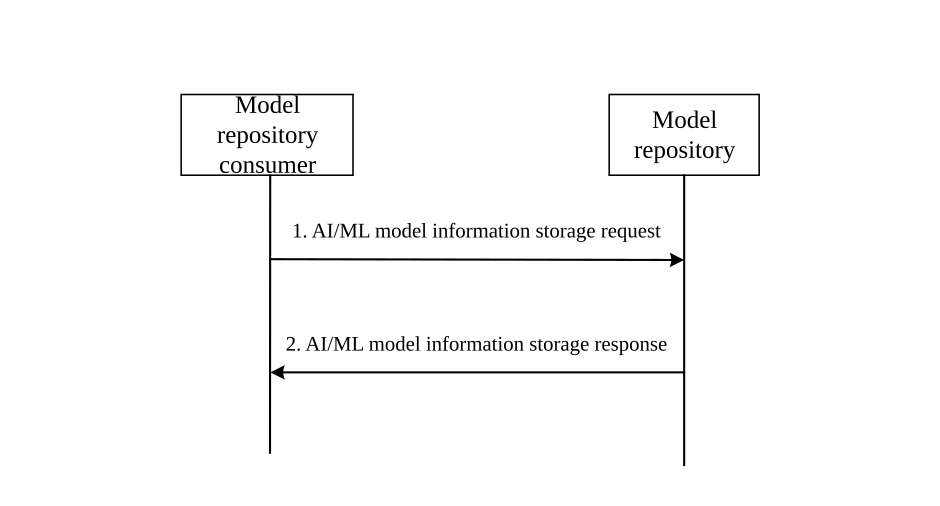
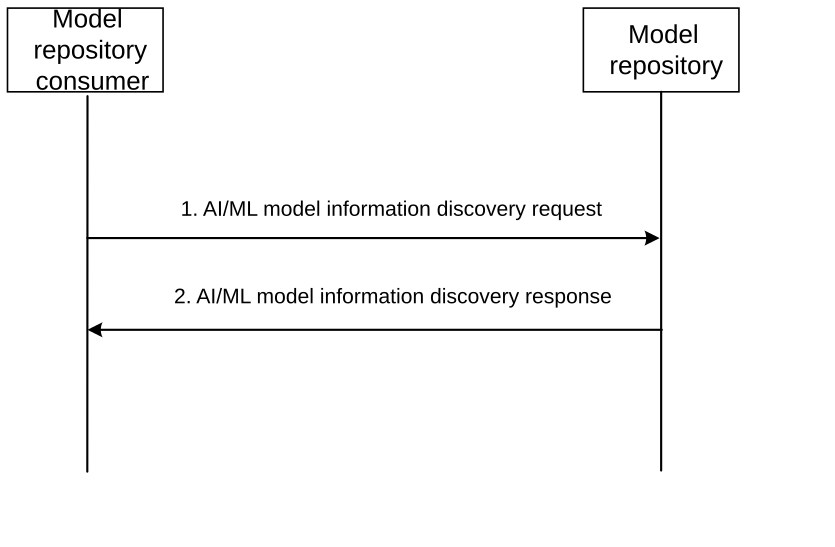

# 8.5 Solution #5: AI/ML model management

## 8.5.1 General

This solution addresses Key Issue \#2.

This solution introduces the AI/ML model information storage and discovery procedures to support AI/ML model management.

In this solution, the following terminology is used:

\- Analytics ID is defined in 3GPP TS 23.436 \[4\].

## 8.5.2 AI/ML model information storage procedure

Figure 8.5.1-1 illustrates the procedure of AI/ML model information storage.

Figure 8.*5*.2-1: AI/ML model information storage procedure

1\. The model repository consumer (e.g. MTME-enhanced ADAES or AIML enablement server or VAL server or ADAE client) sends an AI/ML model information storage request to the model repository to store a model. The model included in the request can be one trained by the repository consumer or its information can be provisioned to the repository consumer. The request contains information elements as described in Table 8.5.4.1-1.

NOTE 1: The detailed definition of the security requirements within the ML model storage requirements is within SA3 scope.

NOTE 2: The details of the ML model storage are to be specified in the normative stage.

2\. Upon receiving the request, the model repository verifies if the model repository consumer is authorized to store the ML model identified by Analytics ID and/or list of the allowed vendors provided within the ML model profile attribute. If the AI/ML model repository consumer is authorized, the model repository processes the request and records information of the AI/ML model (e.g., by creating an AI/ML model profile). The model repository sends a response to the model repository consumer (e.g., MTME-enhanced ADAES or AIML enablement server) with an identifier of the created AI/ML model profile.

NOTE 3: The model repository may be implemented by A-ADRF.

NOTE 4: It is to be determined in the evaluation phase which entities are can have direct interaction with the model repository, e.g., AI/ML enablement server/client and/ or MTME-enhanced ADAE server/client, etc. This procedure is assumed to also enable other AI/ML service consumers to also access this functionality indirectly, via these enablers with direct access.

## 8.5.3 AI/ML model information discovery procedure

Figure 8.5.3-1 illustrates the procedure of AI/ML model information discovery.

Figure 8.5.3-1: AI/ML model information discovery procedure

1\. The model repository consumer (e.g., VAL server) sends an AI/ML model information discovery request to the model repository. The request contains information elements as described in Table 8.5.5.3-1.

2\. Upon receiving the discovery request, the model repository verifies if the AI/ML model repository consumer is authorized to discover the ML model(s) identified by the ML model ID, Analytics ID, List of allowed vendors, Base Model ID, and/or ML model interoperability information. If the AI/ML model repository consumer is authorized, the model repository processes the request.

If the discovery request is for transfer of learning, the model repository identifies all candidate models matching the domain and required accuracy level.

The model repository sends the response message to the model repository consumer. The response includes information of the discovered AI/ML model. Optionally, the model repository can initiate a model transfer process to the consumer.

NOTE 1: It is to be determined in the evaluation phase which entities are can have direct interaction with the model repository, e.g., AI/ML enablement server/client and/ or MTME-enhanced ADAE server/client, etc. This procedure is assumed to also enable other AI/ML service consumers to access this functionality indirectly, via these enablers with direct access.

NOTE 2: When the ML model is within training or re-training phase, the ML model is not available for the discovery. The details should be indicated within the Result IE in Table 8.5.5.2-1. The training and re-training phase is used during federated learning so that AIML enabler consumer rely on model repository to get the model details.

NOTE 3: The model transfer process mentioned in step 2 can use the AI/ML data transfer policies.

## 8.5.4 Architecture Impacts

The application enabler layer architecture impacts are the following:

\- An AI/ML model repository is introduced for enabling the AI/ML model information storage and discovery. Such AI/ML model repository may be part of the ML Repository as described in clause 7.2.3.

## 8.5.5 Corresponding APIs

### 8.5.5.1 AI/ML model information storage request

Table 8.5.5.1-1 describes the information flow from the repository consumer to the model repository as a request for the AI/ML model storage.

Table 8.5.5.1-1: AI/ML model information storage request

<table>
<colgroup>
<col style="width: 33%" />
<col style="width: 16%" />
<col style="width: 50%" />
</colgroup>
<thead>
<tr class="header">
<th>Information element</th>
<th>Status</th>
<th>Description</th>
</tr>
</thead>
<tbody>
<tr class="odd">
<td>Requester Identity</td>
<td>
M

(NOTE 1)
</td>
<td>The identity of the model repository consumer performing the request.</td>
</tr>
<tr class="even">
<td>VAL service ID(s)</td>
<td>O</td>
<td>Identify the VAL service ID(s).</td>
</tr>
<tr class="odd">
<td>ML model</td>
<td>
O

(NOTE 2)
</td>
<td>Provides the trained AI/ML model.</td>
</tr>
<tr class="even">
<td>ML model address</td>
<td>
O

(NOTE 2)
</td>
<td>Represents the ML model address that can be used by Model repository to download the ML model.</td>
</tr>
<tr class="odd">
<td>Analytics ID</td>
<td>O</td>
<td>Represents analytics ID for which the model can be used.</td>
</tr>
<tr class="even">
<td>ML model profile</td>
<td>
O

(NOTE 2)
</td>
<td>Provides the AI/ML model profile.</td>
</tr>
<tr class="odd">
<td>&gt; domain</td>
<td>
O

(NOTE 4)
</td>
<td>Specifies domain for which the model can be used (e.g., for speech recognition, image recognition, video processing, location predication, etc.).</td>
</tr>
<tr class="even">
<td>&gt; List of allowed vendors</td>
<td>
O

(NOTE 3)
</td>
<td>Indicates which vendors that are allowed to retrieve the ML model and thereby also are interoperable to the model.</td>
</tr>
<tr class="odd">
<td>&gt; ML model interoperability information</td>
<td>
O

(NOTE 3)
</td>
<td>Represents the vendor-specific information that conveys, e.g., requested model file format, model execution environment, etc. The encoding, format, and value of ML Model Interoperable Information is not specified since it is vendor specific information, and is agreed between vendors, if necessary for sharing purposes.</td>
</tr>
<tr class="even">
<td>&gt; ML Model phase</td>
<td>
O

(NOTE 3)
</td>
<td>Represents the ML model phase, e.g., in training, trained, re-training, deployed.</td>
</tr>
<tr class="odd">
<td>&gt;&gt; Observed accuracy</td>
<td>
O

(NOTE 4)
</td>
<td>Provides accuracy of the model (if ML model is in trained phase).</td>
</tr>
<tr class="even">
<td>&gt; ML model storage and discovery requirements</td>
<td>
O

(NOTE 3)
</td>
<td>Represents the requirements for the ML Model repository for the ML model storage and discovery.</td>
</tr>
<tr class="odd">
<td>&gt;&gt; Storage duration</td>
<td>O</td>
<td>Represents the ML model storage duration time. When the storage duration time is expired, the stored ML model and the related information shall be deleted.</td>
</tr>
<tr class="even">
<td>&gt;&gt; Security and access requirements</td>
<td>O</td>
<td>Represents the information on security requirements for storing the ML model information and the ML model access requirements (e.g., publicly available, private use only, or available for the list of VAL server IDs).</td>
</tr>
<tr class="odd">
<td colspan="3">
NOTE 1: This information element shall not be updated.

NOTE 2: At least one of these information elements shall be provided.

NOTE 3: At least one of these information elements shall be provided.

NOTE 4: This IE is included only if trained ML model is available and the requestor initiates request for transfer learning.
</td>
</tr>
</tbody>
</table>

NOTE 1: The security requirements for downloading the ML model according to the ML model address IE are within SA3 scope.

NOTE 2: The additional IEs for Transfer Learning (e.g., Base Model ID) is to be decided in the normative stage.

### 8.5.5.2 AI/ML model information storage response

Table 8.5.5.2-1 describes the information flow from the model repository to the repository consumer as a response for the AI/ML model storage request.

Table 8.5.5.2-1: AI/ML model information storage response

| Information element | Status | Description                                                                                                            |
|---------------------|--------|------------------------------------------------------------------------------------------------------------------------|
| Result              | M      | Indicates success or failure of the request                                                                            |
| \> ML model ID      | O      | Represents the identifier of the stored ML model. This information element shall be provided if the result is success. |

### 8.5.5.3 AI/ML model information discovery request

Table 8.5.5.3-1 describes the information flow from the repository consumer to the model repository as a request for the AI/ML model discovery.

Table 8.5.5.3-1: AI/ML model information discovery request

<table>
<colgroup>
<col style="width: 33%" />
<col style="width: 16%" />
<col style="width: 50%" />
</colgroup>
<thead>
<tr class="header">
<th>Information element</th>
<th>Status</th>
<th>Description</th>
</tr>
</thead>
<tbody>
<tr class="odd">
<td>Requester Identity</td>
<td>M</td>
<td>The identity of the model repository consumer performing the request.</td>
</tr>
<tr class="even">
<td>VAL service ID</td>
<td>M</td>
<td>Identify the VAL service ID.</td>
</tr>
<tr class="odd">
<td>Filtering criteria</td>
<td>M</td>
<td>Represents the filtering criteria</td>
</tr>
<tr class="even">
<td>&gt; ML model ID</td>
<td>
O

(NOTE 1)
</td>
<td>Represents the identifier of the stored ML model.</td>
</tr>
<tr class="odd">
<td>&gt; domain</td>
<td>
O

(NOTE 2)
</td>
<td>Domain of the service in which the model will be used to transfer learning (e.g., image processing, location predication, etc.)</td>
</tr>
<tr class="even">
<td>&gt; required accuracy performance</td>
<td>
O

(NOTE 2)
</td>
<td>Required accuracy for transfer of learning for the model</td>
</tr>
<tr class="odd">
<td>&gt; Analytics ID</td>
<td>
O

(NOTE 1)
</td>
<td>Represents analytics ID for which the model can be used.</td>
</tr>
<tr class="even">
<td>&gt; List of allowed vendors</td>
<td>
O

(NOTE 1)
</td>
<td>Indicates which vendors that are allowed to retrieve the ML model and thereby also are interoperable to the model.</td>
</tr>
<tr class="odd">
<td>&gt; Base Model ID</td>
<td>
O

(NOTE 1)
</td>
<td>Represents the based ML model ID that was used for training the discovering model.</td>
</tr>
<tr class="even">
<td>&gt; ML model interoperability information</td>
<td>
O

(NOTE 1)
</td>
<td>Represents the vendor-specific information that conveys, e.g., requested model file format, model execution environment, etc. The encoding, format, and value of ML Model Interoperable Information is not specified since it is vendor specific information, and is agreed between vendors, if necessary for sharing purposes.</td>
</tr>
<tr class="odd">
<td colspan="3">
NOTE 1: At least one of these information elements shall be provided.

NOTE 2: This IE is included only if the requestor initiates request for transfer learning.
</td>
</tr>
</tbody>
</table>

### 8.5.5.4 AI/ML model information discovery response

Table 8.5.5.4-1 describes the information flow from the model repository to the repository consumer as a response for the AI/ML model discovery request.

Table 8.5.5.4-1: AI/ML model information discovery response

<table>
<colgroup>
<col style="width: 33%" />
<col style="width: 16%" />
<col style="width: 50%" />
</colgroup>
<thead>
<tr class="header">
<th>Information element</th>
<th>Status</th>
<th>Description</th>
</tr>
</thead>
<tbody>
<tr class="odd">
<td>Result</td>
<td>M</td>
<td>Indicates success or failure of the request</td>
</tr>
<tr class="even">
<td>&gt; ML model(s)</td>
<td>
O

(NOTE 1)

(NOTE 2)
</td>
<td>Represents the ML model(s). This information element may be provided if the result is success.</td>
</tr>
<tr class="odd">
<td>&gt; ML model address(es)</td>
<td>
O

(NOTE 1)

NOTE 2)
</td>
<td>Represents the ML model address(es) at Model repository that can be used to download the ML model. This information element may be provided if the result is success.</td>
</tr>
<tr class="even">
<td colspan="3">
NOTE 1: Only one of these information elements shall be provided.

NOTE 2: For transfer of learning, the list of all possible models matching the filtering criteria can be included along with model address.
</td>
</tr>
</tbody>
</table>

## 8.5.6 Solution evaluation

This solution addresses Key Issue \#2 and introduces the capability to support the management of AI/ML models, by performing AI/ML model information storage and discovery procedures. The AI/ML model management functionality further enables or supports other functionalities related to AI/ML models (as described in other solutions), such as model training and inference, model distribution, model lifecycle management, transfer learning, etc. This solution is feasible and doesn't introduce any dependency to 3GPP network systems.
