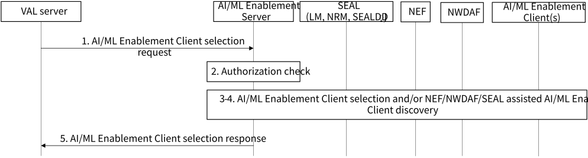
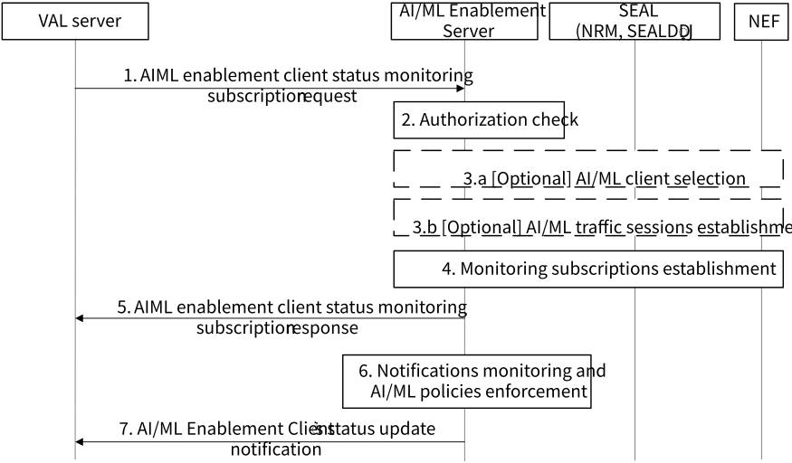

# 8.6 Solution #6: AIML enablement client selection

## 8.6.1 Solution description

The following clauses specify procedures, information flows, and APIs for Key Issue #3 to support AIML enablement client selection.

This solution uses the following definitions:

\- **AIML client set identifier** is an identifier of the selected AI/ML members. The VAL group ID may be used as AIML client set identifier and AI/ML member may be identified by the VAL UE ID or VAL User ID.

### 8.6.1.1 AIML Enablement Client Selection with SEAL and 5GC support

Assumptions:

1\. The proposed solution is based on client-server architecture for federated learning.

2\. The VAL server has already discovered and received a list of AIML enablement clients that are suitable and have available data for a particular AIML operation.

3\. The discovery operation may be performed as described in solution 7 to find a list of AIML enablement clients.

4\. The VAL server may provision the required AI/ML policies in Solution #14 and have the corresponding policy ID(s).

Figure 8.6.1-1: AIML enablement client selection procedure with SEAL and 5GC support

1\. A VAL server sends a request to an AIML enablement server to select a list of AIML enablement clients that have been discovered to meet the requirements for AIML operations. The AIML enablement client selection request includes the requestor identifier, VAL service identifier, a list of AIML client IDs for inclusion into an AIML set or number of required AIML clients to be selected and includes list of AI/ML policies identifiers for the AI/ML member selection, and may include endpoint at the VAL sever or receiving ML model update.

2\. The AIML enablement server validates the selection request. The AIML enablement server further performs authentication and authorization checks to determine if the requestor is able to create a selectedAIML members set.

3\. If the requestor is authorized and the List of AI/ML client IDs IE was provided in step 1, the AIML Enablement Server negotiates with the selected AI/ML Enablement Clients (i.e., the AIML Enablement Server request the AI/ML Enablement Clients to confirm their selection) and creates a selected AIML Enablement Clients set with the AIML Enablement Clients that confirmed their selection as selected members and assigns an identifier for the set (e.g., VAL group ID).

NOTE 1: The negotiation between AI/ML Enablement Server and AI/ML Enablement Client over AIML-UU interface is to be specified in normative stage.

4\. If the requestor is authorized and the Number of the required AIML clients IE was provided in step 1, the AI/ML Enablement Server shall discover the AI/ML Enablement Clients based on provided list of AI/ML Policy IDs (see clause 8.14.3.1 for more details) and AIML client profiles. The AI/ML Enablement Server may interact with NEF (e.g., uses the NEF procedures for the AFsessionWithQoS described in clause 5.2.6.9 of 3GPP TS 23.502 \[6\] and the NEF procedures for the AnalyticsExposure described in clause 5.2.6.16 of 3GPP TS 23.502 \[6\] and in particular the UE Communication Analytics described in clause 6.7.3 of 3GPP TS 23.288 \[2\] and DN Performance Analytics described in clause 6.14 of 3GPP TS 23.288 \[2\]), SEAL services (e.g., SS_NetworkResourceMonitoring, SS_LocationAreaInfoRetrieval APIs), NWDAF and/or ADAE services to obtain the historical data, measurements, and/or predictions for relevant parameters (e.g., QoS, location information) in order to check that the selected members will match the AI/ML policies conditions. The AI/ML Enablement Server shall obtain the AI/ML member identifiers for members that match AI/ML policy conditions and negotiate with the selected AI/ML Enablement Clients candidates (i.e., the AIML Enablement Server request the AI/ML Enablement Clients to confirm their selection) and create a selected AI/ML Enablement Clients set with the AIML Enablement Clients that confirmed their participation as selected members and assign an identifier for the set (e.g., VAL group ID).

NOTE 2: The member selection mechanism in step 4 is implementation specific.

NOTE 3: In steps 3 and 4, the AI/ML Enablement Server provisions the endpoint at the VAL sever for receiving ML model update from the AIML Enablement Clients.

NOTE 4: The AIML enabler server can reuse SEAL group management for any necessary group management.

5\. The AIML enablement server sends an AIML enablement client selection response that includes the status of the selection request and the assigned AIML set identifier.

### 8.6.1.2 Dynamic AIML Enablement Client selection and Monitoring Subscription

Assumptions:

1\. The VAL server may have performed the AIML Enablement Client Selection with SEAL and 5GC support procedure as defined in clause 8.6.1.1 and has the AIML client set identifier.

2\. The VAL server may configure the AI/ML network sessions between VAL server and AI/ML Clients via SEALDD (Sdd_RegularTransmission API) or NEF services (AfSessionWithQoS API) and may have the list of session identifiers (e.g., traffic descriptors from SEALDD as defined in 3GPP TS 23.433 or Transaction Reference IDs as defined in 3GPP TS 23.502 \[6\]).

Figure 8.6.1.2-1: Selected AIML Enablement Client Status Monitoring Subscription

1\. A VAL server sends a request to an AI/ML Enablement Server to subscribe to the selected AI/ML Enablement Client status monitoring. The request shall include the requestor identifier, VAL service identifier, the selected AIML client set identifier or number of required AIML clients to be selected, notification endpoint for the selected AI/ML Enablement Client’s status update and may include list of the AI/ML session identifiers established by the requestor and list of AI/ML policy IDs for the AI/ML member re-selection.

2\. The AIML enablement server validates the selection request. The AIML enablement server further performs authentication and authorization checks to determine if the requestor is able to subscribe to the selected AI/ML Enablement Client status monitoring.

> 3\. \[Optional\] If the requestor is authorized and the list of the AI/ML session identifiers IE is not provided in step 1:
>
> a\. If selected AIML client set identifier is not provided in step 1 and the number of required AIML clients to be selected is provided, then the AIML Enablement server monitors as per the AI/ML selection policy for the AI/ML members who meet the conditions and obtain their identifiers as described in step 4 in clause 8.6.1.1.

b\. The AI/ML Enablement Server may determine the QoS parameters for the AIML traffic session between the requestor and the selected AI/ML Enablement Client(s) and configure the AI/ML traffic session(s) via SEALDD (Sdd_RegularTransmission API) or NEF services (AfSessionWithQoS API).

4\. The AI/ML Enablement Server shall interact with the NEF and/or SEAL services (including SEALDD) to establish the associated monitoring subscriptions based on list of the AI/ML session identifiers provided in step 1 or established sessions in step 3. The AI/ML Enablement Server determines the relevant subscription procedures and the parameters for these subscriptions based on the inputs received from the AI/ML policy IDs.

5\. The AI/ML Enablement server shall response to the VAL server with the response for selected AIML enablement client status monitoring subscription.

6\. The AI/ML Enablement Server monitors the notifications of the established subscriptions in step 4 and based on the received notifications enforces the AI/ML policies which conditions are met, e.g.:

a\. if the conditions for the re-selection action within the member selection policy are met, the AI/ML Enablement Server shall initiate the re-selection procedure (as described in step 3.a) to select a new AI/ML Enablement Client as a selected member. The AI/ML Enabler Server may configure and initiate the AI/ML data transfer from the re-selected member to the selected member. When the AI/ML data transfer is finished or the selected members no longer match the conditions in the policy, the AI/ML Enablement Server shall cancel the related monitoring subscriptions configured in step 5b, release the established AI/ML sessions in step 3, and remove the enforced policies; and

b\. For the selected AI/ML members in step 6.a, if conditions for the QoS adjustment policy are met, the AI/ML Enablement Server shall generate and enforce the QoS policy(-ies) as per step 3 of clause 8.14.2.1. The AI/ML Enablement Server shall continue the QoS monitoring for the relevant AI/ML Enablement Client(s). If the AI/ML Enablement Client QoS adjustment conditions are no longer met the, the AI/ML member is de-selected and the QoS adjustment is reversed and the AI/ML Enablement Server shall initiate the re-selection procedure as described in step 6a.

7\. The AI/ML Enablement Server notifies the VAL server about the selected AI/ML client’s status update, e.g., the AI/ML Enablement Client A is re-selected and replaced by AI/ML Enablement Client B.

## 8.6.2 Architecture Impacts

This solution is based on client-server architecture as described by clause 7.2.

## 8.6.3 Corresponding APIs

Table 8.6.3-1 shows the request sent by a VAL server to an AIML enablement server for the AIML enablement client selection with SEAL and 5GC support procedure.

Table 8.6.3-1: Request for AIML enablement client selection procedure

<table>
<colgroup>
<col style="width: 31%" />
<col style="width: 15%" />
<col style="width: 53%" />
</colgroup>
<tbody>
<tr class="odd">
<td>Information element</td>
<td>Status</td>
<td>Description</td>
</tr>
<tr class="even">
<td>Requestor identity</td>
<td>M</td>
<td>The identifier of the requestor.</td>
</tr>
<tr class="odd">
<td>VAL service identifier</td>
<td>O</td>
<td>An identifier for the VAL service.</td>
</tr>
<tr class="even">
<td>List of AIML client IDs</td>
<td>
O

(NOTE)
</td>
<td>A list of AIML client IDs that was previously discovered for inclusion into an AIML client set.</td>
</tr>
<tr class="odd">
<td>Number of the required AIML clients</td>
<td>
O

(NOTE)
</td>
<td>Indicates the requested number of AIML clients to be selected based on member selection policies.</td>
</tr>
<tr class="even">
<td>List of AI/ML policy IDs for the AI/ML client selection</td>
<td>O</td>
<td>Represents the list of policies that shall be enforced for the client selection procedure.</td>
</tr>
<tr class="odd">
<td>Endpoint at the VAL sever or receiving ML model update</td>
<td>M</td>
<td>Represents the endpoint (pair Address-Port or URL) at the VAL server for receiving ML model update from the selected AIML Enablement Client(s).</td>
</tr>
<tr class="even">
<td colspan="3">NOTE: These information elements are mutually exclusive.</td>
</tr>
</tbody>
</table>

Table 8.6.3-2 shows the response sent by the AIML enablement server to the VAL server for the AIML enablement client selection with SEAL and 5GC support procedure.

Table 8.6.3-2: Response for AIML enablement client selection procedure

|                            |        |                                                                                                                                                                                  |
|----------------------------|--------|----------------------------------------------------------------------------------------------------------------------------------------------------------------------------------|
| Information element        | Status | Description                                                                                                                                                                      |
| Status                     | M      | The status for the request: success or fail.                                                                                                                                     |
| AIML client set identifier | M      | An identifier to associate with the set of AIML enablement clients that the VAL server has provided in the request. The AIML client set can be updated by using this identifier. |

Table 8.6.3-3 shows the request sent by a VAL server to an AIML enablement server for the Selected AIML Enablement Client Status Subscription.

Table 8.6.3-3: Request for AIML enablement client status monitoring subscription procedure

<table>
<colgroup>
<col style="width: 33%" />
<col style="width: 13%" />
<col style="width: 53%" />
</colgroup>
<thead>
<tr class="header">
<th>Information element</th>
<th>Status</th>
<th>Description</th>
</tr>
</thead>
<tbody>
<tr class="odd">
<td>Requestor identity</td>
<td>M</td>
<td>The identifier of the requestor.</td>
</tr>
<tr class="even">
<td>VAL service ID</td>
<td>O</td>
<td>An identifier for the VAL service.</td>
</tr>
<tr class="odd">
<td>AIML client set identifier</td>
<td>
O

(NOTE)
</td>
<td>Represent the set of the AIML clients that events are subscribed to.</td>
</tr>
<tr class="even">
<td>Number of the required AIML clients</td>
<td>
O

(NOTE)
</td>
<td>Indicates the requested number of AIML clients to be selected based on member selection policies.</td>
</tr>
<tr class="odd">
<td>List of the AI/ML session identifiers</td>
<td>O</td>
<td>The list of session identifiers (e.g., traffic descriptors from SEALDD as defined in 3GPP TS 23.433 or Transaction Reference IDs as defined in 3GPP TS 23.502).</td>
</tr>
<tr class="even">
<td>List of AI/ML policy IDs for the AI/ML member re-selection</td>
<td>O</td>
<td>Represents the list of policies that shall be enforced for the client re-selection procedure.</td>
</tr>
<tr class="odd">
<td>Notification endpoint for the selected AI/ML Enablement Client’s status update</td>
<td>M</td>
<td>Represents the endpoint at the VAL server for receiving the notifications on the selected AI/ML Enablement Client’s status update</td>
</tr>
<tr class="even">
<td colspan="3">NOTE: These information elements are mutually exclusive.</td>
</tr>
</tbody>
</table>

Table 8.6.3-4 shows the response sent by the AIML enablement server to the VAL server for the selected AIML enablement client status monitoring subscription procedure.

Table 8.6.3-4: Response for AIML enablement client status monitoring subscription procedure

| Information element | Status | Description                                  |
|---------------------|--------|----------------------------------------------|
| Status              | M      | The status for the request: success or fail. |

Table 8.6.3-5 shows the notification sent by the AI/ML Enablement Server to the VAL server for the AIML enablement client selection status update.

Table 8.6.3-5: Notification for AIML enablement client status monitoring subscription procedure

| Information element                                               | Status | Description                                                                                                                                                                 |
|-------------------------------------------------------------------|--------|-----------------------------------------------------------------------------------------------------------------------------------------------------------------------------|
| Requestor ID                                                      | M      | The identifier of the requestor.                                                                                                                                            |
| List of the selected AI/ML Enablement Client status update events | M      | Represents the list of selected AI/ML Enablement Client status update events, e.g., the AI/ML Enablement Client A is re-selected and replaced by AI/ML Enablement Client B. |

## 8.6.4 Solution evaluation

Solution #6 addresses Key Issue #3 and provides a selection mechanism for AIML enablement servers to select a group of AIML enablement clients for AIML operations. AIML enablement client discovery and selection may be performed in a static or dynamic manner in support of federated, split, and transfer learning workflows. The QoS application traffic session between selected AIML enablement client and requester can also be configured.

This solution also addresses the open issue 4 of Key Issue #7 via the introduction of the AIML policies enforcement for AIMLE Clients selection and re-selection.

This solution is feasible and does not introduce any dependency to the 3GPP network system.
