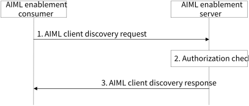
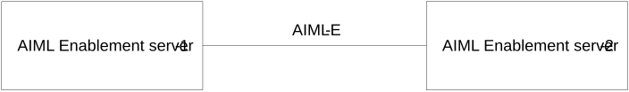

# 8.7 Solution #7: AIML enablement client discovery

## 8.7.1 Solution description

The following clauses specify procedures, information flows, and APIs for Key Issue #3 to support AIML enablement client discovery.

Assumptions:

1\. The proposed solution is based on client-server architecture for federated learning.

2\. The AIML enablement server has a repository of AIML enablement clients and associated AIML client profiles.

3\. AIML enablement clients that support AIML operations have registered with the AIML enablement server and included their AIML client profile. The registration procedure may be performed as described in solution #8.

Figure 8.7.1-1: AIML client discovery procedure

1\. The AIML enablement consumer (e.g.,a VAL server) sends a request to an AIML enablement server to discover AIML enablement clients that are available to participate in federated learning operations, e.g., is available and have required data to train an ML model. The AIML enablement client discovery request includes client/server identifier, security credentials, discovery criteria. The request may also include AIML task container to discover clients who can perform the AIML tasks like AIML model training/offload/split. The AIML task container includes required task service availability duration, AIML task type like model transfer, model training. The request may include a minimum number of FL members required for AIML operation splitting.

2\. The AIML enablement server validates the discovery request and verifies the security credentials provided in the discovery request. The AIML enablement server further performs authentication and authorization checks to determine if the requestor is able to discover AIML enablement clients. If authorized, the AIML enablement server determines a list of AIML enablement clients that meets the discovery criteria.

NOTE 1: The AIML enablement server may provide list of target UE(s) and utilize Member UE selection assistance procedure from 3GPP TS 23.502 \[6\], clause 4.15.13 to get assistance in selecting candidate UEs. The AIML enablement server then determines a list of UEs that fulfils the discovery criteria based on information received from AIML enablement client registrations.

NOTE 2: If the available FL members (at AIML enablement server) that fulfils discovery criteria are less than the required minimum number of FL members for AIML operation splitting, then the AIML enablement server may discover the remaining required FL members from other AIML enablement server over AIML-E reference point and include them in the response message.

NOTE 3: An ML repository can be used to enable this step, depending on normative specifications and deployment choices.

3\. The AIML enablement server sends an AIML enablement client discovery response that includes the status of the discovery request, a list of AIML client profiles matching the discovery criteria, and the number of matching AIML client profiles. The response also includes the information related to supported tasks with guaranteed task KPIs, available AIML tasks service duration.

NOTE 4: In case, the AIML enablement server does not provide the required number of the FL members in the discovery response (i.e., the discovered FL members in the discovery response message are less than the required minimum number of FL members) for AIML operation splitting, then the AIML enablement consumer can discover the remaining required FL members from other AIML enablement server indicating the required number of FL members.

## 8.7.2 Architecture Impacts

Following enhancement are required for the architecture defined in clause 8.1. Figure 8.7.2-1 illustrates the functional model for interconnection between AIML Enablement servers.

Figure 8.7.2-1: Interconnection between AIML Enablement servers

The AIML Enablement server interacts with another AIML Enablement server for the same service over AIML-E reference point.

## 8.7.3 Corresponding APIs

Table 8.7.3-1 shows the request sent by a VAL server to an AIML enablement server for the AIML enablement client discovery procedure.

Table 8.7.3-1: Request for AIML enablement client discovery procedure

|                                |        |                                                                                                                   |
|--------------------------------|--------|-------------------------------------------------------------------------------------------------------------------|
| Information element            | Status | Description                                                                                                       |
| VAL server identifier          | M      | The identifier of the VAL server.                                                                                 |
| Security credentials           | M      | Security credentials to authenticate and authorize the AIML enabler client.                                       |
| AIML client discovery criteria | M      | Discovery criteria for finding suitable AIML enablement clients for AIML operations as detailed in table 8.7.3-2. |

Table 8.7.3-2: AIML client discovery criteria

| Information element                               | Status | Description                                                                                                                                              |
|---------------------------------------------------|--------|----------------------------------------------------------------------------------------------------------------------------------------------------------|
| Requested ML models                               | O      | Requested ML models                                                                                                                                      |
| Requested AIML roles                              | M      | Role for data collection, data preparation, training, or inferencing                                                                                     |
| Target location                                   | O      | Target location for data collection purposes                                                                                                             |
| Application layer AI/ML member capabilities       | M      | Application layer AI/ML member capability information (e.g., ML application type, client availability to support AIML operations at the UE).             |
| Dataset requirements                              | O      | Information about dataset                                                                                                                                |
| \>dataset availability                            | O      | Dataset availability, including dataset size, age, list of data descriptors                                                                              |
| \>Data capabilities                               | O      | Data capabilities such as data collection and supported data processing capabilities                                                                     |
| Required service                                  | O      | Information about the service                                                                                                                            |
| \>Required VAL service ID                         | O      | Required VAL service ID that the client supports                                                                                                         |
| \>Required corresponding service permission level | O      | Required corresponding service permission level (e.g., raw data, processed data, premium resource usage standard resource usage, limited resource usage) |

NOTE: The normative phase is to further determine IE status and if some criteria are to be provided via selection policies.

Table 8.7.3-3 shows the response sent by the AIML enablement server to the VAL server for the AIML enablement client discovery procedure.

Table 8.7.3-3: Response for AIML enablement client discovery procedure

|                                   |        |                                                                                                                                                                                               |
|-----------------------------------|--------|-----------------------------------------------------------------------------------------------------------------------------------------------------------------------------------------------|
| Information element               | Status | Description                                                                                                                                                                                   |
| Status                            | M      | The status for the request: success or fail.                                                                                                                                                  |
| List of AIML client IDs           | M      | A list of AIML client IDs that matches the AIML discovery criteria.                                                                                                                           |
| Number of discovered AIML clients | O      | The number of AIML client profiles that was found to match the AIML discovery criteria. The number indicates the potential AIML enablement clients that could participate in AIML operations. |

## 8.7.4 Solution evaluation

This solution addresses Key Issues \#3 and \#7 and provides a discovery mechanism for VAL applications to find AIML enablement clients capable of and with appropriate datasets for a particular AIML operation. This solution is feasible and does not introduce any dependency to the 3GPP network system.
