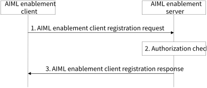

# 8.8 Solution #8: AIML enablement client registration

## 8.8.1 Solution description

The following clauses specify procedures, information flows, and APIs for Key Issue #3 to support AIML enablement client registration.

Assumptions:

1\. The proposed solution is based on client-server architecture for federated learning.

2\. The AIML enablement client has been pre-configured or has discovered the address (e.g. URI) of the AIML enablement server.

3\. The AIML enablement client has been pre-configured with an AIML client profile.

Figure 8.8.1-1: AIML enablement client registration procedure

1\. The AIML enablement client sends a registration request to the AIML enablement server, the registration request includes a AIML enablement client identifier, security credentials, application identifier, and AIML client profile. The AIML enablement client capabilities can also include AIML tasks related capabilities for performing AIML tasks. The supported task related information requirement include type of AIML tasks like model inference, model offload, transfer, model training.

2\. The AIML enablement server validates the registration request and verifies the security credentials. The AIML enablement server further performs an authentication and authorization check to determine if the AIML enablement client is permitted to register to the AIML enablement server and participate in federated learning operations. The AIML enablement server assigns an identifier for the AIML enablement policy to associate it with the AIML enablement client.

NOTE: The ML repository can be used to enable this step, depending on normative specifications and deployment choices.

3\. The AIML enablement server returns an AIML enablement registration response to the AIML enablement client with the status of the registration request and the identifier associated with the AIML client profile.

## 8.8.2 Architecture Impacts

This solution is based on client-server architecture as described by clause 7.2.

## 8.8.3 Corresponding APIs

Table 8.8.3-1 shows the request sent by an AIML enablement client to an AIML enablement server for the AIML enablement client registration procedure.

Table 8.8.3-1: Request for AIML enablement client registration procedure

|                                             |        |                                                                                                                                     |
|---------------------------------------------|--------|-------------------------------------------------------------------------------------------------------------------------------------|
| Information element                         | Status | Description                                                                                                                         |
| AIML enablement client identifier           | M      | The identifier of the AI/ML enabler client.                                                                                         |
| Security credentials                        | M      | Security credentials to authenticate and authorize the AIML enabler client.                                                         |
| AIML client profile                         | M      | Information about the capability of the AIML enablement client to support AIML operations as detailed in table 8.8.3.-2.            |
| List of supported services                  | O      | Supported service information.                                                                                                      |
| \>List of VAL service ID(s)                 | O      | List of VAL service ID(s) that the client supports                                                                                  |
| \>Corresponding service permission level(s) | O      | Service permission level(s) (e.g., raw data, processed data, premium resource usage standard resource usage, limited resource usage |

Table 8.8.3-2: AIML client profile

| Information element                         | Status | Description                                                                                                                                 |
|---------------------------------------------|--------|---------------------------------------------------------------------------------------------------------------------------------------------|
| AIML client profile ID                      | M      | Profile identifier.                                                                                                                         |
| Supported ML models                         | O      | ML models supported by the AIML enablement client                                                                                           |
| Supported AIML roles                        | M      | AIML roles supported by the AIML enablement client such as data collection, data preparation, training, or inferencing                      |
| Availability schedule                       | O      | Availability schedule of the the AIML enablement client                                                                                     |
| Application layer AI/ML member capabilities | M      | Application layer AI/ML member capability information (e.g. ML application type, client availability to support AIML operations at the UE). |
| Dataset availability                        | O      | Dataset availability such as dataset size, age, list of data descriptors                                                                    |
| Data capabilities                           | O      | Data capabilities such as data collection and supported data processing capabilities                                                        |

Table 8.8.3-2 shows the response sent by the AIML enablement server to the AIML enablement client for the AIML enablement client registration procedure.

Table 8.8.3-2: Response for AIML enablement client registration procedure

|                        |        |                                              |
|------------------------|--------|----------------------------------------------|
| Information element    | Status | Description                                  |
| Status                 | M      | The status for the request: success or fail. |
| AIML client profile ID | M      | An identifier for the AIML client profile    |

## 8.8.4 Solution evaluation

This solution addresses Key Issues #3 and #7 and provides a registration mechanism for AIML enablement clients to provide their capabilities for AIML operations. AIML enablement client registration is an important part of federated, split, and transfer learning workflows. This solution is feasible and does not introduce any dependency to the 3GPP network system.
