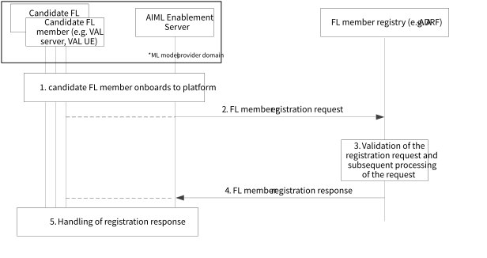
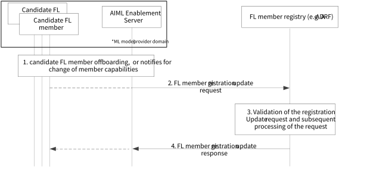

# 8.9 Solution #9: Support for FL member registration

## 8.9.1 Solution description

This solution addresses Key Issue #3.

This solution provides the procedures for the registration and registration update of candidate FL members in an FL Member Registry (e.g., ML repository). Candidate FL members can be application layer entities (e.g., VAL server, EAS) at the server or VAL UE side, which can potentially be selected as FL clients or FL server, FL server/aggregator for a particular ASP /vertical requirement.

### 8.9.1.1 Procedure for FL member registration

Figure 8.9.1.1-1 illustrates the procedure where the registration of a candidate FL member happens via the FL member Registry.

This procedure covers the registration of the candidate FL member to a global repository / registry which is introduced for keeping the FL member registrations. Such candidate member can be a server functionality or a VAL UE functionality or an enabler layer functionality which is registering to the FL member Registry to act as FL member for a given application event (analytics event or event triggered by a VAL layer application server or client).

The following figure illustrates the procedure for registering FL member.

Figure 8.9.1.1-1 Procedure for registration on FL member registry

1\. The candidate FL member (e.g., VAL server, VAL UE) onboards to the platform (edge or cloud), hosting the AIML Enablement Server. Such entity is used as a middle layer between the FL members and the registry and facilitates the registration process.

NOTE: If the candidate FL member is a VAL UE, Solution \#3 and \#8 can be reused for Step 1.

2\. For registration of FL members on the FL member registry, the AIML Enablement Server sends a registration request to the FL member registry. The registration request contains a list of information about the FL member, which require registration on the FL member registry. Such information includes the FL member type and other information such as time availability scheduling information, area of interest or location the member resides, interoperability information, use case availability/limitations.

3\. The FL member registry validates the received request and generates the identity and other security related information for all the FL members listed in the registration request.

4\. The FL member registry sends the generated information in the registration response message to the AIML Enablement Server.

5\. The AIML Enablement Server configures the received information to the individual candidate FL members.

### 8.9.1.2 Procedure for FL member registration update

Figure 8.9.1.2-1 illustrates the procedure where the registration update of a candidate FL member happens via the FL member Registry.

Figure 8.9.1.2-1: Procedure for registration update

1\. The candidate FL member (e.g. VAL server, VAL UE) either decides to offboard or optionally change the capabilities or a trigger is initiated based on the condition changes (e.g. VAL UE moves to an area with limited coverage) and provides this information to the AIML Enablement Server. Such update can be also update of the location of the FL member in different DN/EDN, or the temporary unavailability of the FL member which requires to update the registration.

NOTE: If the candidate FL member is a VAL UE, Solution #3 and #8 can be reused for Step 1.

2\. For registration update of FL members on the FL member registry, the AIML Enablement Server sends a registration update request to the FL member registry. The registration update request contains a list of information about the FL member (what is changed or the change of availability status), which require registration update on the FL member registry.

3\. The FL member registry validates the received update request and generates the identity and other security related information for all the FL members listed in the registration update request.

4\. The FL member Registry sends the generated information in the registration update response message to the AIML Enablement Server or to the candidate FL member.

## 8.9.2 Architecture Impacts

The application enabler layer architecture impacts are the following:

\- An FL member Registry is introduced for enabling the registration of candidate FL members. Such FL member registry may be part of the ML member repository as described in clause 7.2.3.

NOTE: Whether FL member registry will be part of the ML repository will be confirmed based on the agreed AIMLAPP architecture in clause 7.

## 8.9.3 Corresponding APIs

This subclause provides a summary on the corresponding API for solution #9.

\- FL member Register API (request / response model; API provider: FL member registry; known consumer: AIML enablement server; corresponding to step 2 and 4 of clause 8.9.1.1).

\- FL member Register Update API (request / response model; API provider: FL member registry; known consumer: AIML enablement server; corresponding to step 2 and 4 of clause 8.9.1.1).

## 8.9.4 Solution evaluation

This solution addresses Key Issue #3 and introduces the capability to support registration of an FL member (or a group of FL members) and registration update to a FL member registry (based on changes). Such FL members can be VAL UEs or VAL servers which are candidate to be used in ML operations. This solution is important for scenarios where the availability of candidate FL members changes (e.g., due to VAL UE mobility or energy status).

NOTE: The role of FL member registry and whether this is deployed as part of ML repository will be confirmed based on the AIMLAPP architecture selection.

This solution is feasible and doesn't introduce any dependency to 3GPP network systems.
