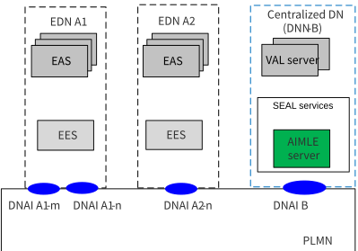
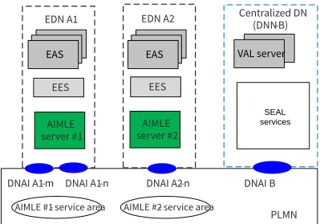
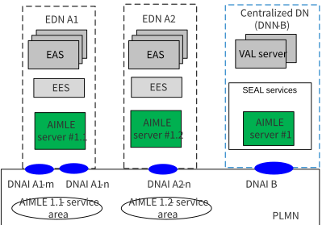

# 9 Deployment scenarios

## 9.1 General

This clause provides the different deployment models for AIML enablement (AIMLE) services. There could be three deployment options:

\- AIMLE server can be deployed at a centralized cloud platform and collects data from multiple EDNs.

\- AIMLE server can be deployed at the edge platform.

\- Hierarchical AIMLE server deployment, where multiple AIML enablement services are deployed in edge or central clouds (e.g., in hierarchical architecture). Such deployment allows for local-global analytics for system wide optimization.

## 9.2 Deployment model #1: Cloud-deployed AIMLE server

In this deployment, as shown in Figure 9.2-1, the AIMLE server is centrally located and can provide support for AIML operations to the application and edge services (EAS/EES, VAL server, other SEAL services).

Figure 9.2-1 cloud deployed AIML enabler

## 9.3 Deployment model #2 Edge-deployed AIMLE server

In this deployment, as shown in Figure 9.3-1, the AIML enabler server is located at the EDN as EAS and provides AIML enablement services to the other EAS(s) or other edge native applications at the edge platform. AIMLE services can be deployed by the ECSP or the MNO to provide value-add services related to AI/ML operations.

The ML support operations, that the edge deployed AIMLE Server provides, are applicable to the AIML enabler service areas (as shown in the example in Figure 9.3-1), which are equivalent to the EDN service areas.

NOTE: AIML enablement server deployed as EAS can provide application enablement service to EES.

Figure 9.3-1 edge deployed AIML enabler

## 9.4 Deployment model #3: Hierarchical AIMLE server deployment

In this deployment, multiple AIMLE servers can be located at different EDNs/DNs and can be deployed by the same provider. Such hierarchical deployments allow the local – global ML operations (e.g., federated learning across domains).

The ML support services that the edge deployed AIML enabler correspond to the AIML enablement service areas (as shown in the example in Figure 9.4-1), which is equivalent to the EDN service areas. The central AIML enablement server covers all PLMN area and is used to coordinate the ML related operations (e.g., FL collaborator/ server / aggregator) with the distributed AIML enablers.

Figure 9.4-1 hierarchical deployment of AIML enabler
