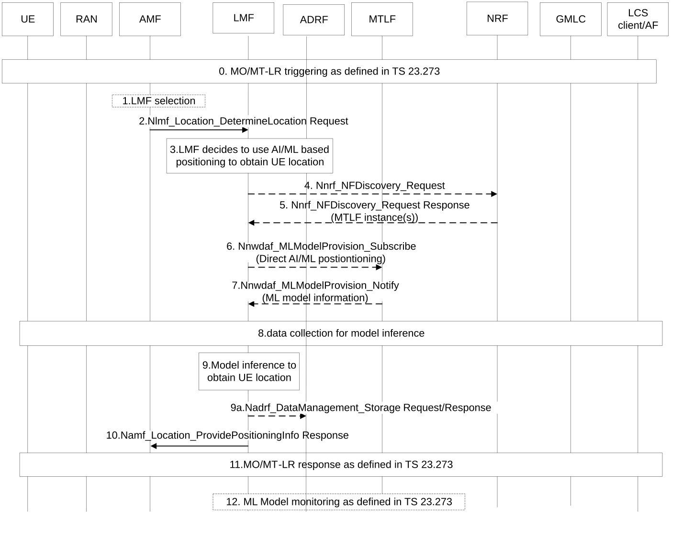
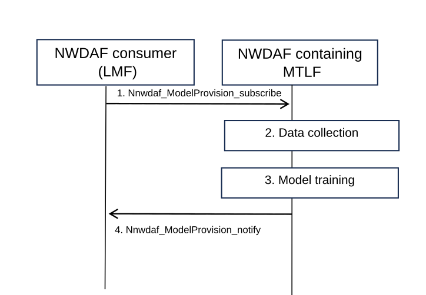
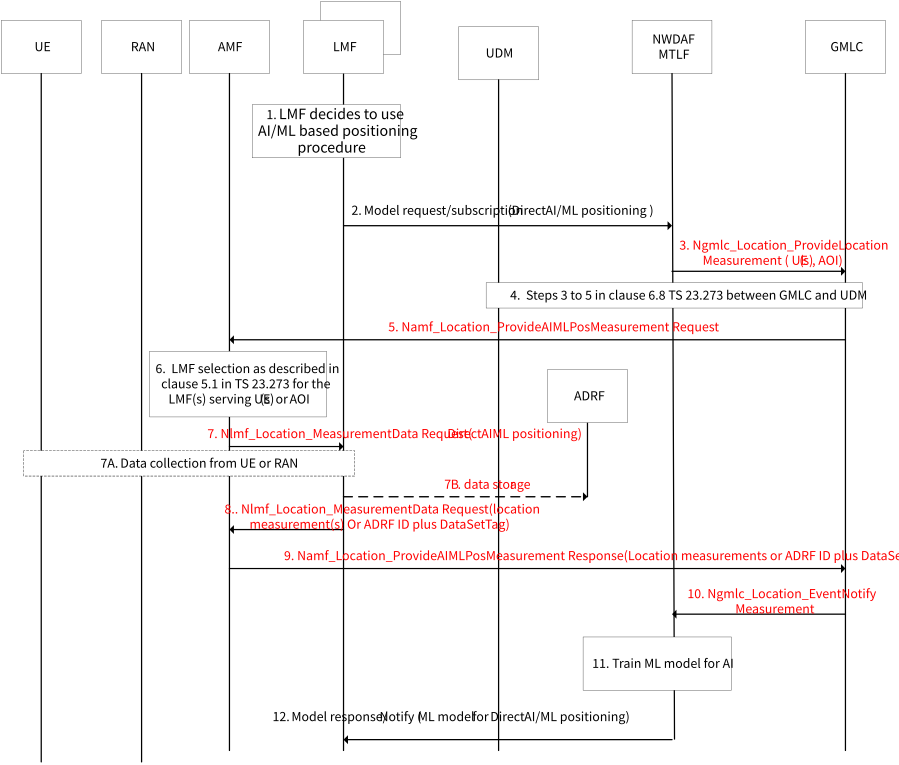

# 6.1 Solution \#1: Direct AI/ML based Positioning for case 2b/3b

## 6.1.1 Description

This solution is for Key Issue#1: Enhancements to LCS to support Direct AI/ML based Positioning.

For Direct AI/ML based Positioning in LMF side, it will be the LMF that provides the estimated UE location based on AI mechanism. In this solution, the LMF can be collocated with an NWDAF containing AnLF.

The ML model for inference in LMF can be retrieved from the NWDAF containing MTLF by reusing the existing procedure defined in TS 23.288 \[5\].

To train the ML model for Direct AI/ML based positioning requested by the LMF, the NWDAF containing MTLF will collect training data from data sources (including LMF and other entities of 5GC).

NOTE: The data related to RAN WGs and used for ML model training for Direct AI/ML based positioning will be discussed and defined by RAN WGs and SA WG2 will align with RAN WGs.

Two approaches are used in AI/ML based positioning, UE assisted positioning for Case 2b and NG-RAN node assisted positioning for Case 3b as defined in TR 38.843 \[6\].

\- The UE assisted positioning is that the UE obtains location measurements (e.g. PRS measurements) and sends the measurements to the LMF to compute a location;

\- The NG-RAN node assisted positioning is that the NG-RAN node obtains location measurements (e.g. SRS measurements) of signals transmitted by a target UE and sends the measurements to the LMF to compute a location.

To support Direct ML Model training for AI/ML positioning, the NWDAF containing MTLF can register to the NRF with the following information in its NF profile.

\- Indication of supporting ML Model training for Direct AI/ML based positioning.

\- ML Model Filter information, e.g. S-NSSAI(s) and Area(s) of Interest for the trained ML model(s).

\- ML Model Interoperability indicator, e.g. vendor ID list allowed to share the ML model for Direct AI/ML based positioning.

\- During the discovery of NWDAF containing MTLF, a NF consumer (i.e. the LMF) may include indication of support of Direct AI/ML based positioning Model, NF consumer information (e.g. vendor ID of the LMF) in the discovery request. The NRF returns one or more candidate for instances of NWDAF containing MTLF to the NF consumer.

## 6.1.2 Procedures

### 6.1.2.1 Direct AI/ML based Positioning in LMF

Figure 6.1.2.1-1: Direct AI/ML based Positioning in LMF collocated with AnLF

0-2. UE may trigger 5GC-MO-LR Procedure, or LCS client may trigger 5GC-MT-LR Procedure as defined in TS 23.273 \[7\].

3\. The LMF determines whether to use legacy UE positioning methods as defined in TS 23.273 \[7\] or AI/ML based positioning method to derive UE location information based on its internal logic (e.g. considering LMF's AI/ML based positioning related capability and/or measurement data reported from UE (case 2b) or RAN (case 3b)). If decides to use AI/ML based positioning method, then the following steps will be performed.

4-5. If the LMF decide to use AI/ML based positioning to obtain UE location and there is no appropriate ML model for AI/ML based positioning available, then the LMF may discover the NWDAF containing MTLF who supports ML Model training for AI/ML based positioning via the NRF by invoking the Nnrf_NFDiscovery_Request service operation (Direct AI/ML positioning Model, ML Model filter information, NF consumer information (e.g. vendor ID of LMF)). The NRF notifies the LMF with one or more NWDAF containing MTLF instances.

Before that, the NWDAF containing MTLF registers its NF profile (includes indication of supporting ML model training for Direct AI/ML positioning, ML Model filter information, ML Model Interoperability indicator) into NRF via Nnrf_NFManagement_NFRegister service.

6\. Then the LMF will retrieve an ML model for AI/ML based positioning from the NWDAF containing MTLF by invoking Nnwdaf_MLModelProvision_Subscribe including Direct AI/ML positioning Model, ML Model filter information, and other information as defined in TS 23.288 \[5\].

7\. The NWDAF containing MTLF sends the trained ML model information for AI/ML positioning to the LMF/AnLF by invoking Nnwdaf_MLModelProvision_Notify as defined in TS 23.288 \[5\].

The NWDAF containing MTLF may have prepared the ML Model for the AI/ML positioning as requested before the subscription, but if it is not ready, e.g. no ML Model can fulfil the accuracy requirement, then new ML model training and corresponding data collection procedure will be performed. The details for ML model training refers to clause 6.1.2.2.

8\. Dependent on the different positioning methods (e.g. UE assisted or Network assisted positioning) as defined in clause 6.11 of TS 23.273 \[7\], the LMF will collect different measurement data from UE (case 2b) or RAN (case 3b) for model inference to obtain UE location.

9\. The LMF performs model inference operation to derive UE location information based on the data collected from the UE (case 2b) or RAN (case 3b).

9a. The LMF may store the measurement data collected in step 7 to perform ML model inference operation to derive UE location information in the ADRF with the corresponding DataSetTag. ADRF ID and DataSetTag indicates the inference data stored in the ADRF which can be used by NWDAF containing MTLF to train or retrain an ML model.

NOTE: Any data privacy aspect with respect to the measurement data stored in ADRF are out of scope of this solution, may be defined by SA WG3.

10-11. The LMF sends the estimated UE location information to UE or LCS client via AMF as defined in TS 23.273 \[7\].

12\. Optionally, to monitor performance of ML models used in Direct AI/ML based positioning, ML Model Accuracy Monitoring procedure as defined in clause 6.2D and 6.2E of TS 23.288 \[5\] may be reused.

NOTE: The data related to RAN WGs for model performance monitoring for Direct AI/ML based positioning will be discussed and defined by RAN WGs and SA WG2 will align with RAN WGs.

### 6.1.2.2 Training procedure for Direct AI/ML positioning model

The NWDAF containing MTLF can provide trained LMF-side model to consumer as follows:

Figure 6.1.2.2-1: Procedure for Training of the Direct AI/ML positioning model

If the NWDAF consumer (i.e. the LMF) requests a trained model in step 1, the NWDAF provides the trained ML model to the consumer with the inference input data information to help the consumer perform inference.

1\. NWDAF consumer can subscribe to NWDAF by using existing procedure to obtain LMF-side model. Alternatively, an internal trigger at the MTLF can trigger the model training.

2\. The NWDAF collects training data (e.g. Measurements data, Positioning method, Time stamp and Ground truth data) from data sources including LMF and other entities in 5GC. One of the methods for collecting data from the LMF is as defined in the procedure of clause 6.1.2.3.

NOTE 1: The data related to RAN WGs and used for model training for Direct AI/ML based positioning will be discussed and defined by RAN WGs, and SA WG2 will align with RAN WGs.

NOTE 2: Whether UE capability information and RAN capability information are also needed as the training data depends on RAN work.

NOTE 3: No data collection by the MTLF directly from UE or RAN will be defined in this solution.

3\. The NWDAF performs model training base on the collected training data.

4\. The NWDAF provides the trained model to the consumer with the inference input data information (i.e. input feature of the ML model in order to infer UE location) to help the consumer perform inference.

### 6.1.2.3 Procedure for ML model training for Direct AI/ML based positioning and data collection

Figure 6.1.2.3-1: Direct AI/ML based positioning and data collection

1\. When the LMF determines to use AI/ML based positioning method to obtain UE location, the LMF may get a trained ML model from NWDAF containing MTLF. The LMF decides to get a trained ML model from NWDAF may be based on LMF implementation or based on ML model accuracy monitoring.

2\. The LMF requests or subscribes to the NWDAF containing MTLF for AIML positioning.

Editor's note: It is FFS how the LMF retrieves the ML Model from MTLF.

3\. Based on the ML model training request from the service consumer (in this case the LMF), the NWDAF containing MTLF initiates the data collection required to training train the ML model for Direct AIML positioning from the GMLC using Ngmlc_Location_ProvideLocationMeasurement request for a UE or group of UEs (i.e. data collection per UE granularity), or for an area of interest (i.e. data collection per area granularity) which may be determined based on the ML Model Filter Information in step 2. This Ngmlc_Location_ProvideLocationMeasurement request is triggered by data collection for ML model training rather than for a LCS request from LCS client/consumer, it may include an indication that the data is collected for training AI/ML model, Positioning method or measurement type of positioning (e.g. SRS measurement, PRS measurement), Data source(s) which generates the data (e.g. RAN, UE, PRU) and Data time window: time interval \[start...end\] for data collection.

NOTE 1: User consent checking may need to be performed by the NWDAF containing MTLF before data collection.

Editor's note: Whether and how the NWDAF selects the UE for data collection based on UE capabilities (e.g. support for PRU) is FFS.

4\. The GMLC invokes steps 3 to 5 in clause 6.8 of TS 23.273 \[7\] once per UE. The GMLC invokes a Nudm_SDM_Get (LCS privacy, SUPI) service operation towards the UDM to get the UE LCS privacy profile of the target UE. The GMLC invokes a Nudm_UECM_Get service operation towards the UDM of the target UE with SUPI of this UE. The UDM returns the current serving AMF ID to the GMLC.

5\. Based on the serving AMF ID in step 4, the GMLC sends Namf_Location_ProvideAIMLPosMeasurement Request to the AMF.

6\. The AMF performs the LMF selection as defined in clause 5.1 of TS 23.273 \[7\] to select the LMF(s) that serve the UE (or group of UEs) or select LMF(s) based on the area of interest.

7\. The AMF sends the Nlmf_Location_MeasurementDataRequest to the LMF(s) selected in step 6 with the AIMLpositioning indication to indicate that the measurement data request is for AIML positioning method.

7A. If the requested measurement data is not available at the LMF or ADRF, the LMF will collect different measurement data from UE (case 2b) or RAN (case 3b) for model training to obtain UE location measurement data

NOTE 2: The data related to RAN WGs and used for model training for Direct AI/ML based positioning will be discussed and defined by RAN WGs, and SA WG2 will align with RAN WGs.

7B. The LMF may stores the measurement data in the ADRF.

8\. The LMF sends the Nlmf_Location_MeasurementData response to the AMF with the requested location measurement data, or the LMF may send the ADRF ID plus DataSetTag if the LMF stores the measurement data in step 7B.

NOTE 3: The data related to RAN WGs and used for ML model training for Direct AI/ML based positioning will be discussed and defined by RAN WGs and SA WG2 will align with RAN WGs.

9\. The AMF sends the Namf_Location_ProvideAIMLPosMeasurement Response to the GMLC with the location measurement data or the ADRF ID plus DataSetTag where the AIML based measurement data is stored.

10\. GMLC may aggregate one or more UE location measurement data received or ADRF ID plus DataSetTag reports in each message sent to NWDAF containing MTLF.

NOTE 4: Any data privacy aspect with respect to the measurement data stored in ADRF are out of scope of this solution, may be defined by SA3 WG.

11\. The NWDAF containing MTLF trains the ML model for Direct AIML positioning based on the data collected in step 10.

12\. The NWDAF containing MTLF sends the trained ML model for Direct AIML positioning to the LMF as requested in step 2.

## 6.1.3 Impacts on services, entities and interfaces

**UE:**

\- Depending on RAN WG decision, perform and report new measurements.

**RAN:**

\- Depending on RAN WG decision, perform and report new measurements.

**LMF:**

\- Determine to use AI/ML based positioning to obtain UE location, based on LMF's AI/ML based positioning related capability and measurement data types reported from UE or RAN.

\- Perform model inference to retrieve UE location based on the collected data.

**NWDAF containing MTLF:**

\- Collect training data for Direct AI/ML based positioning.

\- Train ML model for Direct AI/ML based positioning.

\- Register/Update Supporting of Direct AI/ML positioning in NF profile to NRF.

**NRF:**

\- Support MTLF registration and discovery procedure for retrieval of the Model for Direct AI/ML based positioning.

**GMLC:**

\- Support data collection for ML model training rather than for a real LCS request from LCS client/consumer.

**ADRF:**

\- Support Direct AI/ML based positioning related measurement data storing.

**AMF:**

\- Support to request measurement data from the LMF for the MTLF to do ML model training.
