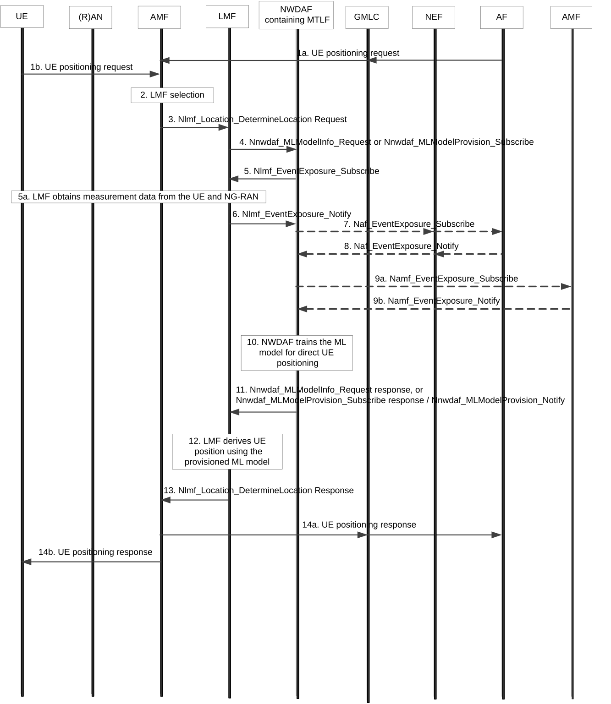

# 6.10 Solution \#10: Direct AI/ML based positioning with NWDAF assistance

## 6.10.1 Description

### 6.10.1.1 General

This solution addresses Key Issue \#1 "Enhancements to LCS to support Direct AI/ML based Positioning".

In this solution, the existing NWDAF framework as specified in TS 23.288 \[5\] is reused for Direct AI/ML positioning in 5GC as follows:

\- The NWDAF containing MTLF trains the ML model for Direct AI/ML positioning.

\- The NWDAF containing MTLF collects UE positioning related data from e.g. the LMF, AF and OAM, to train the ML model for Direct AI/ML positioning.

\- The LMF requests or subscribes to the ML model for Direct AI/ML positioning from the NWDAF containing MTLF.

Editor's note: Whether the LMF has a collocated AnLF for deriving the UE positioning is FFS.

When requesting or subscribing to the ML model for Direct AI/ML positioning from the NWDAF containing MTLF, the LMF provides the following input parameters in the Nnwdaf_MLModelProvision_Subscribe or Nnwdaf_MLModelInfo_Request service operation:

\- Indication for requesting a ML model for Direct AI/ML positioning;

\- Target of ML Model Reporting: SUPI(s) of the target UE(s) for positioning, or any UE (i.e. all UEs under specified conditions (e.g. within an AoI, or served by a combination of S-NSSAI and DNN));

\- ML Model Filter Information optionally including:

\- S-NSSAI;

\- DNN;

\- Service type (see TS 22.071 \[10\]), which identifies the type of the service which requests UE positioning;

\- LCS QoS, which includes Location accuracy, response time and/or LCS QoS Class;

\- one or more positioning methods;

\- Area of Interest.

Editor's note: The details of the ML Model Filter Information are FFS.

\- Other input parameters as specified in clause 6.2A.2 of TS 23.288 \[5\].

The NWDAF containing MTLF provides the output information as specified in clause 6.2A.2 of TS 23.288 \[5\] about the trained ML model for Direct AI/ML positioning, to the LMF using the Nnwdaf_MLModelProvision_Subscribe response / Nnwdaf_MLModelProvision_Notify or Nnwdaf_MLModelInfo_Request response.

### 6.10.1.2 Input data

To train the ML model, the NWDAF containing MTLF collects UE positioning related input data as list in Table 6.10.1.2-1.

Table 6.10.1.2-1: Data collected by NWDAF for training the ML model for UE positioning

| Information                                    | Source | Description                                                                                            |
|------------------------------------------------|--------|--------------------------------------------------------------------------------------------------------|
| UE ID                                          | LMF    | SUPI of the target UE.                                                                                 |
| Timestamp                                      | LMF    | A time stamp when the location was measured.                                                           |
| UE positions (1...max)                         | LMF    | Positions of the UE as defined in TS 23.273 \[7\].                                                     |
| \> UE location                                 |        | Location of the UE as defined in TS 23.273 \[7\].                                                      |
| \> UE velocity                                 |        | Velocity of the UE as defined in TS 23.273 \[7\].                                                      |
| \> LCS Accuracy                                |        | Accuracy of UE position, see TS 23.273 \[7\].                                                          |
| \> LCS response time                           |        | Response time for UE positioning, see TS 23.273 \[7\].                                                 |
| \> LCS QoS Class                               |        | LCS QoS class as defined in clause 4.1b of TS 23.273 \[7\].                                            |
| \> Positioning method                          |        | Positioning method used for UE positioning, see TS 23.273 \[7\].                                       |
| \> UE positioning measurements from the UE     |        | UE positioning related measurements reported by the UE, corresponding to the positioning method.       |
| \> UE positioning measurements from the NG-RAN |        | UE positioning related measurements reported by the NG-RAN, corresponding to the positioning method.   |
| \> PRU position                                |        | PRU position, which include the location and optionally velocity of the PRU used for UE positioning.   |
| \> PRU positioning measurements                |        | PRU positioning related measurements reported by the NG-RAN, UE (i.e. PRU) or LMF.                     |
| \> MBSR position                               |        | MBSR position, which include the location and optionally velocity of the MBSR that the UE connects to. |
| \> MBSR positioning measurement                |        | MBSR positioning related measurements reported by the NG-RAN or UE (i.e. MBSR), or LMF                 |
| \> Service type                                |        | Identifies the type of the service which requests the UE positioning, see TS 22.071 \[10\].            |
| UE location                                    | AMF    | UE location information, e.g. cell ID or TAI.                                                          |
| UE position                                    | AF     | UE position information obtained via application layer, e.g. GNSS positioning information.             |

Editor's note: The details of the input data are FFS.

## 6.10.2 Procedures

Figure 6.10.2-1: Procedure for NWDAF providing ML model for direct UE positioning

1a. \[In the case of 5GC-MT-LR procedure\] The AF or LCS client sends a request to the GMLC for positioning of a target UE, and the GMLC invokes the Namf_Location_ProvidePositioningInfo service operation towards the AMF, as specified in TS 23.273 \[7\].

1b. \[In the case of 5GC-MO-LR procedure\] The UE sends an MO-LR Request message included in a UL NAS TRANSPORT message to the AMF as specified in TS 23.273 \[7\].

2\. The AMF selects an appropriate LMF for positioning of the target UE.

3\. The AMF invokes the Nlmf_Location_DetermineLocation request towards the LMF as specified in TS 23.273 \[7\].

4\. Based on the Nlmf_Location_DetermineLocation request, the LMF discovers and selects an NWDAF containing MTLF, and sends an ML model request/subscribe (Indication of requesting a ML model for direct AI/ML positioning, Target of ML model Reporting = SUPI of the target UE, ML model Filter Information, ML Model Reporting Information) to the NWDAF containing MTLF by invoking a Nnwdaf_MLModelInfo_Request or a Nnwdaf_MLModelProvision_Subscribe.

5-6. The NWDAF containing MTLF collects UE positioning related input data from the LMF as defined in Table 6.10.1.2-1 by invoking Nlmf_EventExposure_Subscribe (Event ID = UE positioning information, Event Filter information), Target of Event Reporting = SUPI of the target UE). The LMF obtains measurement data from the UE and NG-RAN for UE positioning, and provides the measurement data and other data as defined in Table 6.10.1.2-1 to the NWDAF containing MTLF.

Editor's note: It is FFS how the LMF obtains measurement data from the UE and NG-RAN for UE positioning. Coordination with RAN WGs is needed.

7-8. The NWDAF containing MTLF may collect UE positioning related input data from the AF as defined in Table 6.10.1.2-1 by invoking Nnef_EventExposure_Subscribe or Naf_EventExposure_Subscribe service (Event ID = UE positioning information, Event Filter information), Target of Event Reporting = SUPI of the target UE) as defined in TS 23.502 \[3\].

9\. The NWDAF containing MTLF may collect UE positioning related input data as defined in Table 6.10.1.2-1 from the AMF.

10\. The NWDAF containing MTLF performs the ML Model (re)training for direct AI/ML positioning using the collected data.

NOTE: Step 5-10 can be performed before step 4, i.e. there can be an existing trained ML model for direct AI/ML positioning for the UEs including the target UE in the NWDAF containing MTLF.

11\. The NWDAF containing MTLF provides the trained ML model for direct AI/ML positioning to the LMF using either Nnwdaf_MLModelInfo_Request response or Nnwdaf_MLModelProvision_Subscribe / Nnwdaf_MLModelProvision_Notify, depending on the service used in step 1.

12\. The LMF derives the position of the target UE using the provisioned ML model for direct AI/ML positioning.

13\. The LMF invokes the Nlmf_Location_DetermineLocation response towards the AMF to provide the determined location of the target UE.

14a. \[In the case of 5GC-MT-LR procedure or optionally 5GC-MO-LR procedure\] The AMF invokes the Namf_Location_ProvidePositioningInfo response towards the GMLC, and the GMLC returns the position of a target UE to the AF or LCS client, as specified in TS 23.273 \[7\].

14b. \[In the case of 5GC-MO-LR procedure\] The AMF sends an MO-LR Response message included in a DL NAS TRANSPORT message to the UE as specified in TS 23.273 \[7\].

## 6.10.3 Impacts on services, entities and interfaces

**NWDAF:**

\- The NWDAF containing MTLF trains the ML model for Direct AI/ML positioning.

\- The NWDAF containing MTLF collects UE positioning related data from e.g. the LMF, AF and AMF, to (re)train the ML model for Direct AI/ML positioning.

**LMF:**

\- Requests or subscribes to ML model for Direct AI/ML positioning from the NWDAF containing MTLF, and derives UE position using the provisioned ML model.

**UE:**

\- Depending on RAN WG decision, performs and reports measurements.

**RAN:**

\- Depending on RAN WG decision, performs and reports measurements.
