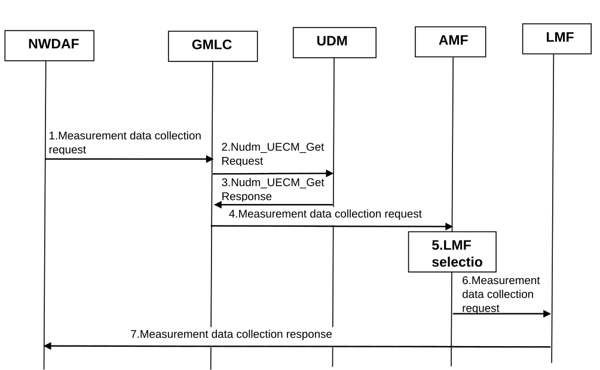

# 6.11 Solution \#11: Data collection procedure for LMF-side model training

## 6.11.1 Functional Description

This solution proposes to reuse the UE positioning procedure defined in TS 23.273 \[7\] to identify target LMF(s) for measurement data collection. After receiving the data collection request, the LMF(s) can send the measurement data and PRU information to NWDAF for LMF-side model training directly(i.e. without passing GMLC/AMF). In the case of a large amount of measurement data is requested by multiple NWDAFs, sending measurement data directly can avoid overload of AMF/GMLC effectively.

## 6.11.2 Procedures

Figure 6.11.2-1: Procedure of data collection for LMF-side model training

1\. NWDAF sends measurement data/PRU information collection request to GMLC with target UE ID(s) and its NF instance ID.

Editor's note: Whether to perform data collection per UE, per area or both is FFS.

2\. The GMLC invokes a Nudm_UECM_Get service operation towards the home UDM of the target UE(s).

3\. The UDM returns the network address (s) of the current serving AMF.

4\. The GMLC forwards measurement data/PRU information collection request with target UE ID(s) and NWDAF instance ID to AMF(s).

5\. The AMF(s) select LMF(s) based on the information as defined in clause 5.1 of TS 23.273 \[7\] or based on AMF local configuration. The selection may use NRF queries.

6\. The AMF(s) send measurement data/PRU information collection request to LMF(s) with target UE ID(s) and NWDAF instance ID.

7\. LMF(s) sends back the measurement data/PRU information of the target UE(s).

## 6.11.3 Impacts on existing services, entities and interfaces

To implement the solution above, the NWDAF shall provide its NF instance ID and target UE ID(s) in the training data collection request. The GMLC shall forward the request to AMF and then AMF shall forward the request to LMF. The LMF needs to prepare training data according to the received target UE ID(s) and send the prepared training data to NWDAF directly.

**UE:**

\- Depending on RAN decision, perform and report measurements.

**RAN:**

\- Depending on RAN decision, perform and report measurements.
