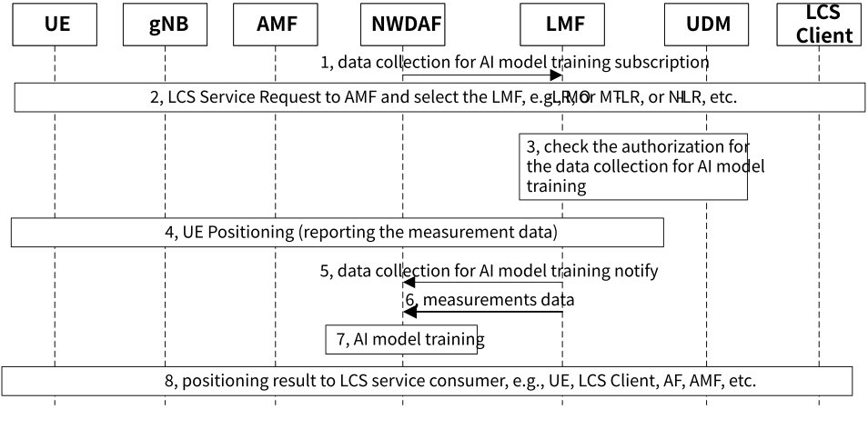

# 6.12 Solution \#12: new solution for KI#1 support the data collection for AI model training based on authorization

## 6.12.1 Description

This solution resolves how to trigger or authorize the positioning data collection for AI/ML model training for Key Issue \#1 Enhancements to LCS to support Direct AI/ML based Positioning. In this solution, it proposes to define a subscription data of authorization for positioning data collection of a UE for AI/ML mode training in UDM. Since the positioning data of one UE is sensitive/private information, it assumed that the AI/ML model training entity has to obtain the authorization from UDM before collecting the positioning data of the UE.

In this solution, it also assumed that the positioning data from non-AI/ML based positioning is also useful for the AI/ML model training. So in this paper, the positioning data can be obtained from AI/ML based positioning procedure, or non-AI/ML based positioning procedure.

In this solution, it is assumed to add positioning data collection for AI positioning model training authorization in UE subscription data in UDM.

Table 6.12.1-1: UE subscription data in UDM

<table>
<colgroup>
<col style="width: 21%" />
<col style="width: 31%" />
<col style="width: 46%" />
</colgroup>
<thead>
<tr class="header">
<th>
LCS privacy

(data needed by GMLC)
</th>
<th>LCS privacy profile data</th>
<th>Provides information for LCS privacy classes and Location Privacy Indication (LPI) as defined in clause 5.4.2 of TS 23.273 [7].</th>
</tr>
<tr class="odd">
<th></th>
<th>Positioning data collection for AI positioning model training authorization</th>
<th>Authorize the AI positioning model training NF (e.g. NWDAF) to collect the measurement data, and/or UE location information for AI positioning model training.</th>
</tr>
<tr class="header">
<th>
LCS mobile origination

(data needed by AMF)
</th>
<th>LCS Mobile Originated Data</th>
<th>When present, indicates to the serving AMF which LCS mobile originated services are subscribed as defined in clause 7.1 of TS 23.273 [7].</th>
</tr>
</thead>
<tbody>
</tbody>
</table>

## 6.12.2 Procedures

Figure 6.12.2-1: Data collection for AI/ML mode training with authorization

1\. NWDAF subscribes the data collection for AI model training service to LMF, to collect the measurements data/location data of one UE when the LCS Service is triggered in future.

If NWDAF has the target UE ID(s), e.g. SUPI, or GPSI, then NWDAF reuses existing "User consent for analytics" as defined in clause 6.2.9 of TS 23.288 \[5\]. then the step 3 is skip.

NOTE: whether reuse existing interface or define new service operations from NWDAF to LMF can be determined during conclusion.

2\. AMF receives LCS service request from UE (i.e. MO-LR), or from LCS Client (i.e. MT-LR), or AMF itself. AMF selects LMF and sends the location request to LMF.

3\. LMF checks with UDM whether to collect the positioning data (e.g. measurement data and or location information) of this UE for AI/ML model training is allowed.

If not allowed, step 5-7 are skip, it means NWDAF cannot obtain the measurement data of this UE for the AI/ML mode training.

4\. UE and/or gNB report the measurement data to LMN.

5\. If the allowed in step 3, LMF sends the data collection for AI model training notify to NWDAF.

6\. LMF sends the measurement data to NWDAF.

7\. NWDAF performs AI/ML model training by using the collected measurement data from LMF.

8\. LMF computes the final location of UE and sends the final UE location to LCS consumers, e.g. UE, LCS client, etc.

## 6.12.3 Impacts on services, entities and interfaces

Editor's note: It is FFS to capture impacts on existing 3GPP nodes and functional elements.

**LMF:**

\- Support for AI/ML Model inference to compute the final UE location.

\- Check with UDM whether the positioning data of the UE is allowed for AI/ML model training.

**UDM:**

\- Enhanced to authorize the positioning data collection for AI/ML mode training based on UE's subscription.

**UE:**

\- Depending on RAN decision, perform and report measurements.

**RAN:**

\- Depending on RAN decision, perform and report measurements.
