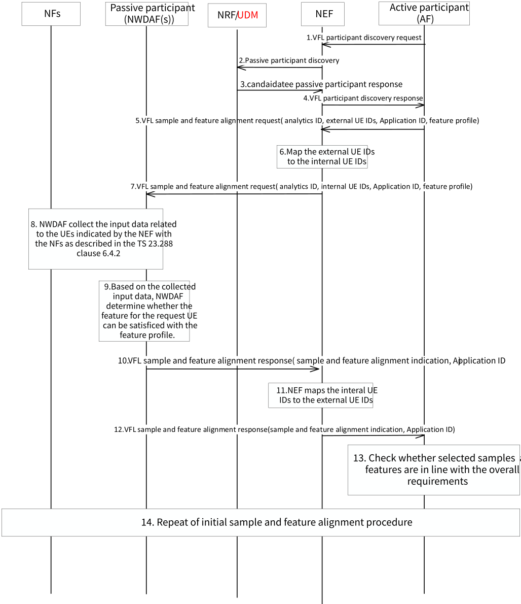
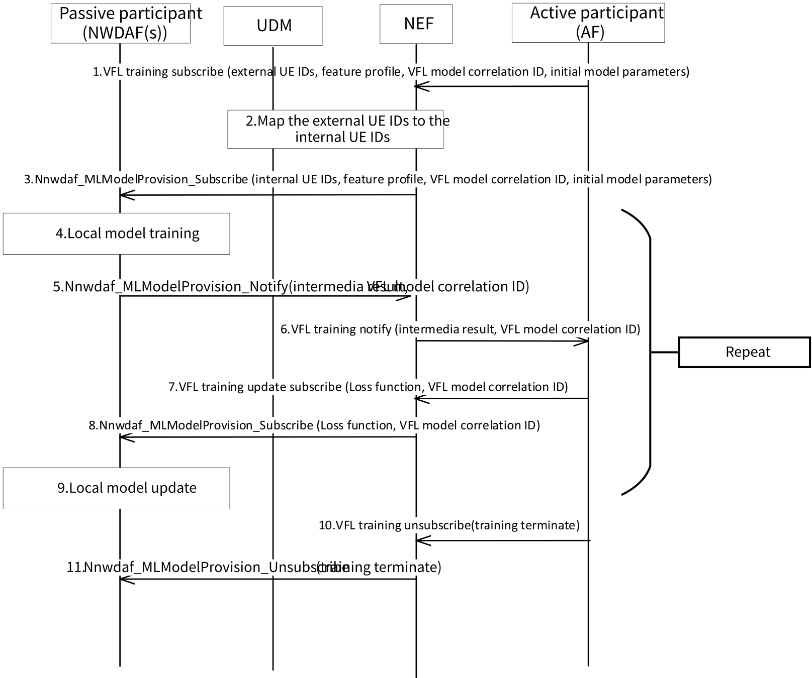
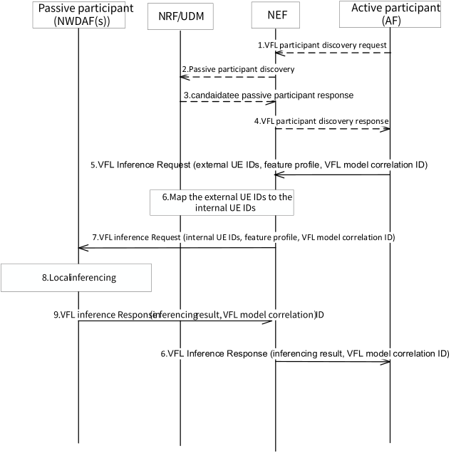

# 6.13 Solution \#13: Sample/Feature alignment and general training procedure for the VFL

## 6.13.1 Description

This solution is proposed to address Key Issue \#2: 5GC Support for Vertical Federated Learning and based on the Use Case \#5.

In Use Case \#5, two scenarios are identified:

\- **Scenario 1:** NWDAF initiates VFL training process.

\- **Scenario 2:** AF initiates VFL training process.

This solution focuses on scenario 2 where AF is the VFL Active Participant(VFL server) with label while NWDAF(s) is the VFL Passive Participant(VFL client) (s).

NOTE 1: In this solution, the VFL Active Participant equals to the VFL server. The VFL Passive Participant equals to VFL client.

The basic principle for this solution is that AF is the only entity which owns the label (e.g. the value for the QoE) for the training data when performing VFL model training. NWDAFs in the 5GC which has the model training capability (e.g. NWDAF with MTLF) will be other entities to train the VFL model with AF collaboratively. Since the label is in the AF, AF will act as the VFL Active Participant(VFL server) and NWDAFs will be the VFL Passive Participant(VFL client).

The function of the VFL Active Participant(VFL server) is shown as following:

\- Initiating the VFL task, performing the sample and feature alignment with the VFL Passive Participant(VFL client)(s) to make sure the training dataset in the different entity has the same sample space and different feature space.

\- Sending the initial model to the VFL Passive Participant(VFL client)(s). Making sure each entity can perform the VFL model training for the same VFL task.

\- Collecting the VFL Passive Participant(VFL client)(s) training result (i.e. intermediate result). Based on itself training result using its own local data, the label and the VFL Passive Participant(VFL client)(s)' training result, calculating the loss information. Sending the loss information to the VFL Passive Participant(VFL client)(s).

\- Indicating to the VFL Passive Participant(VFL client)(s) that the training progress is finished based on the comparison of the gathered training result and the label or the pre-set iteration number is reached.

\- Storing the local well-trained model in order to support the VFL inference later.

The function of the VFL Passive Participant(VFL client) is shown as following:

\- Performing the sample and feature alignment based on the VFL Active Participant(VFL server) request.

\- Receiving the part of the initial VFL model from the VFL Active Participant(VFL server). Using its local dataset to train the local model.

\- Generating the local model training result and sending it to the VFL Active Participant(VFL server).

\- Storing the local well-trained model in order to support the VFL inference later.

## 6.13.2 Procedures

### 6.13.2.1 Sample and feature alignment procedure

In VFL, it is required VFL Active Participant(VFL server) and VFL Passive Participant(VFL client) have same samples and different features before the model training. This solution proposed a preparation process used to have a negotiation between VFL Active Participant(VFL server) (i.e. AF) and VFL Passive Participant(VFL client) (i.e. NWDAF) to ensure they share the same sample space, i.e. same UEs and different features space before the VFL model training. Moreover, if any participating entity leaves or a new entity joins the VFL, this triggers the process of updating the participating entity list. Additionally, it necessitates re-aligning sample and feature profiles among all entities to ensure consistency and compatibility in the collaborative model training process.

If the samples provided by the AF involve multiple NWDAFs, e.g. the UEs served by the AF are served by multiple NWDAFs at the same time for the different feature space, NWDAF A may only collect the SMF related data. NWDAF B may only collect the AMF related data. The AF will negotiate with multiple NWDAFs to ensure each entity has the same sample space but different feature space via NEF. When the AF receive the response, it may decide whether to start VFL model training with following three options:

\- Option 1: maintain the sample and feature space to start VFL model training with multiple NWDAFs;

\- Option 2: reduce the sample space and feature space to ensure to start VFL model training with only one NWDAF;

\- Option 3: stop the VFL process.

Furthermore, it is possible that multiple NWDAFs be involved where only one of them interfaces to the AF, e.g. an NWDAF serving as a delegate for other NWDAFs. The delegate NWDAF may discover NWDAFs that can work as passive VFL passive participants, and it may coordinate sample and feature alignment amongst these NWDAFs. Alternatively, the NEF can hide from the AF that multiple NWDAFs are involved.

NOTE 1: Which of the above solutions will be used and how to determine a delegate and whether the delegate is needed will be discussed in the normative phase.

Figure 6.13.2.1-1: Sample and Feature Alignment Procedure

1\. VFL Active Participant(VFL server) (i.e. AF) determines to use VFL model training because data that cannot be obtained/exposed directly from 5GC (e.g. for privacy reasons) or vendor implementation policy. The VFL Active Participant(VFL server) (i.e. AF) sends VFL participant discovery request to NEF by indicating Analytics ID (e.g. Observed Service Experience), application ID, External UE IDs, filter information (e.g. Area of Interest), VFL Passive Participant(VFL client) capability.

NOTE 2: NEF is needed only when the AF is untrusted AF.

2\. Based on the request from AF, the NEF authorizes the request information and applies parameter mapping (e.g. external UE IDs mapping to internal UE IDs, geographical area mapping to TA(s)/ Cell-id(s), VFL Passive Participant(VFL client) capability). The NEF requests for VFL Passive Participant(VFL client) discovery from NRF and further queries UDM for determining the NWDAF ID and its corresponding serving UE list if the NWDAF registration in UDM is supported with the requested information provided by the AF. The serving UE list for each NWDAF maybe the subset of the UEs requested by the AF.

3\. The NRF returns available NWDAF(s) to the NEF which support the VFL Passive Participant(VFL client) capability and the requested analytics ID. The UDM returns available NWDAF(s) with their corresponding serving UE list to the NEF.

NOTE 3: Each VFL Passive Participant(VFL client) may permit a subset of its available features to be used for VFL training and inference purposes because some features may be confidential depending on UE subscription and/or operator policy and including those information into the NF profile when register to the NRF.The feature related information will not be standardized.

4\. NEF sends the available NWDAF(s) and their corresponding serving UE list and feature information to the AF. The NEF anonymizes NWDAF instances ID(s) into temporary NWDAF ID(s) and sends the temporary NWDAF ID(s) to the AF The NEF also informs the AF whether the NWDAF is a delegate for other NWDAFs.

5a. If the AF can get the feature related information in step 4, the AF considers all NWDAFs discovered by 5GC and selects a set of NWDAFs for VFL training that meet its requirements (e.g. AF may select NWDAFs that provide diverse features with minimal or no overlaps while supporting a particular set of samples supported by AF).

5b. If the AF can not get the feature related information in step 4, VFL Active Participant(VFL server) (i.e. AF) sends the VFL sample and feature alignment request to the NEF including the samples (i.e. external UE IDs) the AF want to use for the VFL training based on the information received in the step 4, the analytics ID (e.g. Observed Service Experience), the application ID indicates which application needs to initiate the VFL operation, and optionally, the feature profile indicates what feature the AF can provide and what feature(s) are needed for performing the VFL. The feature in the feature profile is just some feature description, not the specific value of the feature. Therefore, the feature profile has less privacy issue and can be used for the different vender. What is the exact feature in the feature profile depend on the different VFL task. For example, for the observed service experience case, the input data from AF as described in clause 6.4.2 of TS 23.288 \[5\] can be the feature provided by the AF.

6\. NEF maps the external UE IDs to the internal UE IDs based on the information exchanged with the UDM.

7\. NEF sends the VFL sample and feature alignment request to the VFL Passive Participant(VFL client) (i.e. NWDAF(s)) including the internal UE IDs (e.g. SUPIs), Application ID and feature profile. If multiple NWDAFs involved, the NEF sends the VFL initiation request to each NWDAF, respectively.

8\. Based on the feature profile and requested analytics ID, NWDAF(s) collects the input data related to the internal UE IDs with the NFs as described in clause 6.4.2 of TS 23.288 \[5\]. What data can be collected by the NWDAF is not always the same and not stable. Only after NWDAF perform the data collection and already collect the related input data, NWDAF can determine which feature it can support based on the available dataset.

9\. Based on the collected input data from the NFs, NWDAF(s) can determine which UE related data is available, whether the feature for the input data can be implemented/satisfied with the feature profile provided by AF. Based on the parameters received in the step 4 and the data collected in the step 5, NWDAF may down-select UEs from the internal UE IDs to ensure the samples are same among NWDAF(s) and AF. On the other side, the feature in the same samples should be different among NWDAF(s) and AF.

10\. NWDAF(s) sends the sample and feature alignment response to the NEF including the application ID, the sample and feature alignment indication, to indicate which UE and for which feature can be used in the VFL operation.

11\. If multiple NWDAFs involved, the NEF collects the sample and feature alignment response from NWDAFs. NEF maps the internal UE IDs to the external UE IDs. The UE IDs in this step can be the subset of the UE IDs in the AF request based on the NWDAF(s) determination in order to make the sample and feature alignment.

12\. NEF sends the VFL sample and feature alignment response to the AF including the sample and feature alignment indication.

13\. The VFL Active Participant(VFL server) verifies whether the selected samples and features meet the requirements. If the VFL Active Participant(VFL server) determines that there is an insufficient quantity of samples or features, it can halt the VFL process. Subsequently, it has the capability to initiate a new VFL process by adjusting the requirements or selecting different passive entities, where iterations are needed.

14\. When introducing a new VFL Passive Participant(VFL client) or when updates are required for the current one, the VFL Active Participant(VFL server) evaluates whether realignment is needed for the ongoing VFL procedure or if it is necessary for initiating a new collaborative learning process. Realignment ensures that the sample and feature requirements are appropriately matched to facilitate effective collaboration. If necessary, the VFL Active Participant(VFL server) initiates the sample and feature alignment procedure based on either the existing alignment requirements or an updated version.

NOTE 4: Whether to use the existing (e.g. Nnef_MemberUESelectionAssistance) or new service operation between the AF and NEF and between the NEF and NWDAF to perform the sample and feature alignment will be determined in the normative phase.

NOTE 5: Whether the sample and feature alignment procedure is a separate procedure or can be aligned with the current Federated Learning preparation procedure as specified in clause 6.2C.2 of TS 23.288 \[5\] will be determined in the normative phase.

### 6.13.2.2 General training procedure for the VFL between the VFL Active Participant(VFL server) (i.e. AF) and VFL Passive Participant(VFL client) (i.e. NWDAF)

In the process of VFL model training, the AF and NWDAF(s) exchange intermediate data (e.g. intermediate training result, loss information). It is assumed that the VFL Active Participant(VFL server) has ground truth data or labels or is able to collect ground truth data or labels. It is also assumed that the VFL Passive Participant(VFL client) discovery and selection, the sample/feature alignment are done before the training process.

The VFL model training process will iterate until the AF determines the model performance satisfies requirement based on comparing with the label or the pre-set iteration number is reached.

Figure 6.13.2.2-1: General Training Procedure for the VFL between the VFL Active Participant (i.e. AF) and VFL Passive Participant (i.e. NWDAF)

1\. After performing the sample and feature alignment procedure, NWDAF and AF has the available local datasets to perform the VFL training. Therefore, when the AF needs to initiate the VFL training, AF sends the VFL training subscribe to the NEF including the external UE IDs and feature profile received in the NEF before to indicate which sample and feature are used for the VFL training, the initial e model parameters in order to configure the VFL local model to the NWDAF or the initial local ML model, the VFL model correlation ID in order to let AF know the intermediate result from NWDAF is for which VFL model and VFL task. AF can then correlate it to the AF itself local result to generate the final result. The interoperability information of the model(e.g. model file format, execution environment). In this message, the VFL Active Participant(VFL server) may specify a maximum response time(i.e. the maximum time between receiving loss and sending back the intermediate training result) in every iteration. AF may also include the requested performance metric (e.g. required accuracy of trained ML model) in the request.

NOTE 1: It is assumed that the VFL Active Participant(VFL server) owns the entire initial ML model for VFL before the VFL training performed, as in typical VFL. If the NWDAF has no available VFL sub local model preconfigured before, the AF needs to provide the initial model to the NWDAF before the VFL training performed. For example, for the split-VFL, AF has the top model, and multiple NWDAFs may need the bottom model. The sum number of neurons in the bottom models output layer must equal the number of neurons in the top model input layer. Such limitation is very difficult to resolve by just pre-configuring the different bottom models to the multiple NWDAFs. The other case is that if the trained model performance is unsatisfactory and retraining becomes necessary, new initial local models may need provision from the VFL server after terminating the existing training process. Such cases are challenging to address through the pre-configuration approach. However, Ownership of the entire ML model may vary depending on scenarios, and the relevant procedures may be updated accordingly. The Active Participant may indicate a requested ML model to be used for training. The Active Participant may also check whether the VFL Passive Participant supports the requested ML model during the discovery phase, using the ML model support as a capability of the VFL Passive participant (e.g. as part of the NF profile).

NOTE 2: NEF is needed only when the AF is untrusted AF.

2\. NEF maps the external UE IDs to the internal UE IDs based on the information exchanged with the UDM.

3\. NEF sends the Nnwdaf_MLModelProvision_Subscribe to the NWDAF including the internal UE IDs, feature profile, VFL model correlation ID and initial local model parameters.

4\. NWDAF(s), based on the feature profile, identifies the already collected data happened in the sample and feature alignment procedure. NWDAF uses the collected data and initial local model parameters to do the local model training.

5\. NWDAF(s) sends the Nnwdaf_MLModelProvision_Notify to the NEF including the intermediate results and the VFL model correlation ID. If multiple NWDAFs involved, the NEF aggregates the intermediate results from NWDAFs. The message may include intermediate results identification information, which identifies the intermediate results in the VFL training service, e.g. time stamp.

6\. NEF sends the VFL training notify to the AF including the intermediate results and the VFL model correlation ID.

7\. AF, based on the VFL model correlation ID, correlates the intermediate result to the AF itself local result in order to generate the final result. AF calculates the loss information based on the final result and the label stored in the AF. AF sends the VFL training update subscribe to the NEF including the loss information and the VFL model correlation ID.

NOTE 3: For the QoE prediction use case, the label is QoE value which is known to the AF.

8\. NEF sends the Nnwdaf_MLModelProvision_Subscribe to the NWDAF including the loss information and VFL model correlation ID.

9\. NWDAF, based on the loss information, computes gradient and updates the local model. The step 4 to step 9 are repeated until the termination condition reached.

10\. AF, based on the label and the test dataset, determines the VFL model is in convergence. AF sends the VFL training unsubscribe to the NEF including the training terminate indication. When the requested performance metric is not met after some period of local ML training, AF may determine whether to stop the VFL or update Vertical Federate Learning Strategy (e.g. the updated ML model for local training, updated features, updated UE’s list, updated service area and/or time period).

11\. NEF sends the Nnwdaf_MLModelProvision_Unsubscribe to the NWDAF to terminate the VFL training progress.

After VFL training procedure, VFL Active Participant (VFL server) may collect trained ML models from VFL Passive Participant (VFL client) NF(s). This sequence aims to use the trained model in the inference procedure that involves the other NF. The VFL Passive Participant (VFL client)(s) store the trained ML model with the a VFL model correlation ID so that the trained local ML model may be used also during the inference procedure without sharing ML model.

NOTE 4: Whether to use the exist or new service operation between the AF and NEF to perform the VFL model training will be determined in the normative phase.

NOTE 5: VFL Active Participant (VFL server) collects trained ML models from VFL Passive Participant (VFL client)(s) is needed only when the 5GC supports the VFL inference with NF that has not participated in the VFL model training.

### 6.13.2.3 Inferencing procedure for the VFL between the VFL Active Participant (i.e. AF) and VFL Passive Participant (i.e. NWDAF(s))

Figure 6.13.2.3-1

1\. VFL Active Participant(VFL server) (i.e. AF) may determine to perform VFL inference using the VFL well-trained ML model which is represented by VFL model correlation ID. When there is not a VFL Passive Participant available for VFL inference which has been involved for VFL training of the VFL model correlation ID, the VFL Active Participant(VFL server) (i.e. AF) may send VFL participant discovery request to NEF by indicating Analytics ID (e.g. Observed Service Experience), application ID, External UE IDs, filter information (e.g. Area of Interest), VFL Passive Participant(VFL client) capability. In the discovery request, Area of Interest, requested ML model in the VFL Passive Participant capability is determined based on the stored ML model information of VFL model correlation ID.

NOTE: NEF is needed only when the AF is untrusted AF.

2.- 4. The step 2. - 4. in clause 6.13.2.1 is performed.

5\. VFL Active Participant(VFL server) initiate VFL inference by sending a VFL inferencing request to VFL Passive Participant via NEF including the external UE IDs that are used by the VFL server NWDAF as the data sample for the inference, the VFL model correlation ID to indicate which VFL model should be used by the NWDAF VFL client to generate local inference result, and the feature profile to indicate what are the feature used by the NWDAF VFL Passive Participant to generate the intermediate inference result.

6\. NEF maps the external UE IDs to the internal UE IDs based on the information exchanged with the UDM.

7\. NEF sends the VFL Inference Request to the NWDAF including the internal UE IDs, feature profile, VFL model correlation ID.

8\. When receiving a VFL inference Request from NEF, VFL Passive Participant may derive the local ML model based on the VFL model correlation ID. And VFL Passive Participant may generate local inference result using the local data which includes newly collected data for requested UE IDs and local ML model.

9\. NWDAF(s) sends the VFL inference Response to the NEF including the inference results and the VFL model correlation ID. If multiple NWDAFs involved, the NEF aggregates the inference results from NWDAFs.

10\. NEF sends the VFL inference Response to the AF including the inference results and the VFL model correlation ID.

## 6.13.3 Impacts on services, entities and interfaces

**NWDAF:**

\- Enhancement to support the VFL model sample and feature alignment with the AF to make sure the sample is the same, but the feature for the sample is different between AF and NWDAF.

\- Based on the model and loss function provided by the AF, performing local training and update for the VFL model.

**NEF:**

\- Enhancement to support the sample and feature alignment related information and VFL model training related information exchange between AF and NWDAF.
