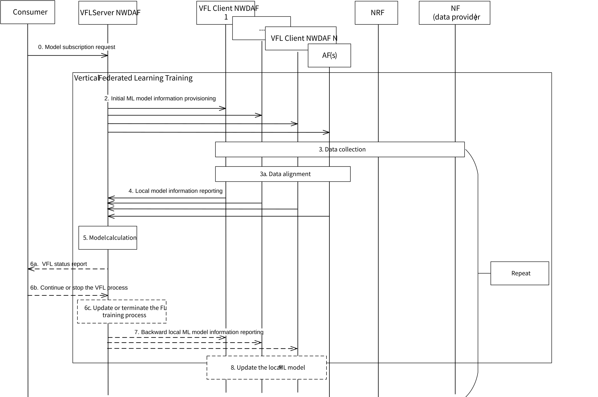
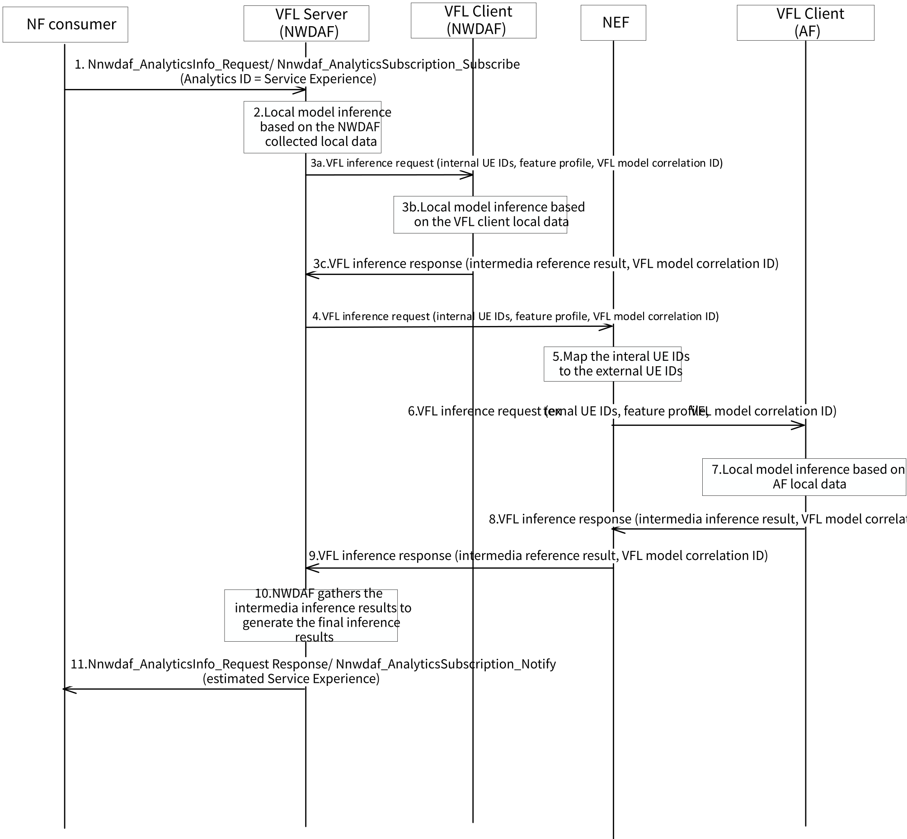

# 6.14 Solution \#14: General procedure for NWDAF initiated Vertical Federated Learning between NWDAF(s) and AF(s)

## 6.14.1 Description

This clause specifies how NWDAF(s) and AF(s) can leverage VFL technique to train joint ML model to address the Key Issue \#2: 5GC Support for Vertical Federated Learning. The training data is always a key element for ML model. In general, more data used in model training, better performance the model would achieve. Due to the data privacy and data heterogeneity, huge amount data of 5GC and AF cannot be fully utilized. Therefore, VFL technique could be introduced to address the above problems, enabling the joint ML model training without any local data sharing based on the data of different features.

As the initiator, the NWDAF can control both the VFL training and inference procedures as defined in clauses 6.14.2.1 and 6.14.2.2 respectively.

Furthermore, in this solution, for the purpose of achieving better understanding, the following terms are defined below:

\- VFL Server: An NF with the labels which performs result aggregation, integrating all the local results and computing gradients information or loss information for ML model update. It also coordinates the VFL process (e.g. selecting participants, exchanging intermediate results).

\- VFL Client: An NF which holds the local dataset and performs local training. There can be multiple VFL Clients in VFL.

Editor's note: It is FFS if separate VFL servers and VFL clients for training (e.g. MTLF) and VFL servers and VFL clients for inference (e.g. AnLF) are required.

## 6.14.2 Procedures

### 6.14.2.1 Training Procedure

The figure 6.14.2.1-1 below shows general training procedure for Vertical Federated Learning between NWDAF(s) and AF(s).

Figure 6.14.2.1-1: General training procedure for VFL between NWDAF(s) and AF(s)

0\. The consumer sends a subscription request to VFL server NWDAF to train an ML model, including Analytics ID, ML model metric (e.g. ML model accuracy).

NOTE 1: As an example, the consumer could be NWDAF containing AnLF which may perform inference and trigger VFL server NWDAF to start VFL training.

1\. VFL server NWDAF selects the VFL clients that participate in VFL (e.g. VFL client NWDAF, AF).

NOTE 2: Details of NF discovery for VFL client is not addressed by this solution.

Editor's note: The procedure for selection of AF(s) that act as VFL client(s) is FFS.

2\. To start VFL training, VFL server NWDAF sends a request to the selected VFL clients. The request includes initial ML model. The request also includes sample alignment information, e.g. UE ID(s) whose corresponding data is used for the VFL model training, and VFL model correlation ID, which identifies the VFL model training process.

Editor's note: Whether initial ML model is provided by VFL server NWDAF or locally generated in VFL client is FFS. Whether information about Feature is required is FFS.

NOTE 3: It is up to SA3 to determine the security issues of ML model sharing between NWDAF and AF.

3\. \[Optional\] Each VFL client collects its local data by using the current mechanism if the VFL client has not local data available already.

3a. \[Optional\] Different VFL clients perform sample alignment if the data has not been aligned.

4\. During VFL training procedure, each VFL client further trains the ML model based on the initial ML Model provided by the VFL server NWDAF and its own data, and reports the local ML model information (e.g. intermediate training result) to the VFL server NWDAF. The report also includes VFL model correlation ID, and intermediate training result identification information, which identifies the intermediate result in the VFL training service, e.g. time stamp.

5\. The VFL server NWDAF computes the backward local ML model information (e.g. gradient information or loss information) based on all the local ML model information. The loss information may include loss function, the value of loss, the type of loss function or type of loss. The backward local ML model information is used for updating the local ML model. Different backward local ML model information may be computed for different VFL clients, respectively.

The VFL server NWDAF may also compute the global ML model metric (e.g. ML model accuracy) based on all the local ML model information and the label.

6a. \[Optional\] Based on the consumer request in step 0, the VFL server NWDAF sends VFL status report to update the ML model metric to the consumer.

6b. \[Optional\] The consumer decides whether the current model can fulfil the requirement, e.g. ML model metric is satisfactory for the consumer and determines to stop or continue the training process. The consumer continues the training process or stops the training process.

6c. \[Optional\] Based on the subscription request sent from the consumer in step 6b, the VFL server NWDAF updates or terminates the current VFL training process.

If the VFL server NWDAF received a request in step 6b to stop the Federated Training process, steps 7 and 8 are skipped.

7\. If the VFL procedure continues, VFL server NWDAF sends the backward local ML model information (e.g. gradient information, loss information) to the VFL clients for next round of VFL.

8\. Each VFL client computes gradient of its local model and updates its local ML model based on backward local ML model information distributed by the VFL server NWDAF at step 7.

NOTE 4: The steps 4-8 should be repeated until the training termination condition (e.g. maximum number of iterations, or the result of loss function is lower than a threshold) is reached.

NOTE 5: If untrusted AF is involved in VFL Clients, the message between 5GC NF and the untrusted AF is via NEF.

NOTE 6: After VFL model training is terminated, VFL server NWDAF may collect trained ML model from VFL clients. This aims to support VFL model inference with participants that have not involved in VFL model training procedure.

Editor's note: Whether to support VFL model inference with participants that have not involved in VFL model training procedure is FFS.

### 6.14.2.2 Inference Procedure

Figure 6.14.2.2-2: General inference procedure for VFL between NWDAF(s) and AF(s)

1\. The first step is the same as the existing one captured in clause 6.4.4 of TS 23.288 \[5\] since the NF consumer doesn't need to be aware whether the NWDAF performs VFL or normal analytics for the requested analytics ID. Consumer NF sends an Analytics request/subscribe (i.e. Analytics ID = Service Experience, Target of Analytics Reporting = UE IDs, Analytics Filter Information that may include one or more of the following as defined in TS 23.288 \[5\], Table 6.4.1-1 (Application ID, S-NSSAI, DNN, Application Server Address(es), Area of Interest, RAT type(s), Frequency value(s)), Analytics Reporting Information=Analytics target period) to NWDAF by invoking a Nnwdaf_AnalyticsInfo_Request or a Nnwdaf_AnalyticsSubscription_Subscribe.

2\. Based on the requested analytics ID, the NWDAF VFL server determines to perform the VFL inference with the NWDAF and AF as VFL client to generate a more accurate analytics result. Besides, sample and feature alignment, and ML model provisioning may be conducted as step 2 and 3a in Clause 6.14.2.1.

NOTE 1: The NWDAF acts as VFL server could only gather the intermediate inference results but not perform local model inference.

3\. VFL server NWDAF sends the VFL inference request to the VFL client NWDAF including the internal UE IDs that are used by the VFL server NWDAF as the data sample for the inference, the feature profile to indicate what are the feature used by the NWDAF VFL client to generate the intermediate inference result, the VFL model correlation ID to indicate which VFL model should be used by the NWDAF VFL client to generate the other part of the intermedia inference result, and an optional maximum response time of local inference. NWDAF VFL client based on the local data and model to generate the intermediate inference result and send the VFL inference response to the VFL server NWDAF including the local inference result and the VFL model correlation ID.

4\. VFL server NWDAF sends the VFL inference request to the NEF including the internal UE IDs that are used by the NWDAF as the data sample for the inference, the feature profile to indicate what are the feature used by the VFL server NWDAF to generate the intermediate inference result, the VFL model correlation ID to indicate which VFL model should be used by the AF to generate the other part of the intermedia inference result, and an optional maximum response time of local inference.

Editor's note: The procedure for selection of AF(s) that act as VFL client(s) is FFS.

5\. NEF maps the internal UE IDs to the external UE IDs.

6\. NEF sends the VFL inference request to the AF including the external UE IDs, the feature profile and the VFL model correlation ID.

7\. Based on the external UE IDs and the feature profile received from NEF, AF identifies the related sample and feature that will be used as the local dataset. Based on the VFL model correlation ID, AF chooses the local model to generate the local inference result.

8\. AF sends the VFL inference response to the NEF including the local inference result and the VFL model correlation ID. The AF shall send the response before maximum response time elapse.

9\. NEF sends the VFL inference response to the VFL server NWDAF including the local inference result and the VFL model correlation ID.

10\. Based on the VFL model correlation, VFL server NWDAF gathers the inference result from the AF and from VFL client NWDAF to generate the final inference result (i.e. observed Service Experience).

11\. The VFL server NWDAF provides the data analytics, i.e. the observed Service Experience to the consumer NF by means of either Nnwdaf_AnalyticsInfo_Request response or Nnwdaf_AnalyticsSubscription_Notify, depending on the service used in step 1.

Editor's note: Whether to use the existing or new service operation between the NWDAF and NEF and between NEF and AF to perform the VFL model inference is FFS.

Editor's note: Whether interactions between VFL clients for inference is supported is FFS.

## 6.14.3 Impacts on services, entities and interfaces

### 6.14.3.1 Training Impact

**NWDAF:**

\- Supports selecting the VFL clients and executing the VFL procedure.

\- Supports performing sample alignment.

**NRF:**

\- Supports the registration and discovery of entities which participate in VFL.

### 6.14.3.2 Inference Impact

**NWDAF:**

\- Enhanced to initiate the VFL inference procedure to support the request analytics.

\- Collects the intermediate results from AF and generates the final inference result based on the AF and NWDAF intermediate inference result.

**NEF:**

\- Enhanced to support the VFL inference related information exchange between NWDAF and AF.
