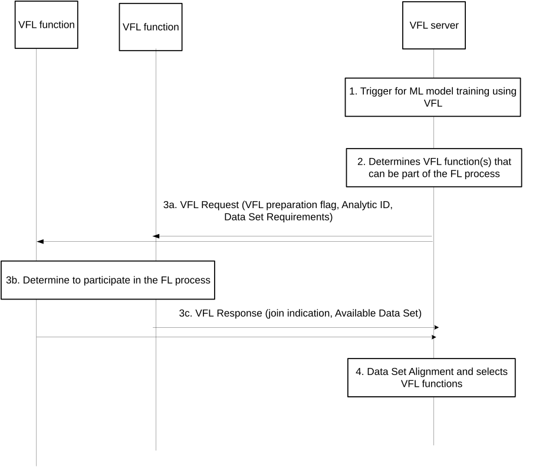
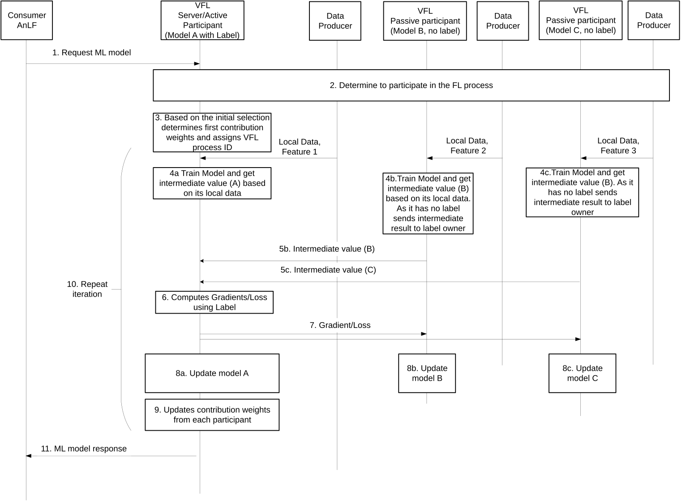
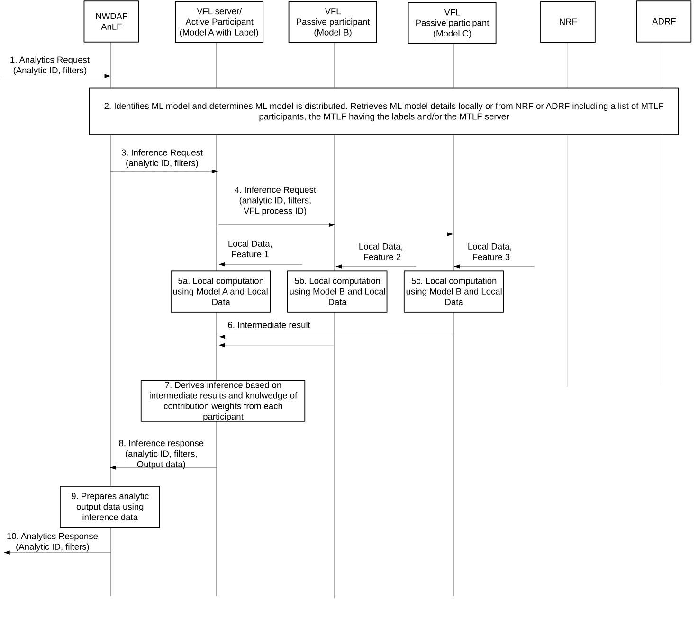

# 6.15 Solution 15: Support for vertical federated learning: Model Training and Inference

## 6.15.1 Description

Editor's note: This clause will describe the solution principles and architecture assumptions for corresponding key issue(s). Sub-clause(s) may be added to capture details.

Vertical federated learning or feature-based federated learning is applicable to the cases that two data sets share the same sample space but differ in feature space.

To support model training using federated learning the following definitions are used:

**- VFL server:** A function that manages the VFL procedures. Selects VFL participants for model training and assigns function to act as VFL active participant or passive participant.

**- VFL active participant:** A VFL function that owns part of an ML model for an analytic ID and knows the labels for the ML model. The active participant is the main function for training an ML model for an analytic ID.

**- VFL passive participant:** A VFL function that owns part of an ML model for an analytic ID but does not know the labels of the ML model but is able to collect local data for one or more features.

A model training function supporting VFL may support a combination of the functions above (e.g. support both VFL server and VFL active participant functions).

The VFL server, Active Participant, Passive participant are all logical functions of the MTLF.

Editor's note: In most cases an MTLF will support both VFL Server and Active Participant logical function. The case where VFL Server and Active participants are in separate MTLFs is FFS.

In order to support VFL, all parties participating in the VFL process must have aligned samples. Feature alignment may also be needed. Such alignment of samples (and features) is beneficial to happen before the VFL process start in order to avoid wasting resources in case during FL process it is determined that alignment of samples is not possible.

The main steps of the VFL process can be divided into the following steps:

1\. Sample (and Features) alignment.

2\. Coordinating/Controlling the VFL process.

3\. Coordinating/Controlling distributed inference.

The procedure described below support VFL between NWDAFs and VFL between AF and NWDAF. In the latter case the AF acts as a VFL Server and may also be the Active Participant.

## 6.15.2 Procedures

Editor's note: This clause describes high-level procedures and information flows for the solution.

### 6.15.2.1 Sample/Feature alignment

Feature/Sample alignment is supported by a VFL server receiving a model training request for VFL operation. The VFL Server on reception of a ML training request may perform the following tasks:

\- Identify other VFL function(s) that perform VFL operation based on the model requested.

\- Identify the data availability (features/samples) available for VFL operation based on the Data Set Requirement.

\- Carry out alignment of samples ensuring that the same samples are used by all parties of the VFL process.

\- Select one (or more) VFL function in order to support the model training process.

\- Determine a candidate list of VFL functions that can participate in the FL process.

Detailed procedure as follows:

Figure 6.15.2.1-1: Data alignment for vertical federated learning

1\. A VFL server receives a request for model training. The request may be a request from an AnLF to train an ML model or may be a VFL preparation request from an AF. The request may include, an identifier identifying the type of model training required (analytic ID) and data set requirements (including Event ID(s) and Samples available for the training process).

2\. The VFL server (from the NRF) a list of VFL functions that can participate in the VFL process.

3a. The VFL server sends a request for model training using VFL to each of the VFL functions and includes the Data Set Requirements and Analytic ID.

3b. Each VFL functions determine if they can participate in the VFL process by checking whether the data according to data set requirement are available (or can be retrieved) and other factors (e.g. load of NF, feature support).

3c. The VFL functions responds if they can join and may include the Available Data Set which contain information on samples matching the samples requested in the Data Set Requirements.

4\. The VFL server determines which samples and/or Features can be used in the VFL process and selects a (list of) VFL function that can participant in the VFL process.

### 6.15.2.2 VFL training procedure

After the alignment is complete the VFL active participant coordinates the VFL training process. The task of the VFL active participant during the training process are proposed to be:

\- Train the model containing the label data based on intermediate values

\- Provide Gradient/Losses to Passive Participants

\- Determine contribution weights from each VFL participant (which are necessary for inference) taking into account:

\- The size of local data available in each participant.

\- The importance of the feature. For example, for a model trained for Service Experience Analytics the Intermediate results provided by a VFL passive participant related to Features available at an AF have more importance than Intermediate Results provided by a VFL passive participant related to Features available at other NFs.

\- The participation in the VFL process during VFL iterations. For example, some VFL participants may not provide an intermediate value during the VFL iteration which makes their local model less accurate.

\- These contribution weights may be part of the model algorithm used by the Active Participant.

NOTE: How the contribution weights are calculated is MTLF implementation specific.

The procedure for a VFL process is shown below:

Figure 6.15.2.2-1: Procedure for model training after sample/feature alignment

1\. A consumer (e.g an NWDAF supporting AnLF) requests a trained ML model for supporting derivation of analytics (e.g. DN performance analytics) and includes the Analytics ID and/or Model ID of the trained model needed.

2\. The VFL server determines vertical federated learning and selects VFL participants and performs sample and feature alignment as required

3\. Based on the selected VFL participants the VFL active participant identifies initial contribution weights from each passive participant. The contribution weights may based on the importance of the features and/or the size of the data available by each active participant. A VFL process ID is also assigned for the training process so that all VFL participant associate the exchange of VFL related messages (including the VFL process ID) to the single VFL process initiated by the VFL server and/or active participant.

4\. Each participant in the VFL process trains their model using the available data (features) and derives an intermediate value (steps 4a, 4b, 4c)

5\. The intermediate value from each participant is sent to the VFL Active Participant.

6\. The VFL Active participant computes the gradient/loss based on the intermediate values received. The gradient/loss may be an aggregate value based on all intermediate values received or a gradient/loss value per VFL passive participant.

7\. The gradient/loss is sent to each passive participant or active participant

8\. Each VFL active/passive participant updates their ML model using the gradient/loss and further input data (step 8a, 8b, 8c)

9\. After step 8 several iterations of steps 4 to step 8 takes place until the VFL active participant determines that the ML model has been trained with the confidence level requested by the ML model consumer.

10\. After several VFL iterations the VFL Active participant updates the contribution weights from each passive participant e.g. based on the number of times feedback (i.e. intermediate values) have been provided or feedback provided within a time limit, by each VFL passive participant, gradient/loss estimation on per passive participant.

11\. Once the ML model is trained the VFL Active participant indicates to the ML model consumer that the trained ML model is available. In the response the following may be included:

\- Addresses or NF ID of each VFL participant and their contribution weights

\- Address of the VFL server

\- Address of the VFL active participant

The ML model of the Active Participant and each Passive Participant may also be stored at the ADRF.

Editor's note: The ML model(s) are stored at the ADRF so as to be available to functions for Inference. Further details on this procedure and the need to store the models at the ADRF is FFS.

### 6.15.2.3 Distributed Inference

Once a model consumer (i.e. an AnLF) is informed that the a model is trained using VFL, the consumer sends a inference request to the VFL Active Participant. The VFL active participant sends inference requests to each VFL participant and aggregates the received result to derive an aggregate inference output. The VFL active participant takes into account the contribution weights of each participant when deriving the aggregate inference output.

Editor's note: Whether distributed inference is supported by an AnLF or MTLF is FFS.

The procedure for inference is shown below:

Figure 6.15.2.3-1: Distributed Inference when ML model is trained using VFL

1\. An NWDAF supporting AnLF receives a request for analytics (e.g. Observed Service Experience Analytics) and includes analytics ID and analytics filters as specified in TS 23.288 \[5\].

2\. The AnLF identifies the ML model needed to derive analytics and determines distributed inference is needed. The AnLF may obtain this information by interfacing with the NRF or via previous interaction with a MTLF acting as a VFL server (the VFL server that trained the ML model).

3\. The AnLF sends an Inference Request to the VFL server/Active Participant. The AnLF includes the Analytic ID (e.g. Observed Service Experience), analytics filters (e.g. target UEs, service area, slice information, application information etc). The Inference Request may be a subscription request (i.e. provide feedback periodically) or a one-time request.

4\. The VFL server/Active Participant sends an Inference Request to the VFL clients

5\. Each VFL participant identifies the local ML model linked to the VFL training process (based on the VFL process ID) and computes an inference output using its local data (step 7a, 7b, 7c)

6\. The Inference output (or intermediate result) from each participant is sent to the VFL Active Participant.

7\. The VFL Server/Active Participant computes an aggregate inference output taking into account the contribution weights from each participant.

8\. The VFL Active participant prepares an inference response and includes output data to the AnLF.

9\. The AnLF prepares Analytic Output data taking into account inference information

10\. The result is sent to the Analytics consumer.

Editor's note: The relation between VFL Server and Active/Passive Participant during inference is FFS.

## 6.15.3 Impacts on services, entities and interfaces

Editor's note: This clause captures impacts on existing services, entities and interfaces.

**MTLF supports:**

\- New functionality to support alignment of samples for the VFL process and selecting participants for the VFL training process.

\- Coordinating the VFL training by acting as an Active Participant.

\- Joining a VFL training process as a Passive Participant.

\- Supporting distributed inference (FFS).

**AnLF supports:**

\- Selecting one or more VFL participants to request inference.
