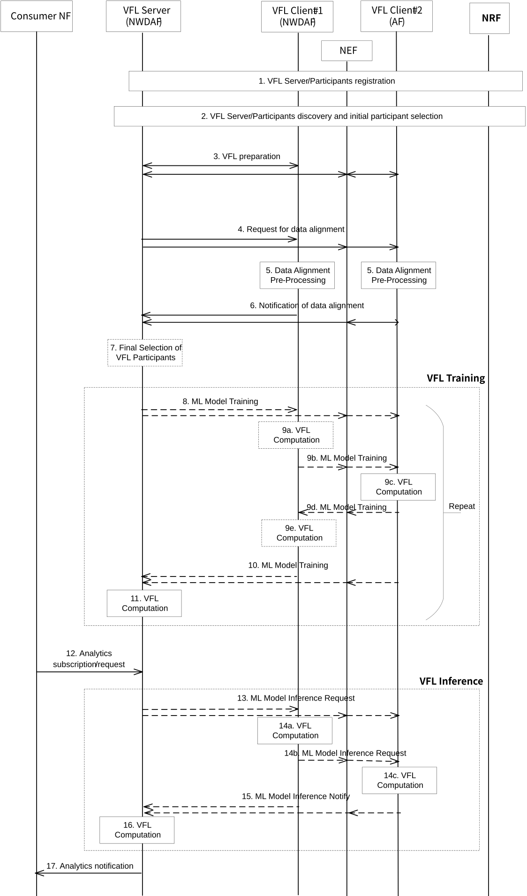

# 6.16 Solution \#16: Support for VFL with NWDAF and AF as Participants

## 6.16.1 Description

This solution addresses use case \#4 and key issue \#2. Unlike traditional centralized learning approaches, where data is pooled together in a single location, or Horizontal Federated Learning (HFL), where different entities contribute similar types of data about different samples, VFL allows for the collaborative training of machine learning models across entities that hold different types of information about the same entities or events.

The solution introduces support for VFL with NWDAF and AF as participants (active and/or passive) by means of enabling data alignment (i.e. sample and feature alignment) among entities participating in the VFL training process with a new service operation. This new service operation allows guaranteeing that training samples are the same in the participating entities even though their training features are different. The solution requires a VFL server guiding the training and distributed inference processes and VFL participants following the VFL server instructions. NWDAF is the NF acting as VFL server in this solution.

This solution applies to intra 5GC VFL or 5GC to AF VFL.

## 6.16.2 Procedures

NOTE 1: In this solution, the VFL server coordinates the VFL operation and acts as active participant with access to labels.

NOTE 2: VFL clients in this solution can be either VFL active participants with access to labels or VFL passive participants without access to labels.

NOTE 3: In this solution, NWDAF instances contain both MTLF and AnLF. VFL training phase involves MTLF and VFL inference involves AnLF. If MTLF and AnLF are not co-located, the trained local model is shared by MTLF to the consumer AnLF.

NOTE 4: Storage of models in ADRF is out of the scope of this solution. This does not prevent storage of models for VFL from being pursued in normative work.

NOTE 5: Existing Rel-18 capabilities for model identification in HFL are assumed to be reused for VFL. Whether one or multiple model identifiers are required can be discussed in normative work.

NOTE 6: NWDAF instances in this solution are assumed to have both MTLF and AnLF capabilities.

NOTE 7: Specification impacts of multiple active participants and sharing of intermediate results between VFL clients requires further discussion.

Figure 6.16.2-1: Procedure for VFL with NWDAF and AF as Participants

The procedure in Figure 6.16.2-1 to support VFL operation at NWDAF is described step by step below.

1\. VFL server (i.e. NWDAF) and VFL clients (i.e. NWDAF, AF) entities register to NRF. The registration may include their NF profiles, Analytics ID(s), Address information of NWDAF, Service Area, VFL capability type information (i.e. VFL server/clients and VFL participant type) and Time interval supporting VFL. The latter parameter can be the same as Time interval supporting FL described in clause 5.2 of TS 23.288 \[5\].

NOTE 8: VFL participant type parameter can have the value of 'active' or 'passive'.

2\. The VFL server and clients are discovered via NRF by invoking the Nnrf_NFDiscovery_Request service operation. The initial selection of VFL clients by the VFL server may happen here. The selection of VFL clients by the VFL server may also be finalized in step 7.

NOTE 9: Details of the discovery mechanism are not within the scope of this solution.

3\. The VFL server sends a VFL preparation request to the VFL clients. For NWDAF clients, the existing service operations Nnwdaf_MLModelTrainingInfo_Request or Nnwdaf_MLModelTraining_Subscribe may be reused and enhanced, or a new service may be defined. For AF clients, a new AF/NEF service is required. Either way, the ML Preparation Flag is provided to check if the VFL clients can meet the ML model training requirement (e.g. Analytics ID, ML Model Interoperability information, Available data requirement, Availability time requirement, etc.). The VFL clients may respond to the VFL server indicating whether they will join the VFL operation and may include the reason in the response message if it cannot join the VFL operation.

4\. The VFL server may determine the list of required features and target samples and sends a request for data alignment (i.e. samples and features) including information required for feature and samples alignment to the VFL clients, via NEF for AF clients. This new service/service operation is required to facilitate the alignment of datasets from different sources in a VFL environment. It ensures that participating entities work with a common set of samples without revealing sensitive data. In addition, these samples are the intersection of different datasets where each entity has different features (information or attributes) for the same set of entities or individuals.

NOTE 10: In some cases (e.g. for third-party AF acting as VFL client) feature alignment and corresponding information exchange between VFL server and VFL clients is optional.

NOTE 11: VFL related discovery, preparation and data alignment steps (steps 2, 3, 4) could be combined.

Required inputs of this service operation include dataset identifiers (i.e. unique identifiers for the datasets held by each VFL client), alignment technique (i.e. specific methods or algorithms to be used for data alignment, such as Private Set Intersection (PSI), feature hashing, or other techniques that ensure data privacy and integrity) and Notification Target Address. Optional inputs may include an alignment correlation ID, expiry time, and additional data alignment information such as challenges or discrepancies encountered in the data alignment process.

NOTE 12: Existing service operations (e.g. Nnwdaf_MLModelTraining_Subscribe, Nnwdaf_MLModelTrainingInfo_Request) may also be enhanced to include feature and sample information for interactions between VFL clients.

5\. Each VFL client performs data alignment pre-processing. This is required for each VFL client to ascertain its capability to meet the AI/ML model training requirements. Data alignment pre-processing may include model training demands feasibility assessment, model access and compatibility, data alignment verification, etc. At this step, VFL passive clients may determine a list of supported features and samples. A VFL client may determine the list of supported features (e.g. a subset of the list of required features shared by active client) and the list of supported samples (e.g. a subset of target samples shared by active client) based on the information received from the VFL Server, its available data, corresponding NF type(s) or instances of the requested analytics ID, recent data collection operations, and ML Model Interoperability information.

6\. The VFL clients notify the VFL server the result of the data alignment, via NEF for AF clients. Furthermore, the VFL clients may provide the VFL server with a decision regarding its participation in the VFL operation along the supported features and sample IDs identified (if any). The VFL clients may also include the reason in the response message if it cannot join the VFL operation.

7\. If not completed at step 4, the selection of VFL clients by the VFL server may be performed or refined based on the inputs received by the VFL server from the VFL clients. At this step, VFL server may perform sample alignment by identifying overlap/intersection of supported samples of all VFL client. A VFL client selected in step 4, may be excluded from VFL training if the list of its supported samples has zero or very little overlap with supported samples of other VFL clients.

Based on supported feature of each VFL client (feature dimension of each VFL client), VFL server may also decide how to partition data features between VFL servers and assigns a subset of features to each VFL client. A VFL client selected in step 4 may be excluded from VFL training if the list of its supported feature has zero overlap with the list of required features. As the 3GPP specified analytics IDs require input data from different domains including 5GC and AF, a domain-based feature selection for cross domain VFL can be used where each domain performs VFL training based the data owned by that domain (i.e. AF performs VFL training based on AF data and 5GC performs VFL training based on 5GC data). However, within each domain also, it is important to decide how to vertically divide data features among multiple VFL clients. For example, observed service experience analytics ID, within 5GC domain, requires input data from AMF, SMF and UPF. In one approach, VFL clients may perform VFL training based on AMF, SMF and UPF data together. In another approach, each VFL client may perform VFL training based on different NF type.

8\. The VFL training process starts on this step, where intermediate training results are shared and coordinated by the VFL server, facilitating a collaborative approach to model refinement across the VFL clients. In the first iteration, the VFL server triggers the VFL training process by invoking a ML Model Training service subscription operation from the VFL Client \#1 (NWDAF). In the subsequent iteration, the VFL server may need to use the ML Model Training service notification operation with the Client \#2 (or last client if more than two) (AF via NEF) to enable model refinements in each client. Subsequent iterations may require the VFL server to subscribe or notify from/to either VFL client using the ML Model Training service. While the existing Nnwdaf_MLModelTraining service can be used for NWDAF clients, a new service at the NEF/AF is required to support this functionality. In the last iteration, the VFL server informs the VFL clients that the VFL training process is completed via a suitable flag, steps 10 through 12 are skipped, and the VFL training loop is terminated.

Alternatively, in each iteration the VFL server contacts both VFL clients in this step and may share intermediate training data related to the VFL process.

NOTE 13: VFL clients may need to share information among themselves during training and inference in situations where a deep learning model is split into parts, and each VFL client processes a specific segment of the model's computation, e.g. split neural networks.

9a. The VFL Client \#1 may perform computation to locally train its model. The computation may lead either to intermediate training results/loss to be shared to the next VFL client in step 9b, or to refine a previously trained model and notify the VFL server in step 10.

9b. The VFL Client \#1 may share its intermediate training results via NEF with the AF client, using the same service operations as in step 8.

9c. Client \#2 (i.e. last VFL client) performs computation to locally train its model. The computation may lead either to intermediate training results to be shared with the VFL server in step 11, or to refine a previously trained model and the previous VFL client in step 10d.

9d. The VFL Client \#1 performs computation to refine its local model.

10\. Intermediate training results and/or model refinement results are shared with the VFL server, via NEF if from AF, using the same ML model training service used in step 9.

11\. The VFL server performs further VFL computation to perform local training using the intermediate results received from the VFL client(s) and/or calculate the loss using the labels.

12\. A consumer NF subscribes to or requests analytics from the NWDAF hosting VFL server functionality that includes AnLF.

13\. A distributed VFL inference process is triggered by the VFL server invoking a ML model inference request from VFL Client \#1. This step can be executed with a new service or by enhancing the existing ML Model Training service since the required VFL computation is essentially the same for inference and some training cycles. The VFL server may also request VFL Client \#2 to perform local inference via NEF.

14a.Participant \#1 performs local inference computation.

14b.Participant \#1 may share intermediate inference results with VFL Client \#2 via NEF when VFL Client \#2 is an AF. In that case, the NEF/AF service used may be new or an enhanced version of the new NEF/AF service already used in step 9.

14c.VFL Client \#2 performs local inference computation.

15\. VFL Client \#2 (i.e. the last VFL client) notifies the result of the distributed inference process to the VFL server using the same service as in step 14 via the notification operation. In this step, VFL Client \#1 may also share its local inference results with VFL server if not shared with another VFL client before.

16\. The VFL server performs further inference computation aggregating intermediate inference results received from the VFL client(s) and derives the requested analytics.

17\. The derived analytics are delivered to the NF consumer.

## 6.16.3 Impacts on services, entities and interfaces

**NWDAF:**

\- New service to support data alignment.

\- Enhancements to Nnwdaf_MLModelTraining service (or new service(s)) to support VFL preparation as well as sharing of intermediate training and inference results.

**NEF/AF:**

\- New service to support data alignment.

\- New service(s) to support VFL preparation as well as sharing of intermediate training and inference results.
