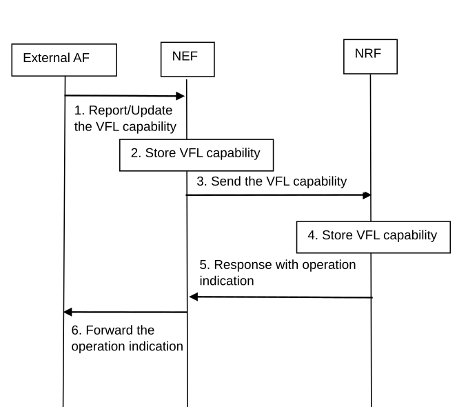
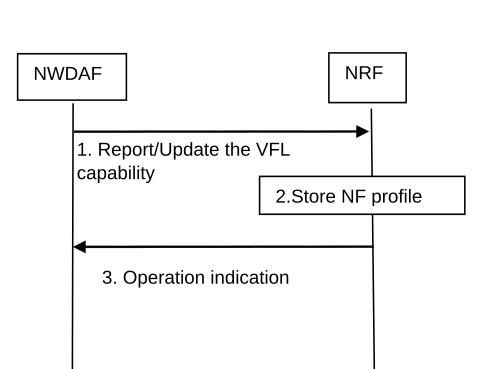
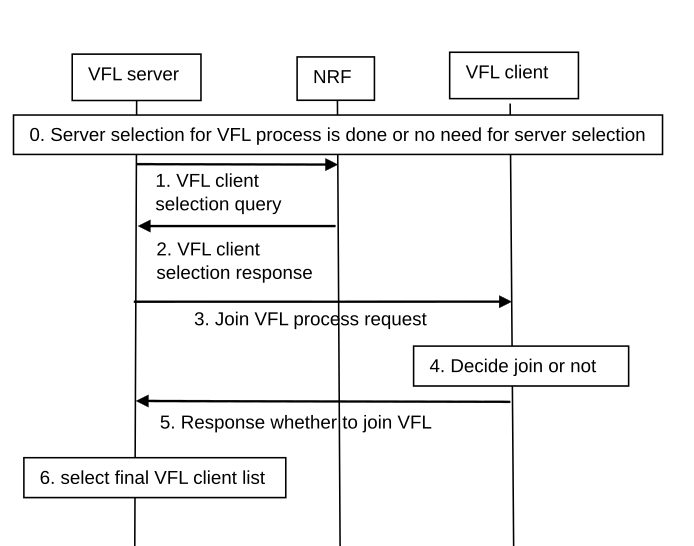

# 6.17 Solution \#17: NF discovery and selection for VFL

## 6.17.1 Description

The VFL process may include NWDAF and external AF. This solution proposes to do NF discovery process through NRF. The NWDAF can report/update its VFL capability to NRF and external AF can report its VFL capability to NRF via NEF. After reporting the VFL capability, the VFL server can select VFL client afterwards. Below are the terminology definitions of this solution:

\- VFL sever: An NF with labels for a VFL training task that may have related inputs data.

\- VFL client: An NF with the required inputs data without the required labels for a VFL training task. There can be multiple passive participants in VFL.

NOTE: The VFL server is equivalent to VFL active participant and VFL client is equivalent to VFL passive participant in this solution.

## 6.17.2 Procedures

### 6.17.2.1 External AF VFL capability report

The 2-side VFL capability reporting process of external AF can be conducted as follows:

Figure 6.17.2-1: VFL capability report for External AF

1\. External AF reports or updates its VFL capability(i.e. VFL server, VFL client, VFL server and client) and its AF ID to NEF.

2\. NEF store the VFL capability and AF ID of external AF in the UnTrustAfInfo.

Editor's note: Whether NEF stores the VFL capability of external AF is FFS.

3\. NEF sends the VFL capability and AF ID of external AF to NRF.

4\. NRF stores the VFL capability.

5\. NRF response NEF with operation indication(i.e. operation successful, operation fail).

6\. The NEF forwards the operation indication to external AF.

### 6.17.2.2 NWDAF VFL capability report

The 2-side VFL capability reporting process of NWDAF can be conducted as follow:

Figure 6.17.2-2: VFL capability report for NWDAF

1\. NWDAF reports/updates its VFL capability (i.e. VFL server, VFL client, VFL server and client) to NRF in its NF profile.

2\. NRF stores the NF profile of NWDAF.

3\. The NRF response with operation indication (i.e. operation successful, operation fail).

### 6.17.2.3 Client selection process of VFL

The client selection process of VFL can be conducted as follows:

Figure 6.17.2-3: Client selection process of VFL

0\. The procedure above assumes the VFL server selection is done, or no need for VFL server selection.

1\. The VFL Server NWDAF discovers and selects other NWDAF(s) containing MTLF as VFL Client NWDAF(s) from NRF by invoking the Nnrf_NFDiscovery_Request service operation. The following criteria might be used: Analytic ID, FL capability Type (i.e. VFL client), Service Area, NF type(s) of data sources from which the VFL Client NWDAF is able to collect data for local model training, Time Period of Interest, ML Model Interoperability Indicator, NF consumer information.

Editor's note: Whether features of VFL clients need to be considered for client selection is for FFS.

2\. The NRF response with a list of VFL client candidates.

3\. VFL Server NWDAF sends Federated Learning joining requests to the VFL Client. In the joining request, it may specify the type of loss that will be used in the VFL process and the maximum response time for every training iteration of the VFL process.

4\. The VFL client checks whether it supports doing gradient calculations base on the type of loss and whether it can send intermediate training results to VFL server in maximum response time. The VFL client makes a final decision on whether to join VFL.

5\. The VFL client sends a response with its final decision.

6\. VFL Server determines the final list of VFL Client to be involved in the VFL procedures.

Editor's note: Whether separate NF discovery procedures are needed for VFL training and VFL inference is for FFS.

## 6.17.3 Impacts on existing services, entities and interfaces

To implement the solution above, The AF and NWDAF shall report its VFL capability to NRF. The NEF shall be involved in helping external AF for the VFL capability reporting. On the other side, the VFL server shall have the ability to select VFL client(s) base on the criteria mentioned in clause 6.17.2.3. The NRF shall have the ability to return VFL client candidate list.
