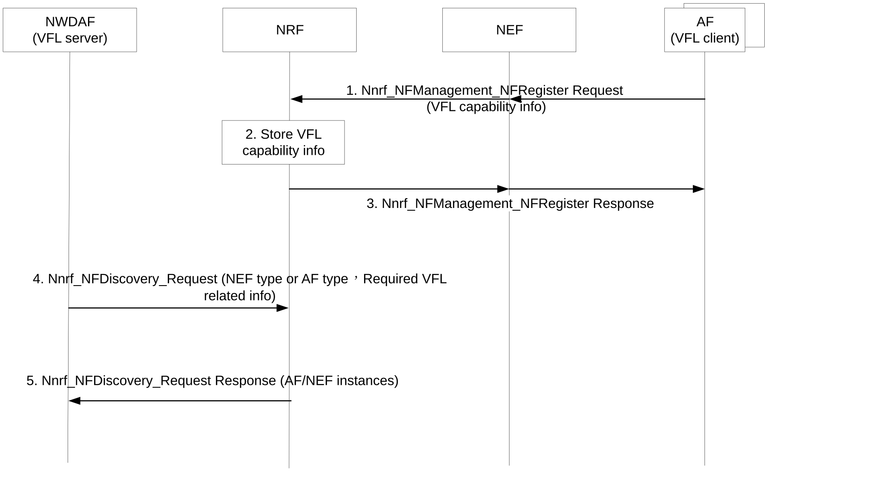
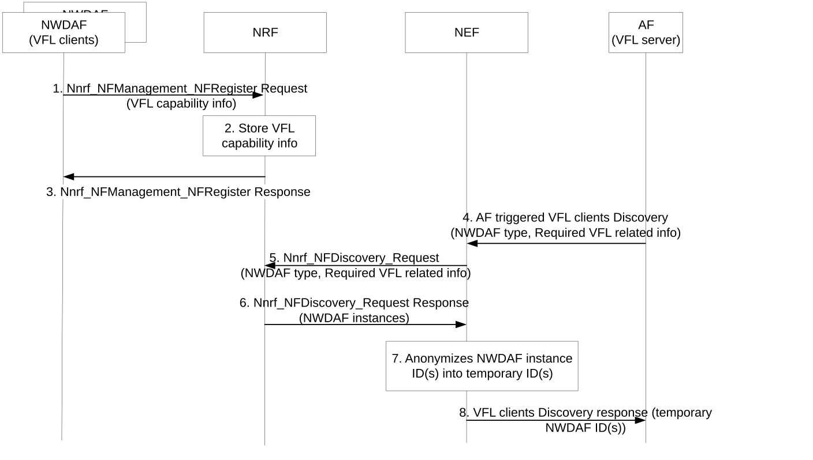
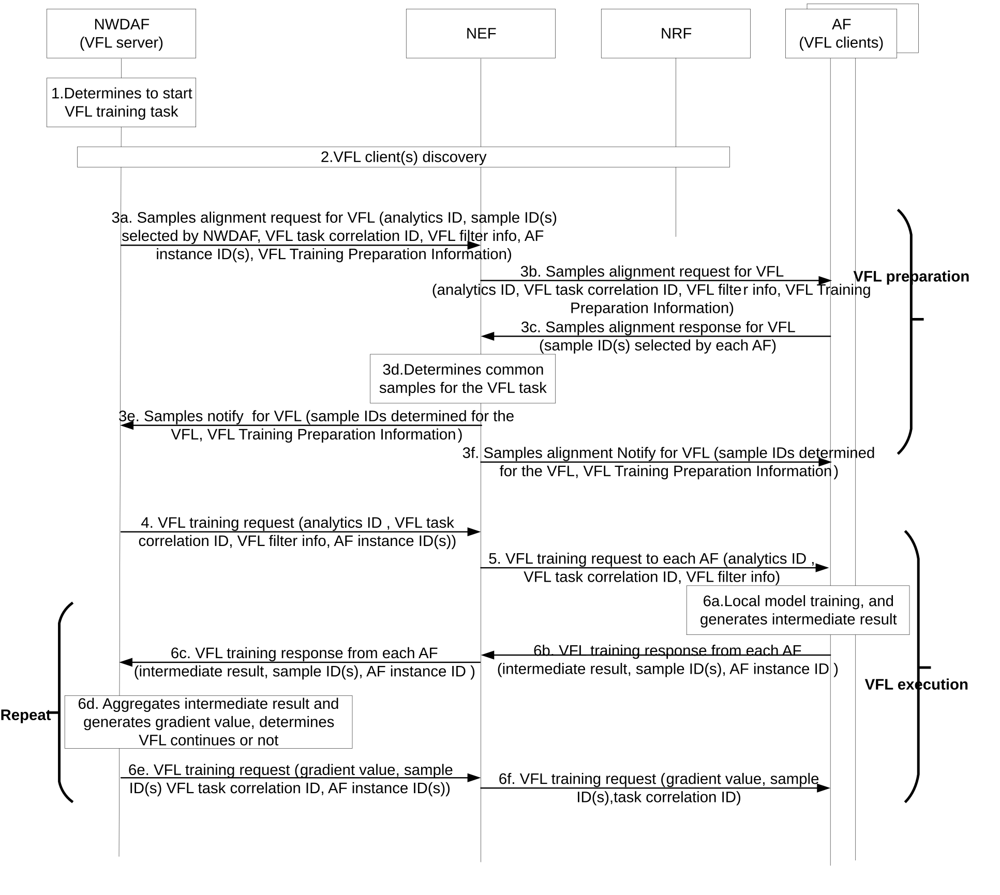
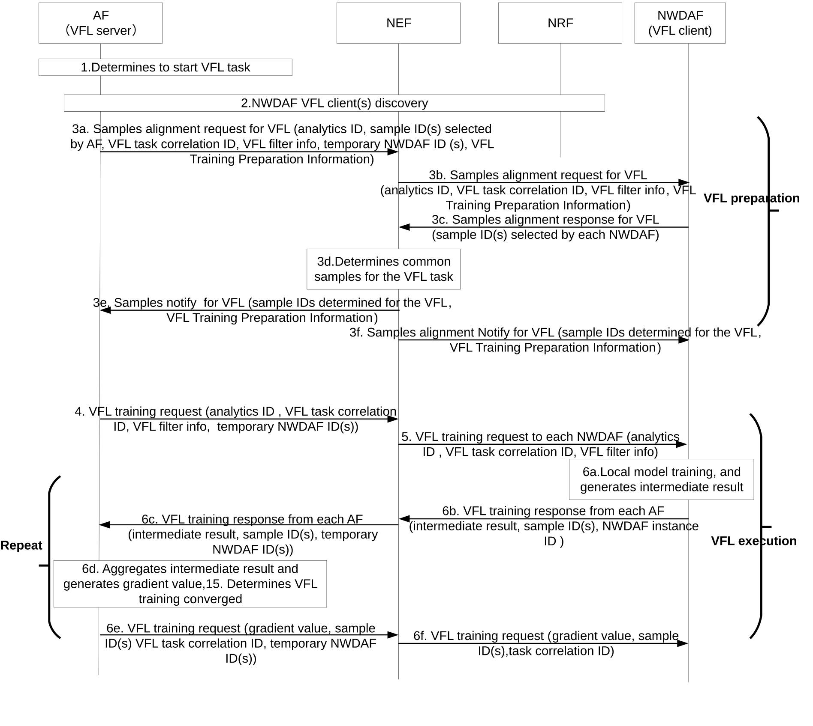
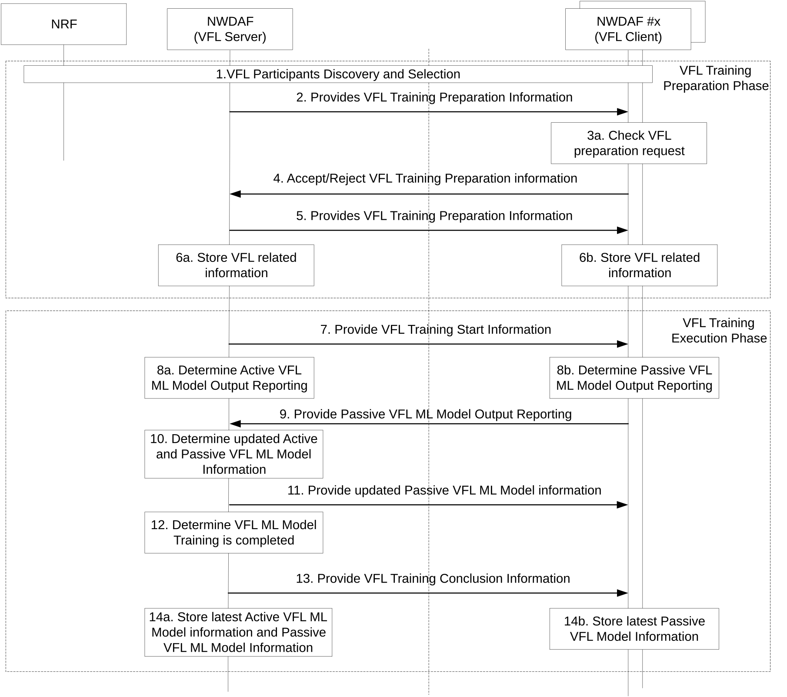
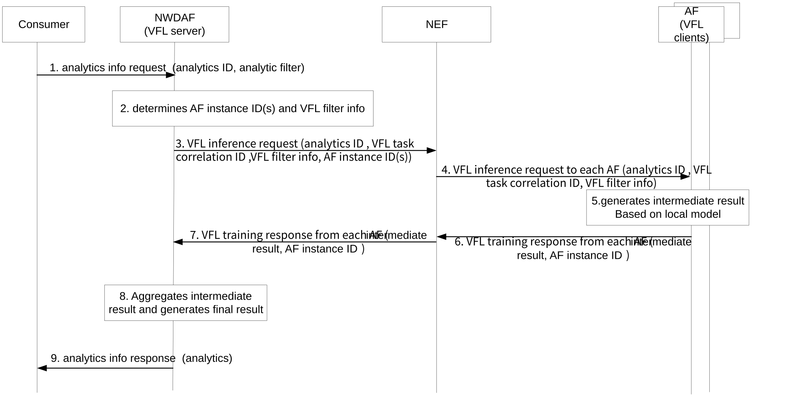
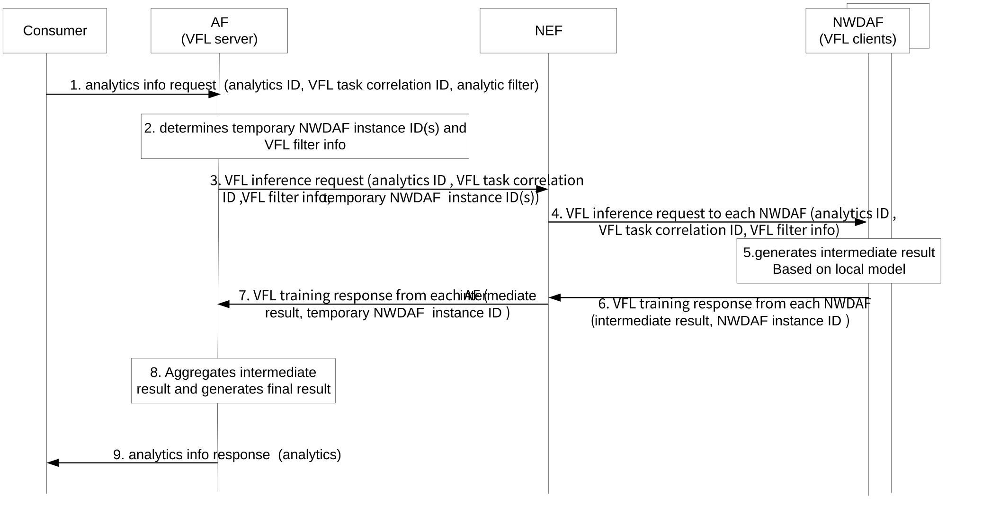
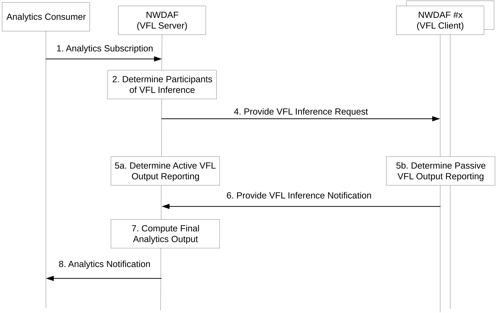

# 6.18.2 Procedures

## 6.18.2.1 Discovery and selection of VFL clients

### 6.18.2.1.1 Discovery and selection of AF(s) if NWDAF as the VFL server

Figure 6.18.2.1.1-1: Registration and discovery of AF(s) for VFL

1-3. The AF registers its NF profile as defined in clause 5.2.7.2.2 of TS 23.502 \[3\], with the difference it includes the Supported VFL capability information (VFL capability type (e.g. VFL Server (VFL active participants) and/or VFL Clients (VFL passive participants)), Time interval supporting VFL Vendor and/or Interoperability related information) into NRF via NEF. The NRF stores the NF profile of AF a. The Time interval supporting VFL indicates when the AF could coordinate/participant in a VFL procedure.

Editor's note: It is FFS whether VFL clients for specific features and analytics IDs can be selected.

NOTE: The untrusted AF could register indirectly via NEF.

4-5. The consumer (e.g. NWDAF acts as VFL server) is to discover the AF(s) supporting VFL via the NRF by invoking the Nnrf_NFDiscovery_Request (including required NF type (e.g. AF type), required VFL capability information) service operation. The NRF notifies the consumer with one or more AF instances IDs. The required VFL capability information may include required VFL capability type (i.e. VFL client), Time period of Interest.

### 6.18.2.1.2 Discovery and selection of NWDAF(s) if AF as the VFL server

Figure 6.18.2.1.2-1: Registration and discovery of NWDAF for VFL

1-3. The NWDAF registers its NF profile as defined in clause 5.2.7.2.2 of TS 23.502 \[3\], with the difference it includes the Supported VFL capability information (VFL capability type (e.g. VFL Server (VFL active participants) and/or VFL Clients (VFL passive participants)), Time interval supporting VFL, Vendor and/or Interoperability related information) into NRF. The NRF stores the NF profile of NWDAF. The Time interval supporting VFL indicates when the NWDAF could coordinate/participant in a VFL procedure.

Editor's note: It is FFS whether VFL clients for specific features and analytics IDs can be selected.

4-8. The consumer (e.g. AF acts as VFL server) is to discover the NWDAF supporting VFL via the NEF by invoking a VFL clients discovery service including required NF type (e.g. NWDAF type), required VFL capability information. The required VFL capability information may include required VFL capability type (i.e. VFL client), Time period of Interest.

The NEF interacts with the NRF by invoking the Nnrf_NFDiscovery_Request including required NF type, required VFL capability information. The NRF notifies the NEF with one or more NWDAF instances.

The NEF anonymizes NWDAF instances ID(s) into temporary NWDAF ID(s) and returns the temporary NWDAF ID(s) to the AF.

Editor's note: Whether temporary NWDAF ID(s) is needed and feasible is FFS.

## 6.18.2.2 VFL training procedure between NWDAF and AF

The following principles are defined for the VFL Joint ML Model training procedures:

\- If AF is involved in the VFL Joint ML Model training process, it is assumed that such AF is capable to perform model training.

\- If NEF is required for the interaction with 3rd party AFs, NEF services are extended in order to properly support the exchange of information between AF and NWDAFs performing the VFL training/inferencing.

Editor's note: Whether and how the locally trained Models via VFL is stored is FFS.

### 6.18.2.2.1 VFL training procedure if NWDAF acts as the VFL server

Figure 6.18.2.2.1-1: VFL training procedure when NWDAF acts as the VFL server

1\. If an ML model needs to be trained on local data set(s) from data source(s) (e.g. NF and AF), which have different feature spaces for the same samples (e.g. UE IDs), the NWDAF as the VFL server determines to use Vertical Federated Learning mechanism if some data cannot be obtained directly from data source AF(s) (e.g. due to data privacy, data security).

2\. The NWDAF selects AF(s) to participate the Vertical Federated Learning procedure by discovering from the NRF, as described in clause 6.18.2.1.1.

**Vertical Federated Learning preparation procedure:**

3a-3f. The NWDAF starts samples alignment procedure with AF(s) via NEF with VFL Training Preparation Information, and then it will obtain common sample ID(s) for the VFL task from NEF, which are determined by the NEF comparing sample ID(s) from NWDAF and AF(s).

The VFL Training Preparation Information may comprises:

\- Indication of VFL capability type to be performed by the NF receiving the VFL Training Preparation Indication;

\- VFL Training Information (e.g. category of output: discrete value, e.g. related to classification algorithms; or continuous value, e.g. regression algorithms, the maximum response time for every training iteration of the VFL process);

Editor's note: Whether VFL training information is needed and the content of it is FFS.

\- analytics ID;

\- VFL task correlation ID;

\- sample ID(s) selected by NWDAF;

\- feature spaces information selected by NWDAF.

NOTE: VFL task correlation ID is to correlate the participants during the VFL training and VFL inference processes, and it is associated with the distributed ML Models in the VFL joint model training process, whether it should be revised to another name will be determined in normative phase.

Editor's note: Whether VFL clients can be reselected and samples should be re-aligned during the VFL training process are FFS.

**Vertical Federated Learning execution procedure:**

4\. To start VFL training procedure, The NWDAF sends VFL training request to NEF including analytics ID, the VFL task correlation ID, and AF instance ID(s) selected in step 2.

5\. The NEF transfers the VFL training request to each AF.

6a. Based on local data set, each AF does local model training for the VFL task and generates intermediate result base on it.

6b-6c. Each AF sends the intermediate result (i.e. Passive VFL ML Model Output Reporting) to The NWDAF via NEF

6d. The NWDAF compiles the intermediate results from AF(s) and its own intermediate result calculated with its local model to calculate the loss function value. And it determines whether the VFL training is converged or reaches the convergence requirement.

6e-6f. The NWDAF returns the intermediate result to corresponding AF via NEF.

Steps 6a-6f will be repeated until the VFL training procedure is finished. The NWDAF sends a notification that the ML Model is trained to AF(s) including the Analytics ID, and the indication that the ML Model is trained.

### 6.18.2.2.2 VFL training procedure if AF acts as the VFL server

Figure 6.18.2.2.2-1: VFL training procedure when AF acts as the VFL server

1\. If the ML model needs to be trained on local data set(s) from data source(s) (e.g. NF and AF), which have different feature spaces for the same samples (e.g. UE IDs), AF as the VFL server determines to use Vertical Federated Learning mechanism if some data cannot be obtained directly from data source NWDAF(s) (e.g. due to data privacy, data security).

2\. The AF selects NWDAF(s) to participate the Vertical Federated Learning procedure by discovering from the NEF and NRF, as described in clause 6.18.2.1.2.

Editor's note: Whether multiple NWDAF(s) can be involved when Active AF initiated the VFL is FFS.

**Vertical Federated Learning preparation procedure:**

3a-3f. The AF starts samples alignment procedure with NWDAF(s) via NEF with, VFL Training Preparation Information, and then it will obtain common sample ID(s) for the VFL task from NEF, which are determined by the NEF comparing sample ID(s) from AF and NWDAF(s).

The VFL Training Preparation Information may comprises:

\- Indication of VFL capability type to be performed by the NF receiving the VFL Training Preparation Indication;

\- VFL Training Information (e.g. category of output: discrete value, e.g. related to classification algorithms; or continuous value, e.g. regression algorithms, the maximum response time for every training iteration of the VFL process);

Editor's note: Whether VFL training information is needed and the content of it is FFS.

\- analytics ID;

\- VFL task correlation ID;

\- AF instance ID(s);

\- sample ID(s) selected by NWDAF;

\- feature spaces information selected by NWDAF;

\- temporary NWDAF ID(s) as defined in clause 6.18.2.1.2.

**Vertical Federated Learning execution procedure:**

4\. To start VFL training procedure, the AF sends VFL training request to NEF including analytics ID, the VFL task correlation ID, and temporary NWDAF ID(s) selected in step 2.

5\. The NEF transfers the VFL training request to each NWDAF.

6a. Based on local data set, each NWDAF does local model training for the VFL task and generates intermediate result base on it.

6b-6c. Each NWDAF sends the intermediate result (i.e. Passive VFL ML Model Output Reporting) to the AF via NEF

6d. The AF compiles the intermediate results from NWDAF(s) and its own intermediate result calculated with its local model to calculate the loss function value. And it determines whether the VFL training is converged or reaches the convergence requirement.

6e-6f. The AF return the intermediate result to corresponding NWDAF via NEF with temporary NWDAF ID(s).

Steps 6a-6f will be repeated until the VFL training procedure is finished. The AF sends a notification that the ML Model is trained to NWDAF(s) including the Analytics ID, and the indication that the ML Model is trained.

## 6.18.2.3 VFL training procedure among NWDAFs

The following principles are defined for the VFL Joint ML Model training procedures:

\- An NWDAF (VFL Server) with VFL Capability for performing VFL ML Training can initiate the process VFL joint Training Process.

NOTE 1: The procedures illustrated in 6.18.2.3-1 show the NWDAF (VFL Server), i.e. Active VFL Participant, initiating the VFL Joint ML Model Training but does not preclude the Passive Participants (VFL Clients) for initiating the VFL Joint ML Model Training.

\- An NWDAF (VFL Server) is able to coordinate the VFL training process among the VFL participants for a VFL Joint ML Model Training Process (i.e. associated with a VFL task correlation ID).

Figure 6.18.2.1.1: VFL Joint Model Training with Active NWDAF and Passive NWDAFs

1\. The NWDAF (VFL Server) identifies the need to start a VFL process. The VFL Server is capable to discover the other NWDAFs (VFL Clients) for performing VFL joint ML Model training. Based on the VFL related configurations available at such NF and the information about the discovered participants, the VFL Server determines the VFL Participant Information required for the VFL joint model training to be executed.

NOTE 2: The procedure defined in 6.18.2.1.2 is used for the discovery and selection of the VFL participants.

**Vertical Federated Learning preparation procedure:**

2\. Based on the VFL related configuration and VFL Participant Information, the VFL Server determines the VFL Training Preparation Information. The VFL Server sends to each of the VFL Client the VFL Training Preparation Information. The VFL Training Preparation Information may comprises:

\- Indication of VFL capability type to be performed by the NF receiving the VFL Training Preparation Indication;

\- VFL Training Information (e.g. category of output: discrete value, e.g. related to classification algorithms; or continuous value, e.g. regression algorithms, the maximum response time for every training iteration of the VFL process);

Editor's note: Whether VFL training information is needed and the content of it is FFS.

\- VFL task correlation ID;

\- VFL filter information;

\- analytics ID;

\- sample ID(s);

\- feature spaces information.

3\. Each VFL Client based on the received VFL Training Preparation Information and the VFL related configuration locally available, determines whether it can associate its training process of a local ML model to the VFL joint model training process with the requested requirements and alignment information comprised in the VFL Training Preparation Information.

4\. In case the requested preparation can be performed, the VFL Client sends to the VFL Server a response with a confirmation, otherwise it sends a response with a rejection.

5\. The VFL Server determines the VFL Training Preparation Phase is completed

6a, 6b. Each VFL participant store the mapping of their local VFL related information to the VFL task correlation ID.

**Vertical Federated Learning execution procedure:**

7\. When the VFL Server determines that the VFL joint model training should start, the VFL Server provides to the VFL Client(s) the following information: analytics ID, the VFL task correlation ID,)

8\. (a,b) The VFl Server and the VFL Client(s) start the training of their local ML model (i.e. Active ML Model at the VFL Server and the Passive ML Model(s) at the VFL Client (s)) associated with the VFL task correlation ID.

The VFL Server and the VFL Client(s) each execute one round of training process to generate, respectively the Active VFL ML Model Output Reporting and Passive VFL ML Model Output Reporting.

NOTE 3: The data used by VFL Server and the VFL Client is collected as per alignment information defined in the preparation phase.

9a, 9b. The VFL Client provides the Passive VFL ML Model Output Reporting to the VFL Server, which comprise the intermediate results of the model training round.

10\. The VFL server compiles the intermediate results from VFL clients(s) and its own intermediate result calculated with its local model to calculate the loss function value.

11\. The VFL Server provides to the VFL Client(s) the intermediate result.

12\. The VFL Server determines that the joint model training is completed.

NOTE 4: The steps 6 to 9 are repeated executed until the VFL Server determines the performance of the jointly trained models is enough to stop the training (e.g. loss function value is converged).

14a, 14b. Each VFL participant, stores the latest information about their locally trained Models associated with the VFL task correlation ID.

## 6.18.2.4 VFL inference procedure between NWDAF and AF

### 6.18.2.4.1 VFL inference procedure if NWDAF acts as the VFL server

Figure 6.18.2.4.1-1: VFL inference procedure when NWDAF acts as the VFL server

1\. To obtain analytics, the NF consumer sends analytics info request to NWDAF with analytics ID, Target of Analytics Reporting and analytics filter.

Editor's note: Whether the NWDAF in this step is the NWDAF acted as VFL sever in VFL model training procedure or another NWDAF containing AnLF is FFS.

2\. For the analytics info request, if the NWDAF as the VFL server decides to do inference based on the ML model jointly trained via VFL mechanism, it determines the VFL task correlation ID, and corresponding AF instance ID(s), which participated in the VFL training procedure to jointly train the ML model.

3-4. The NWDAF sends VFL inference request to corresponding AF(s) via NEF a VFL Inference Request, containing: a flag that indicates the passive participants to start to perform VFL model inference, the VFL task correlation ID, corresponding AF instance ID(s), analytics ID, and VFL inference timing information that indicates the time aspects for the sample alignment and may include:

\- Data timestamp(s): indicates one or more timestamps at which the inference data for VFL inference process is collected.

\- Data time window(s): indicates one or more time windows at which the inference data for VFL inference process is collected.

\- VFL Inference trigger: indicates the condition for triggering the model inference. For example, the passive participant will collect data and perform model inference when UE reaches a certain area.

5\. Each AF generates intermediated result based on local input data using the trained local model corresponding to the VFL task correlation ID.

6-7. Each AF sends the intermediated result to the NWDAF as the VFL server via NEF. 8. The NWDAF as the VFL server aggregates the intermediated result from each AF(s).

9\. The NWDAF sends analytics info response to the NF consumer with the generated final result.

NOTE: Any privacy preserving method for sharing intermediate results is to be defined by SA WG3.

### 6.18.2.3.2 VFL inference procedure if AF acts as the coordinator

Figure 6.18.2.4.2-1: VFL inference procedure when AF acts as the VFL server

1\. To obtain analytics, the NF consumer sends analytics info request to AF with analytics ID, Target of Analytics Reporting and analytics filter.

2\. For the analytics info request, if the AF as the VFL server decides to do inference based on the ML model jointly trained via VFL mechanism, it determines the VFL task correlation ID, and corresponding temporary NWDAF instance ID(s), which participated in the VFL training procedure to jointly train the ML model.

Editor's note: Whether multiple NWDAF(s) can be involved when Active AF initiated the VFL is FFS.

3-4. The AF sends VFL inference request to corresponding NWDAF(s) via NEF a VFL Inference Request, containing: a flag that indicates the passive participants to start to perform VFL model inference, the VFL task correlation ID, corresponding temporary NWDAF ID(s), analytics ID, and VFL inference timing information that indicates the time aspects for the sample alignment and may include:

\- Data timestamp(s): indicates one or more timestamps at which the inference data for VFL inference process is collected.

\- Data time window(s): indicates one or more time windows at which the inference data for VFL inference process is collected.

\- VFL Inference trigger: indicates the condition for triggering the model inference. For example, the passive participant will collect data and perform model inference when UE reaches a certain area.

5\. Each NWDAF generates intermediated result based on local input data using the trained local model corresponding to the VFL task correlation ID.

6-7. Each NWDAF sends the intermediated result to the AF as the VFL server via NEF with the temporary NWDAF ID(s).

8\. The AF as the VFL server aggregates the intermediated result from each NWDAF(s).

9\. The AF sends analytics info response to the NF consumer with the generated final result.

Editor's note: It is FFS if AF can directly offer analytics to the 5GC consumer or not.

NOTE: Any privacy preserving method for sharing intermediate results is to be defined by SA WG3.

## 6.18.2.5 VFL inference procedure among NWDAFs

Figure 6.18.2.5-1 illustrated the procedure for analytics subscription at an NWDAF with an Active participant role (i.e. VFL Server) and the generation of the analytics output based on VFL inference process.

NOTE: The procedure in Figure 6.18.2.5-1 supports the Use Case \#4.

The proposed procedure for VFL inference is based on the following principles:

\- The VFL process executed for analytics generation is transparent to the Analytics Consumer.

\- NWDAF is the entity that determines whether VFL inference process is applicable to a subscription/request from an Analytics Consumer.

Figure 6.18.2.5-1: VFL Joint inference among NWDAFs

1\. The Analytics Consumer discover the appropriated NWDAF (VFL Server) to subscribe or request an analytics.

2\. The NWDAF (VFL Server) determines that VFL inference should be performed and identifies it has the VFL Active Role for a VFL inference process associated with a VFL task correlation ID. The NWDAF with Active VFL Participant Role (VFL Server) determines the VFL Participants, i.e. further NWDAFs) for the VFL process associated with a VFL task correlation ID.

4\. The VFL Server provides to the determined VFL Clients (i.e. Passive NWDAF(s)) a VFL Inference Request, containing: a flag that indicates the passive participants to start to perform VFL model inference, the VFL task correlation ID, analytics ID, and VFL inference timing information that indicates the time aspects for the sample alignment and may include:

\- Data timestamp(s): indicates one or more timestamps at which the inference data for VFL inference process is collected.

\- Data time window(s): indicates one or more time windows at which the inference data for VFL inference process is collected.

\- VFL Inference trigger: indicates the condition for triggering the model inference. For example, the passive participant will collect data and perform model inference when UE reaches a certain area.

5a, 5b. Each participant uses the received VFL task correlation ID to determine the appropriated ML Model to be associated with the VFL Inference process and based on the data of the specified time to generate the local VFL Output Reporting.

6\. Each VFL Client sends the local inference result to the VFL Server including.

7\. The VFL Server aggregates the local inference result from the different VFL Clients to generate the final analytics output result.

8\. The VFL Server sends to the Analytics consumer the analytics notification with the final analytics output result.

NOTE: Any privacy preserving method for sharing intermediate results is to be defined by SA WG3.
