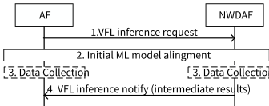

# 6.19 Solution \#19: VFL inference procedure between NWDAF and AF

## 6.19.1 Description

This solution is proposed for KI#2 and Scenario 2 (i.e. AF initiated Scenario) of use case#5 to support the VFL inference procedure between NWDAF and AF. In the VFL model inference, the ML models are aligned, "VFL Passive Participant" NF(s), i.e. NWDAF, send intermediate results to "VFL Active Participant" NF, i.e. AF.

NOTE: The VFL model training is out of scope of this solution and focuses on VFL inference.

Considering the distributed inference nature, the inference procedure involves multiple NF instances. Therefore, the inference for VFL can be categorized into two cases, in terms of the difference between the NF instances that participate in the inference and training.

\- Case 1: The set of NF instances that participate in the inference for VFL (i.e. AF(s) and NWDAF(s)) is same as that participated in the VFL model training. Namely, all the NF instances participate in both VFL model training and inference.

\- Case 2: The set of NFs that participate in the inference for VFL is different from the set of NFs that participated in the VFL model training. Namely, some of the NFs participate in either of VFL model training or inference.

Revisiting the discussion that NWDAF containing MTLF and NWDAF containing AnLF are separately specified, the ML model training capability and inference capability can be supported by different instance. Therefore, Case 2 shall be supported in Rel-19.

To support Case 2, the ML model that will be used in the VFL participants (e.g. ML model that is trained using VFL model training) should be aligned among participants.

## 6.19.2 Procedures

Figure 6.19.2-1: VFL model inference on AF initiated scenario

This clause describes the AF initiated VFL inference procedure to use ML model that trained in the VFL model training procedure. This procedure supports the two cases: case 1) the AF was involved in the VFL model training procedure, and case 2) AF was not involved in the VFL model training procedure. In case 1, the AF has a ML model to be used in the VFL inference. On the other hand, in case 2, the AF may not have or not able to identify a ML model to be used in the VFL inference. In this procedure, NWDAF is required to contain AnLF.

The AF subscribes VFL inference for the NWDAF, and then the NWDAF determines to provides analytics using VFL inference for privacy reason. In case 2, the NWDAF provides an ML model or its identifier that will used in the AF if needed. The NWDAF sends the intermediate results the AF.

1\. The AF subscribes subscription in Nnwdaf_VFL_inference_service (new), via NEF if the AF is untrusted. The subscription request includes ML Correlation ID for VFL, if the AF was involved in the VFL model training procedure (case 1), VFL capability indicator that indicates the capability of AF to perform the ML model inference, and sample alignment information, e.g. UE ID. NWDAF determines to use VFL model inference based on the operator policy, Analytic ID, Service Area/DNAI, and/or UE ID because data that cannot be obtained/exposed directly from data producer NF (e.g. for privacy reasons).

2\. The ML model alignment is conducted between NWDAF and AF(s) if needed. For example, NWDAF may notify the appropriate ML model ID or notify the ML model.

NOTE 1: Whether the ML model transfer is needed requires further discussion.

3\. \[Optional\] Each NF collects its local data associated with the sample alignment information shared in step 1 using the mechanism in clause 6.2 of TS 23.288 \[5\] if the NF does not have local data available already.

4\. NWDAF calculates the intermediate results based on that sample alignment information and reports the intermediate results to AF invoking Nnwdaf_VFL_inference_service_Notify (new) in clause 6.1 of TS 23.288 \[5\]. The notification shall include ML Correlation ID for VFL, sample alignment information, and intermediate results.

NOTE 2: Whether to use the existing or new service operation between the AF and NEF and between the NEF and NWDAF to perform VFL inference requires further discussion.

## 6.19.3 Impacts on Existing Nodes and Functionality

**For AF:**

\- support to request the intermediate results of local ML models from NWDAF (s).

\- support to align the ML model between NWDAF.

**For NWDAF:**

\- support to compute the intermediate results, report the intermediate results to the AF.
