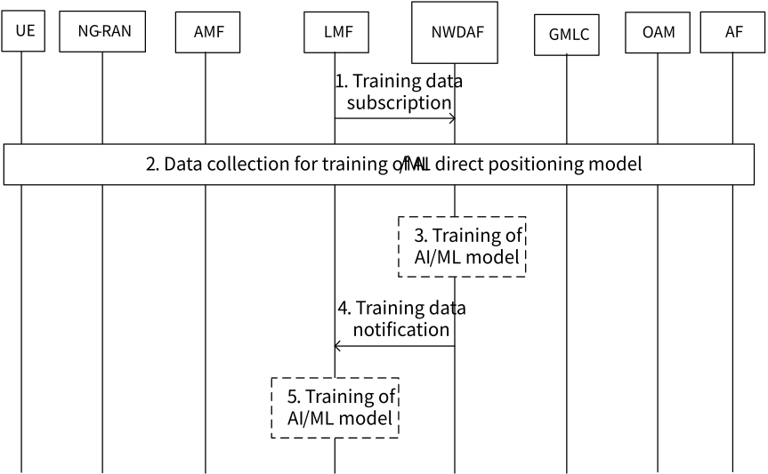
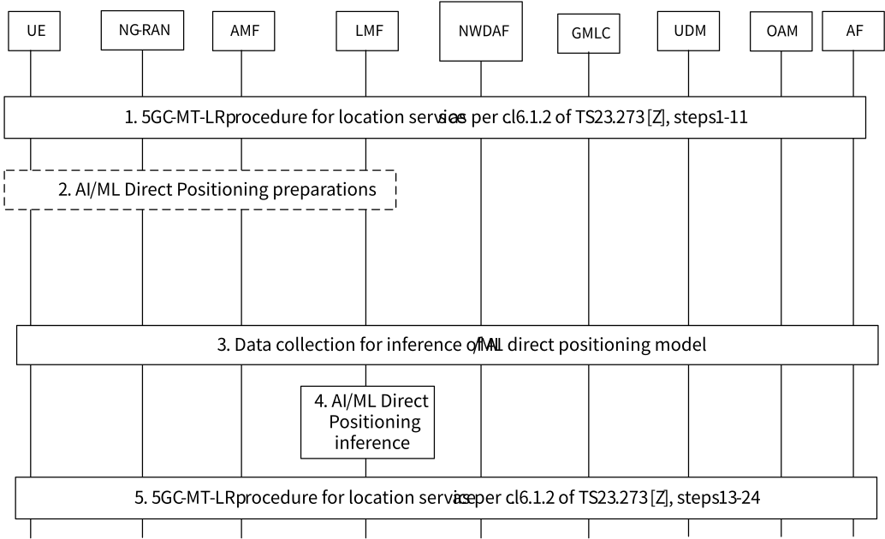

# 6.2 Solution \#2: Support for AI/ML Direct Positioning Training, Inference and Data Collection with LMF-side models

## 6.2.1 Description

This solution addresses KI#1. The solution presents three different aspects regarding 5GC support for AI/ML Direct Positioning with LMF-side models, namely training, inference and data collection procedures. The solution addresses Case 2b and 3b as defined in TR 38.843 \[6\].

The main features of the solution are as follows:

\- LMF requests training data from NWDAF.

\- NWDAF or LMF may perform the AI/ML training.

\- NWDAF may share a trained model with LMF.

\- When a UE location is requested, LMF performs AI/ML inference on the trained model.

In addition, this solution allows LMF to be co-located with NWDAF containing MTLF/AnLF for model training/model inference.

## 6.2.2 Procedures

Clauses 6.2.2.1, 6.2.2.2 and 6.2.2.3 show step-by-step procedures for training, inference and data collection aspects of AI/ML Direct Positioning with LMF-side models, respectively.

NOTE: In all procedures of this solution, LMF may be a standalone NF or co-located with NWDAF containing MTLF/AnLF for model training/model inference (i.e. no interaction between the LMF with the co-located NWDAF needs to be defined).

### 6.2.2.1 Training procedure for AI/ML Direct Positioning with LMF-side models

Figure 6.2.2.1-1: Training procedure for AI/ML Direct Positioning with LMF-side models

The training procedure for AI/ML Direct Positioning with LMF-side models in Figure 6.2.2.1-1 is described step by step below.

1\. LMF subscribes to training data from NWDAF for an AI/ML model to be used for direct positioning. The training data subscription may be a request for analytics using the existing services, or a request for a model, or for other type of data relevant for training. Several optional parameters as defined in TS 23.288 \[5\] may be provided as service operation inputs.

NOTE 1: The training data subscription may be triggered by LMF receiving a previous request from another network entity. The trigger itself is not depicted in Figure 6.2.2.1-1 as it is not considered part of the training procedure itself.

Editor's note: Details of the training data subscription from LMF to NWDAF are FFS.

Editor's note: Whether and which analytics ID and what data may be requested by LMF to NWDAF for model training is FFS.

2\. Data collection is performed to train the model(s) for direct positioning by the NF performing training. If the model is trained by LMF, LMF may use measurements already available at LMF or new measurements, and possibly additional data such as analytics, to train the model. If the model is trained by NWDAF, NWDAF may collect the necessary data from NFs to train the model.

NOTE 2: The data collected from UE and NG-RAN is in RAN WGs scope.

Editor's note: Whether, how and what data are collected for training from NFs by the LMF and by the NWDAF are FFS.

3\. \[CONDITIONAL\] If the training data subscription from LMF in step 1 requires a model to be trained, NWDAF containing MTLF may train the AI/ML model.

4\. NWDAF provides a training data notification to LMF. Depending on the request in step 1, the notification may contain the requested trained AI/ML model for direct positioning if step 3 is executed, or NWDAF may provide along the notification the requested analytics and/or data to the LMF for step 5 to be executed.

5\. \[CONDITIONAL\] If the AI/ML model for positioning has not been trained and has not been provided in step 4, LMF trains the AI/ML model.

Editor's note: It is FFS whether LMF, NWDAF, or both train the model. If LMF trains the model, it is FFS why LMF may collect data from NWDAF

### 6.2.2.2 Inference procedure for AI/ML Direct Positioning with LMF-side models

Figure 6.2.2.2-1: Inference procedure for AI/ML Direct Positioning with LMF-side models

This procedure assumes that a trained AI/ML model is available in LMF for Direct Positioning, i.e. the procedure in Figure 6.2.2.1-1 has already taken place. The inference procedure for AI/ML Direct Positioning with LMF-side models in Figure 6.2.2.2-1 is described step-by-step below.

1\. Steps 1 to 11 in clause 6.1.2 of TS 23.273 \[7\] are followed.

NOTE: In this solution, it is assumed that the location services consumer need not be aware that AI/ML direct positioning is used by the network to estimate the UE location.

2\. AI/ML Direct Positioning preparations are performed to support Case 2b and Case 3b defined in TR 38.843 \[6\]. This step is out of SA WG2 scope.

3\. Data collection is required to perform inference for AI/ML Direct Positioning and estimate the UE location according to Cases 2b and 3b.

Editor's note: Whether and how any data collection for inference from NFs is performed in the 5GC is FFS.

4\. AI/ML Direct Positioning inference is performed at LMF.

5\. Steps 13 to 24 in clause 6.1.2 of TS 23.273 \[7\] are followed to deliver the estimated UE location to the consumer.

## 6.2.3 Impacts on services, entities and interfaces

**NWDAF:**

\- Enhance support for model training services to enable AI/ML positioning training and inference at LMF.

**LMF:**

\- Support for training/inference for AI/ML Direct Positioning and data collection.
