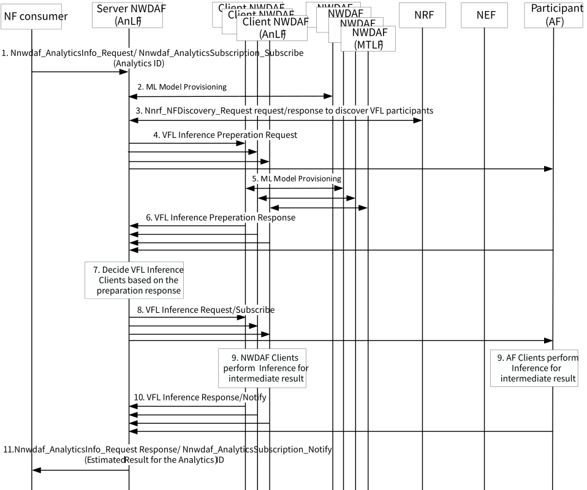

# 6.20 Solution \#20: Inference procedure for the Vertical Federated Learning between NWDAF(s) and AF(s)

## 6.20.1 Description

This solution resolves KI#2: 5GC Support for Vertical Federated Learning, focusing on the procedures for VFL Inference.

While each party in HFL uses the trained global model to make inferences, the parties in VFL have to collaborate to make inferences and each party may have only a sub-model.

The ML Model Training for VFL can be conducted by the NWDAF containing MTLF and/or AF(s), but the inferences are conducted by the NWDAF(s) containing AnLF and/or AF(s). Therefore, to collaborative VFL Inference, the NWDAF(s) containing AnLF and/or AF(s) need to be aware whether the collaboration is needed to make inferences, and a VFL Inference Server need to discover and select VFL Inference Clients (i.e. NWDAF(s) and/or AF(s)) for VFL Inference, and aggregate the intermediate inference results from other VFL Inference Clients. Also, each NWDAF containing AnLF participating the inference needs to provision ML Model for VFL Inference from NWDAF containing MTLF.

For the inferences initiated by NWDAF containing AnLF, we assume that the AF itself provisions its own ML Model for VFL Inference.

To support this procedure, this solution proposes the following VFL Inference Capabilities in NF profile for NWDAF containing AnLF and AF:

\- VFL Inference Server; and/or

\- VFL Inference Client.

In Inference phase, the capabilities do not need to consider whether the VFL Inference Clients have labels or not, we only consider two capabilities that one is the VFL Inference Server which can aggregate the intermediate inferences from VFL Inference Clients and make final inference result, and the other is VFL Inference Client which can provide local inference result to VFL Inference Server.

Also, VFL ML Model may have different ML Model according to its role (VFL Inference Server or Client) (e.g. split-VFL). When provision ML Models for VFL Inference, the NWDAF containing AnLF may include VFL Inference Server or VFL Inference Client Indication when request ML Model provisioning to NWDAF containing MTLF. NWDAF containing MTLF take into account this information when provisioning ML Model for VFL Inference Server or VFL Inference Client.

Editor's note: It is FFS whether the training entity (MTLF) and the inference entity (AnLF) are the same or different.

In addition to the VFL Inference capabilities for NWDAF containing AnLF, it is proposed to use new service operations which can be used for collaborative VFL Inference and preparation before the VFL Inference between NWDAF(s) containing AnLF and AF(s).

When the VFL Inference Server discovers the VFL Inference Clients, it considers required features of the VFL Inference Clients such as NF Set IDs or NF types, or Area of Interest.

Before the training, VFL Inference Server check whether the VFL Inference Clients can meet VFL Inference requirement including Data Availability requirement such as a list of Event IDs of the local data. The Data Availability requirement can be used by the VFL Inference Server to determine the VFL Inference Clients which have different feature spaces.

## 6.20.2 Procedures

### 6.20.2.1 Inference Procedure Initiated by the NWDAF

Figure 6.20.2.1-1: Inference procedure for the VFL initiated by NWDAF

0\. Each NWDAF containing AnLF and AF which support VFL Inference is registered to the NRF with its NF Profile, which includes Analytics ID(s), Address information of NWDAF, Service Area, VFL Inference capability and Time interval supporting VFL Inference.

NOTE 1: When the NWDAF initiates the VFL, multiple AFs can be involved as described in use case#4.

1\. NF Consumer request Analytics to NWDAF containing AnLF which have VFL Inference Server capability.

NOTE 2: The NF consumer can be another AnLF which does not support VFL Inference capability or VFL Inference capability with only VFL Inference Clients.

2\. The NWDAF containing AnLF determines that VFL Inference is needed with other VFL Inference Clients (NWDAF(s) and/or AF(s)) based on the Analytics ID, supported features, or local configuration. If the NWDAF containing AnLF does not have trained ML Model for VFL Inference for the requested Analytics ID, NWDAF containing AnLF need to retrieve ML Model from the NWDAF containing AnLF for the requested Analytics ID.

NWDAF containing AnLF (VFL Inference Server) may need to discover and select NWDAF containing MTLF before the ML Model provisioning for the requested Analytics ID.

Editor's note: Whether the AnLFs can retrieve ML Models distributed among MTLFs is FFS.

Editor's note: More details on how ML Models are retrieved are required.

The ML Model Provisioning request may additionally include VFL Inference Server Indication. The MTLF containing AnLF considers this indication to determine ML Model for VFL Inference Server and provide ML Model to the AnLF in the ML Model Provisioning Response (MLModelProvision Notify or MLModelInfo Response).

3\. The NWDAF containing AnLF discovers candidate VFL Inference Clients (NWDAF(s) and/or AF(s)) by querying the NRF. The discovery request includes Analytics ID, VFL Inference capability for AnLF (VFL Inference Clients) including the support of VFL Inference service operation, and The NF Set ID or NF Type of a data source. The data source information can be used by the VFL Inference Server to determine the VFL Inference Clients for required features of the analytics.

Editor's note: How the VFL Inference Server/Client AnLF can discover MTLF to retrieve ML Model is FFS.

4\. Before initiating the inference with discovered VFL Inference Clients, the VFL Inference Server NWDAF containing AnLF checks whether the discovered candidate VFL Inference Clients (NWDAF(s) and/or AF(s)) can meet the VFL Inference requirement (e.g. Analytics ID, ML Model Interoperability information, Data Availability requirement, VFL Inference Availability time requirement (time span needed for the VFL Inference process), etc.). Data Availability requirement such as a list of Event IDs of the local data can be used by the VFL Inference Server to determine the VFL Inference Clients which have different feature spaces. A new service operation is used for this procedure and include VFL Inference Correlation ID, VFL Inference preparation flag.

If the AF is untrusted, NEF perform the translation and NEF need to support new service operation for VFL Inference.

5\. When the candidate VFL Inference Client AnLF or AF receives the VFL Inference preparation request, it checks whether it can meet the VFL Inference requirement and/or successfully provision the ML Model for VFL Inference and decide whether to join the VFL Inference process. If the VFL Inference Client AnLF or AF cannot provide Intermediate Inference, it can reject to join the VFL Inference process in the response at step 6.

If the candidate NWDAF containing AnLF participating the inference does not have ML Model for VFL Inference, it retrieves ML Model for VFL Inference from NWDAF containing MTLF. NWDAF containing AnLF (VFL Inference Client) may need to discover and select NWDAF containing MTLF before the ML Model provisioning for the request Analytics ID.

The ML Model Provisioning request include Inference Input Data information and VFL Inference Client Indication. The Inference Input Data information is related with the supported feature spaces of the NWDAF containing AnLF and may also be used for the NWDAF containing MTLF to select the ML Model for the NWDAF containing AnLF. The NWDAF containing MTLF considers VFL Inference Client Indication to determine ML Model for VFL Inference Client and provide ML Model to the NWDAF containing AnLF in the ML Model Provisioning Response (MLModelProvision Notify or MLModelInfo Response).

6\. VFL VFL Inference Client (NWDAF(s) containing AnLF and/or AF(s)) response/notify to the inference preparation request/subscribe whether they can join the VFL Inference or not.

7\. The VFL Inference Server NWDAF finally determines VFL Inference Client for inference.

8\. The VFL Inference Server NWDAF sends Inference request/subscribe with new service operation including VFL Inference Correlation ID.

9\. The VFL Inference Client (NWDAF(s) and AF) perform inference and response/notify with intermediate inference results.

10\. The VFL Inference Server NWDAF aggregate the intermediate inference results from the NWDAF(s) containing AnLF and/or AF(s) and generate the final inference result.

11\. The VFL Inference Server NWDAF provides the analytics to the NF consumer with Nnwdaf_AnalyticsInfo_Request response or Nnwdaf_AnalyticsSubscription_Notify.

## 6.20.3 Impacts to Services, Entities and Interfaces

**NWDAF:**

\- Support new Service operation between NWDAF(s) containing AnLF and/or AF(s) for VFL Inference (e.g. Nnwdaf_MLInferenceInfo_Request/Response, Nnwdaf_MLInference_Subscribe/Notify).

\- New capability indication for AnLF (VFL Inference Server, VFL Inference Client).

\- MTLF can provide the ML Model for VFL Inference with additional consideration of the VFL Inference capabilities.

**NEF:**

\- Support new Service operation with AF(s) for VFL Inference (e.g. Nnef_MLInferenceInfo_Request/Response, Nnef_MLInference_Subscribe/Notify).

**AF:**

\- Provision ML model for VFL training and/or inference.

\- Support new service operation for VFL Inference provided by NEF.
