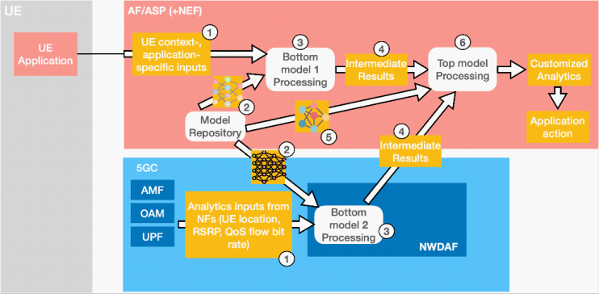
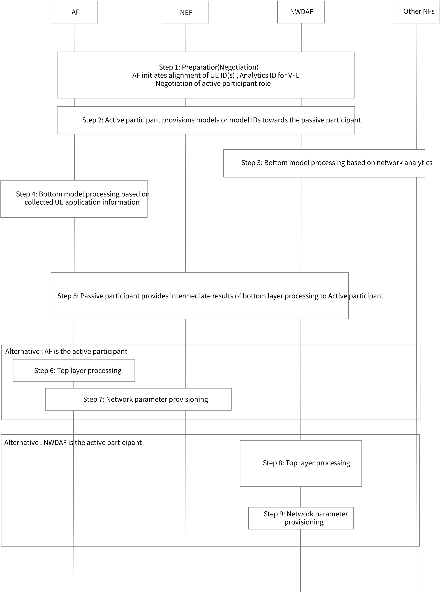
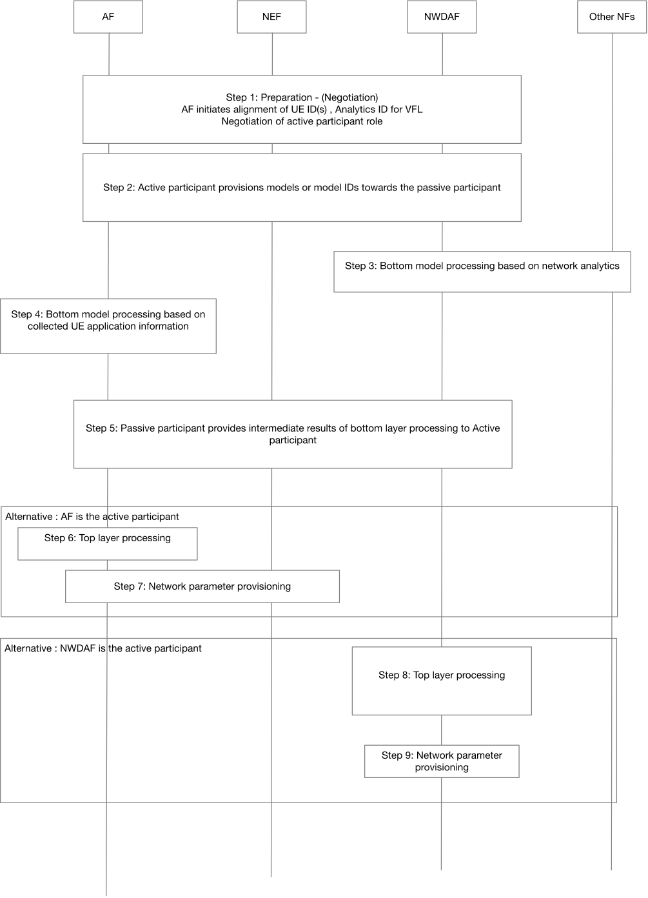

# 6.21 Solution \#21: Vertical Federated Learning for support of Application Layer QoE

## 6.21.1 Key Issue mapping

This solution addresses KI#2 "5GC Support for Vertical Federated Learning".

## 6.21.2 Description

Application Layer Quality of Experience (QoE) is affected by factors in different domains, such as network information (e.g. slice performance, applied policies), UE information (UE power consumption status, trajectory, user context) and Application Layer information (applied codec, QoE metric). The challenge is to use the intelligence available in different segments of the overall system to make accurate QoE predictions at the Application Function, without exposing raw data between segments. Vertical Federated Learning (VFL) is the process of aggregating different features and computing training loss and gradients in a privacy-preserving manner to build a model with data from all parties collaboratively.

VFL systems require that all participants possess the same sample space and different attribute spaces. Each participant in VFL possesses a part of a full model, and all participants should finish a training process part by part. Therefore, exchanged messages among participants in VFL are the intermediate outputs (learning representations) of the local data based on bottom models and their gradients. The bottom model structure in the split VFL architecture for each participant is flexible and a local secret (unknown to others), which is determined by the splitting methods. The top model processing is done by the VFL coordinator or the active participant in the VFL process.

There are two broad categories of VFL for customized QoE in 5GS:

1\. Application provisioning - VFL results are used by the AF/5GC to influence application behaviour (in the AF and/or in the UE).

2\. Network provisioning - VFL results are used by the AF/5GC to provision network parameters.

### 6.21.2.1 VFL for Application QoE provisioning

In this model of VFL, sub-models running in the network and the AF generates customized analytics based on an on-going session to influence the AF and UE application to optimize QoE experienced by the user. The process can be carried by either AF as active participant or NWDAF as active participant. The ML models are supplied by the AF (final output computed in the AF) in the former case or by the NWDAF (final output is transferred by the NWDAF to AF) otherwise.

UE specific inputs collected separately by the AF (e.g. directly from the UE) are used for training a bottom layer partial model at the AF. The 5GC shares intermediate training results from another bottom layer partial model trained with UE specific network information with the AF, without exposing the final model or internal network parameters.

Figure 6.21.2.1‑1: Overview of vertical federated learning with AF as active participant

Steps during training phase:

1\. The AF collects UE context (e.g. mobility, location, etc.) and application-specific inputs (e.g. current/requested data rate, available buffer capacity, available processing capacity, etc.) from the UE. The NWDAF collects information (per-UE, per UE group, per slice, per NF) from various Network Functions (NFs), e.g. the OAM, UPF, AMF, etc.

2\. The AF uses a bottom model portion of the VFL architecture based on the local features that it wants to train the overall model on. The AF provides an application-specific bottom model to the NWDAF that is aligned with the relevant local features available to the NWDAF.

3\. The bottom model at the AF processes the UE-specific inputs presented to it. The bottom model at the NWDAF processes the UE-specific inputs from various NFs.

4\. The intermediate results generated by the bottom model at the AF are forwarded to the top model. The NWDAF shares the intermediate results generated by the bottom model at the NWDAF with the AF.

5\. The AF uses a top model that is designed for the specific bottom models used for the first stage of the training at the AF and the NWDAF.

6\. The top model uses the collected outputs from all participants to calculate the loss function value based on the top model and labels. The AF performs backward propagation and computes gradients for model parameters of the top model and updates its model.

7\. The second set of gradients for forward outputs from each participant (bottom model) are sent back to each participant. Each participant calculates the gradients of its bottom model parameters based on the local data and gradients of the forward outputs from the top model, and then updates its bottom model.

In the inference phase:

The bottom models at the NWDAF and the AF operate on the local data available for each UE and send the intermediate results to the top model. Bottom model 1 (in AF) may use inputs including: UE position, Application metrics, experienced/expected data rates. Bottom model 2 (in NWDAF) may use inputs: from OAM (RSRP, mean number of UEs registered in a NW slice, mean number of established PDU Sessions in a NW slice resource utilization information of a Network Slice instance); from NFs (AMF reports the total number of UEs served by the AMF per S-NSSAI, resource utilization information of a Network Slice instance).

The top model makes decisions based on received intermediate results from the bottom models. No gradients are generated or fed back to the passive participants.

### 6.21.2.2 VFL for Network parameters provisioning

In this model of Vertical Federated Learning, sub-models running in the network and AF generates customized analytics to pre-provision the network to support future QoE requirements of the user. The active participant (AF or NWDAF) performs network provisioning based on custom analytics generated by a ML algorithm operating jointly at the AF and the NWDAF.

A multi-domain VFL model consisting of a bottom model in the AF, acting on local data, and another bottom model in the NWDAF, acting on data provided by one or more NFs, feed into a top model in the active participant that generates network provisioning predictions.

Inputs to the bottom model in the AF may include UE context or application data such as UE location, mobility information, experienced/expected data rates etc.

Inputs to the bottom model in the NWDAF may include RSRP, Mean number of UEs registered in a NW slice, Mean number of established PDU Sessions in a NW slice, Resource utilization information of a Network Slice instance, AMF reports the total number of UEs served by the AMF per S-NSSAI, Resource utilization information of a Network Slice instance.

The intermediate results from the two bottom models are fed to the top model in the active participant.

The top model provides a network provisioning prediction, e.g. slice provisioning. The NWDAF may provide the provisioning information to the appropriate NF, e.g. Network Slice Selection Function (NSSF).

## 6.21.3 Procedures

### 6.21.3.1 Application provisioning for customized QoE

Figure 6.21.3.1-1: Call flow for application QoE provisioning

1\. AF initiates the preparation phase for VFL for analytics ID Collaborative Analytics. This phase includes alignment on UE ID(s) and negotiation of active participant role. This step is always initiated by the AF irrespective of whether AF is the active participant or not.

2\. If AF is the active participant, it provisions one of the bottom model, the model ID or the cut layer in the overall model. If NWDAF is the active participant, NWDAF may provision AF with the corresponding information.

Editor's note: The need for, and the security aspects of AF provisioning bottom Model to NWDAF is FFS.

3\. Bottom layer processing in the NWDAF includes interaction with different NFs for collection of inputs for network analytics.

4\. Bottom layer processing in the AF may include inputs collected from the UE over the application layer.

5\. Passive participant provides intermediate results to the active participant. During the training phase this phase also includes backward propagation of gradients.

6\. Alternative when AF is the active participant: AF performs top layer processing. From the generated results, AF can provision application layer QoE to the UE (e.g. predicated QoE, new codec rate, rendering mode).

Steps 7 to 9 are applicable when NWDAF is the active participant.

7\. NWDAF performs top layer processing and generated analytics results for application layer QoE.

8\. NWDAF exposes analytics results or parameters derived from the top layer processing.

9\. AF derives the application layer QoE from the parameters exposed from NWDAF after top layer processing.

### 6.21.3.2 Network parameters provisioning

Figure 6.21.3.2‑1*:* Call flow for network parameter provisioning

1\. AF initiates the preparation phase for VFL for analytics ID Collaborative Analytics. This phase includes alignment on UE ID(s) and negotiation of active participant role. This step is always initiated by the AF irrespective of whether AF is the active participant or not.

2\. If AF is the active participant, it provisions one of the bottom model, the model ID or the cut layer in the overall model. If NWDAF is the active participant, NWDAF may provision AF with the corresponding information.

Editor's note: The need for, and the security aspects of AF provisioning bottom Model to NWDAF is FFS.

3\. Bottom layer processing in the NWDAF includes interaction with different NFs for collection of inputs for network analytics.

4\. Bottom layer processing in the AF may include inputs collected from the UE over the application layer.

5\. Passive participant provides intermediate results to the active participant. During the training phase this phase also includes backward propagation of gradients.

Steps 6-7 are applicable only when AF is the active participant.

6\. AF performs top layer processing based on the output from the two bottom layer processing.

7\. AF provisions network parameters (e.g. requested slice configuration).

Steps 8 - 9 are applicable when NWDAF is the active participant.

8\. NWDAF performs top layer processing from the output of bottom layer processing.

9\. NWDAF provisions network parameters (e.g. slice configuration).

## 6.21.4 Impacts on services, entities and interfaces

**AF: Initiates VFL UE ID alignment:**

\- As active participant:

\- Provisions bottom layer processing information;

\- provisions gradients during training phase;

\- receives intermediate results.

\- As passive participant:

\- Receives bottom layer processing information;

\- Receives gradients during training phase;

\- Exposure of intermediate results.

**NWDAF:**

\- As active participant:

\- Provisions bottom layer processing information;

\- provisions gradients during training phase;

\- receives intermediate results.

\- As passive participant:

\- Receives bottom layer processing information;

\- Receives gradients during training phase;

\- Exposure of intermediate results.

**NEF:**

\- UE ID alignment for VFL, services to provision bottom layer model parameters to the passive participant and exposure of intermediate results.
