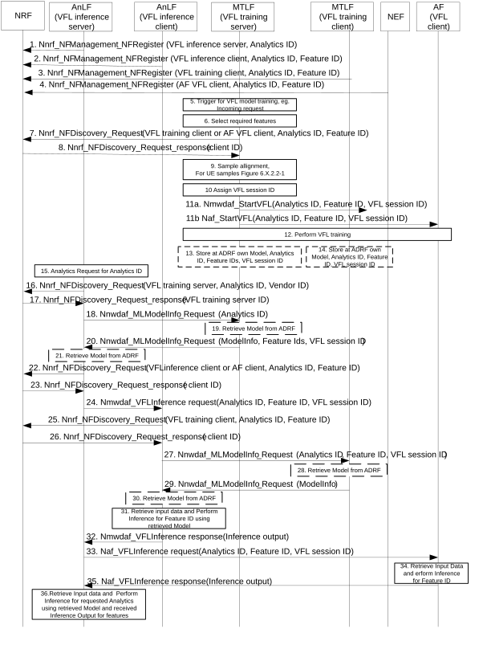
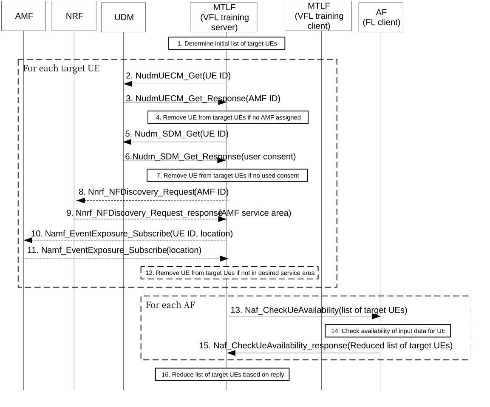

# 6.22 Solution \#22: Vertical Federated learning considering internal NWDAF architecture

## 6.22.1 Description

This solution addresses key issue 2 and use cases 4 and 5.

It assumes that vertical federated learning is controlled by an NWDAF acting as server (or active participant). Clients (or passive participants) can either be other NWDAFs or AFs. No separate Controller is assumed.

NOTE 1: This solutions assumes that the NWDAF acting as server is also the active participant. A similar solution with a separate coordinator is conceivable. Whether a separate coordinator is required can be considered in the evaluation phase.

This solution uses the existing internal NWDAF architecture involving an MTLF to train models and AnLF to do inference based on trained models. The solution also considers that the models can be stored at the ADRF.

When starting a vertical federated learning (VFL) model training session, an MTLF acting as VFL training server discovers and selects MTLF and/or AFs acting as VFL training clients for specific features.

The discovery is using the NRF, where MTLFs register their capabilities to act as VFL training server or VFL training client, along with related Analytics IDs. VFL training clients also register their supported features.

NOTE 2: A feature alignment interaction between VFL server and clients as alternative to storing Features in the NRF can be considered in the evaluation phase.

It is assumed that features and related intermediate results to be exchanged between training clients and training servers will not be standardized, and Feature IDs thus include a Vendor ID plus information (e.g. encoded as string) defined by the vendor.

If the training involves UE related data as samples, the VFL training server selects UEs which are registered and reachable as sample and monitors whether the UEs remain reachable during the training. For AFs acting as VFL training clients, the VFL training server sends a request to each AF to check whether the AF can reach the UEs.

The MTLF acting as VFL training server then assigns a VFL session identifier. The purpose of the VFL session identifier is to enable that models which have been trained together are also used together for inference. The VFL session identifier is required to enable that different entities train the model and use it during inference, to facilitate a storage of models at the ADRF, but also to correlate training and inference related requests if the same VFL client (e.g. AF or monolithic NWDAF) is involved in several VFL training/inference sessions.

Editor's note: Whether it is feasible to design a solution that enables that models which have been trained together are also used together for inference without VFL session identifier is FFS.

The MTLF acting as VFL training server then sends a request to start the training to the selected VFL clients (MTLFs or AFs). The request indicates the Analytics ID, the Feature ID, the desired sample (e.g. list of UEs), and the VFL session ID. The MTLF acting as VFL training server trains a model able to combine information related to several features. Each VFL training client trains a model relating to a special feature. Those models are trained together over several cycles. After each cycle, each VFL training client provides so-called "gradients" as intermediate results to the server that the server uses to update its model, and the server also provides intermediate results to each client that the clients use to update their feature-related models.

After the training completes, both the MTLF acting as training server and the MTLFs acting as training clients store their trained models at the ADRF along with the related Analytics ID, Feature ID (for clients) or an indicator that the model is for an VFL server and VFL session ID.

The inference of analytics or predictions related to VFL-trained models is performed by an AnLF acting as inference server and inference clients (either AnLFs or AFs) for specific features. The models that have been trained together need to be used together for the inference.

When an AnLF receives a request or subscription for analytics or predictions for a particular Analytics ID, it discovers an MTLF for that analytics ID and requests a related model from that MTLF. For VFL, the MTLF acting as VFL training server is contacted. The MTLF acting as VFL training server indicates that a model relates to VFL, and provides the VFL session ID and Feature IDs used to train the model. The AnLF acting as VFL inference server discovers VFL inference clients for the indicated features using the NRF, sends a request or subscription for inference output related to each feature to each VFL inference clients, and provides Analytics ID, Feature ID and VFL session ID within. AnLFs acting as inference clients discover MTLFs acting as training clients for the same analytics ID and feature ID using the NRF and request models from them for the Analytics ID, Feature ID and VFL session ID.

The VFL inference clients retrieve input data and calculate output data related to the corresponding feature and analytics ID using the retrieved model for that feature and provide the output data to the VLF inference server. The AnLF acting as VFL inference server calculates analytics or predictions using the retrieved model and the received feature-related output data.

## 6.22.2 Procedures

### 6.22.2.1 VFL model training and inference involving MTLF, AnLF, ADRF and AF

Figure 6.22.2.1-1: VFL model training and inference involving MTLF, AnLF, ADRF and AF

1\. The AnLF acting as VFL inference server registers its capability to act as VFL inference server in the NRF together with Analytics IDs it supports and a vendor ID.

2\. The AnLF acting as VFL inference client registers its capability to act as VFL inference client in the NRF together with Analytics ID(s) and related Feature ID(s) it supports.

3\. The MTLF acting as VFL training client registers its capability to act as VFL training client in the NRF together with Analytics ID(s) and related Feature ID(s) it supports.

4\. Based on configured information, an NEF registers on behalf of an AF the capability of the AF to act as VFL client in the NRF together with Analytics IDs and related Feature ID(s) the AF supports.

5\. The MTLF acting as VFL training server receives or observes a trigger to start a VFL model training for an Analytics ID.

6\. The MTLF acting as VFL training server selects the required features for the model training based on implementation.

7\. For each feature, the MTLF acting as VFL training server sends a discovery request to the NRF for an MTLF acting as VFL training client or for an AF acting as VFL client and provides the Analytics ID and Feature ID.

8\. For each feature, the NRF provides profiles of candidate NFs matching the discovery request and the MTLF acting as VFL training server selects one such NF.

9\. The MTLF acting as VFL training server may perform sample alignment with the VFL training clients. If UEs are used as samples, the procedure in Figure 6.22.2.2-1 applies.

10\. The MTLF acting as VFL training server assigns a unique VFL session ID.

11\. The MTLF acting as VFL training server sends a request to start the VFL training to the VFL training client for each feature and provides the Analytics ID, Feature ID, and VFL session ID.

Editor´s note: Details of the service operations for steps 11 and 12 and whether new service operations are defined or existing service operations are enhanced is FFS.

12\. The MTLF acting as VFL training server and the VFL training clients perform VFL model training. The VFL training server trains a model which is able to combine information related to several features. Each VFL training client trains a model relating to a special feature. Those models are trained together over several cycles. Each Cycle is triggered by the MTLF acting as VFL training server sending a request as in step 11 to each VFL training client. After each cycle, each VFL training client provides so-called "gradients" as intermediate results to the VFL training server that the server uses to update its model, and the server also provides intermediate results to each VFL training client that the clients use to update their feature-related models.

13\. The VFL training server may store the model it trained in the ADRF together with the Analytics ID, VFL session ID, and Feature IDs of all features used to train the model and an indication that the model is for an VFL server.

14\. Each VFL training client may store the model it trained in the ADRF together with the Analytics ID, VFL session ID and the Feature ID of the feature the model relates to and an indication that the model is for an VFL client.

15\. An AnLF acting as VFL inference server receives a request or subscription for analytics or statistics for an Analytics ID.

16\. The AnLF acting as VFL inference server queries the NRF for an VFL training server for the Analytics ID and its own vendor ID.

17\. The NRF provides profiles of candidate NFs matching the discovery request and the AnLF acting as VFL inference server selects one such NF.

18\. The AnLF acting as VFL inference server requests a model from the selected MTLF acting as VFL training server providing the Analytics ID.

19\. The MTLF acting as VFL training server may retrieve the requested model from the ADRF. The ADRF provides together with the model the VFL session identifier and the Feature IDs of all features used to train the model.

20\. The MTLF acting as VFL training server provides information related to the requested model it trained (either the model or information how to retrieve it). The VFL training server also provides the VFL session ID and the Feature IDs of all features used to train the model.

21\. If the MTLF acting as VFL training server provided information how to retrieve the model, the AnLF acting as VFL inference server retrieves the model.

22\. For each Feature, the AnLF acting as VFL inference server queries the NRF for an AnLF acting as VFL inference client or an AF acting as VFL client for the Analytics ID and related Feature ID.

23\. For each Feature, the NRF provides profiles of candidate NFs matching the discovery request and the AnLF acting as VFL inference server selects one such NF.

24\. For each selected AnLF acting as VFL inference client, the AnLF acting as VFL inference server sends a VFL inference request or subscription and provides the Analytics ID, VFL session ID and Feature ID within the request.

Editor's note: Details of the service operations for steps 24 and 32 and whether new service operations are defined or existing service operations are enhanced is FFS.

25\. Each AnLF acting as VFL inference client queries the NRF for an MTLF acting as VFL training client for the Analytics ID and Feature ID.

26\. Towards each AnLF acting as VFL inference client, the NRF provides profiles of candidate NFs matching the discovery request and the AnLF acting as VFL inference client selects one such NF.

27\. Each AnLF acting as VFL inference client requests the model from the selected MTLF acting as VFL training client providing the Analytics ID, Feature ID and VFL session identifier.

28\. Each MTLF acting as VFL training client may retrieve the requested model from the ADRF, providing the Analytics ID, Feature ID and VFL session identifier.

29\. Each MTLF acting as VFL training client provides information related to the requested model it trained (either the model or information how to retrieve it).

30\. If the MTLF acting as VFL training client provided information how to retrieve the model, the AnLF acting as VFL inference client retrieves the model.

31\. Each AnLF acting as VFL inference client retrieves input data and calculates output data related to the corresponding feature and Analytics ID using the retrieved model for that feature.

32\. Each AnLF acting as VFL inference client provides the output data to the AnLF acting as VFL inference server.

33\. For each AF acting as VFL client selected in step 23, the AnLF acting as VFL inference server sends a VFL inference request or subscription and provides the Analytics ID, VFL session ID and Feature ID within the request.

Editor's note: Details of the service operations for steps 33 and 35 is FFS.

34\. Each AF acting as VFL client selects the applicable model for the inference based on the Analytics ID, VFL session ID and Feature ID, retrieves input data, and calculates output data using the selected model.

35\. Each AF acting as VFL client provide the output data to the AnLF acting as VFL inference server.

36\. The AnLF acting as VFL inference server calculates analytics or predictions using the retrieved model and the received feature-related output data.

### 6.22.2.2 VFL sample alignment for UE samples

Figure 6.22.2.2-1*:* VFL sample alignment for UE samples

1\. Before starting a vertical federated learning, the MTLF acting as VFL training server determines an initial list of target UEs to be used as sample for vertical federated learning.

For each candidate UE, steps 2 to 11 are performed.

2\. The MTLF acting as VFL training server inquiries at the UDM whether an AMF is assigned to the UE.

3\. The UDM returns the assigned AMF ID (if any).

4\. If no AMF is assigned to a UE, the MTLF acting as VFL training server removes this UE from the list of target UEs.

5\. The MTLF acting as VFL training server inquiries at the UDM whether an there is user consent for UE data collection for model training for the UE

6\. The UDM returns the user consent.

7\. If there is no suitable user consent for a UE, the MTLF acting as VFL training server removes this UE from the list of target UEs.

8.-9. The MTLF discovers the AMF address using the NRF.

10.-11. The MTLF inquiries the UE location from the AMF.

12\. If the UE is located outside the desired target area, the MTLF acting as VFL training server removes this UE from the list of target UEs.

For each AF acting as VFL training client, steps 13 to 15 are performed.

13\. The MTLF acting as VFL training server sends a request to the AF to check the availability of target UEs and provides the list of target UEs.

14\. The AF checks for each target UE whether it can retrieve related input data and otherwise removes the UE from the list of target UEs.

15\. The AF replies with a possibly reduced list of target UEs.

16\. The MTLF acting as VFL training server computes the intersection of the possibly reduced list of target UEs provided by the AFs and uses the resulting intersection list as target UEs to be used as sample for the VFL model training.

## 6.22.3 Impacts on services, entities and interfaces

**MTLF:**

\- Act as server or client for VFL model training.

\- Register VFL related capabilities at NRF.

\- As VFL model training server, select features and related VFL model training clients, and request clients to train VFL model for a feature.

\- As VFL model training server, for UEs as sample, determine reachable UEs to be used as sample.

\- As VFL model training client, train VFL model for a feature.

\- Store trained model in ADRF.

\- As VFL model training client, provide trained model for a feature to AnLF acting as VFL inference client.

\- As VFL model training server, provide trained model to AnLF acting as VFL inference server.

**AnLF:**

\- Act as server or client for VFL inference.

\- Register VFL related capabilities at NRF.

\- As VFL inference server, query trained model and features from MTLF acting as VFL model training server, select and related VFL inference clients, and request clients to perform inference for a feature, and combine output data for different features using trained model to compute analytics.

\- As VFL inference client, query trained model for a feature from MTLF acting as VFL model training client, collect input data and derive output data for a feature using the trained model.

**AF:**

\- Act as client for VFL model training and inference.

\- Train VFL model for a feature.

\- Collect input data and derive output data for a feature using the trained model.

\- Check availability of input data related to UEs used as sample.

**NEF:**

\- Based on configuration, register VFL related capabilities of AF at NRF.

**NRF:**

\- Updates to profiles to address new NWDAF capabilities as VFL training server, VFL training client, VFL inference server, and VFL inference client and AF as VFL client.

**ADRF:**

\- Store Feature ID or indication that model is for VFL server, and VFL session ID along with model.
