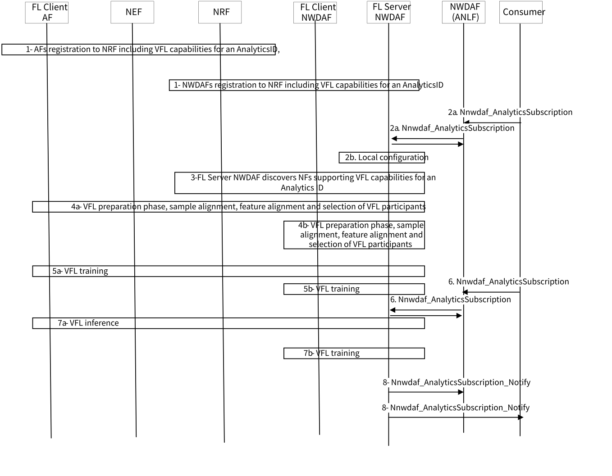
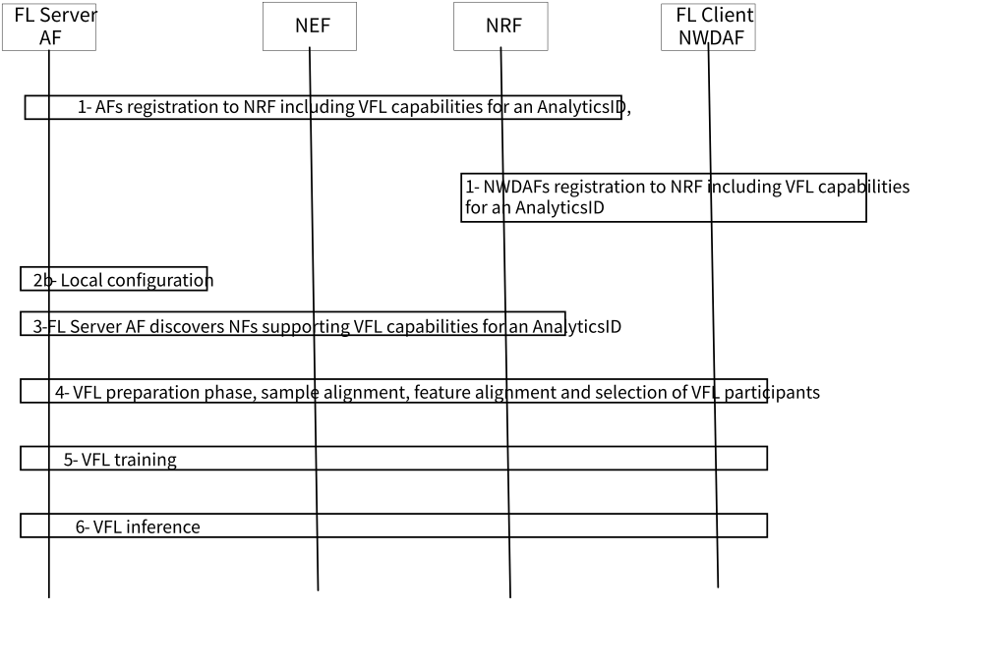
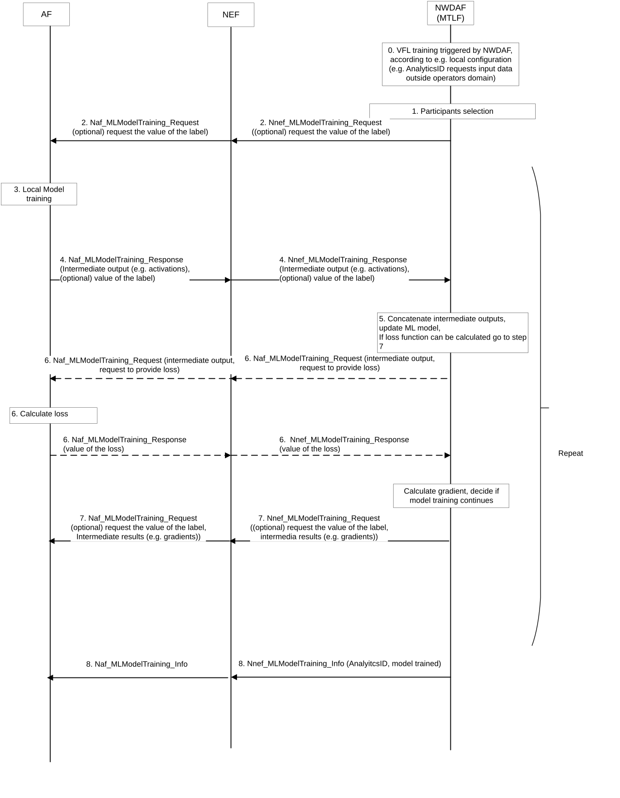
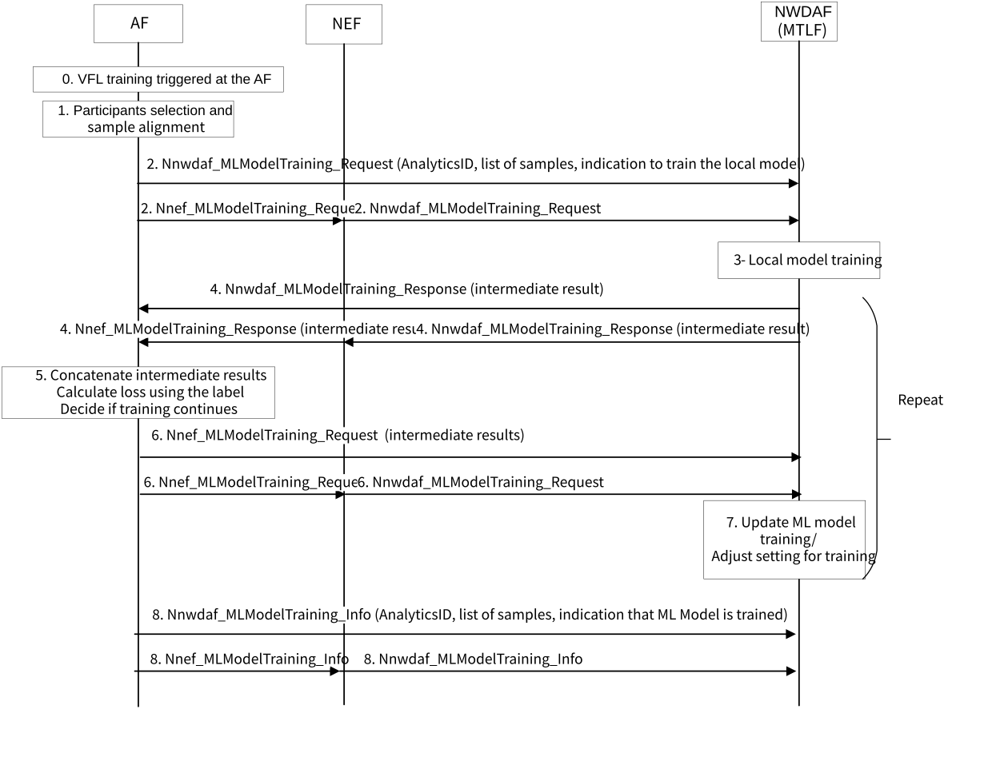
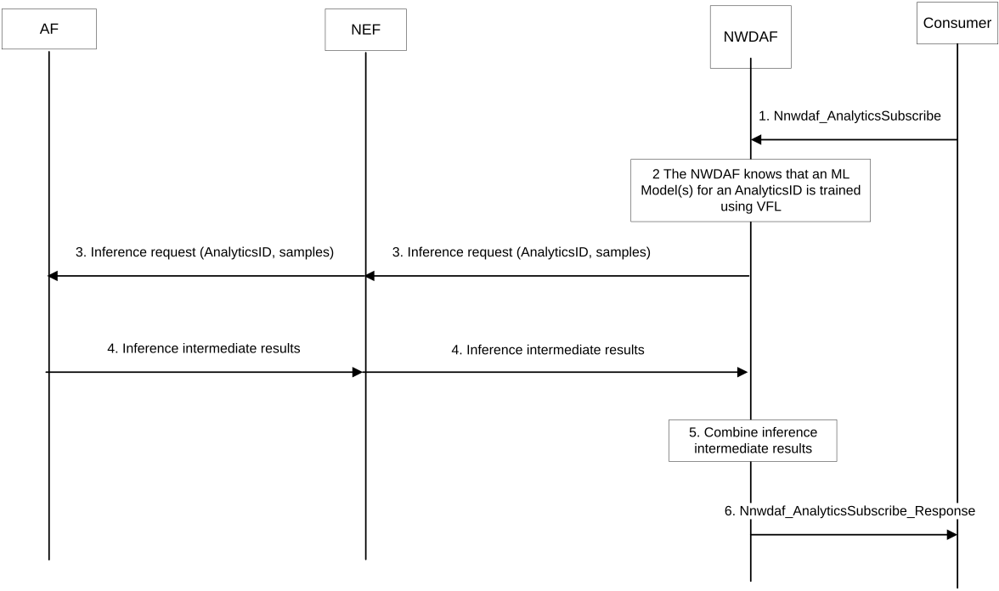
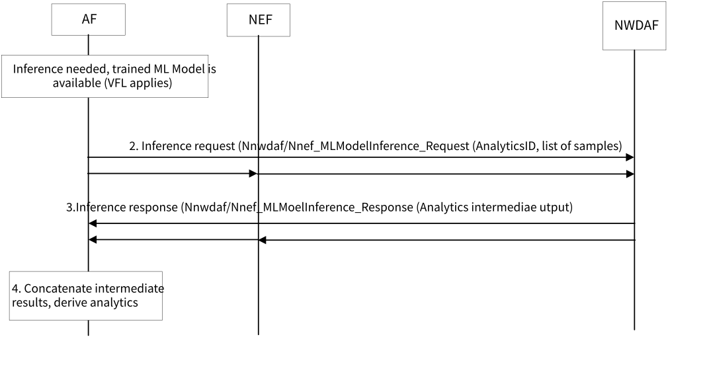

# 6.23.2 Procedures

## 6.23.2.1 NWDAF acts as FL Server with VFL capabilities

Figure 6.23.2.1-1: VFL training and inference when NWDAF acts as a FL Server with VFL capabilities

1\. AFs and NWDAFs with VFL capabilities register to NRF its NF profile that includes whether it can act as a FL server or client with VFL capabilities, and per supported Analytics ID, the type of intermediate results to allow interoperability, optionally the supported data sample types by the NF for this Analytics ID and the list of supported features by the NF. The list of supported features is optional to cover e.g. interdomain scenarios where an AF may not share its features with the MNO or vice versa. The list of supported data samples is optional to cover the case where the Analytics ID has implicit some data sample types. The NF profile is described in clause 6.23.2.3.

2a. A subscription to an Analytics ID to an NWDAF (AnLF) for which no ML Model can be obtained but a distributed ML Model inference applies, triggers the subscription to be forwarded to an NWDAF (MTLF) to perform ML Model training using VFL, if not trained, then inference, in step 3 follows.

2b. Local configuration at NWDAF (MTLF) indicates that an ML Model for an Analytics ID is to be trained using VFL.

3\. The NWDAF (MTLF) acting as a FL Server with FL capabilities NWDAF perform discovery of FL Client(s) with VFL capabilities for that Analytics ID, optionally per Analytics ID the list of ML features that the AF uses for training of the local model, the type of intermediate results and the type of supported data samples. The FL Clients may be other NWDAFs (MTLFs), in that case step 4b follows. or some AFs, in this case step 4a follows, whether to select NWDAF or AF as FL Clients depends on the Analytics ID where the data for this Analytics ID is available.

4a. The FL Server NWDAF selects the candidate FL Client(s) AFs that can train the ML Model including the list of samples to be used for the training, a FL client AF that accepts to join the VFL training also accepts to use the list of samples provided by the FL Server. The FL server NWDAF may also include the list of features that should be used for the training, a FL client AF that accepts to join the VFL training also accepts to use the list of features provided by the FL Server NWDAF, then step 5a follows to initiate the ML Model training.

4b. The FL Server NWDAF selects the candidate FL Client(s), NWDAFs that can train the ML Model the same sample and feature alignment applies, then step 5b follows to initiate the ML Model training.

5a. The NWDAF (MTLF) acting as a FL Server NWDAF with VFL capabilities requests the selected FL Clients with VFL capabilities AF to participate in the model training for an Analytics ID, the initial ML Model is available at both the FL Server NWDAF and FL Client(s) AF. Each FL Client trains the local ML Model with the local input features and transmit the intermediate results to the FL Server to compile outputs, calculate the loss and determine when the training process ends. If the ML Model training was triggered by local configuration, the procedure ends here. If the ML Model training was triggered by a subscription to an Analytics ID, then inference follows in step 7a

5b. The NWDAF (MTLF) acting as a FL Server NWDAF with VFL capabilities requests the selected FL Clients with VFL capabilities NWDAF(s) to participate in the model training for an Analytics ID, the initial ML Model is available at both the FL Server and FL Client(s) NWDAFs. The same training process as in step 5a applies, when the FL Serve NWDAF determines that the ML Model training is completed, then if the ML Model training was triggered by an subscription to an Analytics ID, then inference follows in step 7b, otherwise it ends here.

6\. Same as step 2a, but the NWDAF (MTLF) knows that the ML Model is trained, then performs distributed inference, step 7a follows if the NWDAF does inference with the AF(s), step 7b follows if the NWDAF does inference with other NWDAF(s).

7a. The NWDAF performs inference with the same VFL participants as in step 5a, The NWDAF indicates the list of samples that are used for inference, each FL Client performs ML Model inference with the local input features and transmit the intermediate results to the FL Server that compile the intermediate results and determines the Analytics outputs to be provided to the consumer.

Editor's note: Whether the NWDAF that triggers the training also triggers the inference or different NWDAFs are considered is FFS, as such the procedure will be updated.

7b. The NWDAF performs inference with the same VFL participants as in step 5b, then produces the outputs.

8\. The NWDAF provides the Analytics ID output to the consumer that can be the NWDAF(AnLF) or the consumer, if indicated by NWDAF (AnLF).

## 6.23.2.2 AF acts as FL Server with VFL capabilities

Figure 6.23.2.2-1: VFL training and inference when the AF acts as a FL Server with VFL capabilities

1\. Same as step 1 in figure 6.23.2-1, the AF is the NF that registers to NRF possibly via NEF. The NEF translates the identification of the samples such as UE identifier or External Group Id into the internal identification of the samples, such as SUPI or Internal Group Id.

2\. Same as step 2b in figure 6.23.2-1, the local configuration resides at the AF.

3\. Same as step 3 in figure 6.23.2-1, the FL Server with FL capabilities AF perform discovery of FL Client NWDAF with FL capabilities for that Analytics ID to NRF possibility via NEF.

Editor's note: Whether and how to prevent exposing the NWDAF id to the AF is FFS.

4\. Same as step 4a in figure 6.23.2-1, The FL Server AF selects the candidate FL Client NWDAF also do sample alignment and may perform feature alignment, the

5\. Same as step 5a in figure 6.23.2-1, The FL Server AF with VFL capabilities requests the selected FL Client with VFL capabilities NWDAF to participate in the model training for an Analytics ID, the initial ML Model is available at both the FL Server AF and FL Client NWDAF.

6\. The AF performs inference with the same VFL participants as in step 5, then produces the outputs.

## 6.23.2.3 VFL capabilities within NF profile

The passive participants such as the AF or the NEF (on behalf of the AF) or the NWDAF registers its VFL capabilities into NRF:

\- FL capability information (extending existing one), whether the AF or NWDAF can act as a FL Server with VFL Capabilities or FL Client with VFL Capabilities or both. (MANDATORY).

\- If FL capability information indicates that the AF or NWDAF can perform VFL then the AF or NWDAF provide the list of Analytics IDs that can train. Per Analytics ID the AF provides:

\- Interoperability information such as, VFL training method (e.g. neural networks, XGBoost, etc.). This is a non-specified parameter comparable to ML Model Interoperability Information defined in TS 23.288 \[5\].

\- Dimensionality of the intermediate results (e.g. maximum number of samples and number of nodes).

NOTE: The intermediate results are sent in a container, similar as ML Model File parameter in Nnwdaf_MLModelTraining.

\- Whether the FL Client with VFL Capabilities/passive participant can share labels or not (when supervised learning applies).

\- Whether the FL Client/passive participant can perform loss calculation with the FL Server.

\- whether the FL client or the FL server can share model convergence reports during the training phase.

\- whether the AF, as FL server (with VFL capabilities) can share the impact on the output of the intermediate results provided by NWDAF during training.

\- (Optional). The list of supported ML features.

\- Other parameters that are listed in clause 6.2A.1 of TS 23.502 \[3\].

## 6.23.2.4 Training procedure

The training process in VFL including agreement between the FL server and the FL clients on the training method is illustrated below. The training process is repeated until the server decides to terminate it based on the local constraints that are set by the server and distributed to the clients.

When the ML Model is trained, the active participant notifies the passive participants that there is a trained ML Model available and that the training process has finalized. If the active or passive participant detect that there are changes e.g. in the input data, then it may trigger a re-training, not shown in the figure.

### 6.23.2.4.1 NWDAF as FL Server with VFL capabilities

In this procedure NWDAF is the FL Server/active participant that has the label, i.e. that is determined by NWDAF based on existing OAM provided KPIs related to QoE such packet loss or packet delay as some more listed in clause 6.4 of TS 23.288 \[5\] or is provided by the FL Client/passive participant i.e. AFs or NWDAFs to NWDAF, the label is the value of the QoE for the user.

Alternatively, when the AF or NWDAF does not provide a label, the NWDAF may requests the AF to calculate the loss, this is a extra round to each training interaction.

NOTE: Specification impacts of sharing labels between server and clients requires further discussion.

Figure 6.23.2.4.1-1: VFL training - NWDAF is the FL Server with VFL capabilities, and the AF(s) are the FL Clients with VFL Capabilities

0 The NWDAF with MTLF decides to train the ML model using VFL.

1 The NWDAF with MTLF selects the participant AF including alignment of data samples among all of the participants, ensuring interoperability of intermediate results (e.g. for a neural network, this is the maximum dimensionality of the matrix acceptable by the passive part), selecting AF that can act as a FL Client with VFL capabilities/passive participant and can share its label or selecting AF that can act as a FL Client with VFL capabilities/passive participant and can calculate and share the loss. It is also possible that some negotiation of the required capabilities to do both either share labels or calculate the loss happens during the selection of participants as well.

2 The NWDAF with MTLF sends a request to each selected participant AF participate in VFL. using Nnef_MLModelTraining_Request (new) (for VFL training inter-domain) or Naf_MLModelTraining_Request (new) (for VFL training intra-domain), including the Analytics ID, requests to train, optionally the request to provide the value label (depending on the AnalyticsID), information provided in the AF profile (such as samples or area or type of features or request to provide model convergence reports) and a maximum response time. The NWDAF may assign a Model identifier that is provided to other participants.

3 The AF, trains the local ML model with the local input features, as part of this training the AF may collect input data if it is not available, using procedures outside 3GPP scope.

4 The AF participant transmits the output of the training to the NWDAF, this output is the intermediate results (e.g. activations, optionally model convergence reports in addition the value of the label if requested in step 2) using Nnef_MLModelTraining_Response (for VFL training inter-domain) or Naf_MLModelTraining_Response (for VFL training intra-domain), before transmitting the intermediate output, the AF needs to ensure that user consent was provided by the end user or the AF ensures that a privacy preserving method is applied.

NOTE: Any privacy preserving method for sharing intermediate results is to be defined by SA WG3. However, it is expected that the label provided by the AF is either a digital representation or an aggregated value to protect privacy.

5 The NWDAF with MTLF produces an output using the collected intermediate outputs from the AF participant, it calculates the loss function value based on its own local model and the label that may be provided in step 2, if no label is provided step 6 happens, otherwise step 7 follows.

6 The NWDAF asks the AF to calculate the loss, it sends provide the last produced intermediate result to the AF. The AF calculates the loss, then send it to the NWDAF.

7 The NWDAF with MTLF calculates an intermediate result (e.g. gradients) that is provided to the AF participant. The NWDAF with MTLF also provides the model convergence report within the intermediate results to the AF.

8 The AF participant updates it local model based on the intermediate result (e.g. gradients and the model convergence reports) provided by NWDAF with MTLF, computes new intermediate results that are provided to the NWDAF as described in step 4.

Steps 4 to 7 are repeated until NWDAF determines that the gradients are good enough to stop the ML model training.

9 The NWDAF with MTLF sends a notification that the ML Model is trained to the participant AF using Nnef_MLModelTraining_Info (new) (for VFL training inter-domain) or Naf_MLModelTraining_Info (new) (for VFL training intra-domain), including the Analytics ID, and the indication that the ML Model is trained.

### 6.23.2.4.2 AF as FL Server with VFL capabilities

In this procedure the AF is the FL Server with VFL capabilities/active participant that has the label, i.e. the AF collects QoE metrics obtained at the application layer, e.g. user opinion scores per video session per given time interval, the AF determines the perceived QoE that is used as label. The NWDAF is a passive participant that trains the local model based on the ML features e.g. input data for performance measurements provided by 5GC or OAM RAN KPIs or MDAS to NWDAF as those defined in TS 23.288 \[5\], but not excluding other measurements.

Figure 6.23.2.4.2-1: VFL training - AF acts as FL Server with VFL capabilities

0\. The AF decides to train the ML model using VFL, e.g. due to the need to collect input data from the MNO.

1\. The AF selects the participant NWDAF including alignment of data samples among all of the participants ensuring interoperability of intermediate results (e.g. for a neural network, this is the maximum dimensionality of the matrix acceptable by the passive part).

2\. The AF sends a request to the NWDAF to participate in VFL using Nnef_MLModelTraining_Request (new) (for VFL training inter-domain) or Nnwdaf_MLModelTraining_Request (for VFL training intra-domain), including the Analytics ID, indicating that training of the local model is requested, the list of samples result of the sample alignment in step 2, a maximum response time and other relevant parameters from the NWDAF profile such as samples or feature data.

3\. The NWDAF trains the local ML model with the local input features, as part of this training the NWDAF may collect input data if it is not available as defined in TS 23.288 \[5\].

4\. The NWDAF transmits the output of the training to the AF. this output is the intermediate results (e.g. activations) using Nnwdaf_MLModelTraining_Response that if the AF is outside the MNO domain is provided by NEF to the AF using using Nnef_MLModelTraining_Response (for VFL training inter-domain, before transmitting the intermediate output, the NWDAF needs to ensure that user consent was provided by the end user via UDM or the NWDAF ensures that a privacy preserving method is applied. It may also add within the intermediate results the model convergence reports indicating how the local model is converging.

NOTE: Any privacy preserving method for sharing intermediate results is to be defined by SA WG3.

5\. The AF produces an output using the collected intermediate outputs from NWDAF together with the result of the training of the local model, updates the local model and calculates the loss function.

6\. The AF calculates an intermediate result (e.g. gradients) that is provided to the NWDAF participant. The AF may also include model convergence reports within the intermediate result. It may also add in another container labels and/or a binary value of the labels plus information on whether mainly the network impacts the output, as agreed in handshake.

NOTE: The extra information can be used by NWDAF to learn what features impact the QoE for the application, which is deemed being one of the main objectives for doing VFL with applications. And is believed to be possible to share when operators co-operate with applications in VFL. Having this info will make it possible to perform Inference without requiring and being dependent on data from the AF.

7\. The NWDAF as passive participant updates its local model or adjust the training settings based on the intermediate result (e.g. gradients) provided by AF, computes new intermediate outputs that are provided to the NWDAF as described in step 4.

Steps 4 to 7 are repeated until AF determines that the intermediate results (e.g. gradients) are good enough to stop the ML model training.

8- The AF sends a notification that the ML Model is trained to the NWDAF that participated in VFL training using Nnef_MLModelTraining_Info (new) (for VFL training inter-domain) or Naf_MLModelTraining_Info (new) (for VFL training intra-domain), including the Analytics ID, and the indication that the ML Model for this Analytics ID is trained.

## 6.23.2.5 Inference procedure

The inference process occurs once the training process has been done, the server knows that there is a ML Model for an Analytics ID trained and determines which ones from the participants in the training, that shall participate in the inference. The differences between the VFL training and inference are that both a) there is no need to check the labels, and as such no need to repeat the process and b) the inference is triggered by the NWDAF or by the AF.

### 6.23.2.5.1 NWDAF(AnLF) triggers the inference procedure

The NWDAF can also initiate the inference procedures for a ML Model that is trained with active and passive NWDAFs, but it is not shown in the figure below.

NOTE 1: This solution considers that the NWDAF that trains the model is the same NWDAF as performs inference, as such it is considered that the trained ML Model is stored locally. Other aspects, such as possibility to store the ML Model in ADRF, and how an AnLF can do inference when the ML Model is distributed in one or more MTLFs are not covered yet.

Figure 6.23.2.5.1-1: NWDAF (AnLF) triggers the inference procedure

1\. The NWDAF receives a request or subscription to Analytics ID, the NWDAF checks e.g. the weight of the local model and local data provided by the AF during the training, if it is good enough to perform local inference without requesting the AF to do training collectively, the NWDAF derives the predictions or statistics and the procedure stops here. If the Analytics ID needs data from the AF to be able to provide inference/predictions to the consumer.

2\. The NWDAF knows that there is a trained ML Model for this Analytics ID sing VFL that uses the input data from the AF for the same samples that were included in the Analytics request, otherwise it performs training first as in clause 6.23.2.4.1.

3\. The NWDAF then initiates the inference procedure using Nnef_MLModelInference_Request (new) (for VFL inference inter-domain) or Naf_MLModelInference_Request (new) (for VFL training intra-domain), including the Analytics ID, the reference to the model previously trained list of samples and a maximum response time.

4\. The AF, and each AF trains the local ML model with the local input features, as part of this training the AF may collect input data if it is not available, using procedures outside 3GPP scope. Each AF participant transmits the output of the training to the NWDAF using Nnef_MLModelInference_Response (for VFL training inter-domain) or Naf_MLModelInference_Response (for VFL training intra-domain), before transmitting the intermediate output, the AF needs to ensure that user consent was provided by the end user or the AF ensures that a privacy preserving method is applied.

NOTE 2: Any privacy preserving method for sharing intermediate results is to be defined by SA WG3.

5\. The NWDAF produces an output using the collected intermediate outputs from all the AF participants and itself.

### 6.23.2.5.2 AF triggers the inference procedure

Figure 6.23.2.5.2-1: The AF triggers the inference procedure

1\. The AF performs analytics, then knows that data is needed from NWDAF, but instead a trained ML Model for these analytics using VFL with NWDAF is available for the same samples as the analytics request. The AF decides to ask NWDAF to perform inference of an Analytics ID based on their local data for a list of samples.

2\. The AF sends a request to perform inference to NWDAF, possibly via NEF, using Nnef_MLModelInference_Request (new) (for VFL inference inter-domain) or Nnwdaf_MLModelInference_Request (new) (for VFL training intra-domain), including the Analytics ID, list of samples and a maximum response time. The NEF translates the list of samples, e.g. GPSIs or External-Group-Id into SUPIs and Internal-Group-Id.

3\. The NWDAF performs inference using the local trained ML model with the local input features. The NWDAF transmits the output of the inference to the AF using Nnef_MLModelInference_Response (for VFL training inter-domain) or Nnwdaf_MLModelInference_Response (for VFL training intra-domain), before transmitting the intermediate output, the NWDAF needs to ensure that user consent was provided by the end user or the AF ensures that a privacy preserving method is applied.

NOTE: Any privacy preserving method for sharing intermediate results is to be defined by SA WG3.

4\. The AF produces an output using the collected intermediate inference outputs from the NWDAF and the AF. An Analytics results is available at the AF that takes the NWDAF input data into account.
