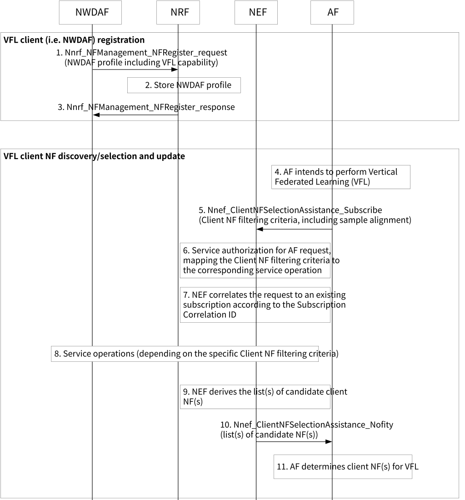

# 6.24 Solution \#24: How to support Vertical Federated Learning between NWDAF and AF

## 6.24.1 Terminology

**VFL server:**

\- owns labels for a VFL task and coordinate the training and inference procedures.

\- distributes initial ML models to each VFL client.

\- Performs sample and feature alignment with VFL client.

\- discovers and selects VFL clients to participant in an VFL procedure.

\- requests VFL clients to do local model training and to report local intermediate information.

\- locally trains ML Model with the available local data set.

\- computes the training loss and the gradients by aggregating local intermediate information from VFL clients.

\- sends the gradients back to FL clients to perform an additional training iteration if needed.

**VFL client:**

\- Performs sample and feature alignment based on criteria from VFL server.

\- locally trains ML Model as tasked by the VFL server with the available local data set.

\- reports the trained local intermediate information to the VFL server.

\- receives the gradient information from VFL server and computes the gradient of its local model.

## 6.24.1 Description

This solution addresses Key Issue \#2: 5GC Support for Vertical Federated Learning. This solution focuses on the scenario where the AF initiates the VFL training process. In this scenario, the AF acts as the VFL server, considered the VFL active participant, owning the label information. The NWDAF(s) act as the VFL client(s), referring to the remaining VFL participants that do not own labels but participate in the training process.

The key operational characteristics of vertical federated learning (VFL) is to train a ML model without explicitly sharing raw data among participants involved in training and inference. However, it still require coordination between the involved participants for training and inference.

This solution targets a use case where VFL is operated between NWDAF and AF, specifically focusing on Scenario 2 as outlined in the agreed S2-2403591, which involves AF initiating the VFL training process. It addresses the following aspects as agreed in S2-2401830:

\- Whether and how the existing NF discovery and selection needs to be enhanced.

\- How to support sample and feature alignment among the participating network entities when performing VFL.

## 6.24.2 Procedures

### 6.24.2.1 Procedure of NF discovery and selection

Figure 6.24.2-1 shows the procedure of NF discovery and selection.

Figure 6.24.2-1: Procedure for of NF discovery and selection

1\. NWDAF with the capability to participate as VFL clients, registers its NF profile with the NRF. This profile may include VFL capability information indicating whether it can support training for VFL, VFL capability type information (i.e. "VFL server or VFL client), the NWDAF NF Type, Analytics ID(s), Address information of NWDAF, Service Area, and Time interval supporting VFL.

If NWDAF is a VFL client, it requires the NWDAF to have the capability to perform ML model training with ML models provided by the AF, serving as a VFL server, as a new functionality.

NOTE 1: A VFL server is considered to be an VFL active participant that owns the label information, while VFL clients refers to the rest of VFL participants that do not own labels but participate in the training process.

2\. The NRF stores the NWDAF profile and marks it as available.

3\. The NRF acknowledges that NF registration is accepted via Nnrf_NFManagement_NFRegister response.

4\. The AF, serving as a VFL server, aims to perform VFL.

5\. The AF subscribes to the VFL client NF selection assistance information by sending an initial Nnef_ClientNFSelectionAssistance_subscribe request, which includes one or more VFL Client NF filtering criteria. Subsequently, the AF may update the client NF filtering criteria of the subscription by invoking Nnef_ClientNFSelectionAssistance_subscribe and providing a Subscription Correlation ID. In this step, filtering criteria related to sample and/or feature alignment or VFL capability may be included.

6\. If the AF request does not contain a Subscription Correlation ID, the NEF verifies the authorization of the AF request and executes the corresponding service operations (e.g. NF discovery) based on the VFL Client NF filtering criteria provided by the AF. If filtering criteria related to sample and/or feature alignment are included in step 5, the NEF may perform necessary operations for sample and/or feature alignment. For example, the NEF may identify a set of available NFs that have data for the same sample but different features based on the received filtering criteria.

NOTE 2: Sample and/or feature alignment may be performed by other NFs (e.g. NWDAF) as well as the NEF.

7\. If the AF request contains a Subscription Correlation ID, the NEF correlates the Nnef_ClientNFSelectionAssistance_Subscribe request to an existing subscription based on the Subscription Correlation ID. The NEF may update the filtering criteria and subsequently trigger corresponding service operations (e.g. NF discovery) based on the updated filtering criteria.

8\. The NEF interacts with different 5GC NFs to collect the required information. The interactions between the NEF and the 5GC NFs depend on the VFL Client NF filtering criteria provided by the AF. If the filtering criteria in step 5 include VFL capability, the NEF discovers candidate NFs with VFL capability through NRF. For filtering criteria that can be verified through NRF besides VFL capability, the NEF finds candidate NFs that satisfy them via NRF. However, for filtering criteria that cannot be directly verified through NRF (e.g. sample and/or feature alignment), the NEF may check their satisfaction through interactions with 5GC NFs. For example, for sample alignment, the NEF requests for VFL client discovery from NRF and further queries UDM for determining the NWDAF(s) and its corresponding serving UE list with the information provided by the AF.

9\. Based on the collected information from other 5GC NFs, the NEF may derive or down-select the list(s) of candidate NFs that fulfil the VFL Client NF filtering criteria in the AF request to reduce signalling between the NEF and the AF.

10\. The NEF sends an Nnef_ClientNFSelectionAssistance_Notify request to the AF, which includes the list(s) of candidate NFs and possibly additional information.

11\. Based on the information received in step 10, the AF determines VFL client NF(s).

## 6.24.3 Impacts on services, entities and interfaces

**NWDAF:**

\- Supports sample and/or feature alignment.

\- Retrieves initial ML models for training from the AF.

\- Performs local ML model training with the initial ML models provisioned from the AF.

\- Performs ML model inference collaboration with other NWDAF(s) and/or the AF.

**NEF:**

\- Receives VFL client NF filtering criteria from the AF.

\- Maps VFL client NF filtering criteria to corresponding service operations, including those required for sample and/or feature alignment.

\- Derives candidate VFL client NFs and sends the information of the candidate VFL client NFs to the AF.

**AF:**

\- Acts as the server managing the training and inference procedures for VFL.

\- Provisions initial ML models for training to the NWDAF or AEF.

\- Receives intermediate results from the NWDAF or AEF.

\- Performs ML model inference collaboration with other NWDAF(s) and/or the AF.

**NRF:**

\- Recognizes and stores a new VFL capability for NWDAF to facilitate the discovery of VFL-capable NWDAF.
