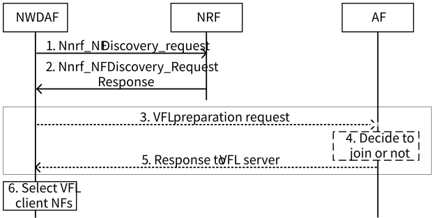
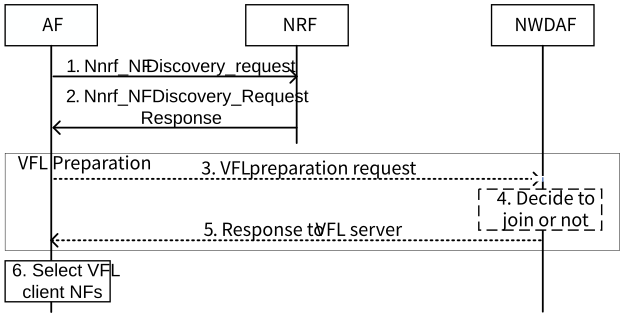

# 6.25 Solution \#25: NF Registration and Discovery Enhancement for VFL

## 6.25.1 Description

This solution is proposed for KI#2 to support NF Registration and Discovery Enhancement for VFL.

Considering the distributed inference nature, the inference procedure involves multiple NF instances. Therefore, the inference for VFL can be categorized into two cases, in terms of the difference between the NF instances that participate in the inference and training:

\- Case 1: The set of NF instances that participate in the inference for VFL (i.e. AF(s) and NWDAF(s)) is same as that participated in the VFL model training. Namely, all the NF instances participate in both VFL model training and inference.

\- Case 2: The set of NFs that participate in the inference for VFL is different from the set of NFs that participated in the VFL model training. Namely, some of the NFs participate in either of VFL model training or inference.

Revisiting the discussion that NWDAF containing MTLF and NWDAF containing AnLF are separately specified, the ML model training capability and inference capability can be supported by different instance. Therefore, Case 2 shall be supported in Rel-19.

To support Case 2, the ML model that will be used in the VFL participants (e.g. ML model that is trained using VFL model training) should be shared among participants.

**Observation: ML model alignment between NWDAF and AF should be supported in both VFL model training and inference.**

During the registration procedures with NRF of the trusted AF and the NWDAF containing MTLF or AnLF, or that of untrusted AF via NEF, the NFs (i.e. NWDAF and AF) shall include their "VFL capability" within their NF Profiles. The detailed VFL capabilities are as follows:

\- "VFL capability" indicates whether to support "VFL Active Participant", "VFL Passive Participant", "VFL training" and/or "VFL inference", respectively, for the corresponding Analytics ID.

\- "VFL training" and "VFL inference" capabilities refer to whether the NF is able to participate in the VFL model training and VFL inference, respectively.

\- "VFL Active Participant" capability means whether the NF is able to:

\- manage the VFL operation (i.e. which is an ML model training and inference mechanism that enables joint training and inference between NWDAF and AF without breaking the data isolation),

\- select "VFL passive participant" NF from NFs that are registered in NRF

\- aggregate the intermediate results from other VFL participants.

\- train its local ML model and send feedback on the intermediate results to each participant if the NF also supports "VFL training" capability.

\- "VFL Passive Participant" capability means whether the NF is able to:

\- compute the intermediate results from the available local data using its local ML model and report them to the "VFL Active Participant".

\- train its local ML model using the feedback from the "VFL Active Participant" if the NF also supports "VFL training" capability.

NOTE: The "VFL Passive Participant" NF does the job by the request from the "VFL Active Participant" NF.

Editor's note: Detailed role of the VFL Active Participant and VFL Passive Participant can be updated according to the terminology discussion.

If the AF is registered as a "VFL Active Participant" and /or a "VFL Passive Participant" in the "VFL capability" parameters, the AF should be able to include "ML model transfer permission" registered in its NF Profile if necessary.

"ML model transfer permission" capability means whether the AF permits the transfer of the local ML model that is trained with the VFL model training to the 5GC.

Editor's note: Whether parameter is needed depends on the discussion of VFL inference, i.e. whether the NWDAF provide ML model to AF.

## 6.25.2 Procedures

### 6.25.2.1 Registration and discovery of NWDAF and AF for VFL

The VFL model training operation consists of NF discovery and VFL preparation. In the NF Discovery, the "VFL Active Participant" discovers the candidates of "VFL Passive Participant" NFs that will participate in the VFL training or inference procedure. In the VFL preparation, the "VFL Active Participant" determines the "VFL Passive Participant" NFs that participate in the VFL model training and/or inference procedure based on the data and computation capability of candidates of "VFL Passive Participant" NFs. The procedure of Scenario 1 and 2 is depicted in Figures 6.25.2.1.1-1 and 6.25.2.1.2-1, respectively.

#### 6.25.2.1.1 NWDAF-initiated registration and discovery of AF for VFL in Scenario 1

Figure 6.25.2.1.1-1: VFL passive participant discovery procedure in Scenario 1

Steps 1 and 2 are the "VFL Passive Participant" NF(s) (i.e. AF) Discovery procedure in Scenario 1.

1-2. "VFL Active Participant" NWDAF determines to use VFL model training or inference based on operator policy, Analytic ID, Service Area/DNAI, UE ID, or data that cannot be obtained/exposed directly from data producer NF (e.g. for privacy reasons). NWDAF may discover and select AF(s) as "VFL Passive Participant" NF(s). If untrusted AF is included in the selected NFs, the NWDAF also selects appropriate NEFs from NRF by invoking the Nnrf_NFDiscovery_Request service operation clause, clause 6.2.2.3 of TS 23.288 \[5\]. The requests shall include sample alignment information (e.g. UE ID), which is used to select the NF that has data associated with the sample alignment information, VFL capability, ML model transfer permission, and other parameters (e.g. Time Period of Interest and ML Model Interoperability Indicator) as described in TS 23.288 \[5\].

Editor's note: The trigger of step 1-2 is FFS.

Editor's note: Whether features information is to be stored in the NRF is FFS.

3\. NWDAF sends VFL preparation requests to the AF(s) using Naf_MLModelTraining_Subscribe (new) or Naf_MLModelTrainingInfo_Request (new). The request is sent via NEF if untrusted AF is included in the AF(s). This aims to check if the AF(s) can meet the VFL requirement (e.g. available data requirement and whether the AF includes the data correlated with the sample alignment information).

4-5. AF(s) check if they can meet the VFL procedure and decide whether to join the VFL process based on implementation. AF(s) indicate to the NWDAF whether they will join the VFL procedure and may include the reason in the response message if they cannot.

Editor's note: Whether the VFL preparation procedure (i.e. Steps 3-5) is needed is FFS. At least, it is an optional procedure that can be skipped if the "VFL Active Participant" NF can decide that the "VFL Passive Participant" NF(s) supports the VFL procedure to be performed (e.g. based on information acquired from previous VFL procedures or from the NRF) or based on local configuration.

6\. The NWDAF determines the final list of "VFL Passive Participant" NF(s) to be involved in the VFL model training procedures based on the information received in step 2 and other information received in step 5 (if available).

#### 6.25.2.1.2 AF-initiated registration and discovery of NWDAF for VFL in Scenario 2

Figure 6.25.2.1.2-1: VFL passive participant discovery procedure in Scenario 1

Steps 1 and 2 are the "VFL Passive Participant" NF(s) (i.e. AF and NWDAF) Discovery procedure in Scenario 2.

1-2. "VFL Active Participant" AF determines to use VFL model training or inference if data that cannot be obtained/exposed directly from NWDAF (e.g. for privacy reasons). The AF may discover and select NWDAF(s) as "VFL Passive Participant" NF(s). If the AF is untrusted AF, Steps 1 and 2 are performed via NEF. The requests shall include sample alignment information (e.g. UE ID), which is used to select the NF with data associated with the sample alignment information and VFL capability type.

3\. AF sends VFL preparation requests to the NWDAF(s) using Nnwdaf_MLModelTraining_Subscribe or Nnf_MLModelTrainingInfo_Request. If the AF is an untrusted AF, the request is sent via NEF. This aims to check if the NWDAF(s) can meet the VFL requirement (e.g. the available data requirement and whether the NWDAF includes the data that is correlated with the sample alignment information).

4\. NWDAF(s) check if it can meet the VFL procedure and decide whether to join the VFL process based on operator policy and/or implementation. NWDAF(s) indicate to the AF whether it will join the VFL procedure and may include the reason in the response message if it cannot join the VFL process.

Editor's note: Whether the VFL preparation procedure (i.e. Steps 3-5) is needed is FFS. At least, it is an optional procedure that can be skipped if the "VFL Active Participant" NF can decide that the "VFL Passive Participant" NF(s) supports the VFL procedure to be performed (e.g. based on information acquired from previous VFL procedures or from the NRF) or based on local configuration.

6\. The AF determines the final list of "VFL Passive Participant" NWDAF(s) to be involved in the VFL model training procedures based on the information received in step 2 and other information received in step 5 (if available).

## 6.25.3 Impacts on Existing Nodes and Functionality

**For NWDAF and AF:**

\- Register the "VFL capability" in NF profile to NRF, (in case of untrusted AF, register the "VFL capability" in NF profile to NRF via NEF profile).

**For NWDAF and AF with "VFL active participant" capability:**

\- Support "VFL passive participant" NF (i.e. NWDAF and AF) discovery procedure.
