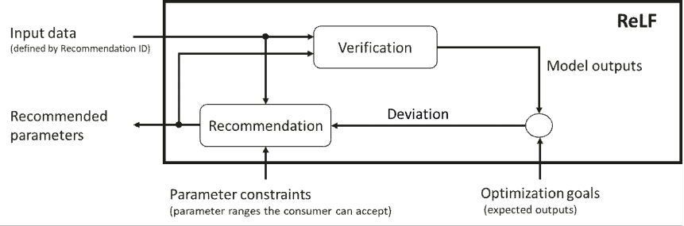
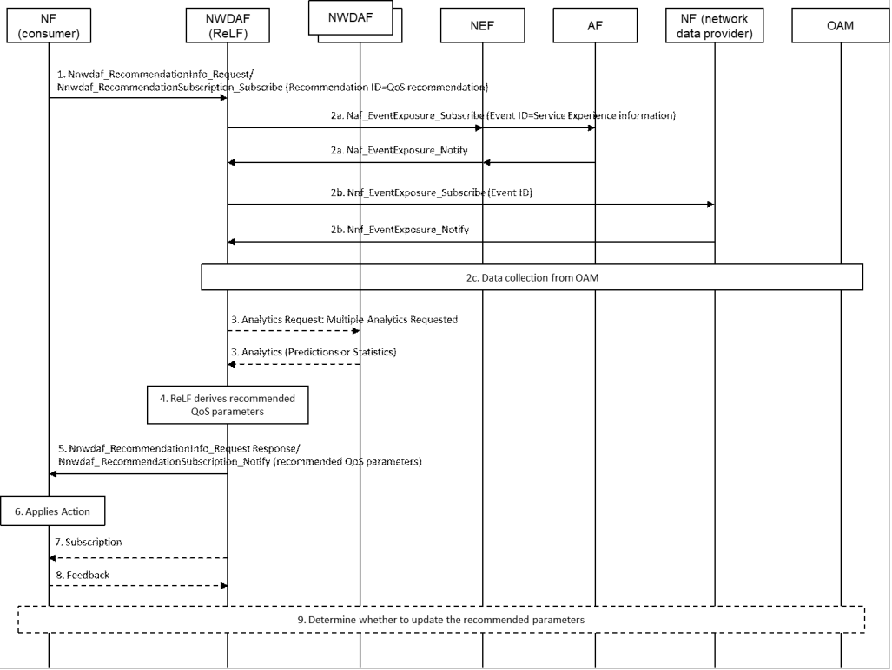

# 6.26 Solution \#26: NWDAF-assisted policy control with Recommendation logical function

## 6.26.1 Description

This solution focuses on Use Case \#1: NWDAF-assisted QoS enhancement and addresses Key Issue \#3: NWDAF-assisted policy control and QoS enhancement.

As documented in Use Case \#1, NWDAF can assist the PCF in determining QoS parameters that can achieve the expected service experience requirements. This solution introduces the Recommendation logical function (ReLF) to enable the NWDAF to provide the recommended parameters that can achieve the expected service experience to the PCF.

The logic for generating analytics and recommendation is different. The recommendation could be the action directly taken by the consumer (which is decided by the consumer, the ReLF will not make decisions on behalf of the consumer), so the NWDAF needs to ensure that the recommendation can help the consumer to reach the desired goals (e.g. expected service experience). However, the analytics will not be directly enforced by the consumer, it's just the intermediate info that help the consumer to determine the actions to be taken, for example, the PCF uses the service experience analytics from NWDAF to determine the QoS parameters to be applied for a service. Therefore, the current analytics framework is not enough for providing effective recommendations, since the analytics output is just statistics or predictions of the network status parameter, which is not directly related to the actions to be taken by the consumer, resulting in that the analytics output may not be able to provide effective assistance to the consumer for achieving the desired goals (e.g. MOS\>=4). Considering the above reason, we propose to introduce the Recommendation logical function to provide recommendations to the consumer.

### 6.26.1.1 Recommendation logical function

Recommendation Logic Function (ReLF) is new NWDAF functionality which may request a plurality of analytics (i.e. multiple analytic ID) from one or more NWDAFs or collect data directly from one or more NF(s) and derives recommendation information (e.g. recommended QoS parameters) that can fulfil the optimization goals (e.g. MOS\>=4) provided by the consumer, and exposes recommendation service to the consumer (e.g. PCF). Figure 6.26.1.1-1 shows the Model-based Predictive Control architecture of ReLF. ReLF derives recommended parameters without knowledge of NF functionality.

Editor's note: Whether to define a new Logic Function or enhance AnLF/MTLF needs to be evaluated.

Figure 6.26.1.1-1: ReLF architecture supporting data-driven recommendation service

The ReLF includes two data-driven parts as following:

\- Verification part, which collects data and derives the output. For example, the verification part may collect data related to service experience and derives the service experience. The verification part may also request analytics from other NWDAF(s) for deriving the Model outputs.

\- Recommendation part, which generates recommended parameters based on the deviation between the model outputs and the optimization goals. The recommendation part tries to derive the recommended parameters within the parameter ranges that the consumer can accept (i.e. parameter constraints) to minimize the deviation from the optimization goals (i.e. the objective function of the recommendation part indicates that the model outputs and the optimization goals should be as close as possible).

NOTE 1: To further optimize the recommendations, the output of the recommendation part could be the input of the verification part, the verification part may be implemented by using a ML model or digital twin, which can verify the goals that can be achieved after using the recommendations and generate new model outputs, then it can be checked whether new deviation between the new model outputs and the optimization goals is small enough. The recommendation part may derive new recommended output based on the new deviation and the parameter constraints. The loop between the verification part and recommendation part is optional. The loop can be performed one or multiple times as needed, and the recommendation part can decide when to stop the loop and then provide the output to the consumer.

NOTE 2: The ReLF may consume the analytics service of AnLF for the model outputs.

NOTE 3: The ReLF only provides recommendations and does not make decisions on behalf of the consumer, the final decision is made by the consumer based on the recommendations and its internal logic (e.g. how the PCF determine the QoS parameters).

NOTE 4: The ReLF is a logical function in NWDAF, an NWDAF can contain one or multiple of the following logical functions: an MTLF, an AnLF, or an ReLF.

NOTE 5: The internal logic (including the Verification part and Recommendation part) of the ReLF is based on implementation, which is out of the scope of 3GPP.

The ReLF can provide Nnwdaf_RecommendationSubscription and Nnwdaf_RecommendationInfo service operations to enable the consumer to subscribe/request recommendations. The consumer of the Nnwdaf_RecommendationSubscription and Nnwdaf_RecommendationInfo service operations can provide the following input parameters:

\- Recommendation ID: identifies the type of requested recommendations. For example, Recommendation ID=QoS recommendation, which indicates that the consumer requests the recommended QoS parameters.

\- Recommendation Filter Information: indicates the conditions to be fulfilled for reporting recommendation Information, e.g. AoI, S-NSSAI.

\- Target of Recommendation Reporting: indicates the object(s) for which recommendation information is requested, entities such as specific UEs, a group of UE(s) or any UE (i.e. all UEs).

\- Recommendation target period: indicates time interval \[start, end\] for which the Recommendation is requested.

\- Optimization goals: expected results achieved using recommended parameters, e.g. MOS\>=4. The consumer may indicate the preference order for different optimization goals when multiple optimization goals are provided.

\- Requested recommendation parameters: indicates the parameters to be recommended by ReLF. The consumer may provide a list of candidate parameters, which can be used by the ReLF to determine which one can achieve the optimization goals.

\- Parameter constraints: constraints per requested parameter, expressed as parameter ranges.

\- Preference order of parameter constraints: which indicates the priority of each list of parameter constraints when multiple lists of parameter constraints are provided, the NWDAF prioritizes generating recommendations that meet high priority parameter constraints.

\- \[Conditional\] Constraints on the aggregated parameter for multiple UEs, e.g. max MFBR for a group of UEs. This parameter is applied when Target of Recommendation Reporting indicates a group of UEs or any UE.

The ReLF provides to the consumer of the Recommendation service operations, the output information as listed below:

\- Recommended parameters: indicates the recommended parameters corresponding to the requested parameters, which are the outputs of the recommendation part of ReLF. For example, the ReLF may provide one or multiple set of recommended QoS parameter combinations, and the ReLF may also indicate the priority order of different recommended QoS parameter combinations.

\- predicted goals: the ReLF may provide the predicted goals that can be achieved by using the recommended parameters. For example, the predicted service experience corresponding to the Recommended QoS parameter combinations.

When the ReLF receives a recommendation subscription/request, it collects the input data and derives the Recommended parameters, and the input data is defined by Recommendation ID. For example, when Recommendation ID=QoS recommendation, the input data may include the service data and performance data collected from the AF (including the service data collected from the UE through the AF), the network data from other 5GC NFs and the network data from OAM and MDAS/MDAF, as defined in Table 6.4.2-1, 6.4.2-1a, Table 6.14.2-1, Table 6.4.2-2, Table 6.4.2-3, Table 6.4.2-4 and Table 6.4.2-5 of TS 23.288 \[5\] respectively. To derive the recommendations, the ReLF may also consume the NWDAF analytics, e.g. Observed Service Experience Analytics, Network Performance Analytics, User Data Congestion Analytics, QoS Sustainability Analytics and DN Performance Analytics.

The ReLF will not make decisions on behalf of the consumer, it's the consumer that can decide whether and how to use the recommendations from the ReLF. Therefore, after providing the notification that includes the recommended parameters to the consumer, the ReLF may subscribe to the consumer for the event that the recommendation is adopted and executed, so that the ReLF can determine whether to continue to perform parameters optimization and update the recommended parameters.

### 6.26.1.2 Policy control enhancement with the assistance of NWDAF (ReLF)

According to TS 23.501 \[2\], TS 23.502 \[3\] and TS 23.503 \[4\], there are some cases related to NWDAF-assisted policy control:

\- The PCF, based on "Service Experience" analytics per UP path, determines for each DNAI, a traffic steering policy ID. SMF may use "Service Experience" analytics per UP path to select UPF.

\- The PCF, based on the "User Data Congestion" predictions including the list of applications contributing the most to the traffic the PCF may perform SM Policy Association modifications to update policies in the SMF for the PDU sessions handling traffic from those applications.

In the above cases, the PCF can further get recommended QoS parameters (e.g. QoS flow Bit Rate, QoS flow Packet Delay, average UL/DL Throughput and peak UL/DL Throughput) from ReLF, which can assist PCF in determining a set of QoS parameter combinations to ensure service experience or avoid user data congestion.

## 6.26.2 Procedures

Figure 6.26.2-1: Procedure for NWDAF providing QoS recommendation

1\. Consumer NF (e.g. PCF) sends a Recommendation request/subscribe (Recommendation ID = QoS recommendation, Recommendation Filter Information, Target of Recommendation Reporting) to NWDAF (ReLF) by invoking a Nnwdaf_RecommendationInfo_Request or a Nnwdaf_RecommendationSubscription_Subscribe.

2a. ReLF subscribes the service data from AF by invoking Nnef_EventExposure_Subscribe or Naf_EventExposure_Subscribe service (Event ID = Service Experience information, Event Filter information).

2b. ReLF subscribes the network data from 5GC NF(s) by invoking Nnf_EventExposure_Subscribe service operation.

2c. ReLF subscribes the network data from OAM related to QoS profile, e.g. RSRP, RSRQ, SINR.

3\. The ReLF may send a request to one or more NWDAF(s) with the analytics required, then the NWDAF(s) provides the requested analytics to the ReLF.

4\. With these data and requested analytics (if applicable), the ReLF derives the recommended QoS parameters.

5\. The ReLF provides the recommendations, i.e. recommended QoS parameters to the consumer NF by means of either Nnwdaf_RecommendationInfo_Request response or Nnwdaf_RecommendationSubscription_Notify, depending on the service used in step 1.

6\. The consumer may apply the recommended QoS parameters.

7\. The ReLF may subscribe to the consumer for the event that the recommendation is adopted and executed.

8\. The consumer indicates to the ReLF that the recommended QoS parameters was applied or not.

9\. The ReLF can determine whether to continue to perform parameters optimization and update the recommended parameters based on the feedback from the consumer.

If the consumer NF is a PCF and it cannot determine the QoS parameters based on the application SLA (e.g. application SLA only indicates MOS\>=4 and no specific QoS parameters), it may take into account the recommended QoS parameters (e.g. QoS flow Bit Rate, QoS flow Packet Delay) and the operator policies including SLA to determine the QoS parameters to be applied for the service.

If the consumer NF is a PCF and it tries to set QoS parameters (e.g. AMBR, MFBR) to avoid user data congestion, it may take into account the recommended QoS parameters (e.g. peak UL/DL Throughput) to determine the QoS parameters to be applied for the service.

## 6.26.3 Impacts to Services, Entities and Interfaces

This solution introduces the Recommendation logical function (ReLF), which exposes the following services:

\- Nnwdaf_RecommendationSubscription service.

\- Nnwdaf_RecommendationInfo service.

Consumer NF:

\- Supports to consume recommended QoS parameters from NWDAF.
