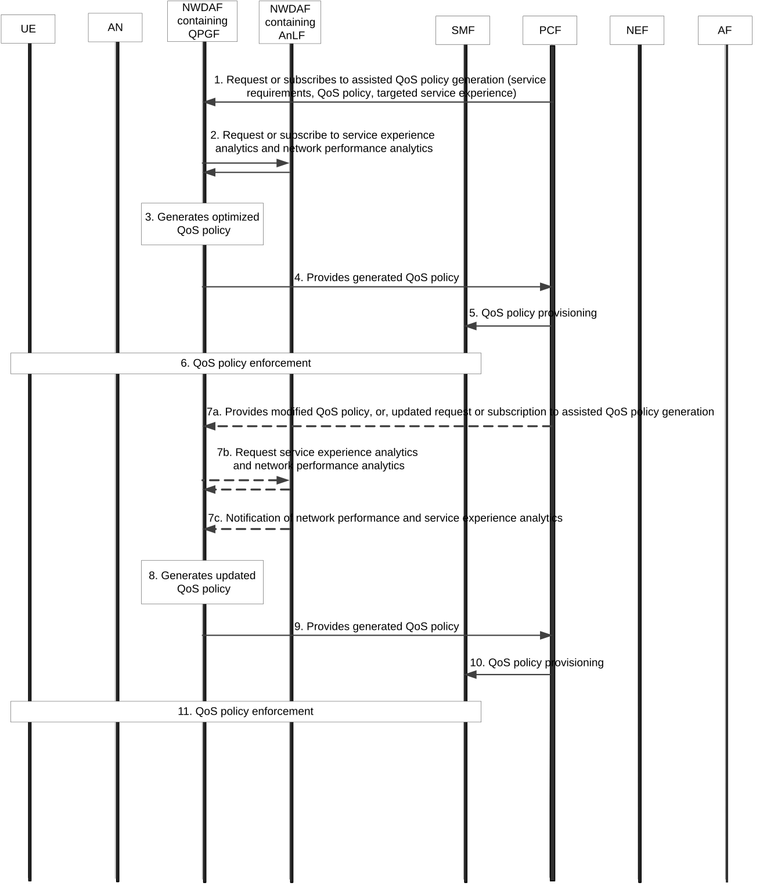

# 6.27 Solution \#27: NWDAF assisted QoS policy generation

## 6.27.1 Description

This solution addresses Key Issue \#3 "NWDAF-assisted policy control and QoS enhancement".

As described in clause 5.1.1 "Use Case \#1: NWDAF-assisted QoS recommendation", the PCF may determine whether the current QoS can fully satisfy the service requirements and update the QoS parameters based on the Service Experience analytics provided by the NWDAF, and it may require several iterations (i.e. PCF adjusting QoS parameters and NWDAF deriving Service Experience analytics) to work out the ideal QoS parameters

Based on the above use case and KI#3 description, it is proposed that the NWDAF can generate assisted QoS Policy based on QoS policy provided by the PCF as well as the analytics of service experience and network performance after enforcement of the QoS policy, so that the iterative procedures between the PCF and NWDAF as shown in Use Case \#1 can be avoided. Furthermore, to minimize the impacts to existing NWDAF logical functions, i.e. AnLF and MTLF, it is proposed to introduce a new logical function in the NWDAF for assisted QoS Policy Generation, namely QPGF (QoS Policy Generation Function).

A NWDAF containing QPGF can generate assisted QoS policy in the following way:

\- The QPGF trains a generative ML model to output the optimized QoS policy using the following input data:

\- service requirements (obtained from the PCF or AF);

\- network performance related data, which can be obtained from Network Performance analytics information provided by the AnLF;

\- service experience related data, which can be obtained from Observed Service Experience analytics provided by the AnLF;

\- optionally, QoS policy provided by the PCF, which can be used for initial model (re)training;

\- optionally, targeted service experience provided by the PCF.

NOTE: How the QPGF trains the generative ML model to output the optimized QoS policy using the above input data is up to implementation. For example, the QPGF can perform Reinforcement Learning to achieve the targeted service experience considering the service requirements and current network performance.

\- The QPGF sends to the PCF the generated QoS policy, which is further provisioned by the PCF to the SMF. The SMF interacts with the NG-RAN, UPF and UE for policy enforcements. The PCF may modify the generated QoS policy before provisioning it to the SMF, and if so the PCF also provides the modified QoS policy to the QPGF.

\- Based on the modified QoS policy if received from the PCF, the QPGF further trains the generative ML model using the latest input data to generate the optimized QoS policy.

## 6.27.2 Procedures

Figure 6.27.2-1: Procedure for QPGF assisted QoS policy generation

1\. The PCF requests or subscribes to assisted QoS policy generation from the NWDAF containing QPGF, providing the service requirements (received from the AF), optionally QoS policy and targeted service experience.

2\. The NWDAF containing QPGF requests or subscribes to network performance analytics and service experience analytics from the NWDAF containing AnLF.

3\. The NWDAF containing QPGF generates optimized QoS policy based on the information provided by the PCF and analytics information provided by the NWDAF containing AnLF.

4\. The NWDAF containing QPGF provides the generated QoS policy to the PCF.

5\. The PCF provisions the generated QoS policy to the SMF. The PCF may modify the generated QoS policy before provisioning it to the SMF.

6\. The SMF interacts with the NG-RAN, UPF and UE to enforce the QoS policy.

7a. The PCF provides the QoS policy if modified in step 5 to the NWDAF containing QPGF, or provides the update request or subscription to assisted QoS policy generation (with updated service requirements, QoS policy and/or targeted service experience), to the NWDAF containing QPGF.

7b/7c. The NWDAF containing QPGF requests network performance analytics and service experience analytics from the NWDAF containing AnLF, or receives notification of updated network performance analytics and service experience analytics information from the NWDAF containing AnLF.

8\. The NWDAF containing QPGF generates further optimized QoS policy, based on the information provided by the PCF and the NWDAF containing AnLF if received in step 7.

9-11. Same as step 4-6.

## 6.27.3 Impacts on services, entities and interfaces

**NWDAF:**

\- Contains a new logical function QPGF which generates optimized QoS policy using the input data such as service requirements and optionally QoS policy and targeted service experience from PCF, and analytics information of service experience and network performance.

**PCF:**

\- Requests or subscribes to assisted QoS policy generation from the NWDAF containing QPGF, by providing service requirements, optionally QoS policy and targeted service experience to the NWDAF containing QPGF.
