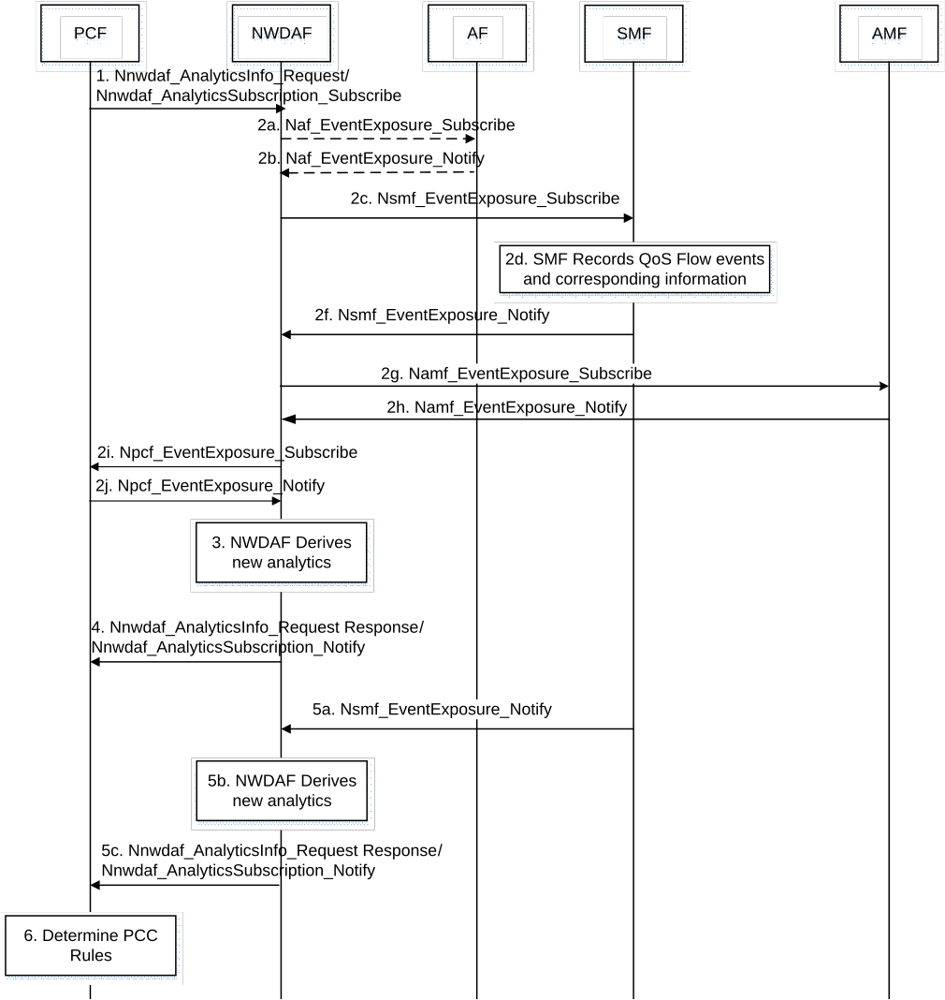

# 6.28 Solution \#28: QoS Flow Analytics

## 6.28.1 Description

In 5GC, QoS Flows are managed by SMF. Based on the requests from UE or AF and also notification from RAN, SMF in collaboration with PCF, based on PCC rules, determines the appropriate QoS characteristics which are then sent by SMF to the RAN, UE and also configured in UPF(s) to establish the QoS Flow. Therefore, SMF has the full knowledge of the established QoS flows for each PDU session of every UE in 5GC based on the PCC rules provided by PCF. This source of information can be used to predict further QoS Flow requests.

The KI#3 is about providing assistance from NWDAF to PCF for QoS and policy control. As explained in the corresponding key issue \#1, the objective is to assist to PCF to achieve the expected service experience with minimum number of iterations of applying QoS profile and evaluating the user experienced service. Currently PCF may need a number of iterations to achieve the expected service experience since it does not take into account (i.e. does not learn) from its past experiences. One solution to the problem is to analyse the past actions taken by the PCF (i.e. the PCC rules derived by PCF and its associated QoS parameters/profiles applied by SMF) in combination with the observed service experience and/or QoS sustainability in the same situation (i.e. for the same UE, in the same location and at the same time); and provide this information as the evaluation of past actions of PCF. Then PCF, may consider these information (i.e. the applied PCC rules and QoS parameter and corresponding observed service experience and QoS sustainability) in deriving PCC rule to be applied in a similar situation.

Currently the "Observed Service Experienced" and "QoS Sustainability" analytics are supported by NWDAF via collecting the corresponding input data for a period of time and then providing the statistics and prediction of the outputs. PCF may subscribe to these analytics to get information about the observed QoS; however, the PCC rules and associated QoS parameter/profiles that led to that level of observed QoS is not recorded for a time window (i.e. PCF and SMF only knows the currently applied QoS profiles/parameters).

To address the gap, the main idea of the proposed solution is that NWDAF can collects the information of the applied PCC rules and established QoS Flows from PCF and SMF respectively and by analysing the information can provide statistics and/or prediction of the PCC rules and QoS Flows parameters.

PCF may subscribe to this analytics and also the Observed Service Experience and QoS sustainability analytics for a specific situation (UE, Application, time, location, etc.) specified by the request input parameters (such as Analytics Filter Information) and then based on the output analytics provided by NWDAF, PCF gets evaluation (in terms of observed user experience and/or QoS sustainability) of the PCC rules (and associated QoS profiles/parameter) which are utilized by PCF to determine appropriate QoS parameters in PCC rules of the given QoS Flow request when there is a request to stablish/modify QoS flow for specific UE in a specific time and/or location.

NOTE 1: PCF needs to subscribe to the proposed "QoS flow" analytics and "Observed Service Experience" and/or "QoS Sustainability" analytics with the same (applicable) Analytics Filter to make sure that the provided evaluation corresponds to the applied PCC rule and QoS profile.

Based on the PCC rules provided by PCF, as defined in clause 5.7.1.1 of TS 23.501, any QoS Flow is characterized by:

\- A QoS profile provided by the SMF to the AN via the AMF over the N2 reference point or preconfigured in the AN;

\- One or more QoS rule(s) and optionally QoS Flow level QoS parameters associated with these QoS rule(s);

\- One or more UL and DL PDR(s) provided by the SMF to the UPF.

In the proposed solution, PCF informs (the QoS related part of) the applied PCC rules to NWDAF and SMF also records the three mentioned categories of information of any QoS Flow of any PDU session of UE(s), possibly in an area of interest and for a period of time, and reports them to NWDAF in the establishment and release of the QoS Flow. Based on the information, NWDAF determines the duration of each QoS Flow and its characteristics and also the number of times these parameters are used for different QoS Flows. Additionally, NWDAF collects time and also the location of the UE. Based on this information, NWDAF knows which QoS Flows (specified by the AN QoS profile, UE QoS rules and UPF PDRs) are commonly used by UE in different scenarios (time and location). This information is used as training data to train a model that can provide a list of most probable (commonly used) QoS Flows parameters for a given UE in a specific scenario. This capability is named provisioning "QoS Flow Analytics" in this paper.

This analytics provides an ordered list of QoS parameters based on the duration and number of usages which in combination to the corresponding "Observed Service Experience" and/or "QoS Sustainability" for the same situation can be interpreted as recommendation to the PCF by NWDAF for example for a given set of parameters:

\- If experienced service is good, the long duration in combination with the large number of usages implies that the QoS Flow based on corresponding set of parameters were satisfying user expectations in many cases, so, this set can be a recommended option.

\- Large number of usages in combination with very short duration in the case of unsustainable situation may imply that PCF has tried this set of parameters but the network could not provide it or in short duration user notified that it is not satisfactory and requested to change it. Therefore, this set may not be good option for the requested QoS Flow.

NOTE 2: It is not mandatory that NWDAF must include only the QoS parameters which has been reported by SMF; using Generative AI technique, NWDAF may generate a new set of QoS parameters as recommendation/prediction for a future time.

Therefore, the proposed analytics in combination to the "Observed Service Experience" and/or "QoS Sustainability" can be used by PCF (as a recommendation of QoS parameters) for QoS and policy control for determining the QoS parameters in QoS Flow establishment/modification time. The details of the operations of the proposed solution are explained in clause 6.28.2.

## 6.28.2 Procedures

The consumer of the proposed "QoS Flow analytics" may indicate in the request:

\- Analytics ID = "QoS Flow".

\- Target of Analytics Reporting: a single UE (SUPI) or a group of UEs (an Internal Group ID).

\- Analytics Filter Information optionally including:

\- S-NSSAI;

\- DNN;

\- Application ID;

\- Area of Interest;

\- an optional list of analytics subsets that are requested.

\- An Analytics target period indicates the time period over which the statistics or predictions are requested.

\- Preferred level of accuracy of the analytics.

\- Optional Preferred level of accuracy per analytics subset;

\- Optional preferred order of results for the list of QoS Flows:

\- ordering criterion: "duration" or "number of usages",

\- order: ascending or descending.

\- Optionally, maximum number of objects.

\- In a subscription, the Notification Correlation Id and the Notification Target Address are included.

To train the ML model corresponding to the QoS Flow analytics, NWDAF collects data specified in Table 6.28.2-1.

Table 6.28.2-1: Input data from 5GC related to QoS Flow

<table>
<colgroup>
<col style="width: 28%" />
<col style="width: 13%" />
<col style="width: 57%" />
</colgroup>
<thead>
<tr class="header">
<th>Information</th>
<th>Source</th>
<th>Description</th>
</tr>
</thead>
<tbody>
<tr class="odd">
<td>Time</td>
<td>SMF</td>
<td>Time stamp of the generated data record</td>
</tr>
<tr class="even">
<td>UE ID</td>
<td>SMF, AF</td>
<td>SUPI in the case of SMF, external UE ID (i.e. GPSI) in the case of AF</td>
</tr>
<tr class="odd">
<td>Group ID</td>
<td>SMF, AF</td>
<td>
To identify UE group if available

Internal Group ID in the case of SMF, External Group ID in the case of AF
</td>
</tr>
<tr class="even">
<td>S-NSSAI</td>
<td>SMF</td>
<td>Information to identify a Network Slice</td>
</tr>
<tr class="odd">
<td>DNN</td>
<td>SMF</td>
<td>Data Network Name where PDU connectivity service is provided</td>
</tr>
<tr class="even">
<td>Application ID</td>
<td>SMF, AF</td>
<td>Identifying the application providing this information</td>
</tr>
<tr class="odd">
<td>PDU session ID (1..max)</td>
<td>SMF</td>
<td>Identification of PDU Session.</td>
</tr>
<tr class="even">
<td>&gt;QoS Flow ID (1..max)</td>
<td></td>
<td>Identification of QoS Flow.</td>
</tr>
<tr class="odd">
<td>&gt;&gt;QoS profile</td>
<td></td>
<td>AN QoS profile of the QoS Flow</td>
</tr>
<tr class="even">
<td>&gt;&gt;QoS rules (1..max)</td>
<td></td>
<td>UE side QoS rules of the QoS Flow</td>
</tr>
<tr class="odd">
<td>&gt;&gt;&gt;5QI</td>
<td></td>
<td>5QI associated to the QoS Rule</td>
</tr>
<tr class="even">
<td>&gt;&gt;&gt;QoS Parameters</td>
<td></td>
<td>QoS parameters of the QoS Rule</td>
</tr>
<tr class="odd">
<td>UE locations (1..max)</td>
<td>AMF</td>
<td>UE positions</td>
</tr>
<tr class="even">
<td>&gt;UE location</td>
<td></td>
<td>TA or cells that the UE enters</td>
</tr>
<tr class="odd">
<td>&gt;Timestamp</td>
<td></td>
<td>A time stamp when the AMF detects the UE enters this location</td>
</tr>
<tr class="even">
<td>"Service data flow detection" and "Policy control" part of PCC rules</td>
<td>PCF</td>
<td>The information of the traffic and corresponding policy rules provided by the PCF.</td>
</tr>
</tbody>
</table>

NWDAF provides the statistic and prediction of QoS Flow as depicted in Table 6.28.2-2 and 6.28.3-3 respectively.

Table 6.28.2-2: Output statistics of QoS Flow Analytics

| Information                                                            | Description                                                           |
|------------------------------------------------------------------------|-----------------------------------------------------------------------|
| UE ID                                                                  | SUPI in the case of SMF, external UE ID (i.e. GPSI) in the case of AF |
| S-NSSAI                                                                | Information to identify a Network Slice                               |
| DNN                                                                    | Data Network Name where PDU connectivity service is provided          |
| Application ID                                                         | Identifying the application                                           |
| QoS Flow (1..max)                                                      | List of QoS Flows                                                     |
| \>Duration                                                             | Duration of QoS Flow                                                  |
| \>Number of usages                                                     | The number of times that this QoS Flow characteristics are used       |
| \>QoS profile                                                          | AN QoS profile of the QoS Flow                                        |
| \>QoS rules (1..max)                                                   | UE side QoS rules of the QoS Flow                                     |
| \>\>5QI                                                                | 5QI associated to the QoS Rule                                        |
| \>\>QoS Parameters                                                     | QoS parameters of the QoS Rule                                        |
| \>"Service data flow detection" and "Policy control" part of PCC rules | Traffic description and applied PCC rules                             |

Table 6.28.2-2: Output predictions of QoS Flow Analytics

| Information                                                            | Description                                                            |
|------------------------------------------------------------------------|------------------------------------------------------------------------|
| UE ID                                                                  | SUPI in the case of SMF, external UE ID (i.e. GPSI) in the case of AF  |
| S-NSSAI                                                                | Information to identify a Network Slice                                |
| DNN                                                                    | Data Network Name where PDU connectivity service is provided           |
| Application ID                                                         | Identifying the application                                            |
| QoS Flow (1..max)                                                      | List of QoS Flows                                                      |
| \>Duration                                                             | Duration of QoS Flow                                                   |
| \>Number of used                                                       | The number of times that this QoS Flow characteristics are used        |
| \>QoS profile                                                          | AN QoS profile of the QoS Flow                                         |
| \>QoS rules (1..max)                                                   | UE side QoS rules of the QoS Flow                                      |
| \>\>5QI                                                                | 5QI associated to the QoS Rule                                         |
| \>\>QoS Parameters                                                     | QoS parameters of the QoS Rule                                         |
| \>"Service data flow detection" and "Policy control" part of PCC rules | \>"Service data flow detection" and "Policy control" part of PCC rules |

Figure 6.28.2-1 shows the procedure where the NWDAF provides QoS Flow analytics, in the form of statistics or predictions or both, to PCF.

Figure 6.28.2-1: Procedure for QoS Flow analytics

1\. PCF sends a request to the NWDAF for the analytics on a specific UE(s), using either Nnwdaf_AnalyticsInfo or Nnwdaf_AnalyticsSubscription_Subscribe service. The analytics type indicated by "Analytics ID" is set to "QoS Flow". The Target of Analytics Reporting is set to SUPI or an Internal Group Identifier and Analytics Filter may include Application ID and Area of Interest. PCF may also specify a desired ordering e.g. "Duration" to get a list of QoS parameters used for most of the time.

2a-b. To provide the requested analytics, the NWDAF may subscribe per application communication information, which is identified by Application ID, from AFs for the UE. The Event ID "UE Communication information" as defined in TS 23.502 \[3\] is used, which indicates communication report for the UE which is requested by the 5GC NF in the step 1.

2c. The NWDAF subscribes to SMF for QoS Flow information of SUPI.

2d. The SMF records the events (establishment, release, change) of QoS Flow of the specified UE per PDU session. SMF also record the corresponding information of the QoS Flow specified in Table 6.28.2-1.

2f. The SMF provides the requested input data to NWDAF.

2g-h. The NWDAF retrieves one or more of Type Allocation code and UE location trends from AMF.

2i-j. The NWDAF retrieves information of applied PCC rules from PCF.

3\. The NWDAF derives requested analytics, in the form of statistics or predictions or both.

4\. The NWDAF provides requested QoS Flow analytics to the NF, using either Nnwdaf_AnalyticsInfo_Request response or Nnwdaf_AnalyticsSubscription_Notify, depending on the service used in step 1. The output includes a list of QoS information which are ordered based on the ordering specified by PCF in step 1.

5\. If the PCF subscribed QoS Flow analytics at step 1, based on new events from SMF, NWDAF may update the analytics, and then notifies the new generated analytics to the PCF.

6\. Using on the ordered list of QoS information provided by NWDAF, PCF knows the most commonly used QoS information for the UE in the specified time and location; based on this information and considering other influencing factors (e.g. network resources, operator's policy, etc.) PCF determines the QoS parameters in QoS Flow establishment/modification time.

## 6.28.3 Impacts on existing services, entities and interfaces

The solution has the following impacts:

**NWDAF:**

\- Extending functionalities to produce QoS Flow analytics.

**SMF:**

\- Extending functionalities and service to report QoS Flow events and corresponding information.

**PCF:**

\- Extending functionalities to use QoS Flow analytics for QoS and policy control.

\- Extending functionalities and service to report applied PCC rules information.
