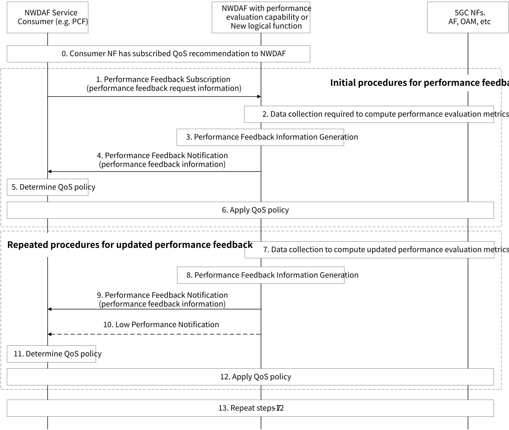

# 6.29 Solution \#29: How to evaluate NWDAF-assisted policy control and QoS enhancement

## 6.29.1 Description

Currently, the quality of NWDAF analytics is monitored by the analytics accuracy. This accuracy monitoring assumes that higher analytics accuracy leads to better performance when analytics consumers take action(s) based on the provided analytics. However, this assumption may not hold true, especially when the target performance's formula is complex, such as nonlinear combinations of various analytics' KPIs.

In such cases, deriving the target performance directly from NWDAF analytics can be challenging. Therefore, there's a need for an enhanced approach that considers the actual impact of NWDAF assistance on the target performance when consumers take action(s) with the assistance of the NWDAF.

This solution addresses how to evaluate NWDAF-assisted policy control and QoS enhancement, including the following aspects:

\- Utilizing not just analytics accuracy but also performance feedback for evaluating the quality of NWDAF-assisted policy control and QoS enhancement.

\- Allowing consumers to specify how performance evaluation metrics are calculated and what input data are required when requesting or subscribing to performance feedback from NWDAF.

\- Introducing performance evaluation capability within NWDAF. The NWDAF with performance evaluation capability collects the required data, calculates performance evaluation metrics, and provides performance feedback information including the performance evaluation metrics.

## 6.29.2 Procedures

Figure 6.29.2-1 shows the procedure to support the use case where NWDAF service consumer (e.g. PCF) subscribes performance feedback from NWDAF to evaluate the quality of QoS recommendation. Other use cases could be also supported by this procedure.

Editor's note: Whether to introduce a new logical function in the NWDAF for performance evaluation capability is FFS.

Figure 6.29.2-1: Procedure for Performance Feedback from NWDAF

0\. NWDAF service consumer (e.g. PCF) has subscribed QoS recommendation to NWDAF which provides recommendation service.

1\. The NWDAF service consumer selects the appropriated NWDAF with performance evaluation capability and subscribes to performance feedback from the NWDAF. The consumer may provide performance feedback request information describing how performance evaluation metrics should be computed using the data collected from 5GC NFs, AF and OAM.

Editor's note: The specifics of performance evaluation metrics and required data are FFS.

NOTE 1: Performance evaluation metrics could involve a combination of RAN UE Throughput KPI and delay in RAN KPI (defined in TS 28.554 \[14\]) for any UE in an area of interest. Alternatively, it could be defined as a non-linear combination of Observed Service Experience related analytics KPIs (i.e. observed Service MoS) and Redundant Transmission Experience related analytics KPIs (defined in TS 23.288 \[5\]) for a group of UEs in an Application.

2\. The NWDAF with performance evaluation capability starts to generate performance feedback information. If the NWDAF with performance evaluation capability does not have enough data, it performs data collection from 5GC NFs, AF and OAM to compute performance evaluation metrics defined in performance feedback request information. If the performance feedback request information is not provided by the consumer, the performance evaluation metrics are determined by the NWDAF with performance evaluation capability.

3\. The NWDAF with performance evaluation capability generates the performance feedback information, including the performance evaluation metrics based on collected data.

4\. The NWDAF with performance evaluation capability provides the performance feedback information to the NWDAF service consumer.

5\. The NWDAF service consumer makes decision on QoS policy based on the received performance feedback, while also taking into consideration any analytics outputs or recommendations from the NWDAF that were subscribed to beforehand.

NOTE 2: If the consumer NF is a PCF and it has subscribed to recommendations for QoS parameters, it can determine whether to adopt the QoS recommendation or not using the performance feedback.

6\. The consumer applies the determined QoS policy from step 5 (e.g. PCF updates PCC rules if needed).

7\. The NWDAF with performance evaluation capability gathers data from 5GC NFs, AF and OAM to compute updated performance evaluation metrics, which may be influenced by previous actions taken by the consumer.

8-9. Same as steps 3-4.

10\. The NWDAF with performance evaluation capability may identify low or insufficient performance, indicating that the target performance is under the threshold (which is pre-configured or received in the Subscribe request). In such cases, the NWDAF with performance evaluation capability may notify the consumer accordingly. As an example, the NWDAF with performance evaluation capability might inform the consumer not to use the recommended QoS parameters.

Editor's note: Whether and how to reuse the existing procedures for Analytics Accuracy Information subscription is FFS.

11\. The consumer decides QoS policy. If the consumer NF is a PCF and it received the notification about low or insufficient performance, it may stop to take into account recommendations from NWDAF for making decisions (e.g. PCF determines QoS parameters by internal logic).

12\. Same as step 6.

13\. Steps 7 to 12 are repeated.

## 6.29.3 Impacts on services, entities and interfaces

**NWDAF:**

\- Performance evaluation capability to compute performance evaluation metrics based on the performance feedback request information.

**PCF:**

\- Provides performance feedback request information to subscribe performance feedback from NWDAF and determines QoS policy based on the performance feedback provided by the NWDAF.

**Other NFs:**

\- Additional data provision to NWDAF.

**AF:**

\- Additional data provision to NWDAF.

**OAM:**

\- Additional data provision to NWDAF.

**UE:**

\- None
