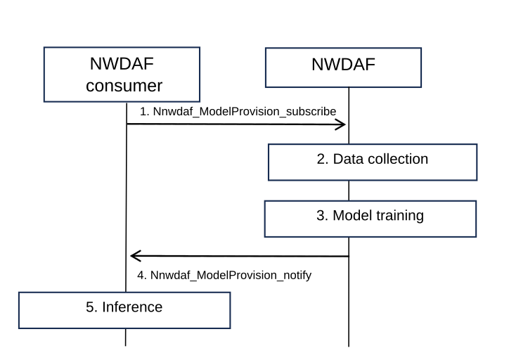

# 6.3 Solution \#3: Training of the AI/ML positioning model

## 6.3.1 Functional Description

A request of LMF-side model that outputs location of a specific UE is provided by the service consumer. After training of the ML model, the NWDAF provides the trained ML model to the service consumer (e.g. LMF) and the service consumer can perform inference afterwards.

Although the service consumer can obtain UE location from AMF/LCS, but the accuracy may not be enough. Therefore, an enhancement of the existing NWDAF is needed, to train the ML model with measurement data and provide a more accurate location estimate of an UE.

### 6.3.1.1 Input of model training

Table 6.3.1.1-1: Data Collected for LMF-side model training

| Information          | Source | Description                                                   |
|----------------------|--------|---------------------------------------------------------------|
| Measurements         |        |                                                               |
| \>Measurement data   |        | The measurement data collected by LMF.                        |
| \>Positioning method | TBD    | The positioning method corresponding to the measurement data. |
| \>Time stamp         |        | Time stamp of measurement data.                               |
| Ground truth data    | TBD    | The Ground truth data for the LMF-side model training.        |

The information may collect by the NWDAF for LMF-side model training is defined in Table 6.3.1.1-1.

Editor's note: It is FFS to determine what and how data to be collected for LMF-side model training. Coordination with RAN WG is needed.

Editor's note: The ground truth data for LMF-side model is ground truth UE location, and how to collect the ground truth UE location is FFS.

The trained LMF-side model shall be able to calculate UE location.

## 6.3.2 Procedures

The NWDAF can provide trained LMF-side model to consumer as follows:

Figure 6.3.2-1: Procedure for Training of the AI/ML positioning model

If the consumer request a trained model in step 1, the NWDAF provides the trained model to the consumer with the training input data information to help the consumer perform inference.

1\. NWDAF consumer(e.g. LMF) subscribe to NWDAF by using existing procedure to obtain LMF-side model.

2\. The NWDAF collects training data specified in the Table 6.3.1.1-1.

Editor's note: It is FFS to determine the data collection procedure for model training.

3\. The NWDAF performs model training base on the collected training data.

4\. The NWDAF provides the trained model to the consumer with the training input data information to help the consumer perform inference.

5\. The consumer can perform inference afterwards.

NOTE: Whether and how to trigger inference is not in the scope of this solution.

Editor's note: Whether the LMF is a standalone NF or co-located with AnLF for model inference is FFS.

## 6.3.3 Impacts on existing services, entities and interfaces

To implement the proposed solution, the NWDAF should support the proposed model training with input data(listed in table 6.3.1.1-1) collection capability. The trained model shall have the ability to calculate UE location. Besides, the NWDAF shall be able to provide the trained model to consumer.
