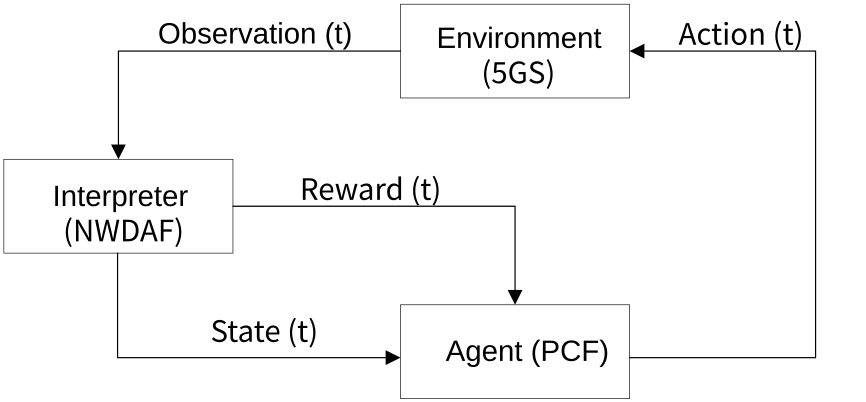
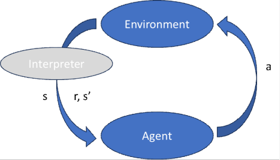
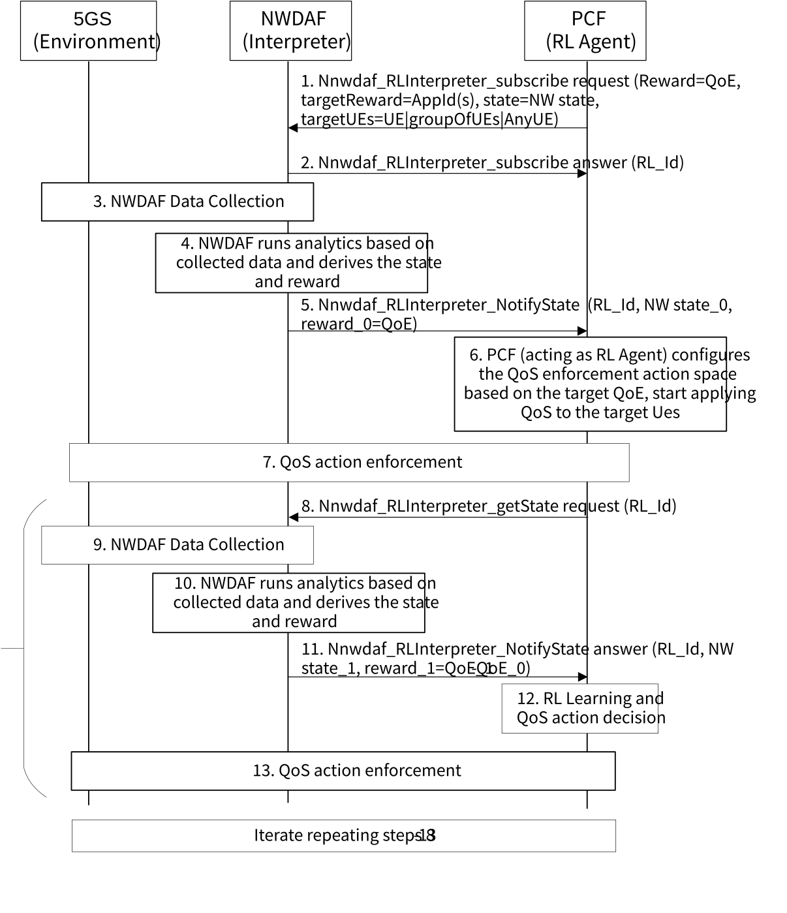

# 6.31 Solution \#31: PCF as RL Agent and NWDAF as Interpreter

## 6.31.1 Key Issue mapping

This solution addresses Key Issue \#3: "NWDAF-assisted policy control and QoS enhancement".

## 6.31.2 Description

This solution (high level view depicted in Figure 6.31.2-1) proposes a 5GC enhancement to support the mechanism of reinforcement learning by:

\- Enhancing PCF as RL Agent.

\- Enhancing NWDAF as RL Interpreter.

Figure 6.31.2-1: Procedure for PCF acting as RL Agent

In this proposal the RL technique is used to learn the most appropriate actions the Agent (PCF) may take to reach a target (wanted) QoE for a service (or group of services) depending on the state of the Network. The target QoE is provided to the PCF via configuration based e.g. on SLA.

In the generic Reinforcement Learning problem, the State may change every time the Agent applies a new Action. The problem can be represented in the following way: The Agent receives the State of the Environment (through the Interpreter) at a certain time (s). Then the Agent selects on action (a) and applies it in the Environment. When this action is applied, the Environment provides a Reward (r) and changes to a new State (s'), the Reward and State provided finally by the Interpreter.

Figure 6.31.2-2: RL Learning Cyclic Procedure

This cyclic procedure brings a sequence of states, actions and rewards: s1, a1,r1;…;sT,aT,rT. The agent may use different learning algorithms to learn the most appropriate action to take on every different state of the NW.

The PCF as Agent may take different actions to maximize the QoE, e.g. to change the QoS parameters (5QI, GBR, MBR, etc.) applied to the target service(s).

The NWDAF as Interpreter needs to observe the Environment and provide the Reward and State upon an action is applied by the PCF. In this context State refers to the NW state and Reward refers to a measure in the increment/decrement of the QoE for the target service(s):

\- State(NW state): the NWDAF is able today to collect big amount of data from the 5GC NFs and OAM that can be used to provide a measure of the state of the NW, e.g. using the input data currently defined for existing analytics as e.g. Slice Load, NW Performance, OSE, User Data Congestion, etc. The combination (i.e. the aggregation) of some existing analytics could be also used for such purpose e.g. slice load, NW performance, OSE, User Data Congestion, etc..

\- Reward: The NWDAF may calculate the Reward of the action applied by the PCF by e.g. comparing the value of OSE analytic before and after the action (note the actions are not taking an immediate effect in the value of OSE analytic), e.g. Reward(t)=OSE(t) - OSE(t-1), so the Reward might be modelled just as an integer. In addition, the NWDAF could collect some other additional data for the calculation as the impact in the QoE for some other services computed also as a difference in the OSE analytic for other services. In such a case the Reward might still include just a single integer value, or the additional computation included as additional data.

\- The PCF needs to implement an algorithm for learning with the assistance of the NWDAF to provide the State and Reward upon every new action is applied in every iteration of the cycle.

Exploration vs. Exploitation: In reinforcement learning, the agent needs to balance exploration (trying new things to discover better rewards) with exploitation (using known information to maximize rewards). This is a fundamental trade-off in RL.

This solution proposes to define a new service in NWDAF to provide the State and Reward to the PCF. The service and methods are proposed generically to allow the application of this mechanism also to other cases where RL is needed. For that purpose, the NF consumer (PCF for the case of this NWDAF-assisted policy control and QoS enhancement) needs to identify which State and Reward (from a list of predefined ones) will be used for the RL procedure.

Defining a new service to provide State and Reward allows the flexibility for the NWDAF to use additional data for such calculation in case it is needed. Another advantage compared with reusing existing NWDAF services and analytics is that the interactions between the PCF and the NWDAF are minimized for every iteration in the RL process, specially for the case where the State is calculated by means of a combination of different Analytics. Last having a new service makes easier for the NWDAF to calculate new values of the State and Reward collecting only data from the NW after the QoS action has been applied by the PCF, because the different invocations of the new service corresponding to the same RL process will be correlated by the same identifier (RL_Id).

In addition, in order to apply the RL process (e.g. the adjustment of QoS to reach a wanted QoE) just to a set a of UEs, the NWDAF new service allows to set the target UEs for the computation of the Reward.

Editor's note: Whether the PCF can collect the State from the Environment directly is FFS.

Editor's note: Whether the PCF can determine the Reward instead of the NWDAF is FFS.

## 6.31.3 Procedures

### 6.31.3.1 PCF as RL Agent

Figure 6.31.3-1 depicts the procedure for the proposed solution.

Figure 6.31.3.1-1: Procedure for PCF as RL Agent

1\. PCF starts the process by invoking the new Nnwdaf_RLInterpreter service providing the definition of state(NW state) and Reward (based on QoE), targetReward (including the appId/service or the list of them for the calculation of the Reward) and target UEs.

Editor's note: Whether the PCF provides a (list of) analytics that are needed to define the NW state or the service request includes a reference for the NWDAF to know what analytics are needed to derive this state is FFS.

2\. NWDAF answers providing the identifier of the RL process. This identifier will be used to correlate all the iterations within the the RL process.

3\. If not available the NWDAF starts data collection in order to calculate the State (e.g. the state may be based on a combination of some existing analytics as slice load, NW performance, OSE, User Data Congestion) and Reward (based on OSE analytic).

4\. NWDAF derives the State and Reward based on collected data. As an example the NWDAF may derive the State based on a combination of some existing analytics e.g. slice load, NW performance, OSE, User Data Congestion. The NWDAF may derive the Reward based on the OSE analytic and the difference between the one calculated in previous iteration. For the first iteration (no previous value of OSE) the NWDAF just provides the initial value of OSE.

5\. NWDAF notifies the PCF by invoking Nnwdaf_RLInterpreter_NotifyState providing the current state of the NW and the initial value of the Reward.

6\. PCF may update PCC rules.

7\. The NW enforces the QoS action as in the PCC Rule.

8\. The PCF asks NWDAF to get a new value of Reward and State.

9\. The NWDAF starts collecting data to get the new value of OSE and NW state. Note the NWDAF needs to collect data from the NW after the QoS action has been applied by the NW. This is to compute the new value of OSE that takes into account such actions.

10\. NWDAF derives the new value of State and Reward based on collected data (similar than in 4).

11\. NWDAF triggers Nnwdaf_RLInterpreter_NotifyState to provide new State and Reward to the PCF

12\. PCF triggers RL agent learning process based on the State and Reward received. RL Agent learns the effect of the past QoS enforcement action decisions for a given NW state. The learning phase basically means that the RL agent learns how to map the states to the actions in an optimal way, usually by trying to maximize the reward of the actions. The RL Agent might decide the QoS enforcement actions based on the target QoE, the set of possible actions whether it's on exploration or exploitation mode, the learnt information, etc.

The PCF selects one action and start applying such action to the target UEs (e.g. by updating the PCC rules).

13\. The NW enforces the QoS action.

The steps 8-13 are repeated sequentially.

Editor's note: Whether an existing service or a new service is needed is FFS.

## 6.31.4 Impacts on services, entities and interfaces

Editor's note: This clause captures impacts on existing 3GPP nodes and functional elements.

**PCF:**

\- Acting as RL Agent.

**NWDAF:**

\- Acting as RL Interpreter, implements a new service to provide State and Reward to assist in RL procedures.

\- NWDAF supports the calculation of state=NW state.

\- NWDAF supports the calculation of Reward.

Editor's note: Impacts on services and NFs need to be detailed.
