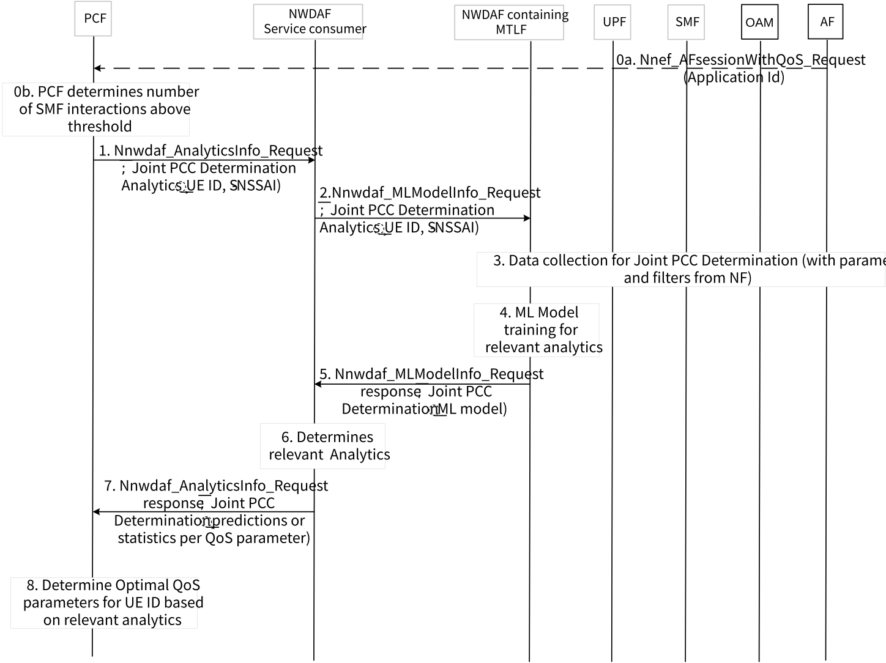

# 6.32 Solution \#32: NWDAF-assisted optimized QoS policies determination

## 6.32.1 Description

This solution addresses aspects of key issue \#3 on NWDAF-assisted policy control and QoS enhancement.

This solution proposes a new network analytic that combines multiple analytics produced within a set time window, such as Observed service experience and QoS sustainability. These new analytic may be called "Joint PCC determination".

As an alternative, existing analytics can be used, albeit ensuring that their outputs are produced within a set time window or validity periods, to ensure that their combined outputs are valid for the duration of this validity period.

The PCF may be configured, based on operator policies, with conditions that trigger the PCF to determine when this new analytic or any other relevant combination of analytic may be requested to enhance QoS Policy control and optimized QoS policies determination. Such conditions may include configuring the PCF with operator policies or local configuration, e.g. a threshold of the number of SMF-PCF interactions that request changing PCC rules, per time period.

The input data used by the NWDAF to derive Joint PCC determination analytics, may include input data collected for existing analytics, e.g. Observed service experience analytics (tables in clause 6.4.2 of TS 23.288 \[5\]), and input data collected for the existing QoS sustainability analytics. (tables in clause 6.9.2 of TS 23.288 \[5\]). Furthermore, additional input data may be collected in relation to QoS sustainability include data for a UE ID or group of UE IDs, application ID, service type, S-NSSAI, and DNN.

Output analytics exposed by NWDAF are dependent on the combined analytics used for the Joint PCC determination, e.g. a combination of output analytics for Observed Service Experience and QoS sustainability.

NOTE: The input data for service experience analytics received by the NWDAF defined by the TS 23.288 \[5\]), Table 6.4.2-5 is also enhanced to support newly introduced/updated fields as per TS 28.104 \[9\], Table 8.4.2.1.3-1 (i.e. serviceInformation and affectedObjects fields) by introducing serviceInformation field and extending the definition of affectedObjects field.

Enhanced ServiceInformation may be useful for the PCF when calculating 5QI values assigned to an application, which the PCF may use as an input to calculate and update the authorized QoS.

## 6.32.2 Procedures

### 6.32.2.1 Procedure for optimized QoS determination based on combined Analytics

The following shows an example procedure where the PCF is triggered to produce optimized QoS policies, and requests multiple analytics, e.g. Observed Service Experience and QoS Sustainability analytics, and it uses these analytic results to determine optimized QoS parameters.

Figure 6.32.2.1-1: Procedure for PCF to be triggered to obtain Joint PCC determination analytics to optimized QoS policies

0a. The AF requests a NEF service operation for a specific application. This may be used by the NEF or the PCF to determine whether additional analytics and predictions may be used, when setting QoS parameters, e.g. based on network operator policies.

0b. Alternatively, the PCF may identify, e.g. using an operator configured threshold, that it has received a large amount of SMF interaction requesting changes to the Policy and Charging Control rules, within certain time period. The time period can, for example, be based on the Revalidation time limit used by the PCF to trigger an SMF interaction, due to enforced PCC rule request.

PCF is triggered to send a request to an NWDAF network function to obtain Joint PCC Determination analytics, e.g. based on step 0a or step 0b, e.g. using Application ID, and S-NSSAI, and indicating a time window within which the combined analytics should be produced.

PCF uses Nnwdaf_analyticsSubscription_Subscribe or Nnwdaf_AnalyticsInfo_Request messages. PCF includes analytics ID = "Joint PCC Determination", UE ID as the target of analytics reporting, and analytics reporting parameters, such as analytics target period. PCF may further include Analytics filter information, such as S-NSSAI/DNN value, and Application ID.

Alternatively, the PCF initiates a subscription for analytics from the NWDAF directly or via DCCF, if deployed, using Ndccf_DataManagement_Subscribe service operation. Whether the NWDAF service consumer (e.g. the PCF) may determine if it directly contacts the NWDAF or it goes via the DCCF, is based on e.g. a need to subscribe, simultaneously, to multiple Analytic IDs, that require data collection from common sources, or as determined by network operator policies.

1\. NWDAF Service consumer sends a Nnwdaf_MLModelInfo_Request message to a NWDAF containing MTLF to request info about ML model for the analytics ID "Joint PCC Determination".

2\. NWDAF containing MTLF checks whether such ML model for "Joint PCC Determination" analytics is available and if it needs to be further trained. The NWDAF containing MTLF may determine that the relevant ML model is not available or need to be re-trained and initiates data collection from different entities (e.g. UPF, SMF, OAM) for ML model training.

3\. NWDAF containing MTLF perform ML model training using the data collected from the NFs and OAM.

4\. After the ML model is training is complete, the NWDAF containing MTLF sends the ML model to the NWDAF Service consumer, e.g. by sending Nnwdaf_MLModelInfo_Request response message to the first NWDAF.

NOTE: The flow does not assume that the ML model training procedure happens immediately upon receipt of the Nnwdaf_AnalyticsInfo_Request message.

5\. NWDAF service consumer determines Joint PCC Determination analytics, based on the received ML Model.

6\. NWDAF service consumer provides the Joint PCC Determination analytic analytics results to PCF, via a Nnwdaf_AnalyticsInfo_Request response.

7\. PCF uses the Joint PCC Determination analytics, to determine an optimal QoS for the UE ID and the application traffic of interest (e.g. QoS that maximizes Observed Service Experience and QoS Sustainabiity).

## 6.32.3 Impacts on services, entities, and interfaces

Editor's note: This clause captures impacts on existing services, entities, and interfaces.

**NWDAF:**

\- Support for new Joint PCC Determination analytics.

**PCF:**

\- Configured to be triggered to determine to optimize QoS policies.
