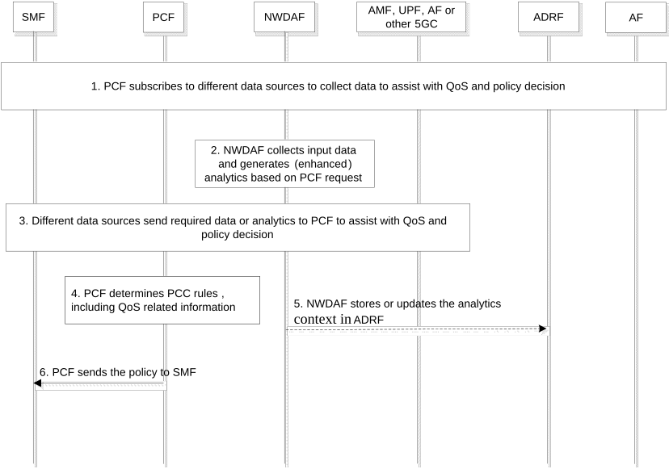
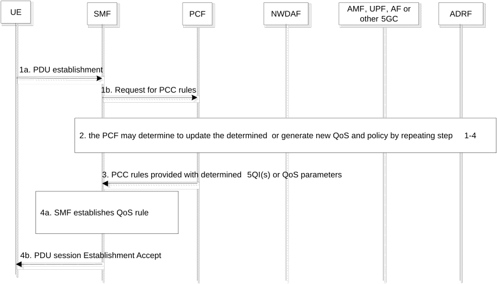

# 6.33 Solution \#33: QoS/policy enhancements assisted by NWDAF

## 6.33.1 Description

Editor's note: The terminology of this solution needs to align with TS 23.503 \[4\].

This solution aims to address the issues in KI#3: NWDAF-assisted policy control and QoS enhancement.

As described in Use Case \#2, each PDU session is associated with a default QoS rule which is normally sufficient for basic browsing or instant messaging over IP in general. For some services that require higher or specific QoS treatments (e.g. V2X, XRM, etc.), modification to the established PDU session might be required, e.g. by establishing new QoS flow or modifying the default QoS rule, which will increase the complex of the system and involve significant system-wide signalling. Furthermore, the modified PDU session may be still not able to guarantee the satisfaction of the QoS. In order to optimise the network performance, it would be beneficial for the 5GC to leverage the NWDAF to assist with determining the 'future proof' and multiple-service-compatible QoS and policy control.

In the existing framework, the PCF may determine the PCC rules based on information collected from multiple data sources, e.g. SMF, UPF, AF, etc. The NWDAF analytics is also considered by the PCF to check and improve the UE and network performance. For example, as documented in clause 6.1.1.3 of TS 23.503 \[4\], the PCF may check whether the applied 5QI values can satisfy the performance requirements and may determine to calculate and update the authorised QoS based on "Service Experience" analytics, may perform the SM Policy Association modifications to update policies for the PDU sessions handling traffic based on User Data Congestion analytics; the PCF may also deploy a combination of multiple network analytics as inputs for policy decisions, e.g. the PCF may request the "Service Experience" analytics based on the UE Communication" analytics received previously for a policy decision.

Currently, the determination of default QoS rule and the SM policy during the PDU session establishment barely deploy the assistance of NWDAF analytics. Whether the determined QoS or policy can satisfy the service requirements or not can be only evaluated after they are applied into 5GS. To avoid necessary PDU session modification, the default QoS can be determined in a more intelligent and sustainable way by considering the aspects that impacts the QoS and policy of the current and also the potential future service(s) of the UE. The PCF may request the leveraged NWDAF analytics of analytic ID(s) to assist with the QoS and policy determination.

The PCF may request a combination of enhanced existing analytics ID(s) as assistance information to determine QoS and policy, similar to the existing mechanism. In addition, the PCF may also request the NWDAF to provide a list of candidate QoS parameters and policies to choose. The PCF will make the final decision on QoS and policy based on its internal logic and subject to operator policy.

For example, the QoS and policy might be determined or updated by considering the network congestion level and resource usage condition (e.g. the resource usage of GBR and non-GBR traffic given by Network performance analytics and congestion level given by congestion related analytics) in the area within which the UE may be expected or unexpected to appear (e.g. based on the UE location provided by UE mobility analytics or Unexpected UE location provided by Abnormal behaviour analytics), the statistics and predictions of the traffic patterns of UE services (e.g. introducing new application level ID level inputs and outputs to UE communication analytics), the service experience of a UE associated to different QoS parameters (e.g. given by service experience), and the finer granularity of QoS sustainability associated to different 5QIs, and the candidate QoS profiles, etc.

The new input data could be service requirements, e.g. 5QI or QoS profile, ARP, RQA, Flow Bit Rates/ traffic rate, GBR or non-GBR, Maximum Packet Loss Rate of the application, as shown in Table 6.33.1-1.

The output of the NWDAF aims help the PCF to understand the service characteristics and the requirements of the past, on-going and potential future service(s) of a UE and the potential candidate QoS. The PCF will be able to generate or determine the future-proof and multi-service-compatible QoS and policy. The statistics and prediction of QoS and policy assistance information may include the per service level or per application ID level traffic related parameters, e.g. by enhancing the existing UE communication analytics, as shown in Table 6..1-2:

\- UL/DL data rate per application ID;

\- data/ traffic volume per application ID;

\- delay per application ID;

\- traffic requirements (e.g. 5QI, ARP, RQA, Flow Bit Rates/ traffic rate, GBR or non-GBR, Maximum Packet Loss Rate of the application or service), etc.

In order to better maintain the service quality for a UE, the QoS sustainability is an important factor. As defined in TS 23.288 \[5\], for a 5QI of GBR resource type, the QoS KPI could be the QoS flow Retainability KPI which reflects how often an end-user abnormally loses a QoS flow during the time the QoS flow is used. If the QoS flow Retainability of a QoS flow associated to a 5QI is not ideal, losing the QoS flow may interrupt the services of a UE. For a 5QI of non-GBR, the QoS KPI refers to the RAN UE Throughput and/or delay in RAN which can reflect the service quality that can be provided by the network in the AOI. Therefore, the outputs analytics could be enhanced to per UE per QoS flow level which will help the PCF to understand the whether the 5QI or QoS parameters can be supported for the UE in the AOI stably. The candidate QoS candidates could be also provide by the NWDAF to the consumer NF (e.g. PCF). The QoS KPI may also provide as the MOS, the user or service experience satisfaction/ level associated to the candidate QoS. The potential enhanced output analytics are shown in Table 6.33.1-2.

Table 6.33.1-1 input Data for output analytics related to of QoS and policy assistance information

| Information                   | Source       | Description                                                                                                                                                                                                        |
|-------------------------------|--------------|--------------------------------------------------------------------------------------------------------------------------------------------------------------------------------------------------------------------|
| Traffic/ service requirements | SMF, PCF, AF | Traffic/ service requirements associated to an application, e.g. 5QI, a set of QoS parameters, ARP, RQA, Flow Bit Rates/ traffic rate, GBR or non-GBR, Maximum Packet Loss Rate of the traffic of the application. |

Table 6.33.1-2 new statistics and prediction for assisting QoS and policy control decision

<table>
<colgroup>
<col style="width: 34%" />
<col style="width: 65%" />
<col style="width: 0%" />
</colgroup>
<thead>
<tr class="header">
<th>Information</th>
<th colspan="2">Description</th>
</tr>
</thead>
<tbody>
<tr class="odd">
<td><strong>Applications (0..max) (NOTE 1)</strong></td>
<td colspan="2">
Traffic characteristics of the list of application in use.

The outputs might be provided by enhanced UE Communication analytics.
</td>
</tr>
<tr class="even">
<td>..&gt; Application ID</td>
<td colspan="2">The identification of the application</td>
</tr>
<tr class="odd">
<td>&gt; data rate</td>
<td colspan="2">UL and/or DL data rate (e.g. flow bit rate) or throughput.</td>
</tr>
<tr class="even">
<td>&gt; data/ traffic volume</td>
<td colspan="2">data/ traffic volume of the application</td>
</tr>
<tr class="odd">
<td>&gt; data packet delay/ latency</td>
<td colspan="2">data packet delay/ latency of the application</td>
</tr>
<tr class="even">
<td>&gt; traffic requirements of the application</td>
<td colspan="2">One or more of the following parameters, e.g. 5QI, ARP, RQA, Flow Bit Rates, GBR or non-GBR, Maximum Packet Loss Rate</td>
</tr>
<tr class="odd">
<td><strong>List of QoS sustainability Analytics at finer granularity (1..max)</strong></td>
<td colspan="2">
List of QoS sustainability Analytics at finer granularity, e.g. per QoS flow or per UE within the interested area.

The outputs might be provided by the enhanced QoS sustainability analytics.
</td>
</tr>
<tr class="even">
<td>&gt;UE ID</td>
<td colspan="2">Identifies a UE.</td>
</tr>
<tr class="odd">
<td>&gt;QFI</td>
<td colspan="2">QoS Flow Identifier.</td>
</tr>
<tr class="even">
<td>&gt;5QI or a set of QoS parameters</td>
<td colspan="2">5G QoS Identifier or a set of QoS parameters of a QoS flow.</td>
</tr>
<tr class="odd">
<td>&gt;Application ID</td>
<td colspan="2">Identifier of an application.</td>
</tr>
<tr class="even">
<td>&gt;Applicable Area (NOTE 1)</td>
<td colspan="2">A list of TAIs or Cell IDs or a geographical area in a fine granularity (e.g. smaller than a cell) within the Location information that the analytics applies to. If a Spatial granularity size was provided in the request or subscription, the number of elements of the list is smaller than or equal to the Spatial granularity size.</td>
</tr>
<tr class="odd">
<td>&gt;Applicable Time Period</td>
<td colspan="2">The time period within the Analytics target period that the analytics applies to. If a Temporal granularity size was provided in the request or subscription, the duration of the Applicable Time Period is greater than or equal to the Temporal granularity size.</td>
</tr>
<tr class="even">
<td>&gt;QoS KPI</td>
<td colspan="2">
The values of QoS KPI could be the MOS, the user or service experience satisfaction/ level, or as defined in clause 6.9.1 of TS 23.288 [5].

e.g. for a 5QI of GBR resource type, (the Reporting Threshold(s)) refer to the QoS flow Retainability KPI; for a 5QI of non-GBR resource type, (the Reporting Threshold(s)) refer to the RAN UE Throughput KPI and/or delay in RAN KPI as defined in TS 28.554 [14].
</td>
</tr>
<tr class="odd">
<td><strong>gNB resource usage for non-GBR traffic</strong></td>
<td>
Usage of assigned resources for non-GBR traffic (average, peak).

This output might be provided by the enhanced Network Performance analytics.
</td>
<td></td>
</tr>
</tbody>
</table>

In order to provide the candidate QoS and the associated KPI of the candidate QoS (e.g. MOS, the user or service experience satisfaction/ level, etc.) to PCF, the NWDAF could reuse the input data of the existing (enhanced) analytics and request additional input data. The NWDAF may reuse the input data of the following analytics IDs:

\- User Data Congestion Analytics

\- Network Performance Analytics

\- UE Mobility analytics and Abnormal Behaviour Analytics

\- UE Communication Analytics

\- Observed Service Experience Analytics

\- QoS sustainability Analytics

NOTE: The input parameters of NWDAF maybe not exclusive to the inputs of the above.

## 6.33.2 Procedures

### 6.33.2.1 Procedures for NWDAF assisted QoS and policy determination

Figure 6.33.2.1-1: Procedures of NWDAF-assisted policy control and QoS enhancement

1\. To collect the relevant information to assist with QoS and policy control decision, PCF subscribes to or send request to different data sources, e.g. NWDAF, AMF, SMF, AF, etc.

This procedure might be triggered by different reasons, e.g. triggered by the AF to authorise the QoS and control policy of a service before the service starts, triggered by the PCF itself to check and update the performance of exiting or active QoS and control policy SM association that have been applied, etc.

The PCF requires the NWDAF to provide the statistics and prediction of one or more (enhanced) analytics ID to assist with QoS and policy control decision for UE, e.g. analytics ID = UE Communication, UE Mobility, Service Experience, QoS Sustainability, Network performance, or new analytics that can provide assistance information of QoS and policy control decision, etc.

2\. NWDAF collects input data and generates analytics based on PCF request, to derive the output analytics that can assist with QoS and policy control.

To derive the output analytics that can assist with QoS and policy control, based on the PCF request, the NWDAF may collect the input data of User Data Congestion Analytics, Network Performance Analytics, UE Mobility analytics and Abnormal Behaviour Analytics, UE Communication Analytics, Observed Service Experience Analytics, QoS sustainability Analytics, etc. and additional input data, e.g. service requirements related data that includes 5QI or QoS profile, ARP, RQA, Flow Bit Rates/ traffic rate, GBR or non-GBR, Maximum Packet Loss Rate of the application.

For example, the information related to QoS monitoring of multiple applications associated to a UE as input data to generate the UE communication analytics at per application ID level. The statistics and prediction of the per application ID level traffic characteristics, e.g. data rate, traffic volume, delay etc. will help the PCF to determine the traffic patterns of multiple services of a UE when deciding the QoS and policy control. Furthermore, in order to generate more sustainability QoS and policy control, the PCF may require the NWDAF to provide the statistics and prediction of QoS Sustainability analytics at finer granularity, e.g. per UE per QoS flow level of a 5QI. Based on the QoS KPI provided by the NWDAF, the PCF may choose the 5QI or the combination of QoS parameters that can provide the required QoS Sustainability for a UE or a QoS flow.

3\. The different data sources in step1 send the required data or analytics (for NWDAF) to the PCF.

4\. The PCF consolidates all the collected data and determine the QoS and policy control. i.e. PCC Rules based on its internal logic and subject to operator policy.

Based on the trigger of the QoS and policy control procedures in step 1, the PCF notifies the determined QoS and policy control to the consumers to update the QoS and policy. For example, the PCF notifies the PCC Rules to SMF to establish or modify SM policy, to the AF for the QoS configuration before the service starts, etc.

5\. Analytics context management.

The NWDAF may determine (based on PCF requirement) to store or update the analytics context (as defined in TS 23.288 \[5\]) of the analytics ID(s) derived in step 2 in ADRF for future use.

6\. The PCF notify the PCC rules to SMF.

### 6.33.2.2 Procedures to deploy NWDAF assisted QoS and policy determination during PDU session establishment

Figure 6.33.2.1-2: Procedures of NWDAF-assisted policy control and QoS enhancement during PDU session establishment

In this clause, the PDU session establishment procedures are used as an example to illustrate the procedures of the how the 5GC will deploy the NWDAF assistance with QoS and policy determination.

1a - 1b. A UE or network may trigger PDU session establishment. Upon receiving the PDU session establishment request, the SMF triggers SM policy establishment procedures to the PCF to require PCC rules.

2\. The PCF determines the QoS and policy for the SM policy establishment request by deploying NWDAF assistance, by repeating step 1-4 in Figure 6.33.2.1-1.

NOTE: It is PCF's decision to determine whether to fetch/use or update the determined QoS and policy, or to generate new QoS and policy, e.g. subject to operator policy.

3\. The PCF notify the SMF of the determined QoS and policy for PDU session of the UE, i.e. may update PCC Rules.

4a-4b. The SMF establishes the SM policy and PDU session based on the information indicated by PCF notification and sends PDU Session Establishment Accept message to the UE. The SMF notifies the UE about the PDU session successfully establishment.

## 6.33.3 Impacts on services, entities and interfaces

**PCF:**

\- Consider a combination of NWDAF analytics, including new or enhanced analytics from NWDAF to generate PCC Rules.

\- Store and update the determined QoS in a PCC Rule.

**NWDAF:**

\- Collect new inputs to generate assistance information of QoS and policy control.

\- Generate new outputs to assist with PCF for QoS and policy control determination, including predictions and statistics.

\- Expose the new output analytics to consumers.
