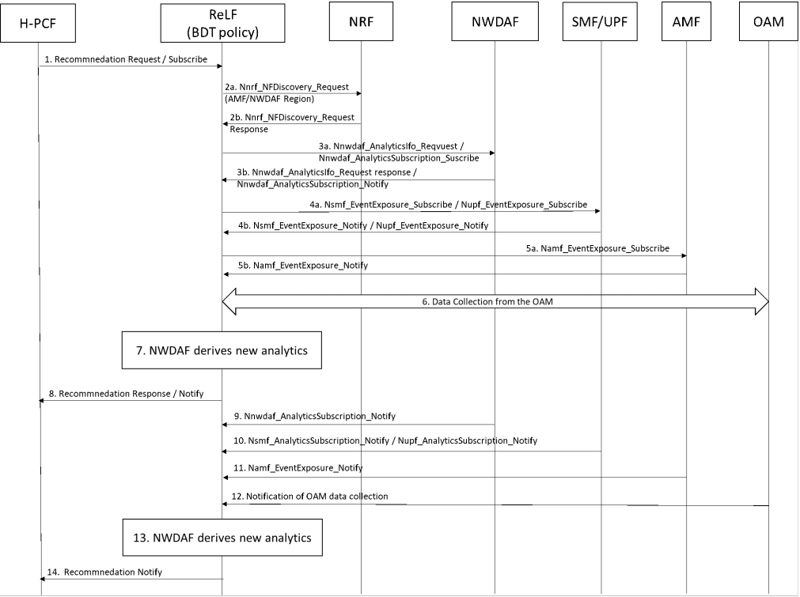

# 6.34 Solution \#34: BDT Policy Recommendations

## 6.34.1 Description

The proposed solution focuses on an analytics service related to BDT policy, which can be used for: (i) policy selection assisting the PCF by providing recommendations related to which BDT polices are fit and optimal to choose from and (ii) policy negotiation by assisting the PCF to identify when a BDT policy is affected by the changing network conditions.

Currently, H-PCF employs the Analytics ID = Network Performance to identify the BDT policies that can be affected when applied in the indicated time window. However, the information captured is limited and the effort needed and time to identify the desired BDT policy may prove to take long due to a potential high number of iterations.

Hence, analytics recommendations (provided by new logical function within NWDAF, named Recommendation Logical Function (ReLF)) may help to assist PCF for selecting future BDT policies.

Editor's note: Whether a new node, i.e. ReLF, is needed or the current NWDAF can already address this Analytics ID is for FFS.

ReLF provides service recommendation to assist the PCF to select BDT policies for a given UE or group of UEs or for a sub-group of UEs, or alternative a given UE or group of UEs in an area of interest. The service consumer is the PCF that can indicate the need for receiving BDT policy recommendation by introducing a new Analytics ID, e.g. "BDT policy".

Editor's note: Whether the processing for determining the BDT time scheduling and data rate is beneficial to be performed in the ReLF or in the PCF is for FFS.

An analytics recommendation subscription or request may adopt the contents of analytics exposure described in clause 6.1.3 of TS 23.288 \[5\] with the following additions:

\- The expected data volume related to the BDT per UE.

\- The expected BDT Time Window per ASP ID.

## 6.34.2 Procedures

### 6.34.2.1 General Procedure

The procedures for deriving BDT service recommendations are shown in Figure 6.34.2.1-1.

Figure 6.34.2.1-1: Procedure for BDT service recommendation analytics

1\. The analytics consumer is either pre-configured with the appropriate ReLF (Analytics ID = BDT policy) or it discovers it through NRF. Then it issues a subscription or a request (including Analytics ID = BDT policy, filter information, etc.) to the selected ReLF (that provides recommendations).

2\. The ReLF once receives a subscription or request for BDT policy recommendations, it collects the required input data (if not collected already). To accomplish this, the ReLF needs to discover via the NRF in step 2a the NFs that needs to collect data from, providing the region where the involved UEs reside or providing the indicated area of interest. The NRF replies in step 2b providing the corresponding NFs.

3-4. The ReLF requests or subscribes to another NWDAF (Analytics ID = UE Mobility) in step 3a or yet another NWDAF (Analytics ID = Network Performance) in step 4a to receive mobility analytics related to the involved UEs and network performance analytics in the region where the involved UEs reside or explicitly indicated by area of interest.

5\. The ReLF subscribes to AMF in step 5a using a subscription service to get the location of the involved UEs, which is received from AMF in step 5b using a notification.

6\. The ReLF requests or subscribes to OAM services related to network performance measurements about the radio resource utilization and the virtual resource consumption of UPFs as well as packet drop and packet loss measurements for both RAN and 5GC.

7\. The ReLF (Analytics ID = BDT policy) derives the requested recommendations.

8\. The ReLF sends response or a notification, which contains the recommendations (BDT policy, Subscription Correlation ID, Confidence, etc.)

9-12. Changes on the NWDAF analytics (i.e. related UE mobility or network performance) or changes on location of the involved UEs reported by the AMF, or regarding the BDT policy characteristics reported by the AF or the CM reported by the OAM can trigger updated notifications to the ReLF provided that the ReLF subscribed to receive updates.

13\. The ReLF (BDT policy) derives new analytics taking into account the most recent data collected.

14\. Once the reporting period is reached or the reporting thresholds are crossed, the ReLF (BDT policy) provides a notification (BDT policy analytics, Subscription Correlation ID, Confidence, etc.).

### 6.34.2.2 Input Data

The ReLF supporting recommendations on BDT policy shall be able to collect UE location, mobility, and policy information from the 5GC and AFs, as well as energy saving information from the OAM.

Table 6.34.2.2-1: UE and Network information collected from 5GC, related AFs and OAM

|                         |        |                                                                                                                                                                                                                                                                                                                                                     |
|-------------------------|--------|-----------------------------------------------------------------------------------------------------------------------------------------------------------------------------------------------------------------------------------------------------------------------------------------------------------------------------------------------------|
| Information             | Source | Description                                                                                                                                                                                                                                                                                                                                         |
| Data Volume per UE      | PCF    | Indicates the data volume that each UE is expected to transmit or receive to/from the specified ASP ID.                                                                                                                                                                                                                                             |
| Number of UEs           | PCF    | Indicates the expected number of UEs involved into the BDT.                                                                                                                                                                                                                                                                                         |
| BDT Time Window         | PCF    | Indicates the potential BDT time window(s), (i.e. start time, stop time) where the ASP expects to retrieve/send data to the UE(s).                                                                                                                                                                                                                  |
| Location of UEs         | AMF    | Location of the UE or group of UEs when BDT would be initiated.                                                                                                                                                                                                                                                                                     |
| UE Mobility pattern     | NWDAF  | Prediction of the location of the UE or group of UEs during the indicated potential BDT time windows.                                                                                                                                                                                                                                               |
| Location of application | AF/NEF | Locations of application represented by a list of DNAI(s). The NEF may map the AF-Service-Identifier information to a list of DNAI(s) when the DNAI(s) being used by the application are statically defined.                                                                                                                                        |
| Network performance     | NWDAF  | Prediction of (relying on NWDAF): (i) RAN status (up/down), radio resource utilization, performance per cell ID and (ii) load per UPF, for all traffic types in the geographical area where the indicated UE or group of UEs related to BDT policy reside or with respect to the indicated area of interest, during the potential BDT time windows. |

### 6.34.2.3 Output Data

The ReLF supporting data analytics on BDT policy shall be able to provide recommendations to the PCF.

Table 6.34.2.3-1: BDT Policy Recommendations and Warning notifications

<table>
<colgroup>
<col style="width: 29%" />
<col style="width: 70%" />
</colgroup>
<tbody>
<tr class="odd">
<td>Information</td>
<td>Description</td>
</tr>
<tr class="even">
<td>ASP or AF ID</td>
<td>Identify of the ASP or AF per BDT policy.</td>
</tr>
<tr class="odd">
<td>&gt; start time</td>
<td>Indicates the recommended start time for applying a BDT.</td>
</tr>
<tr class="even">
<td>&gt; Duration</td>
<td>Indicates the recommended duration for applying the BDT.</td>
</tr>
<tr class="odd">
<td>&gt; UE ID or UE group ID or a list of UE sub-group</td>
<td>
Identifies a UE or a group of UEs, e.g. internal group ID as defined in clause 5.9.7 of TS 23.501 [2] or a list of UE sub-group that shall be associated per BDT.

It shall be noted that a BDT may be related to a selected sub-group of UEs that share similar characteristics in terms of, e.g. speed or direction.
</td>
</tr>
<tr class="even">
<td>&gt; Data rate per UE or aggregate data rate per UE group</td>
<td>Indicates the recommended data rate per UE ID or the aggregate data rate per UE group in an area of interest.</td>
</tr>
<tr class="odd">
<td>&gt; Weight per BDT</td>
<td>Indicates a weight or rate that is related to the importance of applying a recommended BDT data rate and time schedule.</td>
</tr>
<tr class="even">
<td>&gt; Confidence degree</td>
<td>Confidence of the recommendation.</td>
</tr>
<tr class="odd">
<td>ASP or AF ID</td>
<td>Identify of the ASP or AF per BDT policy.</td>
</tr>
<tr class="even">
<td>&gt; UE ID or UE group ID or a list of UE sub-group</td>
<td>Identifies a UE or a group of UEs, e.g. internal group ID as defined in clause 5.9.7 of TS 23.501 [2] or a list of UE sub-group that is already associated with a BDT policy of the list.</td>
</tr>
<tr class="odd">
<td>&gt; Warning location and/or area</td>
<td>Indicate the location if a UE is involved or the area in case one or a group of UEs is involved in the indicated warning.</td>
</tr>
<tr class="even">
<td>&gt; Warning time duration</td>
<td>
Indicate the expected time duration related to the:

- utilization/load increase is the analytics target period subset (see Table 6.6.3-1 of TS 23.288 [5]) of the request network performance analytics.

- fault is indefinite until the OAM indicates otherwise.
</td>
</tr>
<tr class="odd">
<td>&gt; Confidence degree</td>
<td>Confidence of the recommendation.</td>
</tr>
</tbody>
</table>

It should be noted that a BDT warning notification are only issued for specific ASP upon request.

## 6.34.3 Impacts on services, entities and interfaces

Editor's note: This clause captures impacts on existing services, entities and interfaces.

**NWDAF:**

\- Supporting prescriptive analytics engine.
