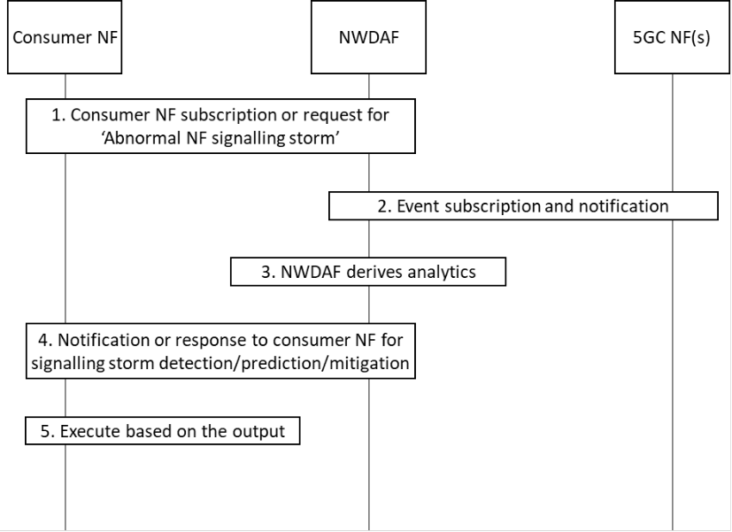

# 6.35 Solution \#35: NWDAF-assisted Network Abnormal Behaviour Mitigation and Prevention

## 6.35.1 Description

This solution resolves KI#4 for NWDAF enhancements to support network abnormal behaviours (i.e. signalling storm) mitigation and prevention. In terms of scenarios, there are cases where it is difficult to troubleshoot and or understand whether the NFs themselves are behaving correctly or not. Often, they may not know that their features/functions are behaving (un)expectedly, probably from cases such as signalling storm, and complexities in NF signalling exchange procedures. This can occur despite the irregularity of number of UEs or types of UE devices.

Hence, NFs need to be robust and resilient to ensure that the UE signalling exchange information are validated(detected, predicted, mitigated and prevented) through the AI/ML NWDAF-assistance. In such cases, NFs need to be able to extract/transfer their signalling exchange information and context information to NWDAF to be guided, e.g. mitigation and prevention for any potential (un)expected behaviours. In this, signalling storm mitigation and prevention in general should not be limited to counting a certain number of message-types from certain specific NFs. The solution is to include Input data such as:

\- an individual and/or groups of NF's sudden increase/decrease (bursts) of TPS (Transaction per second) and/or CPS (Connection per second) from various NF interfaces (e.g. SBIs and non-SBIs).

\- an individual and/or groups of NF's information involved in procedure of a UE or a session such as Connection, Registration, Mobility and Session Managements procedure.

\- an individual and/or groups of NF's information contains information about UE or session context enabling the NWDAF to determine the cause of a signalling storm.

Furthermore, all of the potential scenarios can be observed and measured over a certain duration to include start and end time, number of successful/failed attempts of various UE and NF service requests.

## 6.35.2 Procedures

### 6.35.2.1 General

The NWDAF can provide information on network abnormal behaviours (i.e. signalling storm) as follows.

Figure 6.35.2.1-1: Procedure for NWDAF-assisted Network Abnormal Behaviour Mitigation and Prevention

1\. The consumer NF or e.g. MDAF/MDAS subscribes to or sends a request to NWDAF assistance information for the Abnormal NF signalling storm using either Nnwdaf_AnalyticsSubscription_Subscribe or Nnwdaf_AnalyticsInfo_Request service operation. The request additionally includes thresholds such as confidence level and accuracy of detection. The request may also include as analytic filters an indication of the use case for signalling storm (e.g. signalling storm due to UE mobility).

2\. The NWDAF retrieves Input data from NFs, using Nnf_EventExposure_Subscribe, such as signalling exchange information and context information to derive the required analytics as depicted in clause 6.35.2.2.

3\. The NWDAF derives the required analytics based on the consumer NF request. The NWDAF can collect additional Input data from different NFs, e.g. including from MDAF/MDAS. The NWDAF collects input data from NFs taking into account the use case of signalling storm if provided in step 1.

4\. The NWDAF invokes Nnwdaf_AnalyticsSubscription_Notify or Nnwdaf_AnalyticsInfo_Request response or response to the consumer NF for the Output data analytics as depicted in clause 6.35.2.3.

5\. The consumer upon receiving the detection, prediction and mitigation shall execute based on the output as depicted in clause 6.35.2.4.

NOTE: A care needs to be taken with regards to load when requesting data collection to avoid signalling storm caused by the NWDAF-assisted Network Abnormal Behaviour Mitigation and Prevention procedure.

### 6.35.2.2 Input Data

NFs can extract various information when acting as a consumer or producer. It is assumed to consider Input Data from a Producer NF perspective. The NWDAF collects signalling storm information as listed in Table 6.35.2.2-1 to 6.35.2.2-3.

Table 6.35.2.2-1: Input data collected by NWDAF for AMF

<table>
<colgroup>
<col style="width: 32%" />
<col style="width: 9%" />
<col style="width: 57%" />
</colgroup>
<thead>
<tr class="header">
<th>Information</th>
<th>Source</th>
<th>Description</th>
</tr>
</thead>
<tbody>
<tr class="odd">
<td>NF ID</td>
<td>AMF</td>
<td>NF instance ID of the service producer or consumer.</td>
</tr>
<tr class="even">
<td>Signalling exchange information</td>
<td>AMF</td>
<td>NF procedures containing signalling exchange information related to a particular UE or session from the Connection, Registration, Mobility and Session Managements procedures.</td>
</tr>
<tr class="odd">
<td>&gt; Type of requests from UE/RAN</td>
<td>AMF</td>
<td>Request type for N1 or N2 interface, such as received Initial Registration Request, Mobility and Periodic Registration Request, Service Request, etc.</td>
</tr>
<tr class="even">
<td>&gt; Number of requests from UE/RAN</td>
<td>AMF</td>
<td>Number of requests for N1 or N2 interface, such received Initial Registration Request, Mobility and Periodic Registration Request, Service Request, etc.</td>
</tr>
<tr class="odd">
<td>&gt; Time duration from receiving request from UE/RAN to response to UE/RAN</td>
<td>AMF</td>
<td>Time duration between the request from UE/RAN and response to UE/RAN.</td>
</tr>
<tr class="even">
<td>&gt; Number of successful responses of UE/RAN</td>
<td>AMF</td>
<td>Number of successful responses associated to their initial requests.</td>
</tr>
<tr class="odd">
<td>&gt; Number of failed responses of UE/RAN</td>
<td>AMF</td>
<td>Number of failed responses associated to their initial requests.</td>
</tr>
<tr class="even">
<td>&gt; Reason of failed responses of UE/RAN</td>
<td>AMF</td>
<td>Reasons of failed responses associated to their initial requests.</td>
</tr>
<tr class="odd">
<td>&gt; A posterior Type of requests of UE/RAN (0..max)</td>
<td>AMF</td>
<td>A posterior Request types triggered from UE/RAN, for NF Service request, or request to UE/RAN.</td>
</tr>
<tr class="even">
<td>&gt; &gt; A posterior Type of responses of UE/RAN (0..max)</td>
<td>AMF</td>
<td>A posterior Response types triggered from UE/RAN, for NF Service response, or response to UE/RAN.</td>
</tr>
<tr class="odd">
<td>&gt; Type of requests from NF</td>
<td>AMF</td>
<td>Request type received from NF, e.g. Namf_N1N2Trans, Namf_comm, etc.</td>
</tr>
<tr class="even">
<td>&gt; Number of requests from NF</td>
<td>AMF</td>
<td>Number of requests received from NF, e.g. Namf_N1N2Trans, Namf_comm, etc.</td>
</tr>
<tr class="odd">
<td>&gt; Time duration from receiving request from NF to response to NF</td>
<td>AMF</td>
<td>Time duration between the request from NF and response to NF.</td>
</tr>
<tr class="even">
<td>&gt; Number of successful responses of NF</td>
<td>AMF</td>
<td>Number of successful responses associated to their initial requests.</td>
</tr>
<tr class="odd">
<td>&gt; Number of failed responses of NF</td>
<td>AMF</td>
<td>Number of failed responses associated to their initial requests.</td>
</tr>
<tr class="even">
<td>&gt; Reason of failed responses of NF</td>
<td>AMF</td>
<td>Reasons of failed responses associated to their initial requests.</td>
</tr>
<tr class="odd">
<td>&gt; A posterior Type of requests of NF (0..max)</td>
<td>AMF</td>
<td>A posterior Request types triggered from NF, for NF Service request.</td>
</tr>
<tr class="even">
<td>&gt; &gt; A posterior Type of responses of NF (0..max)</td>
<td>AMF</td>
<td>A posterior Response types triggered from NF, for NF Service response.</td>
</tr>
<tr class="odd">
<td>&gt; Public Warning information</td>
<td>
AMF

/OAM
</td>
<td>Public Warning information such as WRITE-REPLACE WARNING REQUEST, etc.</td>
</tr>
<tr class="even">
<td>&gt; Number of UE AM Policy Updates</td>
<td>AMF</td>
<td>Number of policy requests from PCF such as URSP, Restriction Area, etc.</td>
</tr>
<tr class="odd">
<td>NF Context information</td>
<td>AMF</td>
<td>NF context information related to a particular UE/Session context.</td>
</tr>
<tr class="even">
<td>&gt; State transition information</td>
<td>AMF</td>
<td>
UE related state transition information such as transition type, frequency of CM state changes etc.

State transition identifier:

- "Access Type change to 3GPP access";

- "Access Type change to non-3GPP access";

- "RM state change to RM-DEREGISTERED";

- "RM state change to RM-REGISTERED ";

- "CM state change to CM-IDLE";

- "CM state change to CM-CONNECTED";

- "Handover"; or

- "Mobility Registration Update".
</td>
</tr>
<tr class="odd">
<td>&gt; timer information</td>
<td>
AMF

/OAM
</td>
<td>UE related timer information such as timer type, duration, etc.</td>
</tr>
</tbody>
</table>

Table 6.35.2.2-2: Input data collected by NWDAF for SMF

<table>
<colgroup>
<col style="width: 32%" />
<col style="width: 9%" />
<col style="width: 57%" />
</colgroup>
<thead>
<tr class="header">
<th>Information</th>
<th>Source</th>
<th>Description</th>
</tr>
</thead>
<tbody>
<tr class="odd">
<td>NF ID</td>
<td>SMF</td>
<td>NF instance ID of the service producer or consumer.</td>
</tr>
<tr class="even">
<td>Signalling exchange information</td>
<td>SMF</td>
<td>NF procedures containing signalling exchange information related to a particular UE or session from the Connection, Registration, Mobility and Session Managements procedures.</td>
</tr>
<tr class="odd">
<td>&gt; Type of requests from NF</td>
<td>SMF</td>
<td>Request type received such as PDU Session Establishment, Modification, Release Request, etc.</td>
</tr>
<tr class="even">
<td>&gt; Number of requests from NF</td>
<td>SMF</td>
<td>Number of requests received such as PDU Session Establishment, Modification, Release Request, etc.</td>
</tr>
<tr class="odd">
<td>&gt; Time duration from receiving request from NF to response to NF</td>
<td>SMF</td>
<td>Time duration between the request from NF and response to NF.</td>
</tr>
<tr class="even">
<td>&gt; Number of successful responses of NF</td>
<td>SMF</td>
<td>Number of successful responses associated to their initial requests.</td>
</tr>
<tr class="odd">
<td>&gt; Number of failed responses of NF</td>
<td>SMF</td>
<td>Number of failed responses associated to their initial requests.</td>
</tr>
<tr class="even">
<td>&gt; Reason of failed responses of NF</td>
<td>SMF</td>
<td>Reasons of failed responses associated to their initial requests.</td>
</tr>
<tr class="odd">
<td>&gt; A posterior Type of requests of NF (0..max)</td>
<td>SMF</td>
<td>A posterior Request types triggered from NF, for NF Service request.</td>
</tr>
<tr class="even">
<td>&gt; A posterior Type of responses of NF (0..max)</td>
<td>SMF</td>
<td>A posterior Response types triggered from NF, for NF Service response.</td>
</tr>
<tr class="odd">
<td>&gt; Number of requests for UE SM Policy Update</td>
<td>SMF</td>
<td>Number of requests from PCF to update UE SM Policy per PDU Session, such as QoS, PCC Rules, etc.</td>
</tr>
<tr class="even">
<td>&gt; Load information of connected UPFs</td>
<td>
SMF

/OAM
</td>
<td>Load information of connected UPFs such as using PFCP Load Control Information.</td>
</tr>
<tr class="odd">
<td>&gt; Number of receiving Session Report from UPFs</td>
<td>SMF</td>
<td>Number of receive Session Report from UPF triggered by DL packet in case of PDU Session is in 5GCM-idle state.</td>
</tr>
<tr class="even">
<td>NF Context information</td>
<td></td>
<td>NF context information related to UE/Session context.</td>
</tr>
<tr class="odd">
<td>&gt; Usage information of UE IP address resources</td>
<td>
SMF

/OAM
</td>
<td>Usage information of UE IP address resources (dynamic and static, V4, V6, etc.) for CP or UP allocation, such as number, usage, number of UE IPs, which prohibit allocation during certain time interval, etc.</td>
</tr>
<tr class="even">
<td>&gt; State transition information</td>
<td>SMF</td>
<td>
PDU Session related state transition information such as transition type, frequency SM state changes, etc.

State transition identifier:

- "PDU Session Establishment";

- "PDU Session Release";

- "Communication failure"; or

- "PLMN change".
</td>
</tr>
<tr class="odd">
<td>&gt; timer information</td>
<td>
SMF

/OAM
</td>
<td>PDU Session related timer information such as timer type, duration, etc. an individual and/or groups of NF’s information contains.</td>
</tr>
</tbody>
</table>

Table 6.35.2.2-3: Input data collected by NWDAF for NRF/SCP

<table>
<colgroup>
<col style="width: 32%" />
<col style="width: 9%" />
<col style="width: 57%" />
</colgroup>
<thead>
<tr class="header">
<th>Information</th>
<th>Source</th>
<th>Description</th>
</tr>
</thead>
<tbody>
<tr class="odd">
<td>NF ID</td>
<td>NRF</td>
<td>NF instance ID of the service producer or consumer.</td>
</tr>
<tr class="even">
<td>Signalling exchange information</td>
<td>NRF/SCP</td>
<td>NF procedures containing signalling exchange information related between NF and NRF procedures. NRF/SCP can be used within deployment Model-C/D scope of indirect communication with/without delegated discovery.</td>
</tr>
<tr class="odd">
<td>&gt; Type of requests from NRF</td>
<td>NRF</td>
<td>Request type received such as NF registration and discovery, etc.</td>
</tr>
<tr class="even">
<td>&gt; Number of requests from NF</td>
<td>NRF</td>
<td>Number of NF requests received such as NF registration and discovery, etc.</td>
</tr>
<tr class="odd">
<td>&gt; Time duration from receiving request from NRF to response to NF</td>
<td>NRF</td>
<td>Time duration between the request from NRF and response to NF.</td>
</tr>
<tr class="even">
<td>&gt; NF profile</td>
<td>
NRF

/OAM
</td>
<td>NF Profile information such as allowed NF information per NF and NF Service.</td>
</tr>
<tr class="odd">
<td>&gt; NF load information of registered NFs and NF Services</td>
<td>
NRF

/OAM
</td>
<td>Load information indicates the current load of NFs and NF Services, e.g. CPU, memory, and/or percentage of load information.</td>
</tr>
<tr class="even">
<td>&gt; Capability and priority information of NFs and Services</td>
<td>
NRF

/OAM
</td>
<td>Capability and priority information of registered NFs and NF Services.</td>
</tr>
<tr class="odd">
<td>&gt; NF heart-beat related information</td>
<td>
NRF

/OAM
</td>
<td>NF heart-beat related information such as responding time, Number of retransmissions, heart-beat intervals, etc.</td>
</tr>
<tr class="even">
<td>&gt; Success and failure trend</td>
<td>
NRF

/OAM
</td>
<td>Number Requests/response related trend such as within a certain time interval, ratio, cause/error code, etc.</td>
</tr>
</tbody>
</table>

Editor's note: It is FFS which parameters in tables above are per UE, and which ones are per NF, and whether and how the ones per NF are retrieved from OAM.

### 6.35.2.3 Output Analytics

The output analytics of signalling storm statistics of NWDAF is defined in Table 6.35.2.3-1.

Table 6.35.2.3-1: Signalling storm statistics

| Information            | Description                                                                                            |
|------------------------|--------------------------------------------------------------------------------------------------------|
| Report (1..max)        | List of observed signalling storm.                                                                     |
| \> Target NF ID        | The target of signalling storm detected by NWDAF.                                                      |
| \> Abnormality ID      | The potential cause of NF Abnormality (e.g. massive UE/frequent access, NF abnormal signalling, etc.). |
| \> Source SUPI/NF list | SUPI(s) of the UE(s) or NF(s) which cause the signalling storm.                                        |

The output analytics of signalling storm prediction of NWDAF is defined in Table 6.35.2.3-2.

Table 6.35.2.3-2: Signalling storm predictions

| Information            | Description                                                                                            |
|------------------------|--------------------------------------------------------------------------------------------------------|
| Report (1..max)        | List of observed signalling storm.                                                                     |
| \> Target NF ID        | The target of signalling storm predicted by NWDAF.                                                     |
| \> Abnormality ID      | The potential cause of NF Abnormality (e.g. massive UE/frequent access, NF abnormal signalling, etc.). |
| \> Source SUPI/NF list | SUPI(s) of the UE(s) or NF(s) which cause the signalling storm.                                        |
| \> Confidence          | Confidence of this prediction.                                                                         |

Editor's note: NWDAF may leverage MDAF/MDAS for deriving the output data, and which parameters in the tables above shall be mandated and which ones to be optional is for FFS.

### 6.35.2.4 Mitigation or Prevention

The following examples of existing mechanism can be used to mitigate and prevent the signaling storm.

Table 6.35.2. 4-1: Example mechanisms to mitigate and prevent the signalling storm

| Abnormality ID         | Actions of NFs                                                                                                                                                                                                                                             |
|------------------------|------------------------------------------------------------------------------------------------------------------------------------------------------------------------------------------------------------------------------------------------------------|
| Massive UE access      | AMF sets MM NAS related timer (e.g. back-off, T3512) with suggested time range for a selected set of UEs.                                                                                                                                                  |
| Massive UE access      | SMF sets SM NAS related timer (e.g. back-off) with suggested time range for a selected set of Sessions.                                                                                                                                                    |
| Massive UE access      | AMF/SMF sets suggested N1/N2 interface related ingress/egress threshold, or AMF triggers RAN to initiate overload control for a selected set of UEs in specific slice or priority as defined in clause 8.7.7 of TS 38.413 \[8\] to start overload control. |
| NF abnormal signalling | NRF configures the local policy to prevent the source NF/SCP with abnormal signalling from being discovered or discovering others.                                                                                                                         |
| NF abnormal signalling | Source NF/SCP configures to (re)select other NFs instead of NF with abnormal signalling and may unsubscribes the NF with abnormal signalling.                                                                                                              |
| NF abnormal signalling | Source NF/SCP configures to deprioritize the NFs/Services with abnormal signalling from being selected.                                                                                                                                                    |
| NF abnormal signalling | Source NF triggers UE Reregistration and/or Session Reestablishments to avoid NF with abnormal signalling.                                                                                                                                                 |

NOTE : Detailed mechanisms to mitigate and prevent the signalling storm will consider operator policy.

Editor's note: Table 6.35.2.4-1 lists are to be updated further based on discussions.

Editor's note: The role that the PCF can take to mitigate/prevent the signalling storm is FFS.

## 6.35.3 Impacts on services, entities and interfaces

**NWDAF:**

\- Supports providing subscriptions and/or requests for Abnormal NF signalling storm Analytics.

\- Supports deriving statistics and/or predictions of based on Analytics consumer subscriptions and/or requests.

**Consumer NF:**

\- Supports subscribing or requesting Abnormal NF signalling storm Analytics from NWDAF using Nnwdaf_AnalyticsSubscription_Subscribe or Nnwdaf_AnalyticsInfo_Request service.

\- Supports executing the mitigation and prevention actions based on the analytics data from NWDAF.

**Source NF:**

\- Supports providing additional data exposure for Abnormal NF signalling storm Analytics using Nnf_EventExposure Service.
