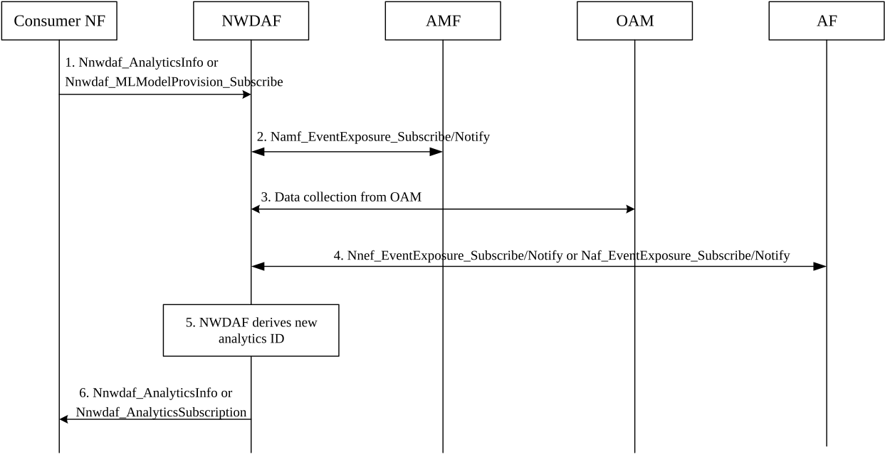

# 6.36 Solution \#36: Registration Signalling Analytics to support detection and prevention of signalling storm

## 6.36.1 Description

This solution is proposed to address Key Issue#4: NWDAF enhancements to support network abnormal behaviours (i.e. Signalling storm) detection and prevention.

As pointed in use case \#3, in some scenarios, UEs are possible to send small data over NAS signalling at same time leading to potential signalling storm. For example, one of the scenarios is IoT scenario where not all application providers have negotiation about the active time of the IoT devices with network. In this scenario, IoT users in some area may be active at the same time so that a large amount of NAS signalling will be transmitted into the network.

Furthermore, some disallowed-accessing users (e.g. IoT, Redcap users in arrears) may be refused to provide service by the system server, accordingly, the PDU sessions of these users will not be established successfully and the users will be forced to go offline. However, the registration process of these disallowed-accessing users is not affected based on current mechanism, as a result, these users will repeat the registration during this highly accessing time. Also, above mentioned flooding registration signalling and the re-registration behaviour are not a kind of abnormal UE behaviour since the service for these users might be restored at some time (e.g. after users pay for fees) and then the users need to be able to register as usual.

To detect and prevent potential signalling storm in this scenario, this solution proposes a new Analytics ID "Registration Signalling Analytics". The NWDAF collects resource usage of the AMF, information about registration signalling, timer setting of the particular users (e.g. IoT users) within an area of interest during a target of period as described in Table 6.36.1-1, and user activation information as described in Table 6.36.1-2. The output of the Analytics ID is a list of registration status which contains a) registration related information for particular users, which helps consumer NF be aware of the registration of these users and identify the abnormal users with repeat registration behaviour in the specified period, b) Registration Signalling Information and AMF resource usage, which are provided as a reference to consumer NF and help consumer NF allocate users (e.g. IoT users) accessing during the period with less registration and low load.

The Consumer NF of the Analytics ID may be AMF or AF, and they may take following actions based on the output of Analytics ID:

\- The AMF is able to identify the abnormal users e.g. IoT users who repeat registration, and allocate longer timer for this kind of users from network side.

\- The AMF is able to group particular users (e.g. IoT users) and allocate suitable timer for each group by considering the AMF resource usage, number of registration signalling.

\- The output analytics subscribed by AF might help application adjust active time for the users.

**Input Data to NWDAF from different sources:**

Table 6.36.1-1: Registration signalling and Timer information collected by NWDAF

| Information                                  | Source  | Description                                                                                                                                                           |
|----------------------------------------------|---------|-----------------------------------------------------------------------------------------------------------------------------------------------------------------------|
| Registration Signalling Information          | AMF     | Description for Registration related signalling received by AMF.                                                                                                      |
| \> Registration Type                         | AMF     | Identifies the type of the registration signalling received by AMF, e.g. initial registration, update registration.                                                   |
| \> Number of registration request            | AMF     | The number of Registration Request message received by AMF per registration type.                                                                                     |
| \> Number of registration failure            | AMF     | The number of registration failure message (i.e. Registration Reject message) received by AMF per registration type.                                                  |
| UE group ID or a list of UE IDs (1..SUPImax) | AMF     | Identifies a group of particular UEs, e.g. IoT users, internal group ID, or a list of UEs which are matching the filter.                                              |
| \> Timer List                                | AMF     | The list description about timers setting for the UE(s)                                                                                                               |
| \>\> Type of timer                           | AMF     | The type of timer which has been set for the UE(s), e.g. Periodic Registration Update timer, Back-Off timer, Wait timer.                                              |
| \>\> Timestamp                               | AMF     | Time stamp when the timer starts.                                                                                                                                     |
| \>\> Timer duration                          | AMF     | The time duration that the timer will last.                                                                                                                           |
| \> Registration Type of the UE               | AMF     | The type of the registration of the UE(s).                                                                                                                            |
| \> Number of UE registration request         | AMF     | The number of Registration Request message per registration type of the UE(s).                                                                                        |
| AMF ID                                       | AMF/OAM | Identifier of the AMF.                                                                                                                                                |
| \> AMF resource usage                        | OAM     | The usage of assigned virtual resources currently in use for the specific AMF (mean usage of virtual CPU, memory, disk) as defined in clause 5.7 of TS 28.552 \[11\]. |
| \> AMF resource usage per service            | OAM     | The usage of assigned virtual resources currently in use for the specific AMF per service.                                                                            |

Table 6.36.1-2: Application activation time information collected by NWDAF

| Information                              | Source | Description                                                                                                               |
|------------------------------------------|--------|---------------------------------------------------------------------------------------------------------------------------|
| Application ID                           | AF     | Identifies the application providing this information.                                                                    |
| User activation time information (1…max) | AF     | Information of activation time for the users (e.g. IoT users) per application.                                            |
| \> Active Time                           | AF     | The time stamp of active time for the users per application.                                                              |
| \> Inactive Time                         | AF     | The time stamp of active time for the users per application, if applicable.                                               |
| \> UE group ID or a list of UE IDs       | AF     | Identifies a group of UEs, e.g. IoT users, internal group ID, external group ID, or a list of UE IDs with the same timer. |

**Output analytics from the NWDAF:**

Table 6.36.1-3: Registration Signalling statistics

| Information                                                                    | Description                                                                                                                      |
|--------------------------------------------------------------------------------|----------------------------------------------------------------------------------------------------------------------------------|
| List of registration status (1..max)                                           | List of observed registration related information for users along with registration signalling information on corresponding AMF. |
| \> Analytics target period subset                                              | Time window within the requested Analytics target period.                                                                        |
| \> List of registration UE IDs                                                 | List of UE IDs of particular users (e.g. IoT users) who send registration signalling to AMF during the sub target period.        |
| \> List of UE IDs with multiple registration                                   | List of UE IDs of abnormal users who repeat register multiple times during the sub target period. (NOTE 1).                      |
| \>\> Registration Type of the UE                                               | The type of the registration for the UE(s).                                                                                      |
| \>\> Number of UE registration request                                         | The number of Registration Request message per registration type for the UE ID(s).                                               |
| \> Registration Signalling Information                                         | Description for registration related signalling received by AMF over the sub target period.                                      |
| \>\>Registration Type                                                          | The type of the registration, e.g. initial registration, update registration.                                                    |
| \>\> Number of registration request                                            | The number of Registration Request message received by AMF per registration type.                                                |
| \>\> Number of registration failure                                            | The number of registration failure message (i.e. Registration Reject message) received by AMF per registration type.             |
| \> AMF ID                                                                      | The identifier of the AMF.                                                                                                       |
| \>\> AMF resource usage                                                        | The average usage of assigned resources (CPU, memory, disk) over the sub target period.                                          |
| \>\>AMF resource usage per service                                             | The average usage of assigned resources (CPU, memory, disk) per service over the sub target period.                              |
| NOTE 1: This list only applies in statistics when repeat registration happens. |                                                                                                                                  |

Table 6.36.1-4: Registration Signalling prediction

| Information                            | Description                                                                                                                       |
|----------------------------------------|-----------------------------------------------------------------------------------------------------------------------------------|
| List of registration status (1..max)   | List of predicted registration related information for users along with registration signalling information on corresponding AMF. |
| \> Analytics target period subset      | Time window within the requested Analytics target period.                                                                         |
| \> List of registration UE IDs         | List of UE IDs of particular users (e.g. IoT users) who send registration signalling to AMF during the sub target period.         |
| \> Registration Signalling Information | Description for registration related signalling received by AMF over the sub target period.                                       |
| \>\>Registration Type                  | The type of the registration, e.g. initial registration, update registration                                                      |
| \>\> Number of registration request    | The number of Registration Request message received by AMF per registration type.                                                 |
| \>\> Number of registration failure    | The number of registration failure message (i.e. Registration Reject message) received by AMF per registration type.              |
| \> AMF ID                              | The identifier of the AMF.                                                                                                        |
| \>\> AMF resource usage                | The average usage of assigned resources (CPU, memory, disk) over the sub target period.                                           |
| \>\>AMF resource usage per service     | The average usage of assigned resources (CPU, memory, disk) per service over the sub target period.                               |
| Confidence                             | Confidence of the prediction.                                                                                                     |

Editor's note: How the consumer requests the Analytics ID is FFS.

Editor's note: Whether the AMF can calculate the output internally is FFS.

NOTE: The Analytics ID in this solution is mainly for the "UE registration".

## 6.36.2 Procedures

Figure 6.36.2-1 illustrates the procedure for registration signalling analytics provided by NWDAF.

Figure 6.36.2-1: Registration signalling analytics provided by NWDAF

1\. The consumer NF subscribes to registration signalling analytics by invoking Nnwdaf_AnalyticsInfo or Nnwdaf_MLModelProvision_Subscribe service (Analytics ID = registration signalling, Target of Analytics Reporting = Internal Group ID or External Group ID, any UE, Analytics Filter Information=AoI).

2\. The NWDAF subscribes to the input data as described in Table 6.36.1-1 by invoking Namf_EventExposure_Subscribe service for collecting registration signalling information received by the AMF and timer information for the UE group or the UE list.

3\. The NWDAF subscribes to the input data from the OAM as defined in the Table 6.36.1-1 according to the data collection principles described in clause 6.2.3 in TS 23.288 \[5\].

4\. The NWDAF subscribes to the input data from AF in the Table 6.36.1-2 by invoking Nnef_EventExposure_Subscribe or Naf_EventExposure_Subscribe service for collecting IoT user activation time information.

5\. The NWDAF derives requested analytics with the collected data. Analytics output parameters are listed in Table 6.36.1-3 and Table 6.36.1-4. 6. The NWDAF provides the requested analytics to the NF by either the Nnwdaf_AnalyticsInfo or Nnwdaf_AnalyticsSubscription service, depending on the service used at step 1.

Based on the output, the NF may take the AMF resource usage and the UE registration status into consideration, and arrange suitable timer for the particular users. For example, if too many particular users (e.g. IoT users) will register during some time period, and the AMF load is high with large amount of registration signalling during that time period, the NF will consider to allocate another time for the users to be active.

## 6.36.3 Impacts on services, entities and interfaces

**NWDAF:**

\- Supports of providing new analytics ID "Registration signalling".

\- Collects registration signalling information and timer information from AMF.

\- Collects activation time information from AF.

**AMF:**

\- Provides registration signalling information and timer information.

**AF:**

\- Provides activation time information.
