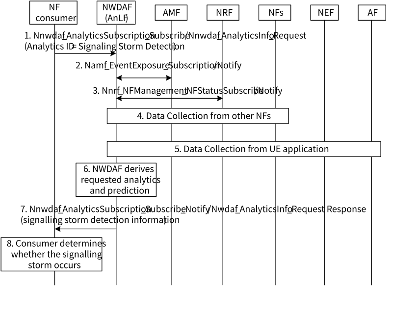
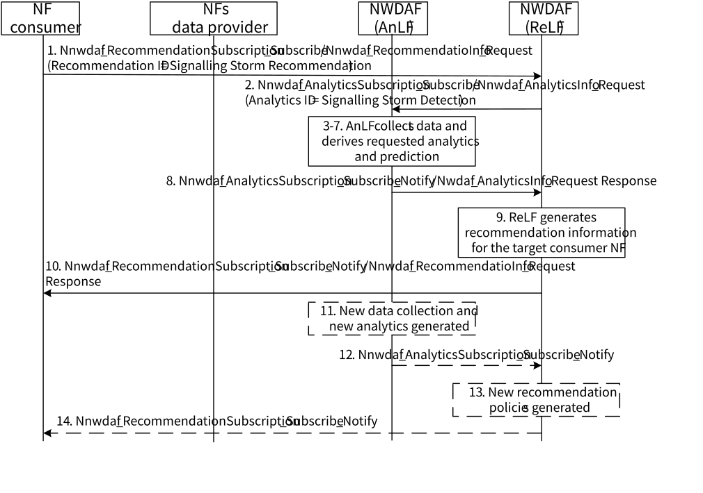

# 6.38 Solution \#38: NWDAF-assisted signalling storm analytics, predictions, prevention and mitigation

## 6.38.1 General description

This is a solution to Key Issue#4: NWDAF enhancements to support network abnormal behaviours (i.e. Signalling storm) mitigation and prevention. This solution includes two aspects:

\- NWDAF-assisted signalling storm detection:

\- Introduce a new Analytics ID, i.e. Analytics ID = Signalling Storm Detection, for the NWDAF to analyse and predict signalling storm of the NFs.

\- NWDAF-assisted signalling storm mitigation:

\- Introduce a new NWDAF functionality, i.e. Recommendation Logical Function (ReLF). ReLF is a logical function in NWDAF, which performs inference and derives recommendation information (i.e. derives recommendation parameters based on NF Consumer's request).

\- Introduce the Nnwdaf_RecommendationSubscription and Nnwdaf_RecommendationInfo services to enable the consumer to subscribe/request recommendation information for signalling storm mitigation and prevention from NWDAF.

\- Define a new Recommendation ID to identify the recommendation type requested by the consumer, i.e. Recommendation ID = Signalling Storm Recommendation.

### 6.38.1.1 NWDAF-assisted signalling storm detection

From the development process of the signalling storm in the above scenario, it can be seen that signalling storms may be caused by repeated requests from UEs. Therefore, whether a signalling storm occurs in the network can be predicted by analysing the statistical characteristics of the received signalling request and the processing capability of the network, i.e. the NWDAF collects the signalling request received by NFs, analyses the statistical characteristics of the signalling and derives the signalling storm probability of the network.

The service consumer is ReLF.

The consumer of these analytics may indicate in the request:

\- Analytics ID = "Signalling Storm Detection";

\- Target of Analytics Reporting: any UE;

\- Analytics Filter Information optionally containing:

\- Area of Interest (AOI): restricts the scope of signalling storm analytics to the specific area;

\- An Analytics target period: indicates the time window when the signalling storm detection should be activated;

\- Monitoring window size: indicates time window during which the analytics is derived;

\- Analytics Reporting Information optionally containing:

\- Target NF IDs: indicates instance IDs of target NFs or Set ID that should be executed for signalling storm analytics and detection;

\- Reporting period: indicates the period for the NWDAF to report the analysis result to the consumer;

\- Reporting threshold and filter:

\- Signalling rate or frequency threshold: indicates the frequency of the received signalling under the monitoring window;

\- Signalling rate or frequency growing speed threshold: indicates the growing speed of the signalling frequency. For example, the signalling frequency received by NF is 1000 signalling per seconds at time1 and 10000 signalling per seconds at next time. The Increased Signalling rate or frequency is equal to 10. When the Increased Signalling rate or frequency is above the threshold, the NWDAF can provide the analytics;

\- Failure signalling request type: indicates the type of the failed message and that the NWDAF should report analysis results based on the type of the failed message;

\- Failure signalling request number threshold: indicates the threshold of the number of messages corresponding to each message type. When the number of failures corresponding to the failure message type reaches the threshold, the NWDAF provides the analysis result and provides the number of messages in the analysis result.

\- Total failure signalling request number: indicates the threshold that identifies the number of messages that cause such a failure. When the total number of failed messages reaches this threshold, NWDAF provides analysis results;

\- UE Request Type: indicates the type of a request initiated by a UE. For example, a request type is an initial registration request initiated by the UE, a periodic registration request, and a mobility registration request;

\- Frequency of requests threshold: identifies a frequency at which the UE initiates a request of this type of message. For example, it identifies a frequency at which the UE initiates an initial registration request, and the number of request messages of this type initiated per minute or per seconds;

\- UE number threshold: indicates a threshold of a quantity of UEs whose quantity of request messages of the type meets the Frequency of requests threshold. For example, if the number of UEs that initiate registration requests exceeds the preset threshold (10 times per hour) and the number of such UEs exceeds 100 (the threshold is set to 100), the NWDAF provides analysis output.

#### 6.38.1.1.1 Input Data

The total signalling received by the NFs and the request type should be collected to determine the statistical characteristic of the NF. And the finer granularity information such as signalling from UE should also be collected to determine whether the UE is abnormal.

Table 6.38.1.1.1-1: Input data from 5GC for signalling storm detection

| Information                      | Source   | Description                                                                                                                                                                                                                                  |
|----------------------------------|----------|----------------------------------------------------------------------------------------------------------------------------------------------------------------------------------------------------------------------------------------------|
| Timestamp                        |          | A timestamp associated with the collected information.                                                                                                                                                                                       |
| UE ID                            | AMF      | The GUTI of the UE. The GUTI is included in the signalling request such as re-registration request and PDU session request.                                                                                                                  |
| Back-off timer                   | AMF      | Applied MM back-off timer to the UE.                                                                                                                                                                                                         |
| Expected UE Behaviour parameters | UDR      | Same as Expected UE Behaviour parameters specified in TS 23.502 \[3\].                                                                                                                                                                       |
| priority of the UE               | UDR      | The priority information of the UE to access to the network during different time period. It is provided by the AF and stored in the UDR as Expected UE Behaviour parameters (e.g. different type of IOT device (camera lens, Water meter)). |
| Service request statistics       | NFs      | The request signalling received by NFs, e.g. AMF/SMF.                                                                                                                                                                                        |
|  \> Type                         | NFs      | The type of the request (e.g. initial/mobility/periodic/update/ emergency registration request or PDU session request, NF services).                                                                                                         |
|  \> Frequency                    | NFs      | The total number of each type request per time unit (e.g. per second).                                                                                                                                                                       |
|  \> Request result               | NFs      | The result of the request (e.g. accept, reject)                                                                                                                                                                                              |
| NF Instance ID                   | NRF      | Identification of the NF instance that NF profile information corresponds to.                                                                                                                                                                |
|  \> NF load                      | NRF, SCP | The load of specific NF instance(s) in their NF profile as defined per TS 29.510 \[13\].                                                                                                                                                     |
|  \> NF status                    | NRF, SCP | The status of a specific NF instance(s) (registered, suspended, undiscoverable) as defined per TS 29.510 \[13\].                                                                                                                             |
|  \> Priority                     | NRF, SCP | Priority (relative to other NFs of the same type) to be used for NF selection.                                                                                                                                                               |
|  \> Capacity                     | NRF, SCP | Static capacity information expressed as a weight relative to other NF instances of the same type.                                                                                                                                           |
| Signalling statistics            | NFs, SCP | The number of different types of signalling received and sent by different NF instance(s) during a target time period, etc.                                                                                                                  |

Table 6.38.1.1.1-2: Per UE attribute to be collected from the AF for signalling storm detection

| Information        | Source         | Description                                                         |
|--------------------|----------------|---------------------------------------------------------------------|
| Per UE attribute   | UE Application | UE application data to be collected from UE.                        |
| \> Destination     |                | Expected final location of UE based on the route planned.           |
| \> Time of arrival |                | Expected time of arrival to destination based on the route planned. |

#### 6.38.1.1.2 Output Data

The NWDAF provides analytics and/or predictions for signalling storm detection to the consumer, as defined in Table 6.38.3-1.

Table 6.38.1.1.2-1: Signalling Storm Detection (Statistics/Predictions)

| Information                                       | Description                                                                                                                                                                       |
|---------------------------------------------------|-----------------------------------------------------------------------------------------------------------------------------------------------------------------------------------|
| Analytics Area                                    | List of TA(s) or Cell ID(s) within the requested area of interest.                                                                                                                |
| Time period list                                  | List of time slots during the Analytics target period.                                                                                                                            |
| NF type                                           | The type of the NF instance (e.g. AMF)                                                                                                                                            |
| NF instance ID                                    | Identification of the NF instance.                                                                                                                                                |
| CPU usage                                         | The average usage of the CPU.                                                                                                                                                     |
| Received Signalling Analytics                     | Information of signalling received by NF.                                                                                                                                         |
|  \> Total number of received signalling           | Indicates the statistics on the number of signalling messages received by NFs in the specified period.                                                                            |
|  \>\> Signalling request type distribution        | Indicates the signalling request type (e.g. registration request/ service request/PDU session request).                                                                           |
|  \>\> Received number of signalling               | Received number of signalling of the specific signalling type.                                                                                                                    |
|  \> Growing speed of received signalling          | Difference between the number of signalling messages received by the NF in this time window and the number of signalling messages received by the NF in the previous time window. |
|  \>\> Signalling request Type                     | Registration request/ service request/PDU session request.                                                                                                                        |
|  \>\> Received number of signalling               | Differ number of received signalling on this specific type.                                                                                                                       |
|  \> Signalling analytics from UE                  | Analyse the number of signalling messages received from UEs within a specified period.                                                                                            |
|  \>\> Signalling request Type                     | Registration request/ service request/PDU session request.                                                                                                                        |
|  \>\> number of signalling from same UE           | Number of received signalling requests initiated by the same UE within a specified period.                                                                                        |
|  \>\>\> UE number                                 | Number of UEs whose signalling requests sent by the same UE are within the range specified in the preceding table.                                                                |
| Sending Signalling Analysis                       | Information of signalling sent by the NF.                                                                                                                                         |
|  \> Total number of sending signalling            | Indicates the statistics on the number of signalling messages sent by NFs in the specified period.                                                                                |
|  \> Total number of successful sending signalling | Total number of accepted signalling messages sent by the NF.                                                                                                                      |
|  \>\> Signalling Request type                     | The request type of successful signalling messages.                                                                                                                               |
|  \>\> Number of the signalling                    | Number of successful signalling messages of each type.                                                                                                                            |
|  \> Total number of failure sending signalling    | Total number of rejected signalling messages sent by NFs.                                                                                                                         |
|  \>\> Failure request type                        | The request type of failure signalling.                                                                                                                                           |
|  \>\> Failure request number                      | The total number of each failure request number.                                                                                                                                  |
| Signalling Storm Probability                      | Probability of signalling storms.                                                                                                                                                 |
| Signalling Storm threshold                        | The consumer can determine the signalling storm occurring based on this threshold.                                                                                                |

#### 6.38.1.1.3 NWDAF-assisted signalling storm analytics Procedure

Figure 6.38.1.1.3-1 depicts a procedure for signalling storm analytics/prediction service provided by NWDAF.

Figure 6.38.1.1.3-1: Procedure for NWDAF providing signalling storm analytics and predictions

1\. The NF Consumer and the SCP sends an Analytics request (Analytics ID = Signalling Storm Detection, Analytics Filter Information, Target of Analytics Reporting) to NWDAF containing AnLF by invoking either Nnwdaf_AnalyticsInfo_Request or Nnwdaf_AnalyticsSubscription_Subscribe.

2\. The NWDAF may subscribe to the information as defined in Table 6.38.2-1 from AMF.

3\. The NWDAF may subscribe to the data as defined in Table 6.38.2-1 from NRF/SCP.

4\. The NWDAF may collect the data as defined in Table 6.38.2-1 from other 5GC NFs/SCP.

5\. For UE related data collection, if the request is authorized, the NWDAF may follow the UE Input Data Collection Procedure via the AF as defined in clause 6.2.8 of TS 23.288 \[5\]. Detailed information is described in Table 6.38.2-2.

6\. NWDAF derives the requested analytics as defined in Table 6.38.3-1.

7\. NWDAF sends the notification or response to the consumer using Nnwdaf_AnalyticsInfo_Request Response or Nnwdaf_AnalyticsSubscription_Subscribe_Notify, depending on the service received in step 1.

8\. The consumer can determine whether the signalling storm occurs based on the signalling storm threshold, and make recommendation to the potential involved NFs on how to prevent or mitigate the signalling storm.

### 6.38.1.2 NWDAF-assisted signalling storm prevention and mitigation

Based on the signalling storm analytics and predictions provided by the NWDAF containing AnLF and the request from the consumer, the ReLF generates the corresponding recommendation parameters or polices to assist the NF consumer to prevent or mitigate the signalling storm.

The service consumer of signalling storm prevention and mitigation may be any NF.

The consumer of these recommendation may indicate in the request:

\- Recommendation ID = "Signalling Storm Recommendation";

\- Target of Recommendation Reporting: any UE;

\- A Recommendation target period: indicates the time window when the signalling storm recommendation is to be provided;

\- NF consumer information: NF instance ID or Set ID, consumer NF's serving area, e.g. TAI;

\- Expected NF information for recommendation: NF type, DNN, S-NSSAI, expected NF's serving area, e.g. TAI;

\- List of target NF instance or NF Set candidates information: Target NF instance IDs or NF Set IDs for NF discovery and selection to serve the request from the expected NF. When a list of candidate NF instances or NF Set is provided, the NF instances or NF Set recommended by ReLF are the subset of this list;

\- Recommendation Filter Information optionally containing:

\- Area of Interest (AOI): restricts the scope of signalling storm recommendation to the provided area.

#### 6.38.1.2.1 Input Data

The total signalling received by the NFs and the request type should be collected to determine the statistical characteristic of the NF. And the finer granularity information such as signalling from UE should also be collected to determine whether the UE is abnormal.

NF instance IDs of DNN/S-NSSAI should be collected by the ReLF for signalling storm prevention and mitigation.

Table 6.38.2-3: Input data from 5GC for signalling storm prevention and mitigation

| Information     | Source | Description                                            |
|-----------------|--------|--------------------------------------------------------|
| Timestamp       |        | A timestamp associated with the collected information. |
| NF instance IDs | NRF    | IDs of all NF instances serving a DNN/S-NSSAI.         |

#### 6.38.1.2.2 Output Data

The NWDAF provides analytics and/or predictions for signalling storm detection to the consumer, as defined in Table 6.38.3-1.

Table 6.38.1.2.2-1: Signalling Storm Recommendation Information

| Information                                                                                                                                                                                         | Description                                                                                                                           |
|-----------------------------------------------------------------------------------------------------------------------------------------------------------------------------------------------------|---------------------------------------------------------------------------------------------------------------------------------------|
| NF instance ID                                                                                                                                                                                      | Identification of the NF instance.                                                                                                    |
| Validity Period                                                                                                                                                                                     | The validity period for the recommended information to be applied.                                                                    |
| Recommendation for processing request signalling                                                                                                                                                    | Recommended signalling control for NF to process the received request.                                                                |
|  \> DNN/S-NSSAI                                                                                                                                                                                     | DNN/S-NSSAI corresponding to the recommendation.                                                                                      |
|  \> Signalling request type                                                                                                                                                                         | Indicates the related signalling request type of the recommendation (e.g. Registration request/ service request/PDU session request). |
|  \> Rate of processing request signalling (NOTE)                                                                                                                                                    | Recommended number of received request signalling to be handled in a time window for the NF.                                          |
| Recommendation for invoking/requesting a service                                                                                                                                                    | Recommendation signalling control for NF to invoke/request a service.                                                                 |
|  \> DNN/S-NSSAI                                                                                                                                                                                     | DNN/S-NSSAI corresponding to the recommendation.                                                                                      |
|  \> Service type                                                                                                                                                                                    | Service type the NF will request.                                                                                                     |
|  \> Target NF instance                                                                                                                                                                              | Recommended target NF instance of the requested service type.                                                                         |
|  \> Rate of invoking/requesting                                                                                                                                                                     | Recommended number of sending request signalling in a time window for the NF.                                                         |
| Recommendation for the NF profile information                                                                                                                                                       | Identification of the NF instance that NF profile information corresponding to.                                                       |
|  \> Priority                                                                                                                                                                                        | Recommended Priority (relative to other NFs of the same type) to be used for NF selection.                                            |
|  \> Capacity                                                                                                                                                                                        | Recommended Static capacity information, expressed as a weight relative to other NF instances of the same type.                       |
| Recommended UE behaviour policies                                                                                                                                                                   | UE behaviour policies recommended by ReLF.                                                                                            |
|  \> Back-off timer to the AMF                                                                                                                                                                       | Time interval per UE attempts to re-register.                                                                                         |
| NOTE: If the number of the request signalling received by the NF within a period of time is greater than that recommended by the NWDAF, the NF may discard or reject the received request messages. |                                                                                                                                       |

Editor's note: Whether the back-off timer in the recommendation is applicable or not is FFS.

#### 6.38.1.2.3 NWDAF-assisted signalling storm prevention and mitigation procedure

Figure 6.38.1.2.3-1 depicts a procedure for signalling storm recommendation provided by NWDAF containing ReLF.

Figure 6.38.1.2.3-1: Procedure for NWDAF-assisted signalling storm prevention and mitigation

1\. The NF consumer and the SCP sends a Recommendation request/subscribe (Recommendation ID = Signalling Storm Recommendation) to NWDAF containing ReLF for signalling storm recommendation by invoking a Nnwdaf_RecommendationInfo_Request or a Nnwdaf_RecommendationSubscription_Subscribe.

2\. ReLF collects NF instance IDs of the DNN/S-NSSAI the NF consumer belongs to from the NRF as defined in Table 6.38.2-3, and sends an Analytics request/subscribe (Analytics ID = Signalling Strom Detection) to AnLF by invoking a Nnwdaf_AnalyticsInfo_Request or Nnwdaf_AnalyticsSubscription_Subscribe.

3-7. AnLF subscribes to the data from data sources and derives requested analytics and predictions as described in step 2-6 in Figure 6.38.1-1.

8\. The AnLF provides the analytics and predictions information as defined in Table 6.38.3-1 to the ReLF via either Nnwdaf_AnalyticsInfo_Request Response or Nnwdaf_AnalyticsSubscription_Subscribe_Notify.

9\. Based on the analytics and predictions, the ReLF derives the recommended information as defined in Table 6.38.3-2.

10\. The ReLF provides the recommendation parameters to the NF consumer via either Nnwdaf_RecommendationInfo_Request Response or Nnwdaf_RecommendationSubscription_Subscribe_Notify, depending on the service received in step 1.

11-14. If at step 1 the NF and the SCP has subscribed to receive continuous reporting of signalling storm prevention and mitigation, the ReLF may generate new recommendation parameters, and provide them along with the corresponding Validity Period to the NF consumer upon reception of notification of new signalling storm information from AnLF.

## 6.38.2 Impacts on existing services, entities and interfaces

Impacts for signalling storm detection:

**NWDAF:**

\- Supports the new Analytic ID for the signalling storm detection analytics.

\- Supports collecting the amount of signalling received by and sent from the NFs and finer granularity information from UE to derive signalling storm detection.

Impacts for signalling storm mitigation:

**NF Consumer:**

\- New NWDAF containing Recommendation logical function (ReLF) to consume the analytics and detections of signalling storm, and interactions between the ReLF and AnLF.

\- Supports to interact with ReLF and to consume signalling storm recommendation information from ReLF to prevent or mitigate signalling storm, e.g. AMF, SMF, UPF, SCP, etc.

**NWDAF:**

\- Supports a new logical functionality, i.e. Recommendation logical function (ReLF), and a new Recommendation ID for the signalling storm prevention and mitigation, which supports the following new services:

\- Nnwdaf_RecommendationSubscription service.

\- Nnwdaf_RecommendationInfo service.

Editor's note: The difference and benefit to introduce the new ReLF for signalling storm prevention and mitigation, compared with enhancement of the existing AnLF, needs to be evaluated before concluding on the solution.
