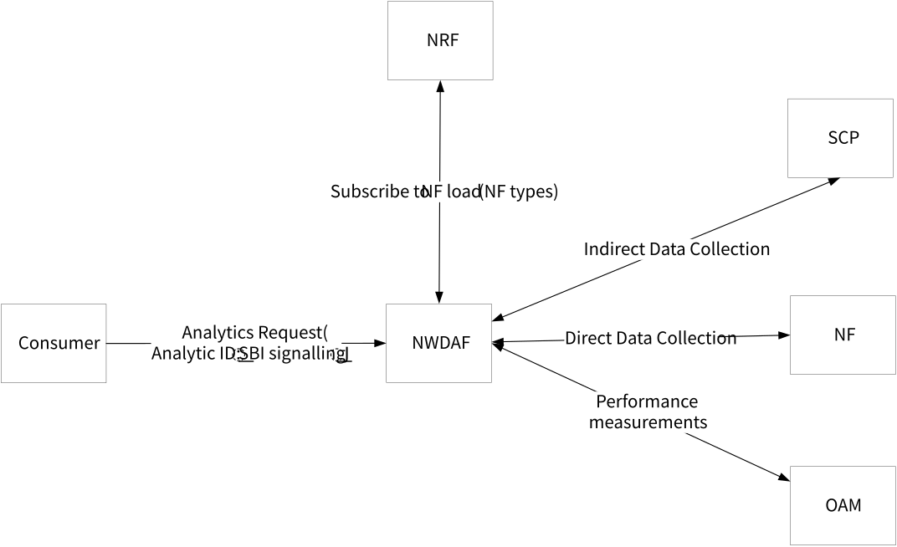
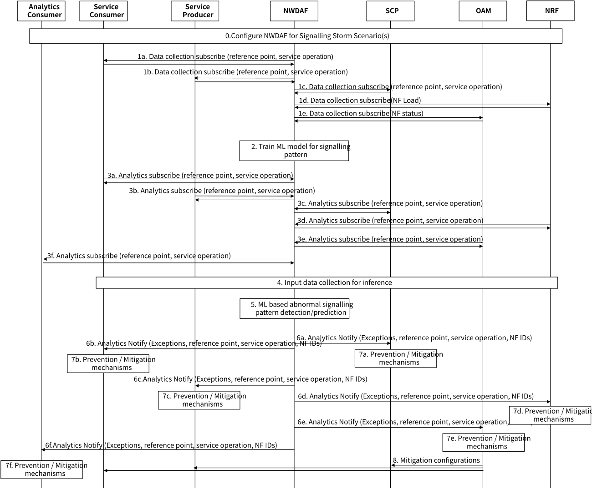
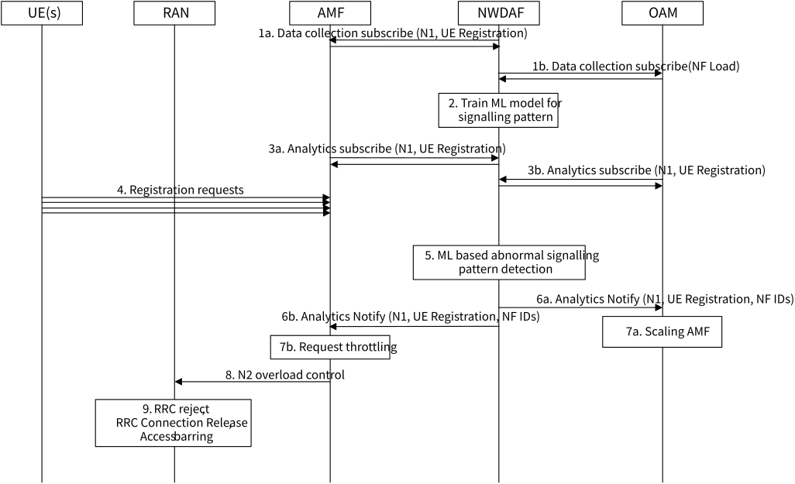
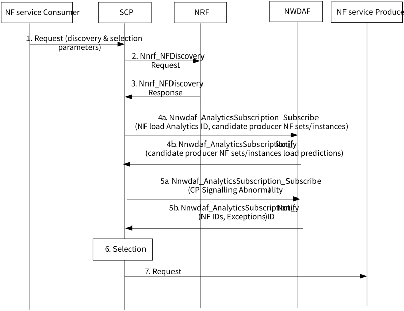

# 6.39 Solution \#39: NWDAF Analytics based Signalling Strom Prediction

## 6.39.1 Description

The 5G core network, with its exponential growth in connected devices (e.g. IoT devices), complex control plane traffic (considering the number of network functions and corresponding services) and unexpected misconfiguration or failure of NFs, is susceptible to "signalling storms," which overwhelm the network function with excessive control messages, leading to dysfunctionality of NFs and consequently service outages. Predicting and preventing these storms is crucial to minimize and ideally to avoid the outrage period. AIML offers powerful tools like anomaly detection and traffic forecasting to anticipate storm risks, while automated state-of-the-art mitigation strategies like resource scaling and service throttling can prevent them from crippling the network. This proactive approach helps to safeguard the smooth operation of 5G core.

Communications between entities, such as the communication between RAN and AMF or inter-NFs or between AF and NEF, to get services from each other in the corresponding reference points via the corresponding service operations can be represented as a control plane signalling pattern. Each pattern can be characterized by a number of (time varying and/or location dependent) features such as max/mean/min number of request in a time window, max/mean/min number of responses in a time window, the number of the timed-out requests, max/mean/min response time, etc.

Signalling storms can erupt due to different reasons and in various scenarios in the network such as:

\- A large number of Internet of Things (IoT) devices registering simultaneously during device rollout or a huge number of UEs registering simultaneously after a disaster recovery may lead to signalling storm in N1 reference point between RAN (on behalf of UEs) and AMF.

\- An event in an area could trigger many IoT devices to report the event, and for that, they need to establish PDU session. Consequently, there will be an overwhelming number of PDU session establishment requests on N11 reference point between AMF and SMF.

\- So frequent requests from multiple AFs to NEF may lead to signalling storm on N33 reference point between AF and NEF.

\- The numerous session updates by SMF caused by a faulty policy update can also trigger the storm on N4 between SMF and UPF.

However, regardless of the actual root-cause of the signalling storm in the previous examples, the control plane signalling pattern between the mentioned entities is abnormal, e.g. too many requests than the normal case or unusual too large response time, or large number of rejected requests, etc.

Putting these observations together, one possible solution to predict and/or detect signalling storm in the network (and accordingly prevent and/or mitigate via taking an appropriate action) is to train a ML model(s) to predict/detect abnormalities in the control plane signalling pattern in a specific reference point between network entities and possibly for a particular set of the associated service operations. By training a ML model to recognize typical SBA signalling patterns, the NWDAF can predict the occurrence of SBA signalling storm when there is a trend of abnormal SBA signalling. However, monitoring all control plane communications in 5GC among all network entities is impractical (due to significant overhead), accordingly, in this solution, to reduce the overhead, the NWDAF is instructed/configured to monitor control plane signalling corresponding to specific scenarios.

This is the idea of the proposed solution where NWDAF collects metrics/KPIs of service operations (e.g. the number of the requests messages in a time window, the number of responses messages in a time window, etc.) between two particular network entities and train a model for the analytics of detecting the control plane abnormal signalling patterns. Other network entities such as the service producer entity or OAM can subscribe for this analytics ID and get notified if a control plane signalling abnormality is predicted/detected by NWDAF and then takes the predefined prevention/mitigation actions. The framework of the proposed solution is shown in Figure 6.39.1-1 and details are explained as follows.

Figure 6.39.1-1: The framework of the proposed solution

Currently, NFs can collect and report various metrics/KPIs of their operations; for example, the following KPIs are defined in TS 28.552 \[11\]:

\- Number of successful initial registrations.

\- Number of mobility registration update requests.

\- Mean time of Registration procedure.

\- Total number of attempted service requests.

\- Number of PDU session creation requests.

By extending this capability of NFs, it is supposed that they can provide more information about their service operations such as number of requests per time window, number of responses per time windows, timing information of the request/responses, number of timed-out requests, number of rejected requests, etc.

NWDAF functionality is extended to provide the "Control Plane Signalling Abnormality" analytics ID. For this purpose, NWDAF collects the metrics/KPIs of the operations for a reference point (e.g. N11) and (optionally) for a particular service (e.g. PDU session create context) exchanged between the corresponding service producer and consumer from the corresponding network entities. In addition to these service operation KPIs, NWDAF may also collect other input data related to signalling storms such as the load information of the NFs. Using the collected input data, NWDAF trains ML model(s) to detect/predict the abnormality in the control plane signalling in a particular reference point and (optionally) for a particular service. Other network entities such as the service producer and consumer NFs can subscribe to this analytics ID. To provide the analytics, NWDAF continuously collects the input data from the corresponding source and use them as inputs to the ML model which can identifies various abnormalities/exceptions in the control plane signalling such as too many (parallel / on-going) requests, too many requests reject/time-out, too late responses, etc. Table 6.39.1-1 shows the input data that NWDAF may collect and Table 6.39.1-2 are the output prediction/detection of the "Control Plane Signalling Abnormality" analytics.

Table 6.39.1-1: Input data from 5GC related to Control Plane Signalling Abnormality

<table>
<colgroup>
<col style="width: 28%" />
<col style="width: 21%" />
<col style="width: 49%" />
</colgroup>
<thead>
<tr class="header">
<th>
Information

(NOTE 1)
</th>
<th>Source</th>
<th>Description</th>
</tr>
</thead>
<tbody>
<tr class="odd">
<td>NFs ID</td>
<td>Service Producer and Consumer entities</td>
<td>The NF instance ID of the service producer and consumer entities.</td>
</tr>
<tr class="even">
<td>Service Operation information</td>
<td>Service Producer and Consumer entities</td>
<td>The information of the reference point and corresponding service operation.</td>
</tr>
<tr class="odd">
<td>Service Operation Request Counters</td>
<td>
Service Producer entity / OAM

(NOTE 2)
</td>
<td>The counters related to the requests received by the service producer entity</td>
</tr>
<tr class="even">
<td>&gt; Number of requests</td>
<td></td>
<td>The number of request received in a time window.</td>
</tr>
<tr class="odd">
<td>&gt; Rate of requests</td>
<td></td>
<td>The rate of the service requests.</td>
</tr>
<tr class="even">
<td>&gt; Unhandled requests</td>
<td></td>
<td>The number of request received but not responded.</td>
</tr>
<tr class="odd">
<td>&gt; Timing of request</td>
<td></td>
<td>Max/min/variance of inter-request periods.</td>
</tr>
<tr class="even">
<td>&gt; Rejected requests</td>
<td></td>
<td>The number of rejected requests.</td>
</tr>
<tr class="odd">
<td>&gt; Redundant requests</td>
<td></td>
<td>The number of redundant request.</td>
</tr>
<tr class="even">
<td>Service Operation Response Counters</td>
<td>
Service Consumer entity / OAM

(NOTE 2)
</td>
<td>The counters related to the requests sent by the service consumer entity.</td>
</tr>
<tr class="odd">
<td>&gt; Number of requests</td>
<td></td>
<td>The number of request sent in a time window.</td>
</tr>
<tr class="even">
<td>&gt; Rate of requests</td>
<td></td>
<td>The rate of the service requests.</td>
</tr>
<tr class="odd">
<td>&gt; Unhandled requests</td>
<td></td>
<td>The number of request sent but not replied.</td>
</tr>
<tr class="even">
<td>&gt; Timing of request</td>
<td></td>
<td>Max/min/variance of inter-request periods.</td>
</tr>
<tr class="odd">
<td>&gt; Rejected requests</td>
<td></td>
<td>The number of timeout requests.</td>
</tr>
<tr class="even">
<td>&gt; Redundant requests</td>
<td></td>
<td>The number of redundant request.</td>
</tr>
<tr class="odd">
<td>NF Context data</td>
<td>Service Producer and Consumer entities</td>
<td>The information about the current UE context, or network context and NF’s load.</td>
</tr>
<tr class="even">
<td>&gt; Number of UEs</td>
<td>NF</td>
<td>Total number of UEs that is served by the NF.</td>
</tr>
<tr class="odd">
<td>&gt; Number of network context</td>
<td>NF</td>
<td>Total number of network context (e.g. interface context) that is maintained by the NF.</td>
</tr>
<tr class="even">
<td>&gt; NF load</td>
<td>NRF</td>
<td>The load of specific NF instance(s) in their NF profile.</td>
</tr>
<tr class="odd">
<td>&gt; NF status &amp; resource usage</td>
<td>OAM</td>
<td>The usage of assigned virtual resources currently in use for specific NF instance(s) (mean usage of virtual CPU, memory, disk) as defined in clause 5.7 of TS 28.552 [11].</td>
</tr>
<tr class="even">
<td>Unexpected operational event (Note 3)</td>
<td>Service Producer and Consumer entities</td>
<td></td>
</tr>
<tr class="odd">
<td>&gt; Load</td>
<td></td>
<td>NF load crossed a threshold.</td>
</tr>
<tr class="even">
<td colspan="3">
NOTE 1: All input data are optional.

NOTE 2: The already supported counters/KPIs by OAM defined per NF in TS 28.552 [11] are collected from OAM; other remaining counters/KPIs are collected from the corresponding NFs.

NOTE 3: Whether and how service producer/consumer NFs provides these events are left to implementation.
</td>
</tr>
</tbody>
</table>

Table 6.39.1-2: Outputs of Control Plane Signalling Abnormality

<table>
<colgroup>
<col style="width: 31%" />
<col style="width: 68%" />
</colgroup>
<thead>
<tr class="header">
<th>Information</th>
<th>Description</th>
</tr>
</thead>
<tbody>
<tr class="odd">
<td>Source NF(s) ID</td>
<td>The NF ID of the source network entities.</td>
</tr>
<tr class="even">
<td>Destination NF ID</td>
<td>The NF ID of the destination network entity.</td>
</tr>
<tr class="odd">
<td>Reference Point &amp; Service Operation(s)</td>
<td>The information of the reference point and service operation(s) impacted.</td>
</tr>
<tr class="even">
<td>Exceptions ID (NOTE 1)</td>
<td>
The ID of detected abnormality including:

- Too many requests;

- Too many parallel requests (without response);

- Too less responses;

- Too late responses;

- Too inconsistent responses time;

- Too many request reject;

- Too many request timeout;

- Unexpected messages pattern.
</td>
</tr>
<tr class="odd">
<td colspan="2">NOTE 1: Detecting abnormality and identifying the exception ID is left to the NWDAF implementation; similar to exception/abnormality detection in other applications, unsupervised machine learning techniques such as clustering can be used for this purpose that does not need labelled ground-truth data.</td>
</tr>
</tbody>
</table>

Currently various mechanisms in the implementation (e.g. Request throttling, Back-pressure, Connection Pooling) and standardized solution (e.g. load-balancing, N2 overload control, NAS congestion control as defined clause 5.19 of TS 23.501 \[2\]) can be used in the case of signalling storm. In the proposed solution, the following entities can subscribe to the "Control Plane Signalling Abnormality" analytics ID and once reception of the notification of abnormality, may take the actions mentioned as examples:

\- The service producer entity: Back-pressure, Connection Pooling, etc.

\- The service consumer entity: Request throttling, NF reselection, etc.

\- OAM: Horizontal/Vertical scaling, Proper configuration of the network entities, etc.

\- SCP (in the case of using SCP for service communication between NFs): Request throttling, Back-pressure, Connection Pooling, etc.

\- NRF: Local policy to isolate the impacted NFs (e.g. avoid selecting the overwhelmed service producer for a time period).

## 6.39.2 Procedures

Figure 6.39.2-1 depicts the procedure for the proposed solution where NWDAF collects input data including the metrics/KPIs of the service operations, and produce the notification of the abnormal control plane signalling pattern, which is a trigger to take a prevention/mitigation action in other entities.

Figure 6.39.2-1: NWDAF Control Plane Signalling Abnormality Analytics ID for Signalling Storm

0\. To reduce monitoring and data collection overhead, NWDAF is configured for detecting/predicting specific signalling storm scenarios either by instruction from OAM, or a request from other NF that uses the NWDAF analytics for signalling storm mitigation (the NF may be the service provider NF, service consumer NF, NRF, SCP, or any other NF in the network). There are two options to specifies the signalling storm scenarios: 1) determining a predefined "Scenario ID" that specifies which control plane signalling involved or 2) specifying service operation(s) in a reference point, i.e. services and message types to filter messages to be observed.

1\. NWDAF subscribes to other network entities for the input data needed for analytics. The metrics/KPIs of a particular service operations in a specified reference point are collected from the service consumer and service producer entities in steps 1a and 1b respectively. If SCP is deployed in the network and the service consumer and producer entities are communicating through the SCP, the service operation metrics/analytics can also be collected from the SCP in step 1c. In step 1d, NWDAF collects NF load information from NRF. Finally, in step 1e, NWDAF subscribes to the NF load information from OAM; moreover, it may also subscribe to "5GC control plane congestion analysis" from OAM (MDAF) defined TS 28.104 \[9\] using procedures described in TS 23.288 \[5\].

Editor's note: Whether SCP can be a source of input data is FFS.

2\. The NWDAF trains ML model(s) to predict/detect abnormalities in the control plane signalling in a specific reference point and specific service operations.

3\. The analytics consumer, i.e. the network entities may be notified in the case of signalling storm of a service operations of a reference point, subscribes to the NWDAF indicating the reference point and service operations. More specifically, the service consumer entity in step 3a, the service producer entity in step 3b, SCP in step 3c, NRF in step 3d, and OAM in step 3e may subscribe to the analytics. Any other NF may also subscribe to the analytics in step 3f.

4\. The NWDAF collects the input data needed for inference, i.e. the metrics/KPIs of service operations and NF loads.

5\. The collected input data are used to detect/predict control plane signalling abnormalities.

6\. The analytics consumers are notified by NWDAF for detected/predicted abnormalities indicating the exception(s), the affected service operations of a reference point and the NF IDs of the service consumer and producer. In step 6a, NWDAF sends notification to SCP, in step 6b, it notifies the service consumer entity, in step 6c, the notification is sent to service producer entity, notification is sent to NRF in step 6d, and finally in step 6e, NWDAF notifies OAM regarding the prediction/detection of signalling abnormalities. If any other NF subscribed to the analytics, it is notified by NWDAF in step 6f.

7\. The analytics notification by NWDAF triggers prevention/mitigation mechanism already available in the network entities, e.g. back-pressure in the service consumer. In step 7a, SCP may activate its internal overload control mechanism. In step 7b, the service consumer entity may decide to reduce the number of the requests. In step 7c, the service producer entity may activate overload control such as back-pressure, in step 7d, NRF may decide to isolate the impacted NFs based on this notification, and finally in step 7e, OAM takes this notifications into account and enable prevention/mitigation mechanisms such as scaling up/out of the entities or proper configuration of other entities. In a particular signalling storm, if any other NF is notified by NWDAF regarding the abnormality, it may take appropriate mitigation action.

8\. The OAM may also provide extra configurations for signalling storm prevention/mitigation.

### 6.39.2.1 UE registration signalling storm prevention/mitigation using Control Plane Signalling Abnormality Analytics

The proposed procedure can be used to prevent/mitigate various signalling storm scenarios. Figure 6.39.2-2 depicts how it is applied for the UE registration signalling storm scenario.

Figure 6.39.2-2: UE registration signalling storm prevention/mitigation using Control Plane Signalling Abnormality Analytics

1a. NWDAF subscribes to AMF to collect metrics/KPIs of the UE registration process in the N1 reference point.

1b. NWDAF subscribes to OAM to collect AMF load information.

2\. The NWDAF trains ML model(s) to predict/detect abnormalities in the control plane signalling in a specific reference point and specific service operations.

3\. AMF and OAM respectively in steps 3a and 3b subscribe to NWDAF for the Control Plane Signalling Abnormality Analytics of UE registration process in the N1 reference point.

4\. There is a large number of UE registration requests that are going to overwhelm AMF.

5\. NWDAF predict/detect abnormalities (e.g. too many requests and/or too late responses) in the UE registration process in reference point N1.

6\. NWDAF notifies the OAM in step 6a and the AMF in step 6b respectively regarding the exception(s) predicted/detected in the signalling pattern of the N1 reference point.

7a. To mitigate the signalling storm, the OAM may take a mitigation action based on the operator's policy.

7b. Based on the notification from the NWDAF, the AMF may attempt to reduce the request, e.g. NAS level congestion control mechanism defined in clause 5.19.7 of TS 23.501 \[2\].

8\. The AMF may also use N2 overload mechanisms defined in clause 5.19.5.2 of TS 23.501 \[2\] to ask RAN to reduce the volume of the request.

9\. Based on the request from the AMF, RAN may take a mitigation action (e.g. activate congestion control mechanisms defined in TS 38.300 \[15\] and TS 38.413 \[8\] such as RRC reject and/or Access barring).

Editor's note: The mitigation and prevention methods above may affect the network access of normal UEs. To reduce the impact on normal UEs, more precise and efficient mitigation and prevention methods targeting abnormal UEs are FFS.

### 6.39.2.2 Inter-NF Signalling storm prevention/mitigation by SCP using NWDAF Analytics

Figure 6.39.2.2-1: Inter-NF Signalling storm prevention/mitigation by SCP using NWDAF Analytics

1\. The NF service consumer intends to communicate with an NF service producer. The NF service consumer sends the service request to an SCP. The request may include discovery and selection parameters necessary to discover and select a NF service producer instance. For a subsequent request to the same resource, the request may contain binding information.

2\. The SCP may perform discovery upon the request either by interacting with an NRF using Nnrf_NFDiscovery service NRF or may use information collected during the previous interactions with an NRF (by the Nnrf_NFDiscovery service or Nnrf_NFManagement_NFStatusNotify service operation

3\. The NRF returns NF profiles of candidate NFs matching the discovery parameters

4\. If the SCP did not yet subscribe to NF load analytics for NF candidate, it now subscribes at the NWDAF for load predictions based on the NF load analytics. Then, the SCP obtains Notifications about NF load predictions for the candidate NFs from the NWDAF.

5\. If the SCP did not yet subscribe to CP Signalling Abnormality Analytics ID for NF candidate, it now subscribes to the analytics ID. Then, the SCP obtains Notifications about abnormal signalling pattern for the candidate NFs from the NWDAF.

6\. The SCP selects (or reselects) an NF service producer from the candidate NFs. It prefers NFs with lower load predictions and avoids sending requests to NFs which are predicted to become overloaded/abnormal/malfunction.

7\. If the NF service consumer is authorized to communicate with the NF service producer, the SCP forwards the request to the selected NF service producer.

## 6.39.3 Impacts on existing services, entities and interfaces

The solution has the following impacts:

**NWDAF:**

\- Extending functionalities to produce Control Plane Signalling Abnormality Analytics ID.

\- Collects training data for signalling storm detection and prediction.

\- Trains ML model for signalling storm detection.

**5GC NFs (e.g. AMF/SMF/NEF/SCP):**

\- Extending service to report counter/metrics/KPIs of service operations specified in.

\- Extending event reporting capability to report the unexpected operational events.

**NRF:**

\- Set local policy to isolate the source NF based on NWDAF signalling abnormality analytics.

**SCP:**

\- Extending functionalities to subscribe at NWDAF to predictions of NF load or Abnormal CP signalling related to NFs the SCP communicates with.

\- If an NF is predicted to become overloaded or abnormality in the CP signalling, direct incoming service requests to other NFs.

**OAM, AMF, SCP, NEF:**

\- Subscription to NWDAF analytics to be notified regarding signalling storm.

\- Taking signalling storm mitigation action based on the notification from NWDAF.

Editor's note: Impacts on other NFs are FFS.
