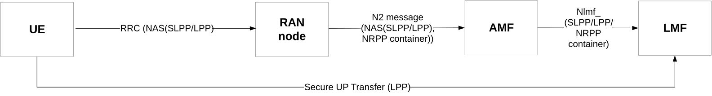
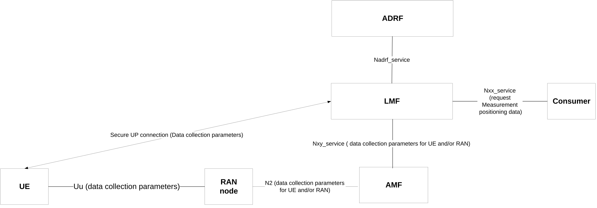
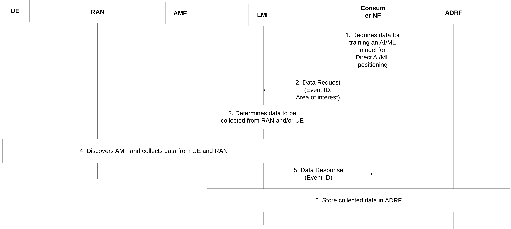

# 6.4 Solution 4: Data Collection Framework for Direct AI/ML positioning

## 6.4.1 Description

Editor's note: This clause will describe the solution principles and architecture assumptions for corresponding key issue(s). Sub-clause(s) may be added to capture details.

The current LCS framework allows the LMF to collect positioning measurement related data from UE and the RAN via control plane by providing positioning related data in a container within RRC/NAS and N2 messages. In addition, the positioning measurement related data may be provided via a user plane connection between the UE and the LMF. If LMF decides to use user plane the LMF indicate to the UE to use user plane for positioning with the information to establish a secure connection. The current framework is shown in Figure 6.4.1-1.

Figure 6.4.1-1: Current framework for data collection for positioning

The LMF currently obtains measurement data from UE/RAN node only when the LMF receives a request to identify a location of a specific UE (based on the service request sent by an AMF) which is originated from LCS client or UE. As such there is no triggering from model training entities (e.g. NWDAF containing MTLF) for measurement data collection and no framework currently defined to transfer data to model training entities (e.g. NWDAF containing MTLF) for model training. In addition, the LMF can only obtain measurement data from UE/RAN per UE granularity based on the per UE location estimate request from LCS client or UE, but the data collection for model training may be per area granularity for efficiency.

As such the following data collection framework is proposed to be supported as described in Figure 6.4.1-2 below:

Figure 6.4.1-2: Data Collection Framework for positioning measurement data

The LMF is used to collect measurement related positioning data.

Editor's note: Whether the DCCF is involved is FFS.

The main steps of the data collection procedure are as follows:

\- An LMF receives a request to collect measurement related data for positioning. The request may include requirements for collecting measurement data which can include:

\- UE identifiers: One or more UEs to collect measurement data and the type of data required

\- Area of interest including Cell ID(s) and/or may TAI(s) (collect measurement data only when UEs are served by RAN nodes with specific Cell ID(s) or by RAN nodes within target area).

\- One or more Event IDs where each Event ID correspond to type of data to collect and report.

NOTE 1: What data need to be collected depends on RAN agreements.

NOTE 2: Considering the operator's policies on UE data collection and exposure, the LMF ensures that no sensitive measurement data are exposed to 3rd parties.

Editor's note: Whether UE identifiers are included are FFS.

\- Further requirements regarding how the data should be collected, e.g. the resolution of the data, how often the data should be collected, criteria on sending the data, the location information at which the data was generated, whether the quality of the data is to be reported, timestamp associated to each of the data points/sets, which are to be collected.

\- The LMF collects data from UE and/or from RAN.

Editor's note: It is FFS whether and what data needs to be collected and how to collect the data from UE/RAN by the LMF. Coordination with RAN WGs is needed.

\- The LMF may store the data in ADRF.

\- The LMF may transfer the collected data to model training entities (e.g. NWDAF containing MTLF).

## 6.4.2 Procedures

Editor's note: This clause describes high-level procedures and information flows for the solution.

The procedure for configuring the UE and RAN node is as follows. For simplicity only the control plane procedure for reporting data is shown.

Figure 6.4.2-1: Data collection via LMF

1\. A consumer requires data to train an AI/ML model. The consumer may be an NWDAF containing MTLF.

Editor's note: Other consumers for collecting positioning measurement data are FFS.

2\. The consumer sends a request including an Event ID of the data needed to be collected, an area of interest (where data are to be collected) and target UEs (if data is to be collected by specific UEs).

3\. The LMF considering the operator's policies on UE data collection and exposure, determines what data are needed to be collected from UE and or RAN.

4\. The LMF discovers an AMF. The LMF may also identify which UEs served by an AMF.

Editor's note: The potential impacts of the procedure on existing mechanisms of collecting data from UE/RAN by LMF is FFS.

Editor's note: The interaction between the LMF and the consumer is FFS.

5\. LMF provides requested data to consumer.

6\. LMF may store data in ADRF.

## 6.4.3 Impacts on services, entities and interfaces

Editor's note: This clause captures impacts on existing services, entities and interfaces.

LMF:

\- Needs to handle requests from consumer (e.g. NWDAF MTLF) to collect positioning related measurement data from RAN/UE

NOTE: There may be potential impacts on LPP and/or NRPPa for collecting data for AI based positioning, which needs to be coordinated with RAN WGs.
