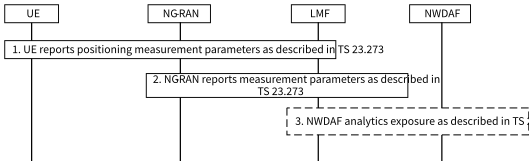

# 6.6 Solution \#6: LMF based ML model training and Inference

## 6.6.1 Description

This is a solution proposed for KI#1: Enhancements to LCS to support Direct AI/ML based Positioning.

In order to support the Direct AI/ML based positioning for case 2b, 3b, the LMF is required to be enhanced to support the AI/ML- based positioning. How LMF performs ML model training and inference, is based on implementation (out of scope of 3GPP).

LMF may collect data from UE, NG-RAN or NWDAF for model training and inference. LMF collects data from UE via either CP or UP solution with LPP protocol as described in TS 23.273 \[7\], LMF collects data from NG-RAN via NRPPa protocol as described in TS 23.273 \[7\]. LMF may also request NWDAF to expose some information that supported in TS 23.288 \[5\] to assist the AIML based positioning. How LMF uses the received parameters to perform ML model training and inference is based on implementation (out of scope of 3GPP).

Editor's note: How does LMF selects UEs to collect data for ML model training and inference is FFS.

## 6.6.2 Procedures

This is the data collection procedure to support ML model training and inference for AI/ML based positioning in LMF.

Figure 6.6.2-1: Data collection for LMF based ML model training and inference

1\. LMF requests from the UE to report the positioning measurement parameters as described in TS 23.273 \[7\]. UE reports positioning measurement parameters by using LPP protocol via either the CP or UP.

Editor's note: Enhancements of the procedure is FFS.

2\. LMF requests NG-RAN to report the positioning measurement parameters as described in TS 23.273 \[7\]. NG-RAN reports positioning measurement parameters by using NRPPa protocol.

3\. LMF may request NWDAF to expose location Accuracy Analytics as described in clause 6.17 of TS 23.288 \[5\].

NOTE 1: There is no sequence of these 3 steps, LCS may trigger these steps in parallel.

NOTE 2: The collected measurement parameters from UE in step 1 and NG-RAN in step 2 is determined by RAN WGs. If there are new measurement parameters that provided by UE or NG-RAN in Rel-19 depends on RAN's progress in Rel-19.

LMF will use the received parameters from UE, NG-RAN and NWDAF to perform ML model training or inference, and it will generate the target UE positioning as inference output. How LMF uses the received parameters to perform ML model training and inference is based on implementation (out of scope of 3GPP).

In order to monitor the inference performance of the AI/ML based positioning model, the LMF may obtain ground truth data by using different positioning method, for example, the PRU associated procedure as defined in clause 6.17 of TS 23.273 \[7\], or GNSS assistance procedure as defined in clause 6.15 of TS 23.273 \[7\].

## 6.6.3 Impacts on services, entities and interfaces

LMF, NG-RAN, UE:

NOTE: The collected measurement parameters from UE in step 1 and NG-RAN in step 2 is determined by RAN WGs. If there are new measurement parameters that provided by UE or NG-RAN to LMF in Rel-19 depends on RAN's progress in Rel-19.

Editor's note: How does LMF selects UEs to collect data for ML model training and inference is FFS.
