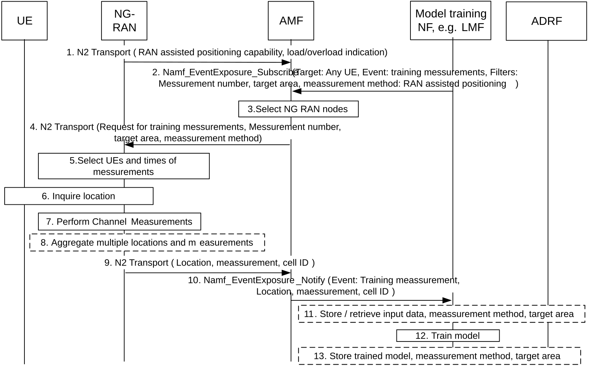
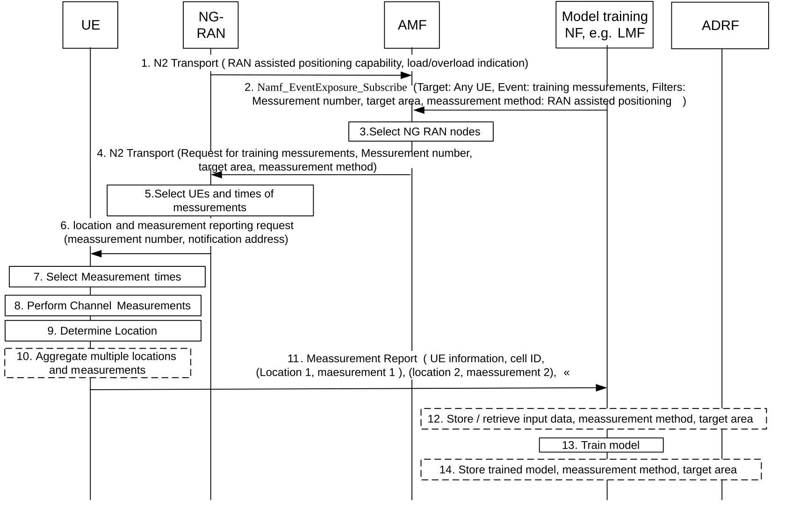
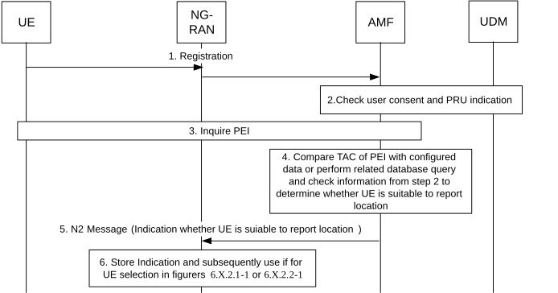
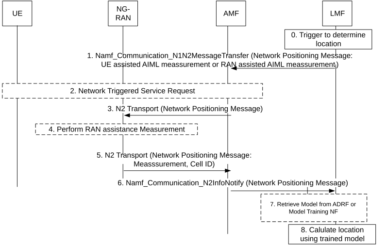
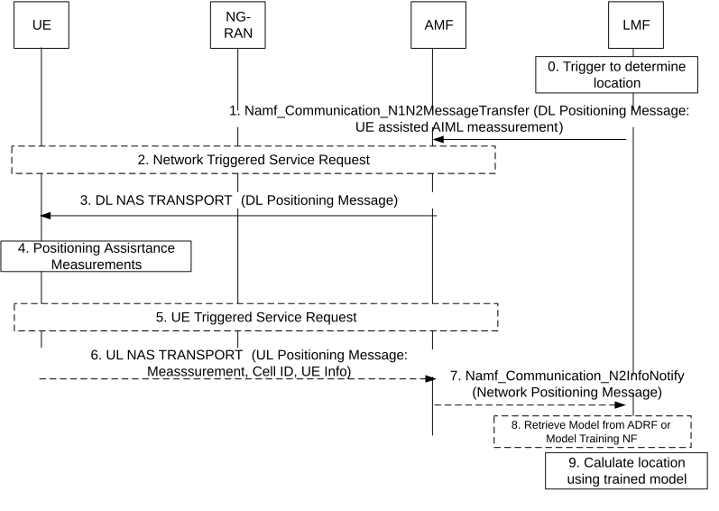
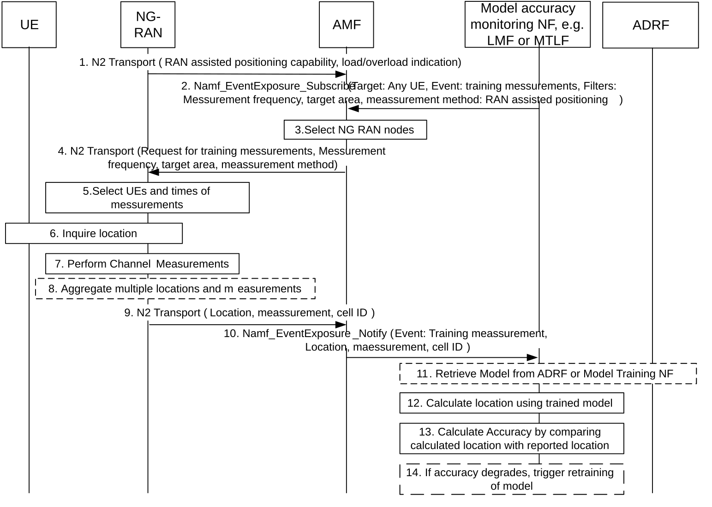

# 6.7 Solution \#7 Training of LMF-side Model to determine location

## 6.7.1 Description

Models will closely relate to topologies and antenna in an area or a radio cell and will thus be specific to an area or cell or at least consider the cell as input. For models related to UE measurement (for Case 2b: UE-assisted/LMF-based positioning), details of the UE such as number of reception points may also matter; this can be reflected in separate models or input data to the model. Different models will likely apply for UE-assisted positioning (case 2b, channel measurement by UE) and NG-RAN node assisted positioning (case 3b, channel measurement by NG-RAN).

It is assumed that for the model training, in addition to channel measurements also ground truth data about the related UE location will be required, most likely Global Navigation Satellite System (GNSS) information such as GPS information provided by the UE. For the training of the model many correlated measurements are required, each consisting of accurate ground truth data (e.g. GPS coordinates or a known location of a stationary positioning reference unit (PRU, see TS 23.273 \[7\].)) location reported by the UE or of an indicated PRU and channel measurements for different Transmission reception points and the same UE at the same point in time.

Editor's note: This assumption needs to be confirmed by RAN groups and related conclusions need to wait for RAN decisions.

Editor´s note: If RAN decides to use only known locations of PRUs as ground truth data, additional ground truth location measurements are not required.

The reporting of ground truth by a UE data requires the capability of the UE to determine its location. There is already a capability indication from UE to RAN to indicate the capability to report locations. The reporting of measurements by the UE (for Case 2b: UE-assisted/LMF-based positioning) will require additional UE capabilities. It is desirable to select UE models/types that are known to provide accurate locations or measurements to enhance the quality of training data. The PEI (containing IMSEI/ISMEISV with Type Allocation Code (TAC), see TS 23.003 \[12\]) of UEs can be used to select suitable UEs, but it is only available in the AMF.

Also RAN nodes with special capabilities to support the new measurements and report related location are required.

The measurements and location reports can lead to considerable load; and it is desirable to perform them when there is sufficient capacity and related NG RAN nodes, cells and UEs are not overloaded. It is thus desirable to allow RAN nodes to select times for training measurements when they are less loaded.

Only UEs in the right area /cell can be used to train the related model. RAN nodes know which UEs they are serving and can select related UEs.

To reduce signalling load, a bulk subscription to measurements and a bulk reporting of measurements seems desirable.

TS 23.273 \[7\] defines methods for an LMF to obtain location information related to a single UE (see parts copied in the Annex). They do not allow for bulk subscriptions related to many UEs and they do not support reporting of ground truth data along with measurements. However, a direct reporting from UE to LMF via the user plane is supported.

It is also desirable to provide means to monitor the accuracy of models while they are in use for inference of locations.

Thus, the solution adheres to the following principles:

\- The entity performing the model training (LMF or NWDAF/MTLF) performs a bulk subscription for location model training measurements towards the AMF. The request denotes the target area, the desired time window for measurements, the desired number of measurements, and/or a desired frequency of measurements, and an indication whether measurements for UE-assisted positioning or RAN-assisted positioning are requested. The request can also denote a destination address to which measurements are to be provided.

NOTE: The entity performing the model training is expected to be selected in the conclusion phase.

\- The AMF selects NG-RAN node(s) based on the capabilities of the RAN nodes and their load and the target area and forwards the request to the selected RAN nodes. It may reject requests or parts of the target area if there are no suitable RAN nodes.

Editor's note: Interactions between AMF and RAN nodes need to be coordinated with RAN and related conclusions need to wait for RAN decisions.

\- The RAN node may select appropriate times for measurements based its load, radio load, and the availability of suitable UEs. The RAN node selects UEs capable of reporting ground-truth location and for UE-assisted measurements also capable of performing such measurements.

\- For NG-RAN node assisted positioning, the NG RAN node performs channel measurements for each of the selected UEs and request the related UE to report its location. The NG RAN node reports the measured parameters and location reported by the UE, possibly in combination with the cell ID where the UE was located, via AMF to the model training entity.

Editor's note: Information exposed by RAN nodes need to be confirmed by RAN and related conclusions need to wait for RAN decisions.

\- For UE assisted positioning, the NG RAN node requests the UE to performs channel measurements and provide them, and also request the related UE to report its location. The NG RAN node may request to perform multiple measurements and indicate a time window. The NG RAN node also provide a destination address where to provide the results. The UE measures the location and also performs requested channel measurements. The UE performs the requested number of measurements and determine the times for measurements and result reporting based on its own load, battery status, and radio load. The UE sends information about its location, measurement and information about its configuration (e.g. number of transmission reception points) towards the target address provided by the NG RAN node via a data connection.

Editor's note: Information exposed by UEs need to be confirmed by RAN and related conclusions need to wait for RAN decisions.

\- The model training entity may store the input data received from NG RAN node or UE at the ADRF together with information about target area, measurement method (UE-assisted positioning or RAN-assisted positioning).

\- The model training entity trains the model with the input data and may store the trained model at the ADRF using a special "location" Analytics ID. It stores information about target area and measurement method (UE-assisted positioning or RAN-assisted positioning) together with the model.

\- When a UE registers, the AMF determines based on the Permanent Equipment Identifier (PEI), and in particular the Type Allocation code (TAC) which is part of an IMEI or IMEISC used as PEI, whether the UE is suitable to report its location for model training and whether the UE is suitable to perform measurements for UE-assisted location determination. The AMF provides that information to NG-RAN, and NG-RAN stores this information as part of the UE context and may subsequently use it to select UEs.

\- The LMF acting as inference entity may retrieve suitable models from the ADRF. The LMF requests and/or selects models based on the target area and the measurement method. When receiving a request to determine the location of a UE, the LMF sends a request for a channel measurement to the NG-RAN via AMF and indicates the measurement method (UE-assisted positioning or RAN-assisted positioning). For RAN-assisted measurement, NG-RAN performs the measurement. For UE-assisted measurements, NG-RAN requests the UE to perform and report the measurement along with information about its configuration (e.g. number of transmission reception points). NG-RAN provides the measurement to the LMF via the AMF.

\- A model accuracy monitoring entity (LMF or NWDAF/MTLF) also sends a request via AMF to a NG RAN node to provide measurements and ground truth locations indicating a lower target frequency of measurements than for the model training. The model accuracy monitoring entity uses the reported measurements to calculate location using the model, and compares the calculated locations with the reported locations to determine the accuracy of the model. If the accuracy of the model degrades, it triggers a new model training.

NOTE: The entity performing the model accuracy monitoring is expected to be selected in the conclusion phase.

## 6.7.2 Procedures

### 6.7.2.1 Training an LMF-side model for NG-RAN assisted positioning

Figure 6.7.2.1-1: Training an LMF-side model for NG-RAN assisted positioning

1\. The NG RAN nodes inform the AMF about their capability to support NG-RAN assisted positioning. The NG RAN nodes may also provide periodic reports about their load and/or send indications when being in overload.

Editor's note: How the NG_RAN indicates capabilities of the RAN nodes and their load to the AMF is to be determined by RAN WGs.

2\. The model training MF, e.g. MTLF inside NWDAF or an LMF sends a request to an AMF to provide measurements and locations for training a location model. The request denotes a target area and may denote a target time period, a target number of measurements, and/or a target frequency of measurements. The request also denotes NG-RAN assisted positioning as the desired measurement method.

3\. The AMF selects NG-RAN node(s) based on the capabilities of the RAN nodes, their load and the target area and forwards the request to the selected RAN nodes. It may reject the request in step 2 or parts of the target area if there are no suitable RAN nodes.

4\. The AMF sends a request to provide measurements and locations for training a location model with parameters as described in step 2 to each of the selected RAN nodes.

5\. The NG RAN node selects UEs in the target area that indicated a capability to report location information and for UE-assisted channel measurements also a capability to perform such measurements. The NG RAN node may determine the times and frequencies of measurements and requests to the UE considering the load and available capacity of itself, related radio cells, and of selected UEs.

6\. For each selected UE and each related measurement time, the NG-RAN node requests the UE to report its location.

Editor's note: Interactions between NG-RAN and UE need to be confirmed by NG-RAN and related conclusions need to wait for RAM decisions.

7\. For each selected UE and at each measurement time, the NG-RAN node performs a channel measurement.

8\. The NG RAN node aggregates multiple measurements in one report

9\. The NG RAN node reports the measured parameters and locations reported by the UE, and the cell ID where the UE was located, to the AMF.

10\. The AMF forwards the information received in step 9 to the model training entity. The AMF may aggregate multiple received reports before the forwarding.

11\. The model training entity may store the input data received in step 10 at the ADRF together with information about target area, measurement method (UE-assisted positioning or RAN-assisted positioning). The model training entity may subsequently retrieve the stored information for the model training.

12\. The model training entity trains the model with the information received in step 10. The trained model has the purpose to derive a location out of measurements.

13\. The model training entity may store the trained model at the ADRF using a special “location” Analytics ID. It stores information about target area and measurement method (UE-assisted positioning or RAN-assisted positioning) together with the model. It may also store an identifier of the stored input data that have been used to train the model.

### 6.7.2.2 Training an LMF-side model for UE assisted positioning

Figure 6.7.2.2-1: Training an LMF-side model for UE assisted positioning

1\. The NG RAN nodes inform the AMF about their capability to support UE assisted positioning. The NG RAN nodes may also provide periodic reports about their load and/or send indications when being in overload.

Editor's note: How the NG_RAN .indicates capabilities of the RAN nodes and their load to the AMF is to be determined by RAN WGs.

2\. The model training MF, e.g. MTLF inside NWDAF or an LMF sends a request to an AMF to provide measurements and locations for training a location model. The request denotes a target area and may denote a target time period, a target number of measurements, and/or a target frequency of measurements. The request also denotes a notification address where to receive the measurements (either of a data storage entity or of the model training entity). The request also denotes UE assisted positioning as the desired measurement method.

3\. The AMF selects NG-RAN node(s) based on the capabilities of the RAN nodes and their load and the target area and forwards the request to the selected RAN nodes. It may reject requests or parts of the target area if there are no suitable RAN nodes.

4\. The AMF forwards the request to the selected RAN nodes.

5\. The NG RAN node selects UEs in the target area that indicated a capability to report location information and a capability to perform measurements for UE-assisted positioning. The NG RAN node may determine the times and frequencies of measurements and requests to the UE considering the load and available capacity of itself, related radio cells, and or of selected UEs.

6\. For each selected UE, the NG-RAN node requests the UE to perform measurements for UE-assisted positioning and report its location. The NG RAN node may request to perform multiple measurements and may also indicate a desired number of measurements, a related time window, and/or a desired frequency of measurements. The NG RAN node also provide a notification address where to provide the results. The UE may reject the request for instance if it is overloaded or needs to safe power due to low battery status.

Editor's note: Interactions between NG-RAN and UE need to be confirmed by NG-RAN and related conclusions need to wait for RAN decisions.

7\. The UE may determine the times for measurements and result reporting based on its own load, battery status, and radio load.

8\. For each measurement time, the UE performs a channel measurement.

9\. For each measurement time, the UE determines its location.

10\. The UE node may aggregate multiple measurements in one report

11\. The UE reports the measured parameters and locations, and the cell ID where the UE was located, to the received notification address via a data connection (PDU session). The UE may report in addition information related to its antenna configuration (e.g. number of Transmission reception points) and/or about its model/type (e.g. PEI or TAC).

12\. The model training entity may store the input data received from the UE in step 11 at the ADRF together with information about target area, measurement method (UE-assisted positioning or RAN-assisted positioning). The model training entity may subsequently retrieve the stored information for the model training.

13\. The model training entity trains the model with the information received in step 11. The trained model has the purpose to derive a location out of measurements.

14\. The model training entity may store the trained model at the ADRF using a special “location” Analytics ID. It stores information about target area and measurement method (UE-assisted positioning or RAN-assisted positioning) together with the model. It may also store an identifier of the stored input data that have been used to train the model.

### 6.7.2.3 Selecting UEs for reporting locations based on PEI

Figure 6.7.2.3-1: Selecting UEs for reporting locations based on PEI

1\. The UE registers via NG-RAN node at an AMF.

2\. The AMF obtains subscription data from the UDM that contain user consent for data collection and an indication whether the UE is suitable to serve as a PRU and whether the PRU is stationary.

3\. The AMF inquires the Permanent Equipment Identifier (PEI) of the UE.

4\. The AMF uses information obtained in step 2, configured information related to suitable TACs and the Type Allocation code (TAC) which is part of an IMEI or IMEISC within the inquired PEI to determine whether the UE is suitable to provide location reports for the purpose of model training and/or whether the UE is suitable to perform measurements for UE-assisted positioning.

5\. The AMF indicates to the NG RAN node whether the UE is suitable to provide location reports for the purpose of model training and/or whether the UE is suitable to perform measurements for UE-assisted positioning, for instance within the UE registration procedure.

6\. The NG RAN stores this information as part of the UE context and uses that information when selecting UEs in step 5 of figure 6.7.2.1-1 or 6.7.2.2-1.

### 6.7.2.4 Inference of location for NG-RAN assisted positioning

Figure 6.7.2.4-1: Inference of location for NG-RAN assisted positioning

0\. A trigger to determine location as specified in of TS 23.273 \[7\] occurs at an LMF, for instance an incoming Nlmf_Location_DetermineLocation service operation. The LMF determines to use NG-RAN assisted direct AIML positioning with LMF side model.

1\. The LMF sends a request for a NG-RAN assistance measurement related to the UE. The request is similar to step 1 in Figure 6.11.2-1 of TS 23.273 \[7\].

2.-3. Same steps as in in Figure 6.11.2-1 of TS 23.273 \[7\].

4\. The NG-RAN performs RAN assistance measurements.

5.-6. Same steps as in Figure 6.11.2-1 of TS 23.273 \[7\]. The NG RAN node reports the measurements and the cell ID.

7\. The LMF may retrieve the trained model from the model training entity or the ADRF. To request the model is uses a special "location" Analytics ID, the target area and measurement method (UE-assisted positioning or RAN-assisted positioning).

8\. The LMF calculates the UE location using the trained model and the information received in step 6.

### 6.7.2.5 Inference of location for UE assisted positioning

Figure 6.7.2.5-1: Inference of location for UE assisted positioning

0\. A trigger to determine location as specified in of TS 23.273 \[7\] occurs at an LMF, for instance an incoming Nlmf_Location_DetermineLocation service operation. The LMF determines to use UE assisted direct AIML positioning with LMF side model.

1\. The LMF sends a request for a UE assistance measurement related to the UE. The request is similar to step 1 in Figure 6.11.1-1 of TS 23.273 \[7\].

2.-3. Same steps as in Figure 6.11.1-1 of TS 23.273 \[7\].

4\. The UE performs UE assistance measurements.

5.-7. Same steps as in Figure 6.11-1 of TS 23.273 \[7\]. The UE reports the measurements, the cell ID, and information related to its antenna configuration (e.g. number of Transmission reception points) and/or about its model/type.

8\. The LMF may retrieve the trained model from the model training entity or the ADRF. To request the model is uses a special "location" Analytics ID, the target area and measurement method (UE-assisted positioning or RAN-assisted positioning).

9\. The LMF calculates the UE location using the trained model and the information received in step 7.

### 6.7.2.6 Monitoring accuracy of model for NG-RAN assisted location measurements

Figure 6.7.2.6-1: Monitoring accuracy of model for NG-RAN assisted location measurements

1.-10. Same steps as in Figure 6.7.2.1-1. The model training entity is replaced by the model accuracy monitoring entity, which may be the same as the model training entity or a different entity, for instance an LMF or NWDAF/MTFLF. The model accuracy monitoring entity preferably request measurements in low frequency in step 2.

11\. The model accuracy monitoring entity may retrieve the trained model from the model training entity or the ADRF. To request the model is uses a special "location" Analytics ID, the target area and measurement method (UE-assisted positioning or RAN-assisted positioning).

12\. The model accuracy monitoring entity uses the reported measurements received in step 10 to calculate location using the trained model

13\. The model accuracy monitoring entity compares the calculated locations with the reported locations received in step 10 to determine the accuracy of the model.

14\. If the accuracy of the model degrades, the model accuracy monitoring entity triggers a new model training.

## 6.7.3 Impacts on services, entities and interfaces

**Model training entity (LMF or NWDAF/MTLF):**

NOTE: The entity performing the model training is expected to be selected in the conclusion phase.

\- Performs a bulk subscription for location model training measurements towards the AMF.

\- Receive measurements and ground truth location.

\- Train model.

\- Store input data and trained model in ADRF.

\- Provide model to LMF (if entity is different from LMF).

**AMF:**

\- Selects NG-RAN node(s) based on the capabilities of the RAN nodes and their load and the target area and forwards the request to the selected RAN nodes.

\- Determine whether UEs are suitable to report location based on PEI.

**NG RAN node:**

Editor's note: NG RAN impacts need to be coordinated with RAN WGs and related conclusions need to wait for RAN decisions.

\- Select appropriate times for measurements.

\- Selects UEs.

\- Request UEs to report location.

\- For RAN-assisted positioning, perform measurements.

\- For UE-assisted positioning, request UE to perform measurements.

\- Report measurements and location.

**UE:**

Editor's note: UE impacts need to be coordinated with RAN WGs and related conclusions need to wait for RAN decisions.

\- Determine ground-truth location.

\- For UE-assisted positioning, performs requested channel measurements.

\- Report measurements and location.

**LMF:**

\- Determine location method.

\- Retrieve trained model from training entity (if not collocated) or ADRF.

\- Request and receive assistance measurement.

\- Calculate location based on trained model and received assistance measurement.

**Accuracy monitoring entity (LMF or NWDAF/MTLF):**

NOTE: The entity performing the model accuracy monitoring is expected to be selected in the conclusion phase.

\- Retrieve trained model from training entity (if not collocated) or ADRF.

\- Performs a bulk subscription for location model training measurements towards the AMF.

\- Receive measurements and ground truth location.

\- Calculate location based on trained model and receive assistance measurement.

\- Calculate accuracy by comparing ground truth location and calculated location.

**ADRF:**

\- Store Input data for training location model.

\- Store model using special Analytics ID together with indication of area/cell ID, indication whether model applies to UE assisted or RAN assisted measurement.
