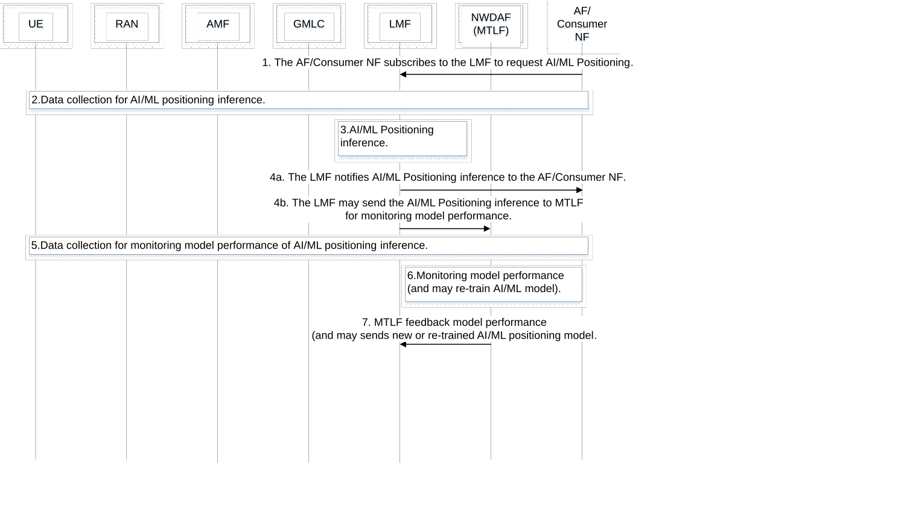

# 6.8 Solution \#8: MTLF-based model performance monitoring for AI/ML positioning

## 6.8.1 Description

This solution addresses Key Issue \#1 "Enhancements to LCS to support Direct AI/ML based Positioning" regarding how to monitor model performance for ML models used for direct AI/ML based positioning. And assumes LMF with an AI/ML model for inference capability.

According to the definition of TS 23.288 \[5\], an NWDAF containing MTLF has the accuracy checking capability for Analytics and/or ML Models.

The LMF may perform the AI/ML positioning inference and provide it to consumers when requested by consumer. The LMF may provide inference data to MTLF for model monitoring. The MTLF performs AI/ML positioning model monitoring based on requests from LMF.

The MTLF may collect UE location information from UE, RAN, AMF, GMLC and AF as described in TS 23.273 \[7\]. MTLF trains ML Model and monitors AI/ML positioning Model performance based on newly collected UE data and re-trains or re-provisions the existing AI/ML positioning Model.

## 6.8.2 Procedures

Figure 6.8.2-1: Procedure of MTLF-based model performance monitoring for AI/ML positioning

1\. The AF/Consumer NF subscribes to the LMF to request AI/ML Positioning.

2\. The LMF performs UE location data collection from UE, RAN, AMF and GMLC as described in TS 23.273 \[7\].

Editor's note: The details on enhancements to those procedures in step2 are FFS.

3\. The LMF uses the trained ML Model for direct AI/ML based positioning.

4\. The LMF notifies AI/ML Positioning inference to the AF/Consumer NF, and may send the inference to MTLF for monitoring model performance.

5\. The MTLF performs UE location data collection for monitoring model performance of AI/ML positioning inference.

NOTE: UE location data collection as ground truth data, e.g. via application layer, is out of this solution's scope.

6\. The MTLF obtains model performance based on the collected UE location data and may decide to re-train/re-provision the ML Model for LMF.

7\. The MTLF provides a model performance report to LMF. When the newly generated or re-trained ML Model is ready, the MTLF sends a new or re-trained ML Model to the LMF.

Editor's note: It is FFs whether UE location calculated by model and UE location inquired by MTLF can be obtained with sufficiently small time difference for accuracy estimates.

## 6.8.3 Impacts on services, entities and interfaces

**MTLF:**

\- Supports to monitor AI/ML positioning model performance.

\- Supports to generate new or re-trained AI/ML positioning models.

**LMF:**

\- Supports to provide inference of AI/ML positioning to MTLF.

**RAN:**

\- Supports to provide UE location data to LMF.

**UE:**

\- Supports to provide UE location data to LMF.
