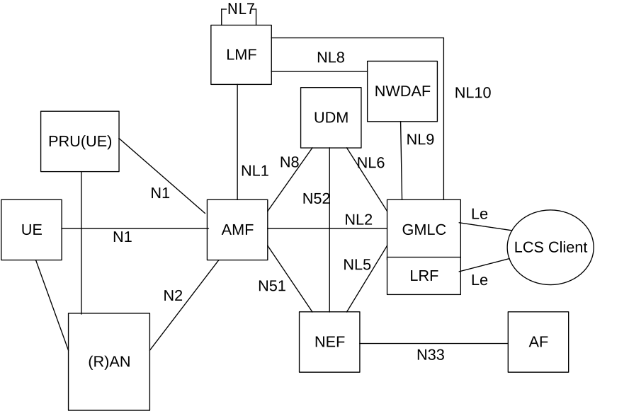
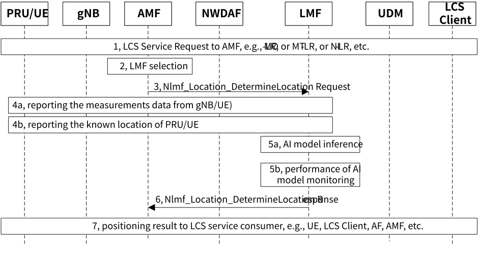
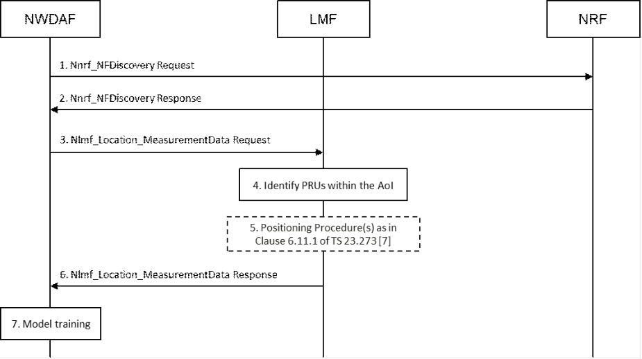

# 6.9 Solution \#9: new solution for KI#1 support monitoring the performance of AI model

## 6.9.1 Description

This solution resolves the how to monitor and evaluate the performance of an AI/ML models in Key Issue \#1 Enhancements to LCS to support Direct AI/ML based Positioning. PRU (Positioning Reference Unit) defined for LCS service is reused to support LMF to monitor and evaluate the performance of an AI/ML model.

In this solution the architecture assumption as shown in Figure 6.9.1-1 is to reuse the NWDAF architecture for AIML model training entity that also collects data for the training. LMF (may be co-located with NWDAF) is the entity to perform AIML model inference and to monitor the performance of the AIML model. There are following assumptions:

\- NWDAF is the entity for training the AI/ML Model for Direct AI/ML positioning.

\- NWDAF is the entity for data collecting with objective to train the AI/ML Model for Direct AI/ML positioning.

\- PRU known location and associated PRU location measurement(s) from LMF are used for AI/ML model training.

\- LMF is the entity for AI/ML Model inference to compute the final UE location.

\- LMF is the entity to monitor and evaluate the performance of an AI/ML model

NOTE 1: Whether there is a need to define model request/inference capability for LMF itself can be determined during conclusion phase.

In this solution, it is also assumed that the monitoring and evaluating the performance of an AL/ML mode is executed in purpose on dedicated UEs (e.g. PRU), not for all the UEs. For example, operator can monitor the performance of an AM/ML model by comparing two or more sets of locations of one specific UE (e.g. PRU) to determine whether performance of the AI/ML model is good or not. The location of the specific UE can be obtained via AI/ML model, GPS, or other positioning methods provided by network.

In this solution, it is assumed there are dedicated UEs, e.g. PRUs or UEs pre-configured by operator, to serve for AI model training and/or AI model performance monitoring. And it should avoid overloading the RAN due to perform the AI model monitoring. How are these PRUs/dedicated UEs deployed is up to operator implementation.

NOTE 2: Whether or what additional information is needed for AI model training or AI model performance monitoring, it needs to coordinate with RAN. If the performance of an AM/ML is lower than one preconfigured condition, LMF may stop or change the AI/ML model, or request NWDAF to train or update the AL/ML mode, or to use other positioning methods based on the operator policy.

Figure 6.9.1-1: Architecture assumption for supporting Direct AI/ML based Positioning

## 6.9.2 Procedures

### 6.9.2.1 Performance of AI/ML model monitoring based on PRU

Figure 6.9.2.1-1 performance of AI/ML model monitoring based on PRU

1\. AMF receives LCS service request from UE (i.e. MO-LR), or from LCS Client (i.e. MT-LR), or AMF itself.

2-3. AMF selects a LMF and sends Location request to LMF that determines to select AI/ML model based positioning method to compute the final UE location. The LMF may subscribe/request AI/ML model from NWDAF, and the procedure of the NWDAF collecting data and training the AI/ML model is detailed in clause 6.9.2.2.

Editor's note: Whether the AMF selects LMF by considering the capability supporting AI based positioning of LMF is FFS.

4a. PRU/UE, or/and gNB reports the measurements data to LMF for computing the final UE location.

4b. PRU/UE also reports the known location information to LMF. The PRU/UE can obtain its known location information by e.g. GPS, or other positioning way.

5a. LMF performs AI model inference to compute the final UE location based on the collected measurement data from PRU/UE, or/and gNB.

5b. LMF monitors and evaluates the performance of the AI model by comparing the calculated PRU/UE's location and the known location of PRU/UE, to determine whether the performance of AI/ML model is still good, or needs to drop the AI/ML model to change the positioning method to compute the final UE location.

Optionally, LMF may trigger to request the AI/ML training entity to train/update the AI model.

6\. LMF sends the final UE location to AMF

7\. AMF sends the UE location to LCS consumers, e.g. UE, LCS client, etc.

### 6.9.2.2 Procedure of PRU information collection for AI/ML model training

Figure 6.9.2.2-1: Procedure of PRU information collection for AI/ML model training

1\. NWDAF invoke an Nnrf_NFDiscovery Request service operation to an NRF. The service operation includes a PRU existence indication and an AoI.

2\. The NRF selects one or more PRU serving LMFs based on the PRU existence indication and the AoI received in step 1 and sends an Nnrf_NFDiscovery Response to the NWDAF. The service operation includes the profiles of the PRU serving LMFs selected by the NRF.

3\. The NWDAF sends a measurement data request to each PRU serving LMF, that includes the AoI and a PRU indication, which indicates to obtain the PRU information.

4\. The PRU serving LMF identifies PRUs within the AoI based on the AoI and a PRU indication received in step 3.

5\. The PRU serving LMF uses the procedures defined in clause 6.11.1 of TS 23.273 \[7\] to obtain the location measurements of the PRUs.

NOTE: It is up to RAN WGs to determine what location measurement(s) is needed and how to obtain the location measurement(s) from UE/RAN by the LMF.

6\. The PRU serving LMF sends a measurement data response to the NWDAF, that includes the PRU known location and associated PRU location measurement(s).

7\. The NWDAF performs model training based on the PRU known location and associated PRU location measurement(s).

## 6.9.3 Impacts on services, entities and interfaces

Editor's note: It is FFS to capture impacts on existing 3GPP nodes and functional elements.

**NWDAF:**

\- Support to discover the PRU serving LMFs, and request the PRU known location and associated PRU location measurement(s) directly from the PRU serving LMFs.

**LMF:**

\- Support for AI/ML Model inference to compute the final UE location

\- Support for monitoring and evaluating the performance of the AI/ML model

\- Support to identify PRUs within an AoI based on the request from NWDAF.

\- Support to send the PRU known location and associated PRU location measurement(s) to the NWDAF.

**AMF:**

\- Enhance to select the LMF that supporting AI based positioning, based on the request or location policy, etc.

**UDM:**

\- Support Direct AI/ML based Positioning service in UE subscription data.

**UE:**

\- Depending on RAN decision, perform and report measurements.

**RAN:**

\- Depending on RAN decision, perform and report measurements.
